# Account Types

### **Overview** 

The Account Types feature allows administrators to create and manage categories used to classify accounts in the Back Office. Account types help organize accounts based on their purpose, such as Receivables, Purchase, Payable, Sales, Payment, Discount, Member, Income, and Expense.

Administrators can add new account types, edit existing ones, delete unnecessary account types, and change their display order to maintain an organized account structure.

<figure><figcaption></figcaption></figure>

### **Screen Elements** 

| **Screen Element**  | **Description**                                                                                                                      |
| ------------------- | ------------------------------------------------------------------------------------------------------------------------------------ |
| Account Type List   | Displays the available account types, such as Receivables, Purchase, Payable, Sales, Payment, Discount, Member, Income, and Expense. |
| Search              | Allows you to search for a specific account type.                                                                                    |
| Add Account Type    | Opens the screen to create a new account type.                                                                                       |
| Edit Account Type   | Allows you to modify the selected account type.                                                                                      |
| Delete Account Type | Allows you to delete the selected account type after confirmation.                                                                   |
| Sort Account Types  | Opens the sorting window where account types can be reordered by dragging them.                                                      |
| OK                  | Saves the new order of account types in the sorting window.                                                                          |
| Cancel              | Closes the sorting window without applying the changes.                                                                              |
| Close               | Closes the Account Types screen.                                                                                                     |

### **Working** 

#### **Add Account Type** 

1. Open “Account Types” from the Back Office.
2. Select "Add Account Type”.

<figure>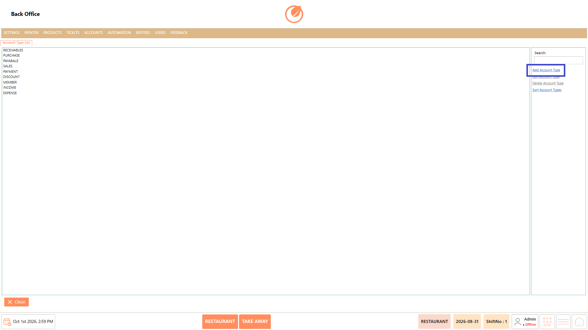<figcaption></figcaption></figure>

3. Enter the required account type “Name”.

<figure>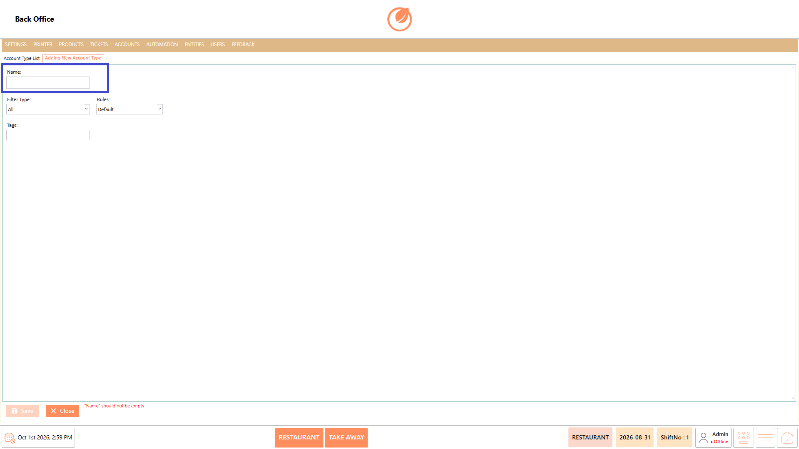<figcaption></figcaption></figure>

4. Select the “Filter type” for the account type.

<figure>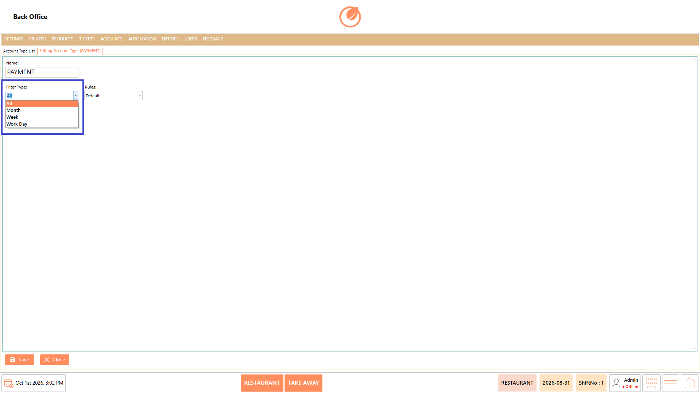<figcaption></figcaption></figure>

5. Select the “Rules”.

<figure>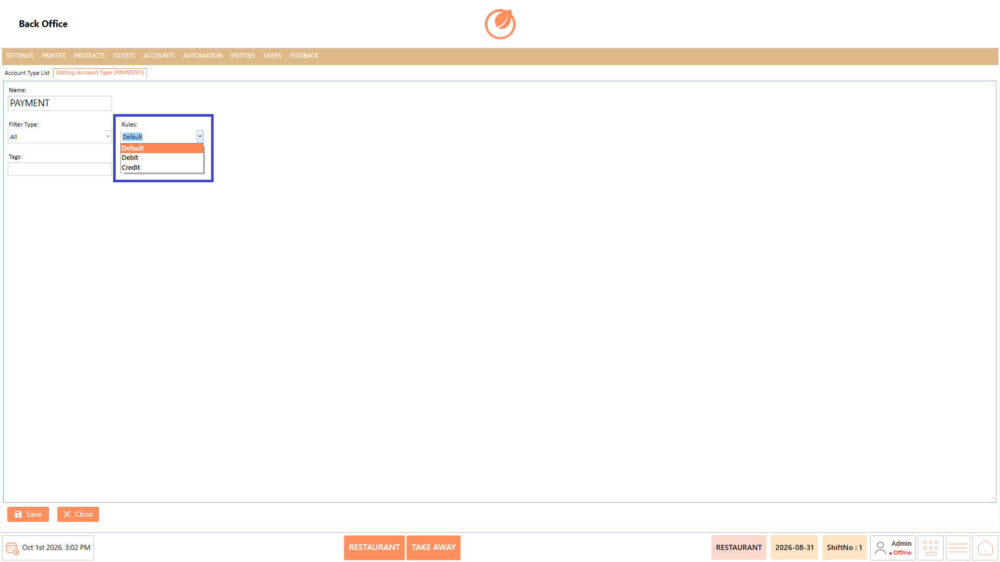<figcaption></figcaption></figure>

6. Add the tags, if any.

<figure>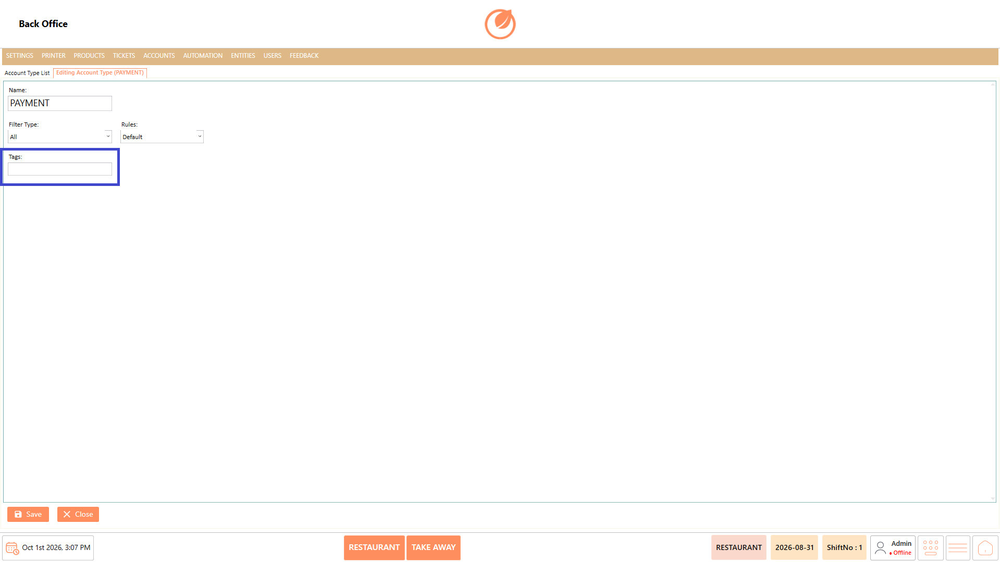<figcaption></figcaption></figure>

7. Select “Save” to add the account type to the list.

<figure>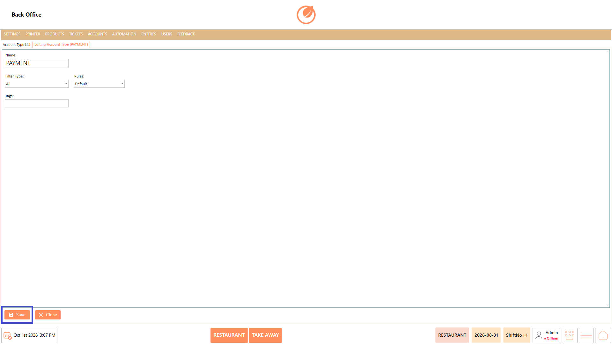<figcaption></figcaption></figure>

#### **Edit Account Type** 

1. Select the account type you want to modify.
2. Select “Edit Account Type".

<figure>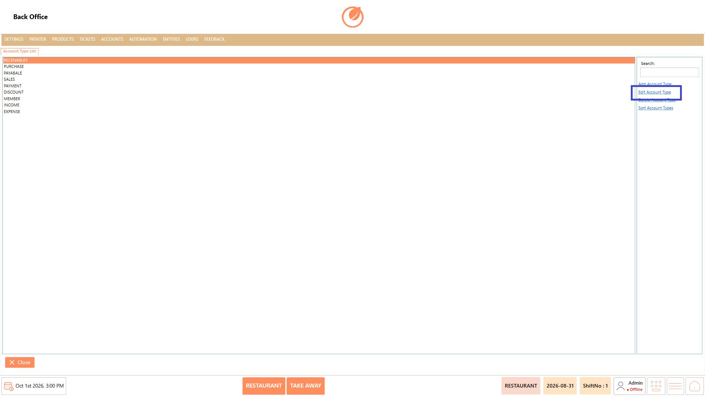<figcaption></figcaption></figure>

3. Update the account type details as required.
4. Save the changes.

<figure><figcaption></figcaption></figure>

#### **Delete Account Type** 

1. Select the account type you want to remove.
2. Select "Delete Account Type”.

<figure><figcaption></figcaption></figure>

3. A confirmation message is displayed.
4. Select “Yes” to delete the account type or "No” to cancel.

<figure>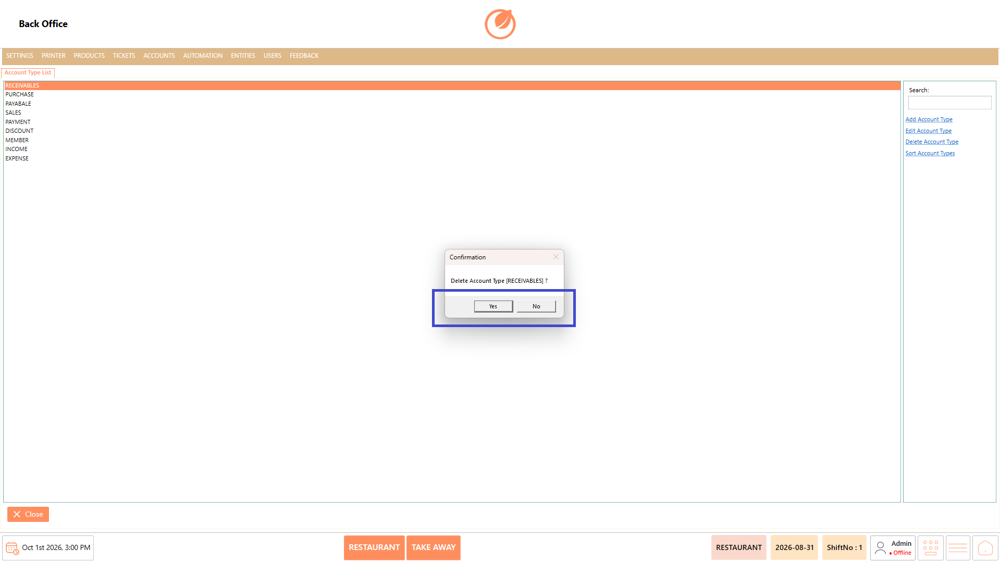<figcaption></figcaption></figure>

#### **Sort Account Types** 

1. Select “Sort Account Types”.

<figure>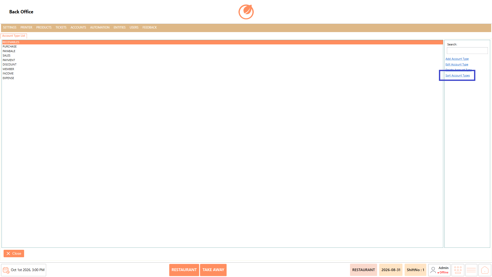<figcaption></figcaption></figure>

2. In the Sort Account Types window, drag the account types to the required order.

<figure>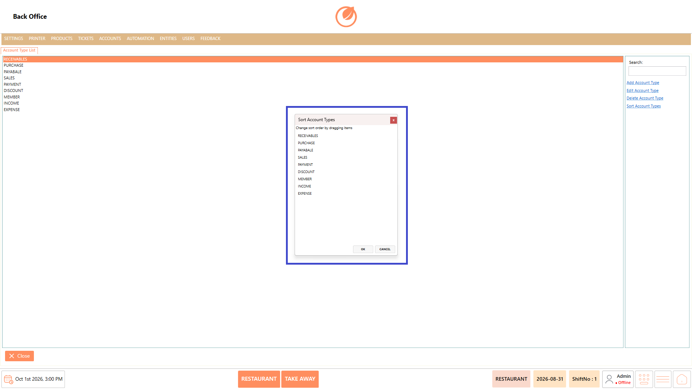<figcaption></figcaption></figure>

3. Select “OK” to apply the new order.

<figure>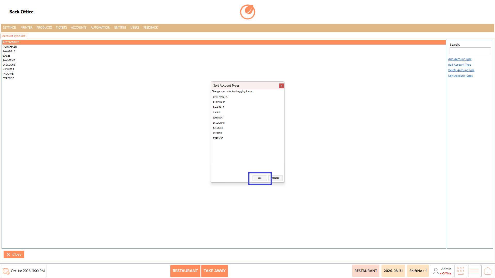<figcaption></figcaption></figure>

### **Use Case** 

* Create new account categories when additional account classifications are required.
* Modify existing account types when their names need to be updated.
* Remove account types that are no longer required.
* Reorder account types to organize the list according to operational requirements.

### **Notes** 

* Enter a name before saving a new account type.
* The Account Type field is required when creating an account type.
* Deleting an account type requires confirmation.
* Use Sort Account Types to change the display order of account types.
* Drag and drop the account types to arrange them in the required order.
* Select OK in the sorting window to apply the new order.
* Select Cancel if you do not want to apply the sorting changes.
* Use the Search field to quickly locate an account type.
* Existing account types can be edited or deleted from the Account Type List.
