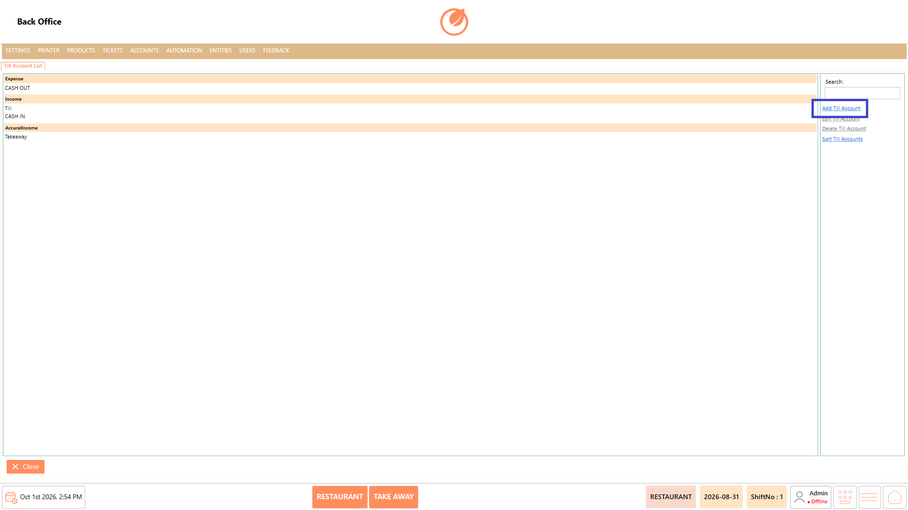
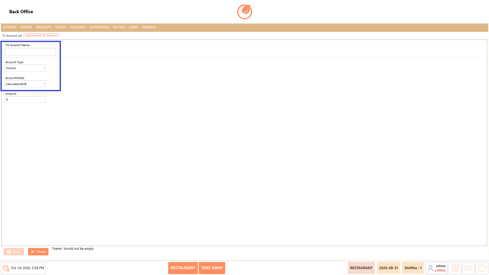
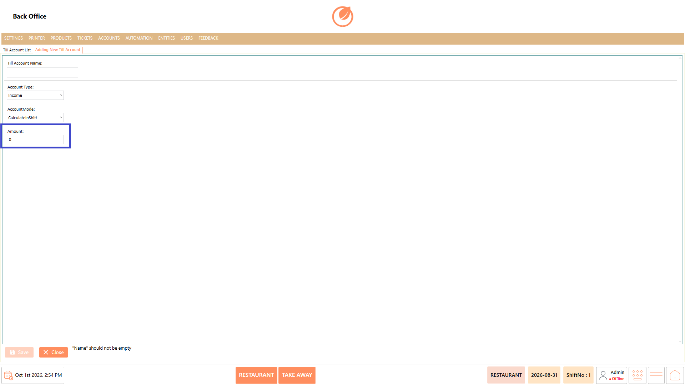
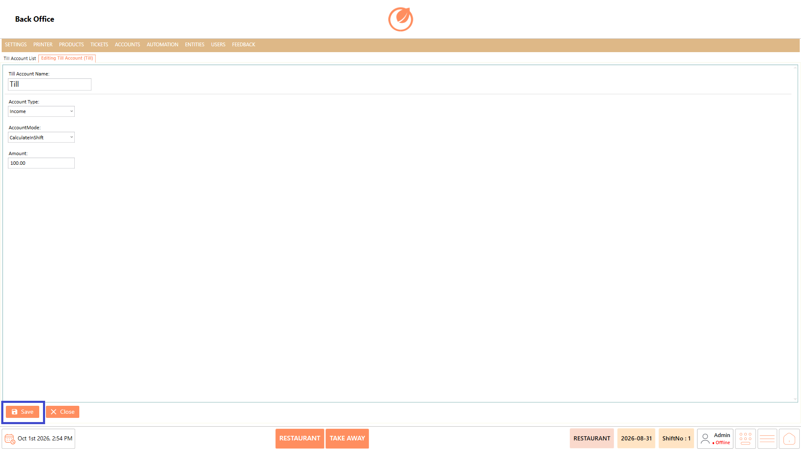
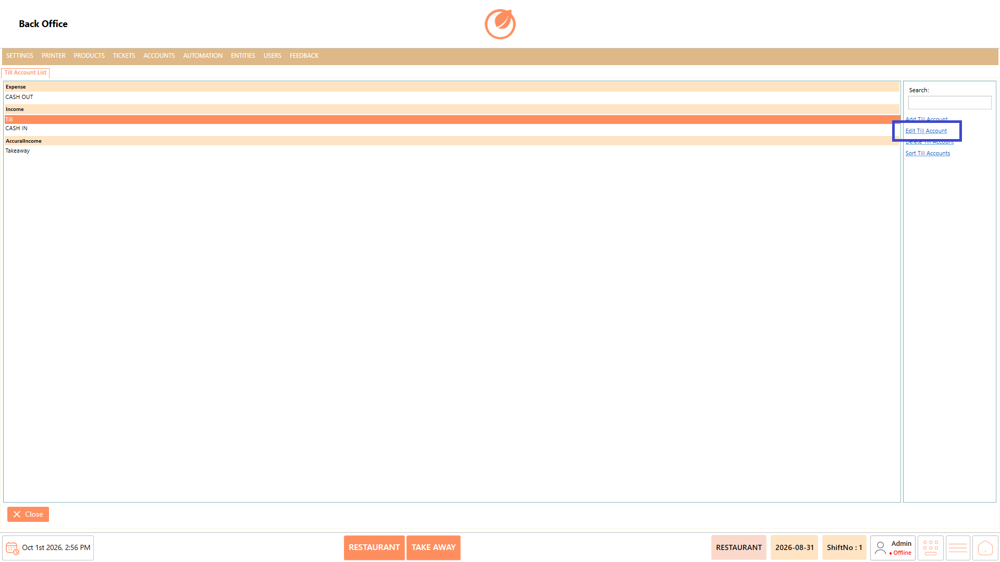
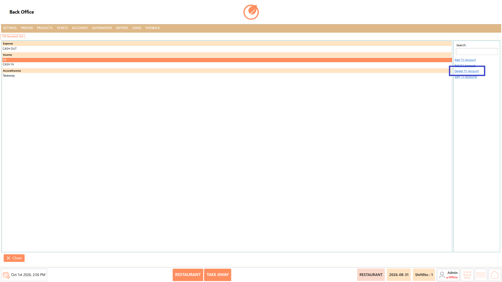
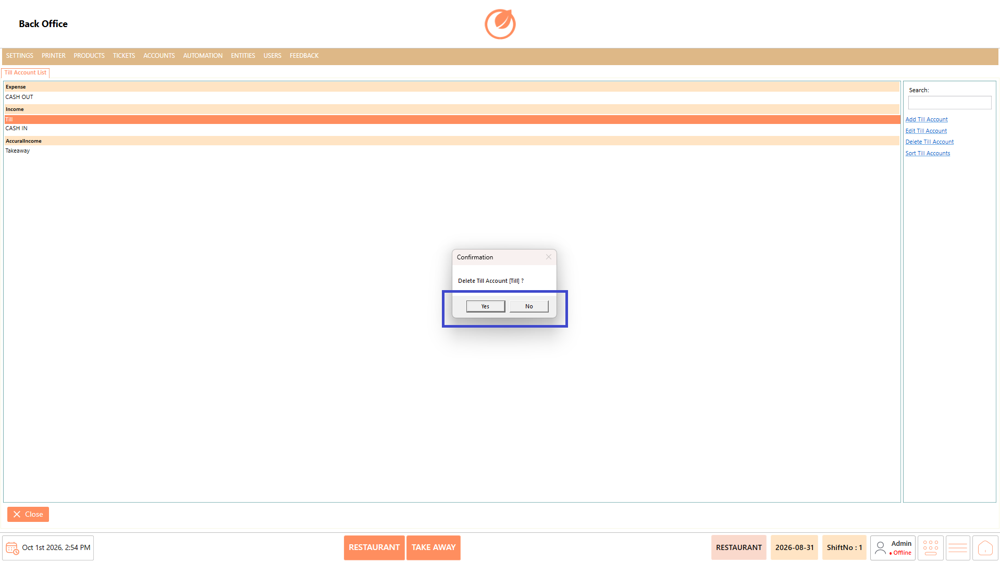
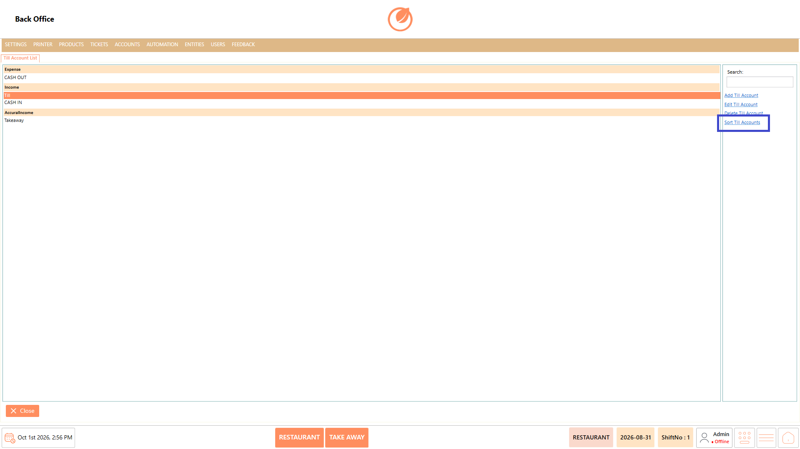
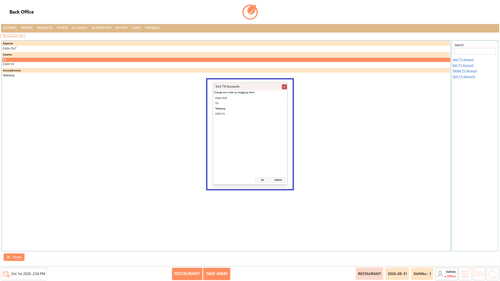
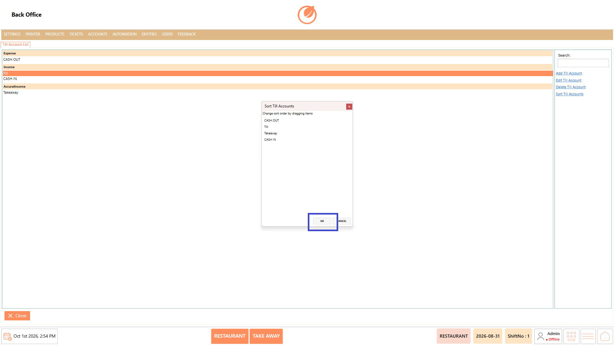

# Till Account

### **Overview** 

The Till Account feature in the Back Office allows authorized users to manage the accounts used to record and organize till-related financial transactions. Users can view the existing till accounts and maintain the account list based on their operational requirements.

The feature supports creating new accounts, modifying existing account details, deleting accounts that are no longer required, and arranging the display order of accounts. Each account can be configured with an Account Type, Account Mode, and Amount to define how it is maintained within the system.

<figure><figcaption></figcaption></figure>

### **Screen Elements** 

| **Screen Element**        | **Description**                                                                                                      |
| ------------------------- | -------------------------------------------------------------------------------------------------------------------- |
| Till Account List         | Displays the existing till accounts grouped by account type, such as Expense, Income, Accrual Income, etc.           |
| Search                    | Allows users to search for a specific till account from the list.                                                    |
| Add Till Account          | Opens the screen to create a new till account.                                                                       |
| Edit Till Account         | Allows users to modify the details of an existing till account.                                                      |
| Delete Till Account       | Removes a selected till account after confirmation.                                                                  |
| Sort Till Accounts        | Opens the sorting window where the order of till accounts can be changed.                                            |
| Till Account Name         | Field used to enter the name of the till account when creating or editing an account.                                |
| Account Type              | Specifies the type of account. Available options include Income, Expense, Accrual Income, and Accrual Expense.       |
| Account Mode              | Specifies how the account amount is handled. Available options include Calculate In Shift and No Calculate In Shift. |
| Amount                    | Field used to enter the amount associated with the till account.                                                     |
| Save                      | Saves the newly entered or modified till account details.                                                            |
| Close                     | Closes the current screen or Till Account window.                                                                    |
| Yes / No                  | Used to confirm or cancel a deletion action.                                                                         |
| Sort Till Accounts Window | Displays the available accounts and allows their order to be changed by dragging the items.                          |

### **Working** 

#### **Add a Till Account** 

1. Select "Add Till Account" from the Till Account List.

<figure><figcaption></figcaption></figure>

2. Enter the required "Till Account Name".
3. Select the required "Account Type".
4. Select the required "Account Mode".

<figure><figcaption></figcaption></figure>

5. Enter the "Amount".

<figure><figcaption></figcaption></figure>

6. Select "Save" to create the till account.

<figure><figcaption></figcaption></figure>

Note: The Till Account Name is required. If it is left empty, the system displays the message "Name" should not be empty.

#### **Edit a Till Account** 

1. Select the till account you want to modify from the list.
2. Select "Edit Till Account".

<figure><figcaption></figcaption></figure>

3. Update the required account details.
4. Select "Save" to apply the changes.

<figure><figcaption></figcaption></figure>

#### **Delete a Till Account** 

1. Select the till account you want to remove.
2. Select "Delete Till Account".

<figure><figcaption></figcaption></figure>

3. Review the confirmation message displayed by the system.
4. Select "Yes" to delete the account or "No" to cancel the action.

<figure><figcaption></figcaption></figure>

#### **Sort Till Accounts** 

1. Select "Sort Till Accounts".

<figure><figcaption></figcaption></figure>

2. The Sort Till Accounts window displays the available accounts.
3. Drag the accounts to arrange them in the required order.

<figure><figcaption></figcaption></figure>

4. Select "OK" to apply the changes.

<figure><figcaption></figcaption></figure>

### **Use Case** 

1. Create separate till accounts to organize different types of financial transactions.
2. Configure an account as Income for recording income-related transactions.
3. Configure an account as Expense for recording expense-related transactions.
4. Use Accrual Income or Accrual Expense when the corresponding account type is required.
5. Set the Account Mode based on whether the account should be calculated in the shift.
6. Update an existing till account when its configuration or amount needs to be changed.
7. Delete till accounts that are no longer required for operations.
8. Sort till accounts to arrange them in an order that is convenient for users.

### **Notes** 

* A Till Account Name must be entered before the account can be saved.
* Select the appropriate Account Type when creating a till account.
* Account Mode determines whether the account is configured to calculate in the shift.
* Review the selected account before deleting it, as the system asks for confirmation.
* Use Sort Till Accounts to change the display order of accounts.
* Select "Cancel" in the sorting window if the changed order should not be applied.
* Ensure the Amount is entered according to the account requirement.
* Use "Close" to exit the Till Account screen.
