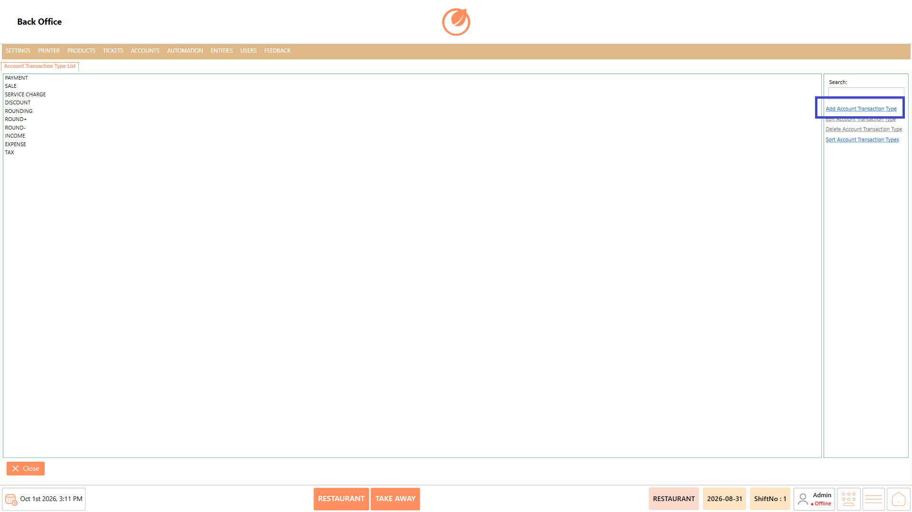
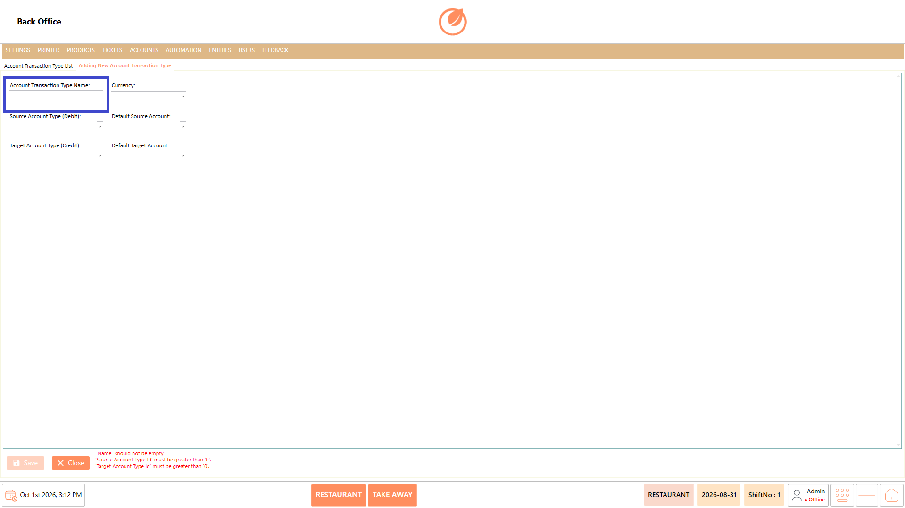
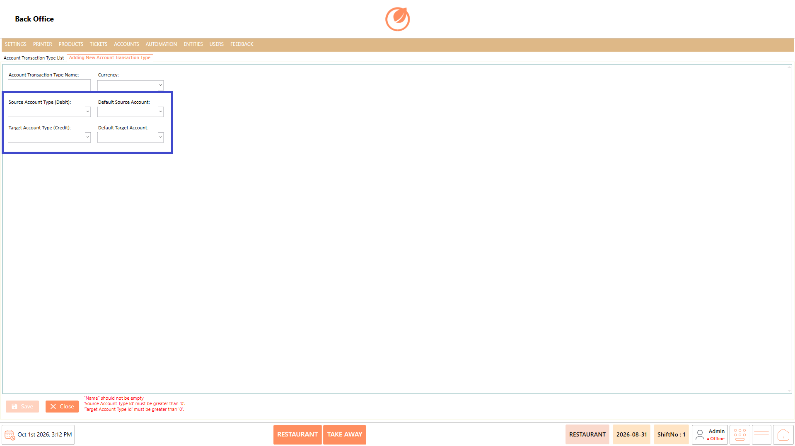
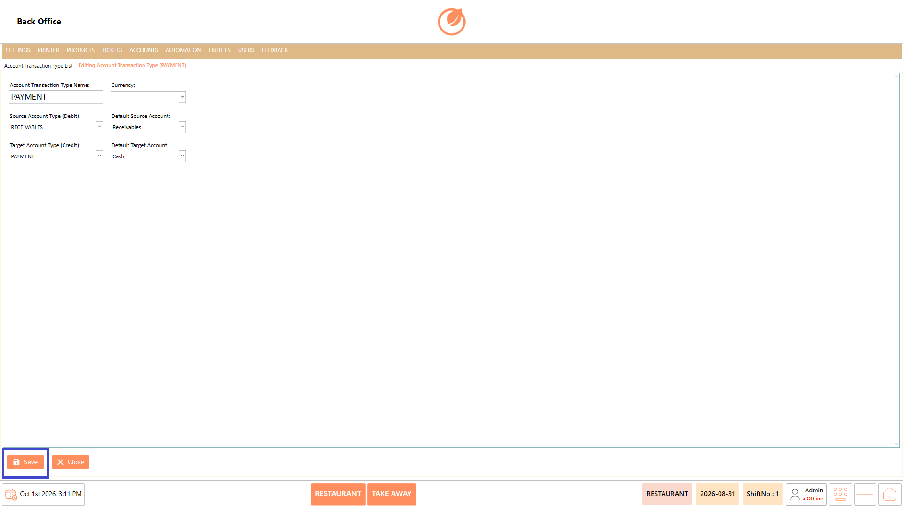
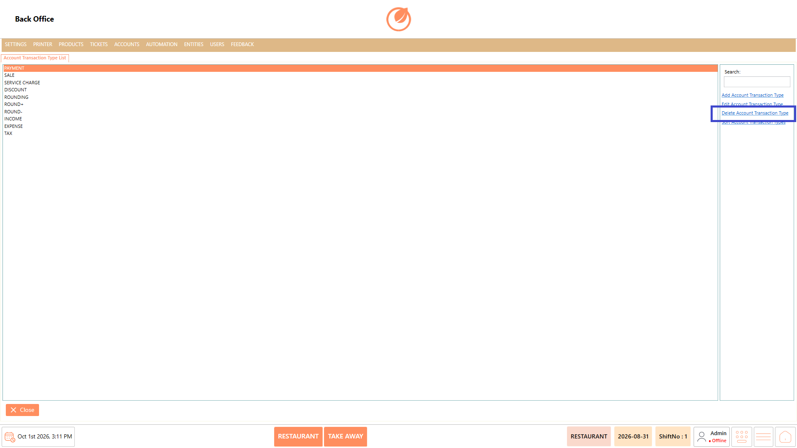
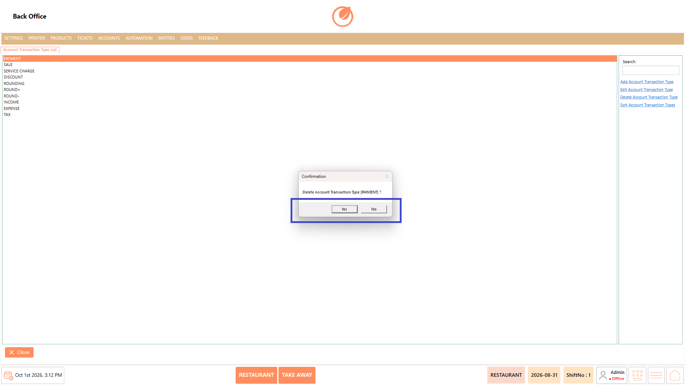
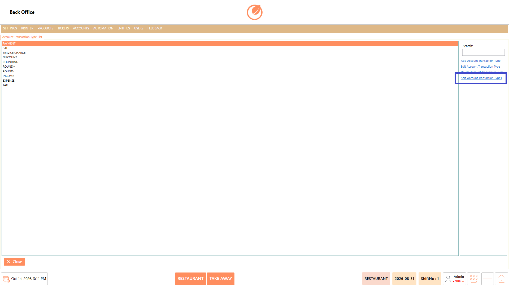
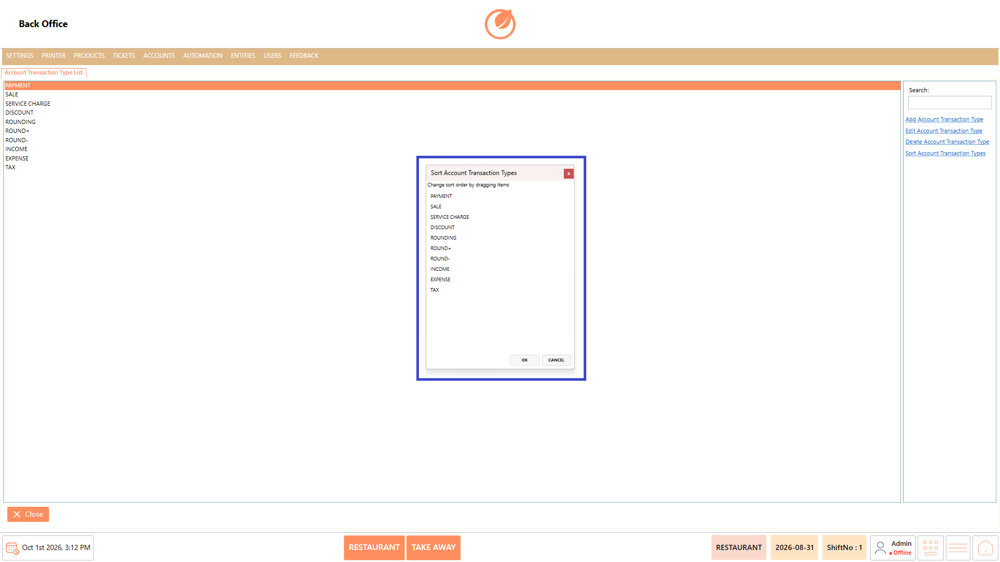
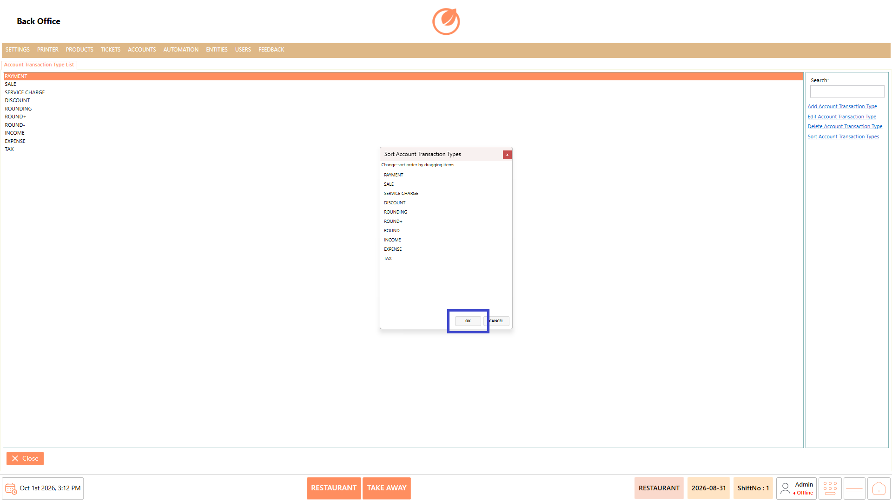

# Transaction Type

### **Overview** 

The Account Transaction Type feature in the Back Office allows you to manage the transaction types used for accounting and financial transactions. You can maintain the list of account transaction types by adding new types, editing existing details, deleting unnecessary types, and changing their display order. The feature also provides a search option to quickly locate a specific transaction type from the list.

<figure><figcaption></figcaption></figure>

### **Screen Elements** 

| **Screen Element**              | **Description**                                                                       |
| ------------------------------- | ------------------------------------------------------------------------------------- |
| Account Transaction Type List   | Displays the available account transaction types.                                     |
| Search                          | Allows you to search for a specific account transaction type.                         |
| Add Account Transaction Type    | Opens the screen to create a new account transaction type.                            |
| Edit Account Transaction Type   | Allows you to modify the selected account transaction type.                           |
| Delete Account Transaction Type | Allows you to remove the selected account transaction type after confirmation.        |
| Sort Account Transaction Types  | Opens the sorting screen where the order of account transaction types can be changed. |
| Save                            | Saves the details entered while adding or updating an account transaction type.       |
| Yes / No                        | Allows you to confirm or cancel an account transaction type deletion.                 |
| OK                              | Confirms the new order after sorting account transaction types.                       |
| Cancel                          | Cancels the sorting changes without applying them.                                    |

### **Working** 

#### **Add Account Transaction Type** 

1. Open Account Transaction Type from the Back Office.
2. Select "Add Account Transaction Type".

<figure><figcaption></figcaption></figure>

3. Enter the required Account Transaction Type Name.

<figure><figcaption></figcaption></figure>

4. Select the required Currency, Source Account Type (Debit), Default Source Account, Target Account Type (Credit), and Default Target Account.

<figure><figcaption></figcaption></figure>

5. Select "Save" to add the account transaction type to the list.

<figure><figcaption></figcaption></figure>

#### **Edit Account Transaction Type** 

1. Select the account transaction type you want to modify.
2. Select "Edit Account Transaction Type".

<figure><figcaption></figcaption></figure>

3. Update the account transaction type details as required.
4. Select "Save" to save the changes.

<figure><figcaption></figcaption></figure>

#### **Delete Account Transaction Type** 

1. Select the account transaction type you want to remove.
2. Select "Delete Account Transaction Type".

<figure><figcaption></figcaption></figure>

3. A confirmation message is displayed.
4. Select "Yes" to delete the account transaction type or "No" to cancel.

<figure><figcaption></figcaption></figure>

#### **Sort Account Transaction Types** 

1. Select "Sort Account Transaction Types".

<figure><figcaption></figcaption></figure>

2. The list of account transaction types is displayed in a separate window.
3. Drag the account transaction types to arrange them in the required order.

<figure><figcaption></figcaption></figure>

4. Select "OK" to save the changes.

<figure><figcaption></figcaption></figure>

### **Use Case** 

* Create a new account transaction type when a required transaction type is not available in the existing list.
* Configure the Currency associated with an account transaction type.
* Define the Source Account Type (Debit) and Target Account Type (Credit) for an account transaction type.
* Specify the Default Source Account and Default Target Account while configuring a transaction type.
* Update an existing account transaction type when its configured details need to be changed.
* Delete an account transaction type that is no longer required.
* Search for a specific account transaction type when the list contains multiple entries.
* Reorder account transaction types to display them in the required sequence.

### **Notes** 

* Ensure that the Account Transaction Type Name is entered when creating a new transaction type.
* The Source Account Type (Debit) and Target Account Type (Credit) are required when adding an account transaction type.
* Review the account transaction type details before selecting Save.
* Deleting an account transaction type requires confirmation.
* Select No in the confirmation window if you do not want to delete the selected transaction type.
* Sorting changes can be discarded by selecting Cancel.
* Use the Search option to quickly locate an account transaction type.
* Arrange the transaction types in the required order before selecting OK in the sorting window.
