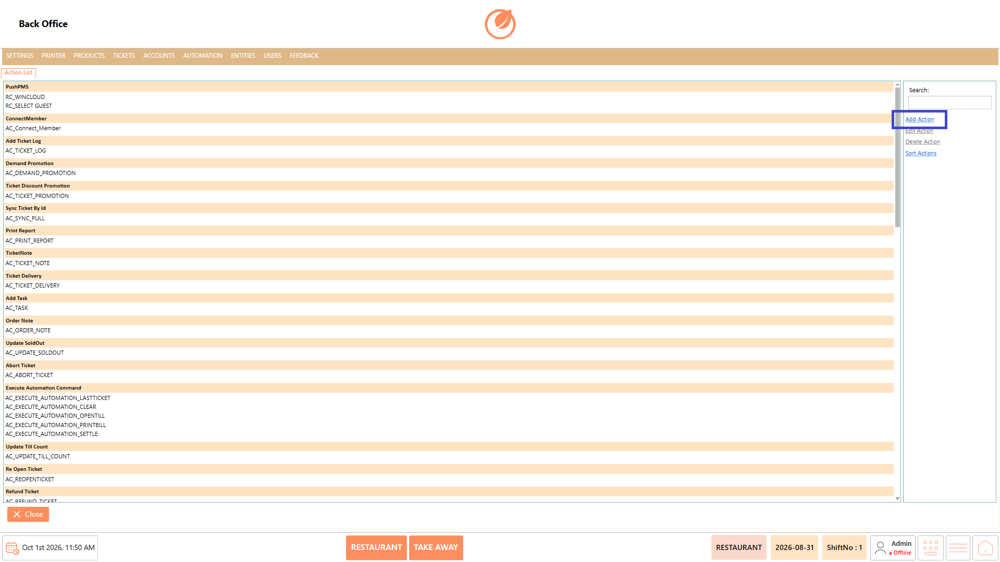
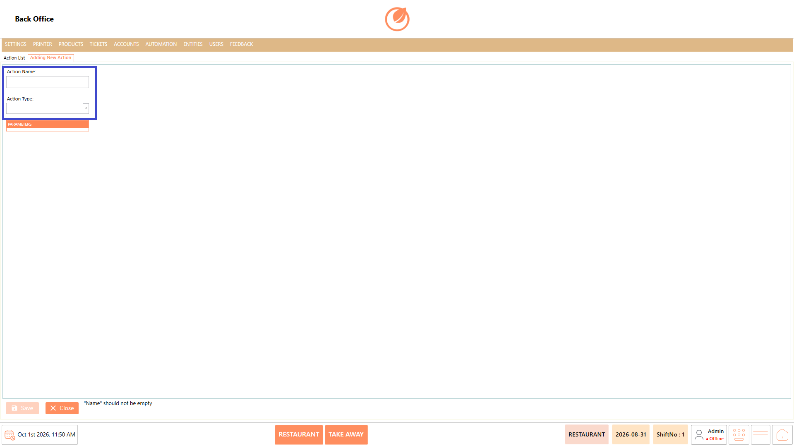
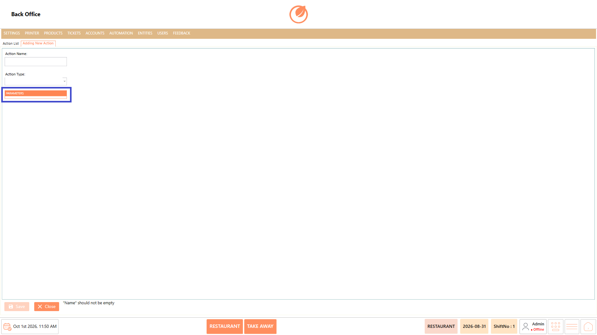
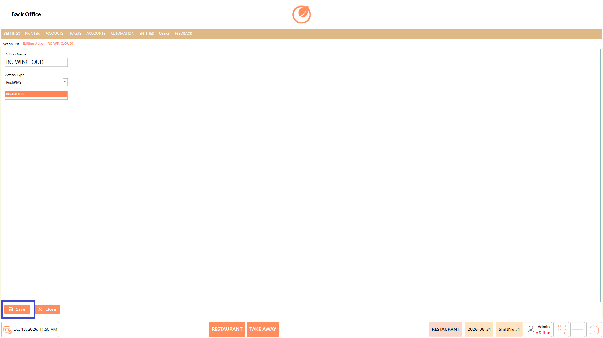
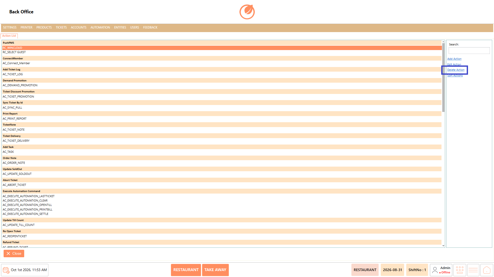
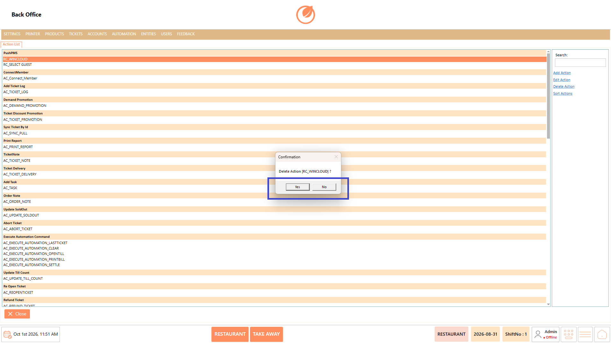
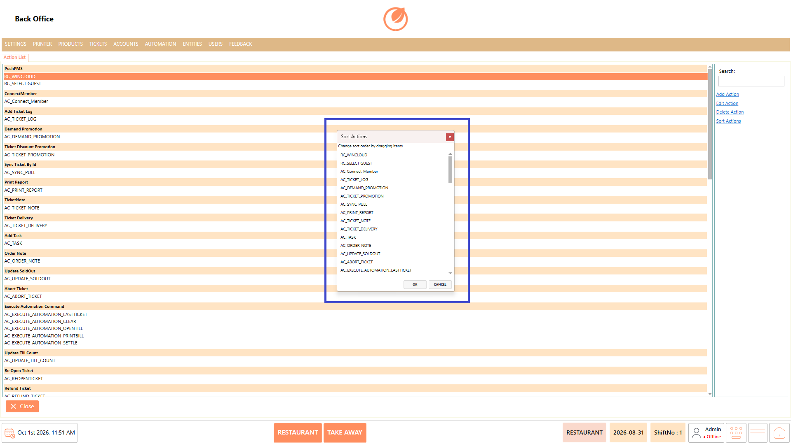
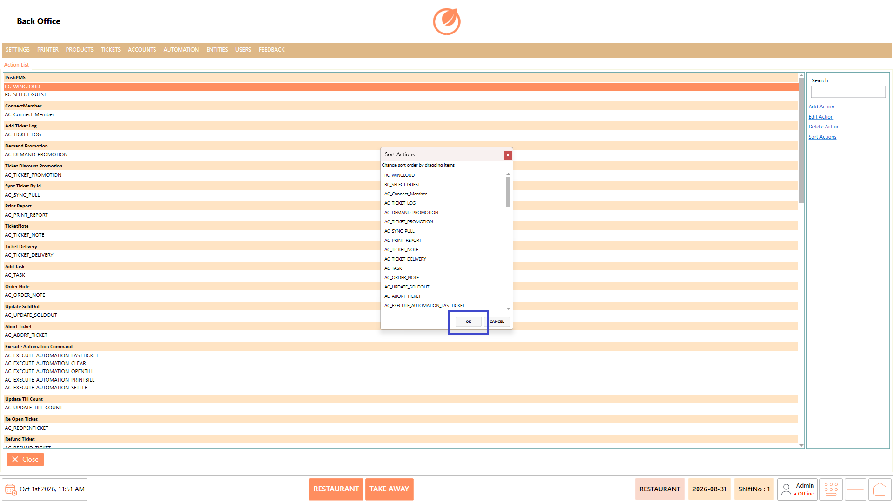

# Action

### **Overview** 

The Action in the Back Office allows administrators to manage the actions configured in the system. It provides a centralized list of available actions and allows users to add new actions, modify existing action details, delete actions that are no longer required, and change the order in which actions are displayed.

When adding an action, users can specify the Action Name, select an Action Type, and configure the available Parameters.

<figure><figcaption></figcaption></figure>

### **Screen Elements** 

| **Screen Element** | **Description**                                                                     |
| ------------------ | ----------------------------------------------------------------------------------- |
| Action List        | Displays the list of configured actions.                                            |
| Search             | Allows users to search for an action in the list.                                   |
| Add Action         | Opens the screen for creating a new action.                                         |
| Edit Action        | Opens the selected action for modification.                                         |
| Delete Action      | Deletes the selected action after confirmation.                                     |
| Sort Actions       | Opens the sorting window to change the order of actions.                            |
| Action Name        | Field used to enter the name of the action when creating or editing an action.      |
| Action Type        | Dropdown used to select the action type.                                            |
| Parameters         | Section where the parameters related to the selected action type can be configured. |
| Save               | Saves a newly created or modified action.                                           |
| Close              | Closes the current screen.                                                          |
| Yes                | Confirms deletion of the selected action.                                           |
| No                 | Cancels the deletion operation.                                                     |
| OK                 | Applies the new order after sorting the actions.                                    |
| CANCEL             | Cancels the sorting operation without applying the new order.                       |

### **Working** 

#### **Add Action** 

1. Open Action List from the Back Office.
2. Select "Add Action".

<figure><figcaption></figcaption></figure>

3. Enter the required Action Name.
4. Select the required Action Type.

<figure><figcaption></figcaption></figure>

5. Configure the available Parameters, if applicable.

<figure><figcaption></figcaption></figure>

6. Select "Save" to add the action to the list.

<figure><figcaption></figcaption></figure>

#### **Edit Action** 

1. Select the action you want to modify from the list.
2. Select "Edit Action".

<figure><figcaption></figcaption></figure>

3. Update the Action Name, Action Type, or applicable parameters as required.
4. Select "Save" to save the changes.

<figure><figcaption></figcaption></figure>

#### **Delete Action** 

1. Select the action you want to remove from the list.
2. Select "Delete Action".

<figure><figcaption></figcaption></figure>

3. A confirmation message is displayed for the selected action.
4. Select "Yes" to delete the action or "No" to cancel.

<figure><figcaption></figcaption></figure>

#### **Sort Actions** 

1. Select "Sort Actions" from the Action List.

<figure><figcaption></figcaption></figure>

2. The Sort Actions window displays the available actions.
3. Drag the actions to arrange them in the required order.

<figure><figcaption></figcaption></figure>

4. Select "OK" to apply the new order.

<figure><figcaption></figcaption></figure>

### **Use Case** 

* Create a new action when an additional action is required in the system.
* Define an Action Name to clearly identify the action in the Action List.
* Select the appropriate Action Type while configuring a new action.
* Configure the available Parameters based on the selected action type.
* Edit an existing action when its configured details need to be updated.
* Delete actions that are no longer required in the Action List.
* Search for a specific action when the list contains multiple configured actions.
* Reorder actions to maintain the required sequence using "Sort Actions".

### **Notes** 

* The Action Name is required when adding an action.
* Select an action from the list before using "Edit Action" or "Delete Action".
* Deletion requires confirmation before the selected action is removed.
* Use "No" if you do not want to proceed with deletion.
* Changes to an action should be saved using "Save".
* Use "Sort Actions" to change the display order of actions.
* Actions can be reordered by dragging them within the sorting window.
* Use "CANCEL" in the sorting window if the new order should not be applied.
