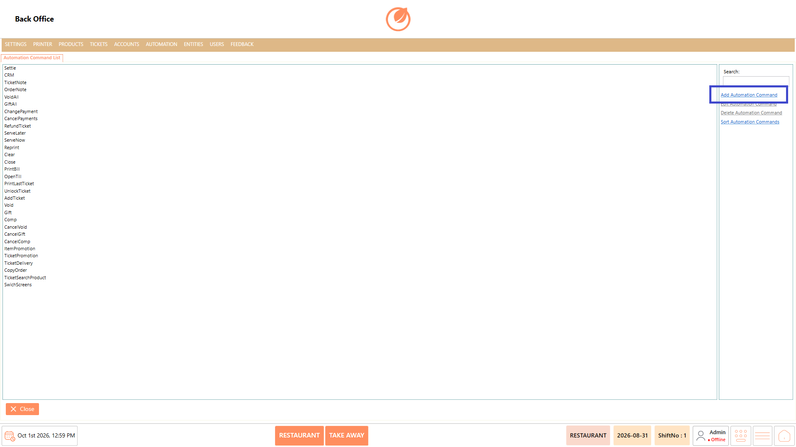
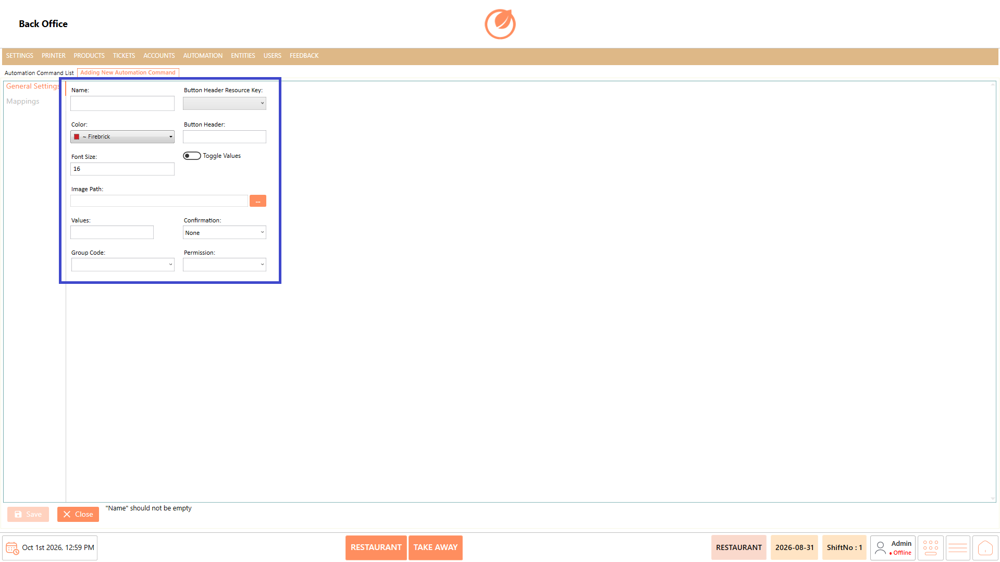
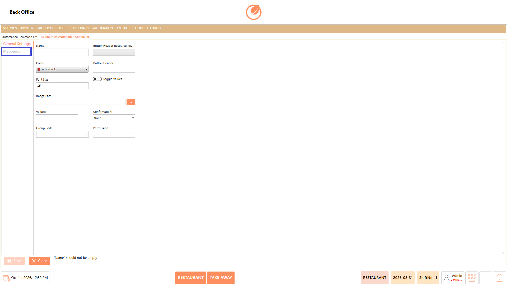
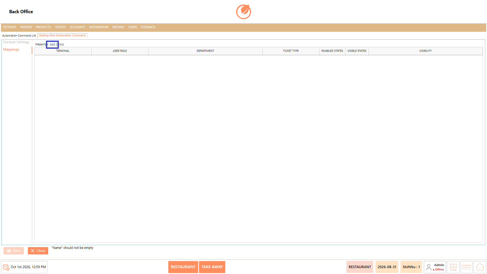
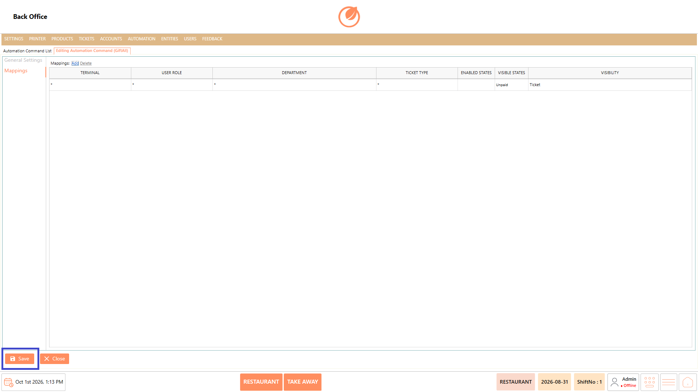
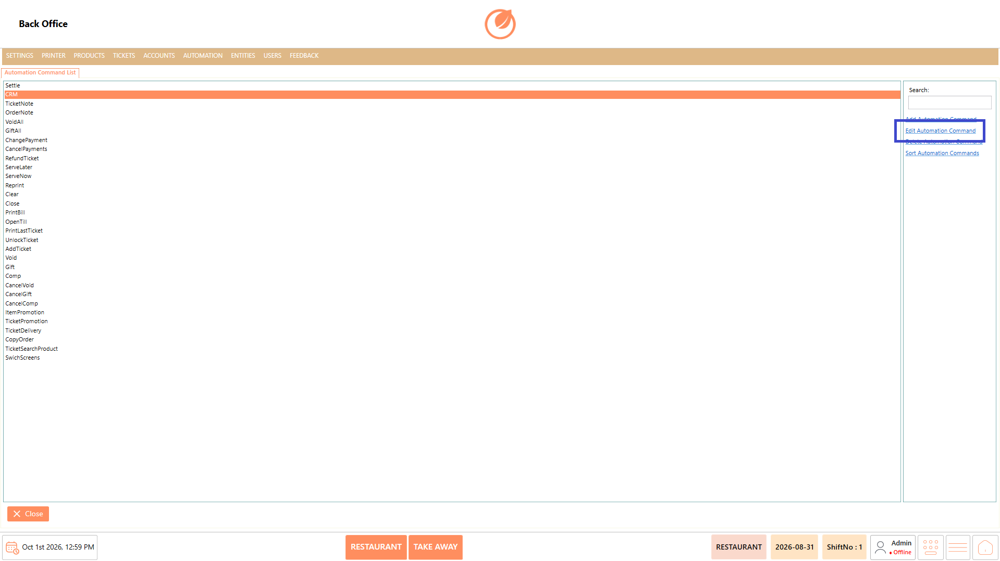
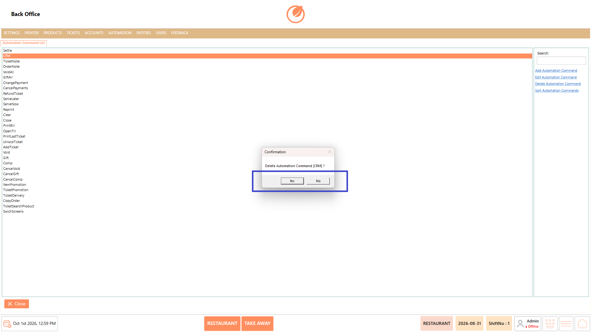
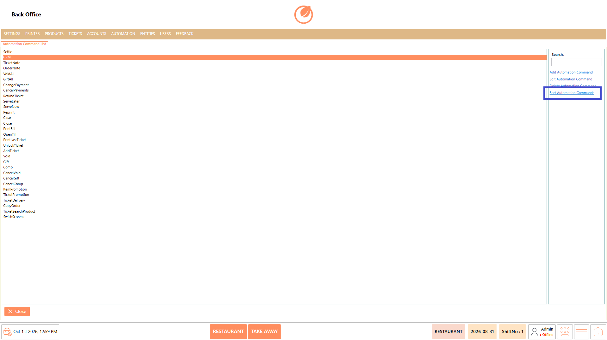
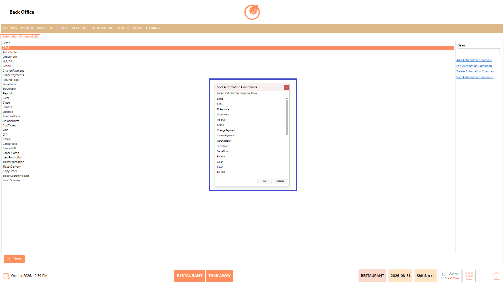
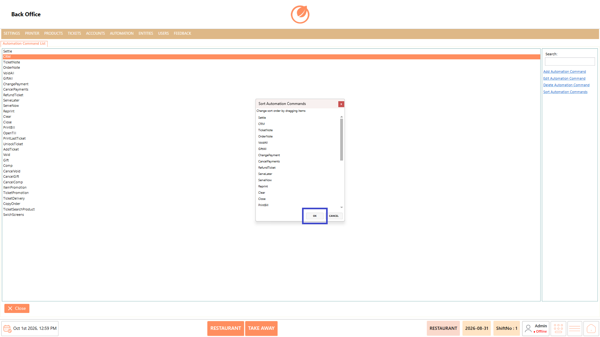

# Automation Command

### **Overview** 

The Automation Command feature allows administrators to manage the commands available for different operational requirements in DinePlan. The Automation Command List displays the existing commands and provides options to search, add, edit, delete, and sort them.

When adding or editing a command, administrators can configure its general settings and define mappings based on terminal, user role, department, ticket type, enabled states, visible states, and visibility.

<figure><figcaption></figcaption></figure>

### **Screen Elements** 

| **Screen Element**         | **Description**                                                    |
| -------------------------- | ------------------------------------------------------------------ |
| Automation Command List    | Displays the available automation commands.                        |
| Search                     | Searches for a specific automation command.                        |
| Add Automation Command     | Opens the screen to create a new automation command.               |
| Edit Automation Command    | Opens the selected command for modification.                       |
| Delete Automation Command  | Deletes the selected automation command after confirmation.        |
| Sort Automation Commands   | Allows commands to be reordered by dragging and dropping.          |
| General Settings           | Contains the configuration options for the automation command.     |
| Name                       | Specifies the name of the automation command.                      |
| Button Header Resource Key | Specifies the resource key for the button header.                  |
| Color                      | Sets the color of the command button.                              |
| Font Size                  | Sets the font size of the command button.                          |
| Button Header              | Specifies the text displayed on the command button.                |
| Toggle Values              | Enables or disables value-related settings.                        |
| Image Path                 | Specifies the image path for the command.                          |
| Values                     | Specifies values associated with the command.                      |
| Confirmation               | Specifies the confirmation option for the command.                 |
| Group Code                 | Specifies the group code associated with the command.              |
| Permission                 | Specifies the permission required for the command.                 |
| Mappings                   | Defines where and under which conditions the command is available. |
| Add / Delete               | Adds or removes a mapping entry.                                   |
| Terminal                   | Specifies the terminal where the command is available.             |
| User Role                  | Specifies the applicable user role.                                |
| Department                 | Specifies the applicable department.                               |
| Ticket Type                | Specifies the applicable ticket type.                              |
| Enabled States             | Specifies the states in which the command is enabled.              |
| Visible States             | Specifies the states in which the command is visible.              |
| Visibility                 | Specifies where the command is displayed.                          |

### **Working** 

#### **Add an Automation Command** 

1. From the Automation Command List, select "Add Automation Command".

<figure><figcaption></figcaption></figure>

2. Enter the automation command name in "Name".
3. Configure the required options such as "Button Header Resource Key", "Color", "Font Size", "Button Header", "Image Path", "Values", "Confirmation", "Group Code", and "Permission".

<figure><figcaption></figcaption></figure>

4. Select "Mappings" to configure the mapping for the automation command.

<figure><figcaption></figcaption></figure>

5. Select "Add" and configure the required "Terminal", "User Role", "Department", "Ticket Type", "Enabled States", "Visible States", and "Visibility".

<figure><figcaption></figcaption></figure>

6. Select "Save" to save the automation command.

<figure><figcaption></figcaption></figure>

#### **Edit an Automation Command** 

1. From the Automation Command List, select the required automation command.
2. Select "Edit Automation Command".

<figure><figcaption></figcaption></figure>

3. Update the required details or mappings.
4. Select "Save" to save the changes.

<figure><figcaption></figcaption></figure>

#### **Delete an Automation Command** 

1. Select the automation command you want to remove from the Automation Command List.
2. Select "Delete Automation Command".

<figure><figcaption></figcaption></figure>

3. A confirmation message is displayed.
4. Select "Yes" to delete the automation command or "No" to cancel the operation.

<figure><figcaption></figcaption></figure>

#### **Change Sort Order** 

1. From the Automation Command List, select "Sort Automation Commands".

<figure><figcaption></figcaption></figure>

2. Drag and drop the automation commands to arrange them in the required order.

<figure><figcaption></figcaption></figure>

3. Select "OK" to save the new sort order.

<figure><figcaption></figcaption></figure>

### **Use Case** 

1. Add new automation commands to support additional operational actions.
2. Edit existing commands when their configuration or display details need to be updated.
3. Delete automation commands that are no longer required.
4. Sort commands to arrange them in a preferred sequence for easier access.
5. Configure button headers, colors, font sizes, and images to customize command display.
6. Define mappings to make commands available for specific terminals, user roles, departments, or ticket types.
7. Configure enabled and visible states to control when commands are available or displayed.
8. Assign permissions and confirmation settings to control access and user interaction with commands.

### **Notes** 

* The Name field is required when creating an automation command.
* Review the mappings before saving to ensure the command is configured for the required conditions.
* Deletion requires confirmation before the selected automation command is removed.
* Use Sort Automation Commands to maintain the required command order.
