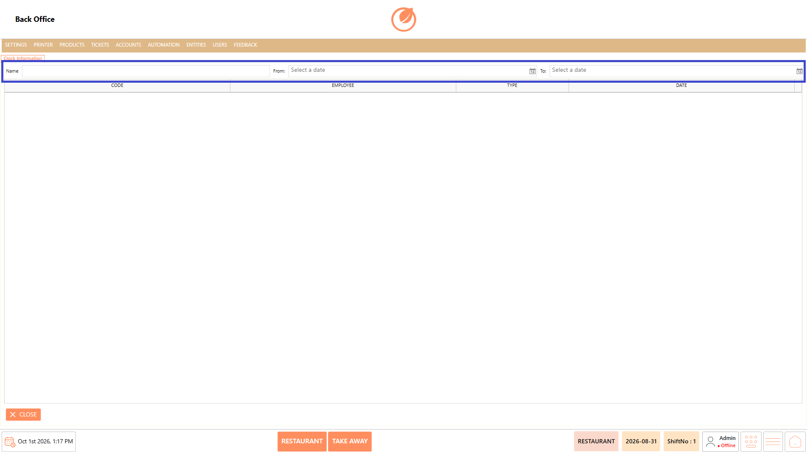
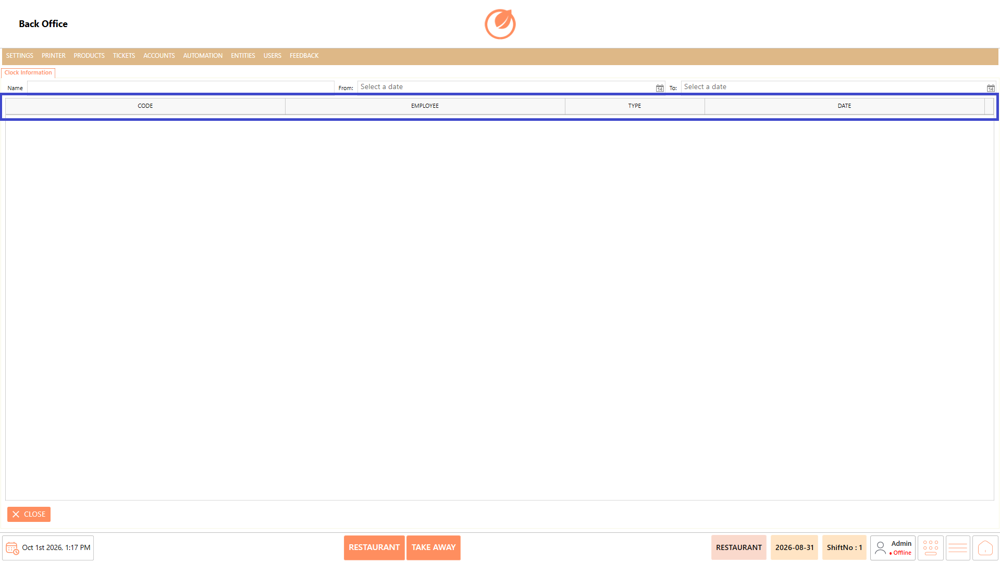

# Clock Information

### **Overview** 

The Clock Information feature allows users to view clock-related information recorded in the system. Users can filter the displayed records by Name and a specific date range using the "From" and "To" fields.

The results are displayed in a table with details such as Code, Employee, Type, and Date, making it easier to review clock information for a selected employee and period.

<figure><figcaption></figcaption></figure>

### **Screen Elements** 

| **Screen Element** | **Description**                                                |
| ------------------ | -------------------------------------------------------------- |
| Name               | Allows you to specify the employee name to filter the records. |
| From               | Specifies the start date for the search.                       |
| To                 | Specifies the end date for the search.                         |
| Code               | Displays the code associated with the clock record.            |
| Employee           | Displays the employee associated with the record.              |
| Type               | Displays the type of clock record.                             |
| Date               | Displays the date of the clock record.                         |
| Close              | Closes the Clock Information screen.                           |

### **Working** 

1. Enter the required employee name in "Name", if required.
2. Select the start date in "From".
3. Select the end date in "To".

<figure><figcaption></figcaption></figure>

4. The clock information matching the selected criteria is displayed in the table.
5. Review the clock records under "Code", "Employee", "Type", and "Date".

<figure><figcaption></figcaption></figure>

### **Use Case** 

* Review clock information for a specific employee.
* View clock records for a selected date range.
* Check the employee associated with a clock record.
* Review the type of clock record recorded for an employee.
* Identify the date associated with a clock record.

### **Notes** 

* The "From" and "To" fields can be used to specify the required date range.
* The displayed records include "Code", "Employee", "Type", and "Date".
