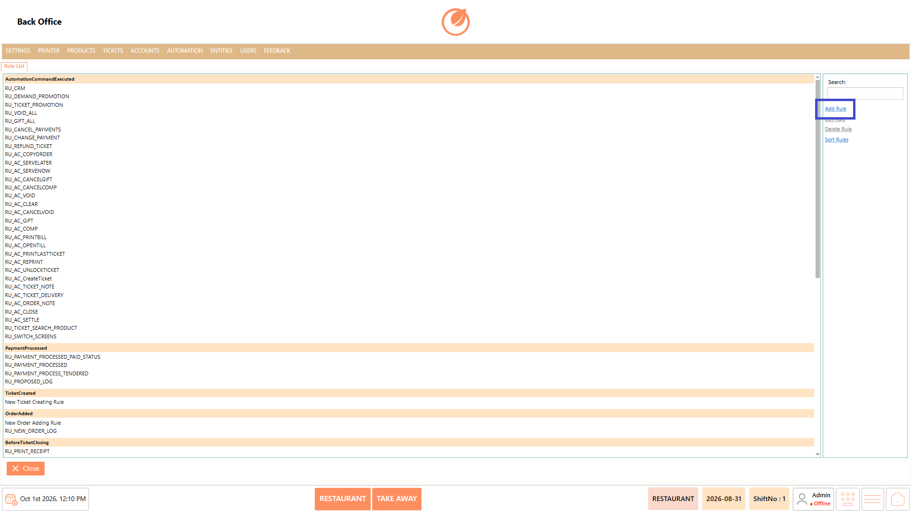
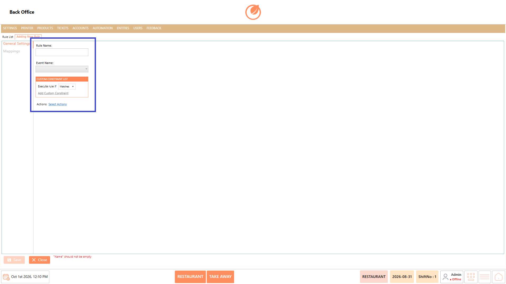
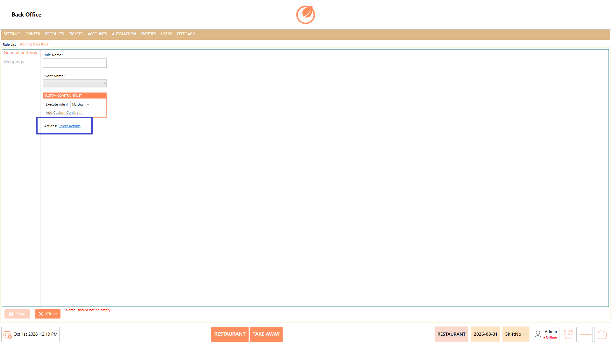
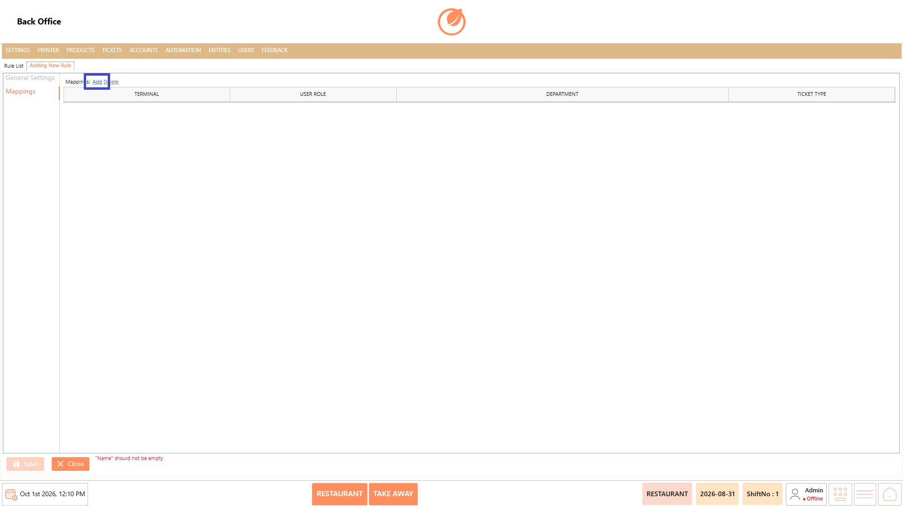
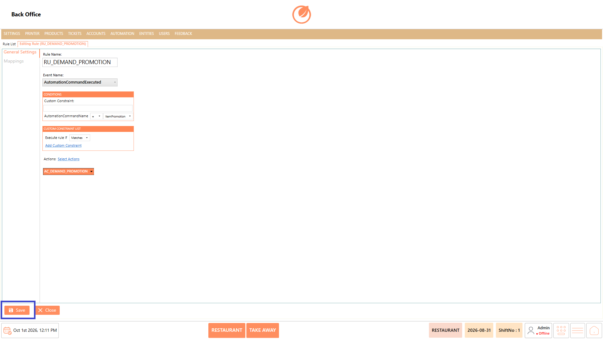
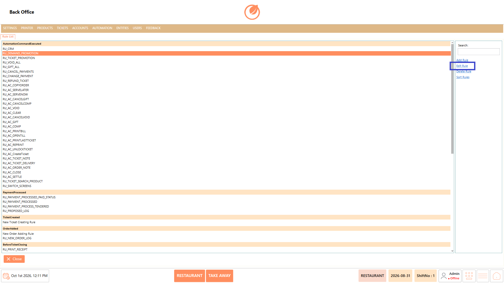
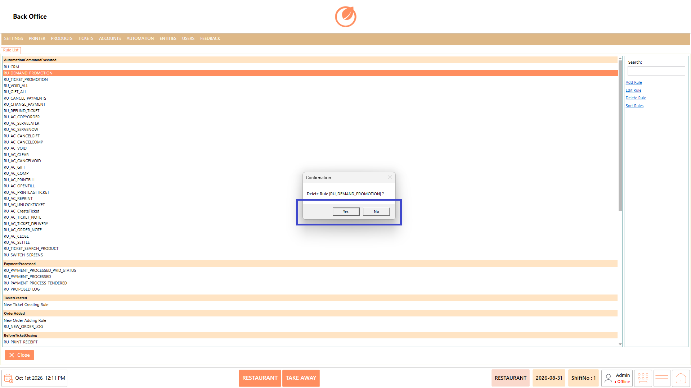
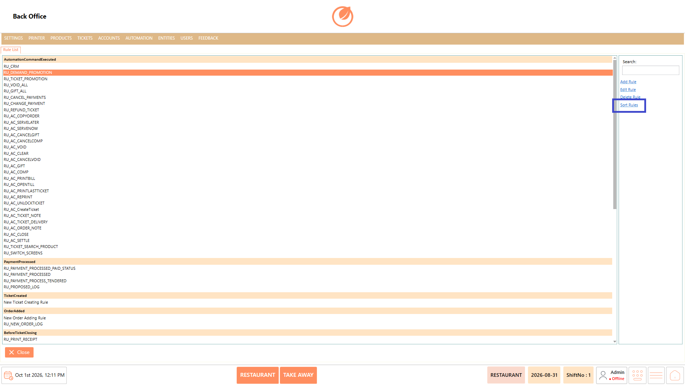
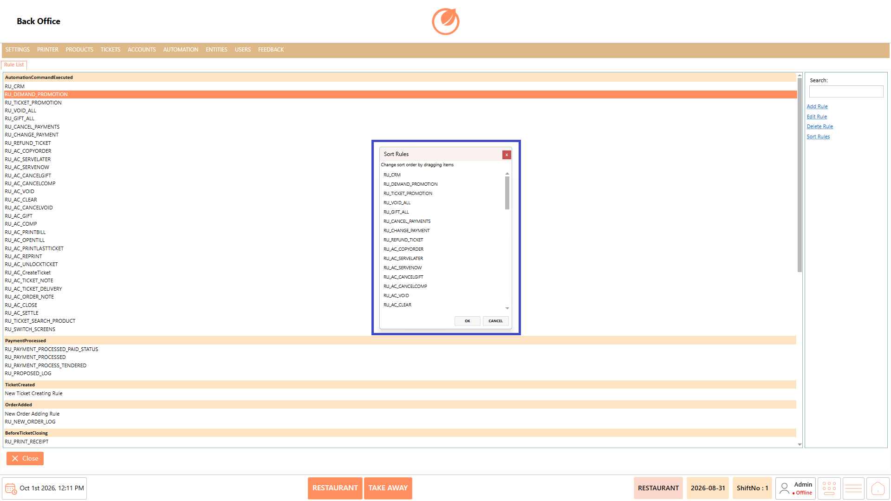
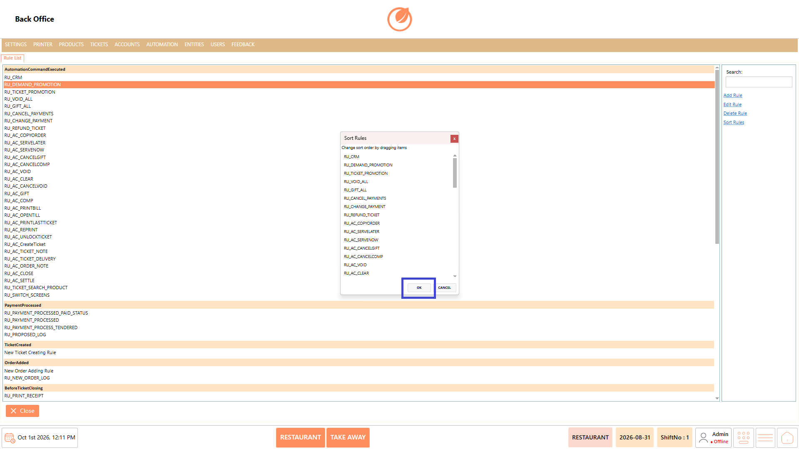

# Rules

### **Overview** 

The Automation Rules feature allows administrators to manage rules that define actions based on specific events and conditions. Users can create new rules, modify existing rules, delete rules, and change the order of rules.

<figure><figcaption></figcaption></figure>

### **Screen Elements** 

#### **Rule List** 

| **Screen Element**      | **Description**                                                                                         |
| ----------------------- | ------------------------------------------------------------------------------------------------------- |
| Rule List               | Displays the available automation rules, grouped according to their associated events.                  |
| Search                  | Allows users to search for a specific rule.                                                             |
| Add Rule                | Opens the screen to create a new automation rule.                                                       |
| Edit Rule               | Opens the selected rule for modification.                                                               |
| Delete Rule             | Deletes the selected rule after confirmation.                                                           |
| Sort Rules              | Opens the sorting window where rules can be reordered by dragging them.                                 |
| Close                   | Closes the Automation Rules screen.                                                                     |
| Rule Name               | Enter the name of the automation rule.                                                                  |
| Event Name              | Select the event associated with the rule.                                                              |
| Custom Constraint List  | Defines additional conditions for the rule.                                                             |
| Execute rule if         | Specifies whether the rule should be executed when the defined constraint matches.                      |
| Add Custom Constraint   | Adds a custom condition to the rule.                                                                    |
| Actions: Select Actions | Selects the actions to be performed when the rule is executed.                                          |
| Mappings                | Opens the mapping section for defining the applicable terminal, user role, department, and ticket type. |
| Save                    | Saves the automation rule.                                                                              |
| Close                   | Closes the rule configuration screen.                                                                   |

### **Working** 

#### **Add a Rule** 

1. Select "Add Rule" from the Rule List.

<figure><figcaption></figcaption></figure>

2. Enter a Rule Name.
3. Select an Event Name.

<figure><figcaption></figcaption></figure>

4. Configure the required Custom Constraint.
5. Select the required Actions.

<figure><figcaption></figcaption></figure>

6. Open Mappings and select the applicable mapping values.

<figure><figcaption></figcaption></figure>

7. Select "Save" to create the rule.

<figure><figcaption></figcaption></figure>

#### **Edit a Rule** 

1. Select the required rule from the Rule List.
2. Select "Edit Rule".

<figure><figcaption></figcaption></figure>

3. Update the required rule settings, constraints, actions, or mappings.
4. Select "Save" to save the changes.

<figure><figcaption></figcaption></figure>

#### **Delete a Rule** 

1. Select the required rule from the Rule List.
2. Select "Delete Rule".

<figure><figcaption></figcaption></figure>

3. A confirmation message is displayed asking whether to delete the selected rule.
4. Select "Yes" to confirm the deletion or "No" to cancel.

<figure><figcaption></figcaption></figure>

#### **Sort Rules** 

1. Select "Sort Rules".

<figure><figcaption></figcaption></figure>

2. In the Sort Rules window, drag the rules to change their order.

<figure><figcaption></figcaption></figure>

3. Select "OK" to apply the new order.

<figure><figcaption></figcaption></figure>

### **Use Case** 

* Trigger specific actions automatically when a defined event occurs in the POS system.
* Apply additional conditions to ensure an automated action is performed only when the required criteria are met.
* Automate routine processes that would otherwise require staff to perform the same action manually.
* Configure different automated actions based on specific events, such as order or transaction-related activities.
* Apply automation to specific terminals when different POS terminals require different operational behavior.
* Restrict an automation rule to particular user roles or departments when the action should apply only to selected staff or areas.
* Apply different automation rules to specific ticket types when the required action depends on the type of transaction being processed.
* Manage multiple automation rules and arrange their order when the sequence of rule execution is important.

### **Notes** 

* Rule Name must be entered before saving a rule.
* Select the appropriate Event Name when creating or configuring a rule.
* Custom constraints can be added when additional conditions are required.
* Actions can be selected for the rule from Select Actions.
* Mappings can be configured based on Terminal, User Role, Department, and Ticket Type.
* Multiple mappings can be added or removed as required.
* Verify the rule configuration before selecting "Save".
* Deleting a rule requires confirmation.
* Use "Sort Rules" to change the order of existing rules.
* Rules in the sorting window can be reordered by dragging them.
