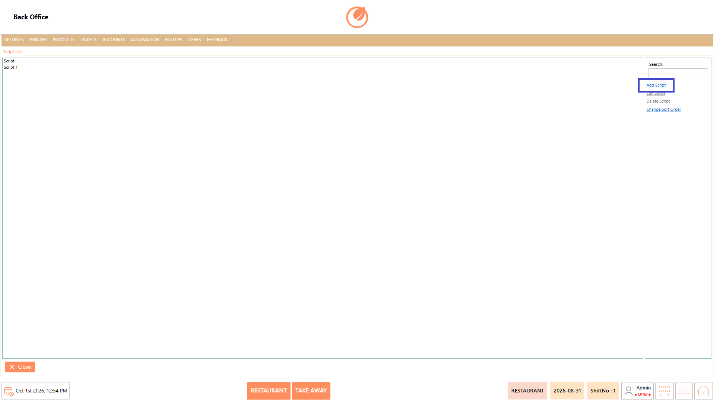
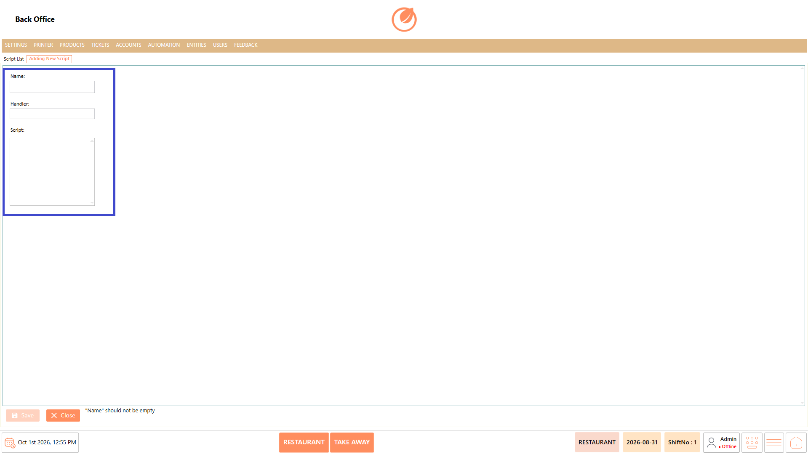
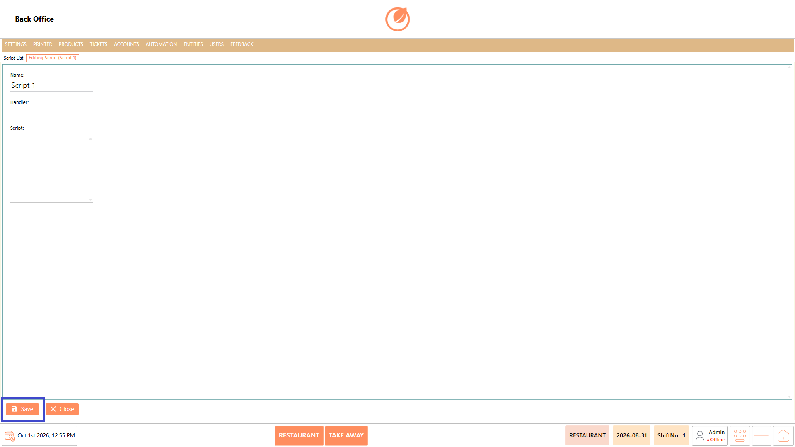
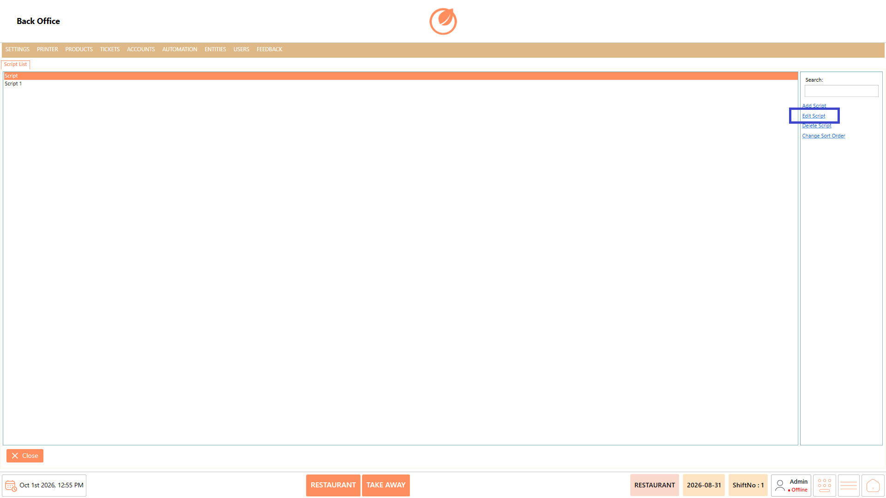
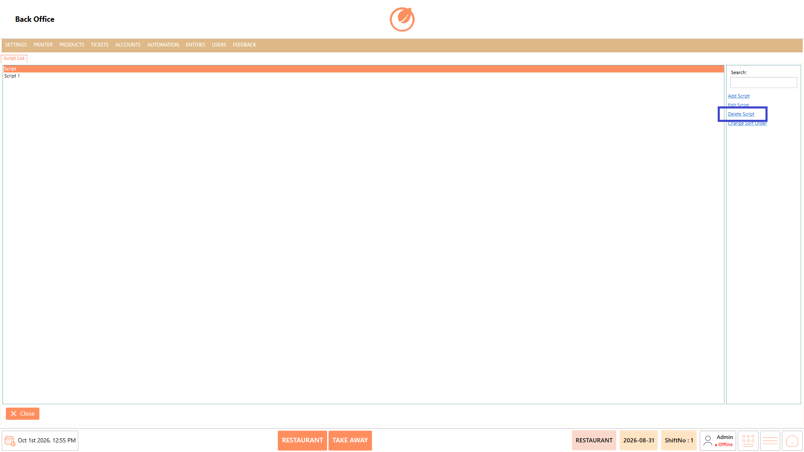
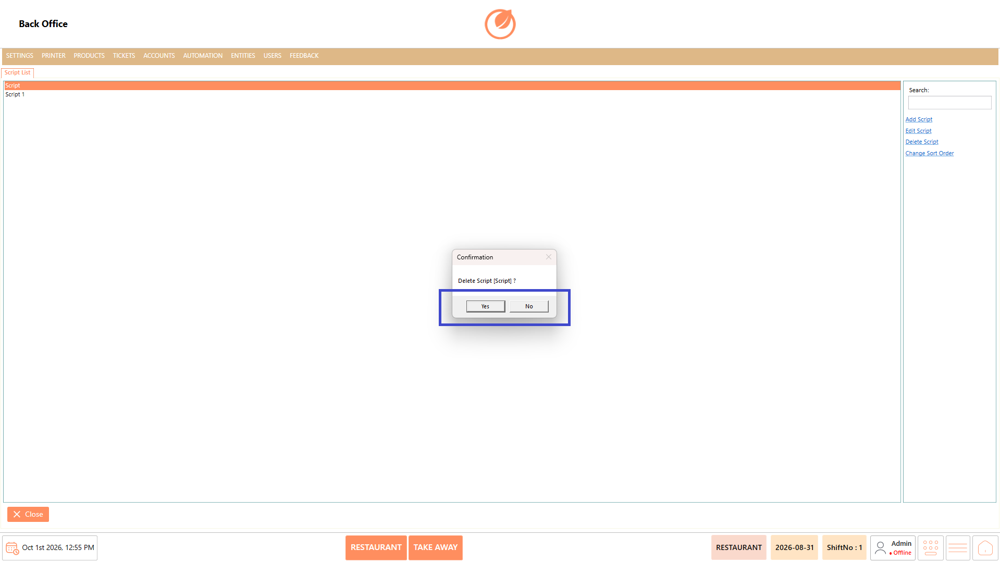
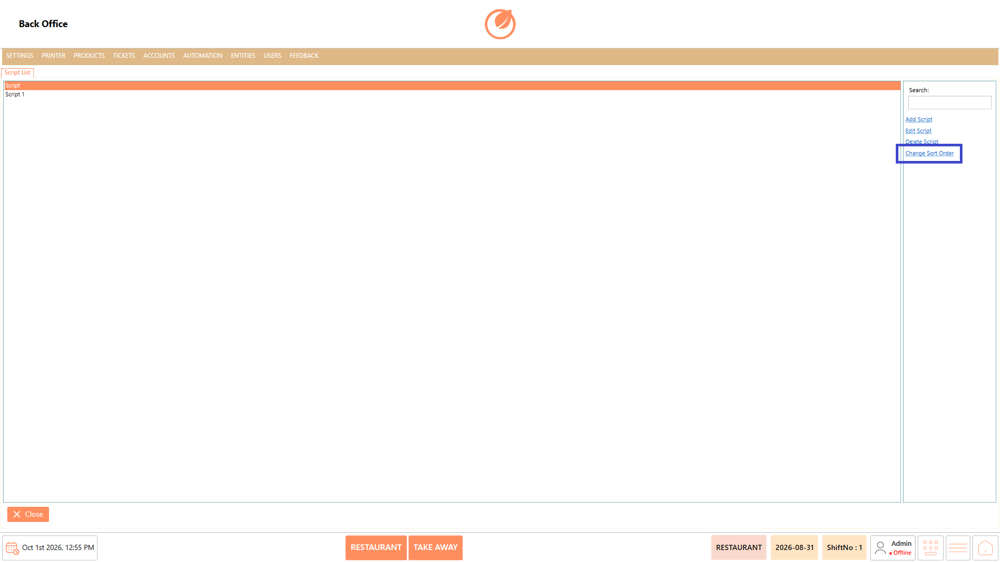

# Script

### **Overview** 

The Script feature in the Back Office allows authorized users to create and manage scripts used within the system. Users can define a script by providing a Name, Handler, and Script content, and can test the script when required. This provides a centralized way to maintain and manage the scripts configured in the system.

<figure><figcaption></figcaption></figure>

### **Screen Elements** 

| **Screen Element** | **Description**                                                  |
| ------------------ | ---------------------------------------------------------------- |
| Script List        | Displays the available scripts.                                  |
| Search             | Allows users to search for a specific script.                    |
| Add Script         | Opens the screen to create a new script.                         |
| Edit Script        | Allows users to modify the selected script.                      |
| Delete Script      | Deletes the selected script after confirmation.                  |
| Change Sort Order  | Allows users to change the order in which scripts are displayed. |
| Close              | Closes the Script screen.                                        |

### **Working** 

#### **Add a Script** 

1. From the Script List, select "Add Script".

<figure><figcaption></figcaption></figure>

2. Enter the script name in "Name".
3. Enter the required handler in "Handler".
4. Enter the script content in "Script".

<figure><figcaption></figcaption></figure>

5. Select "Save" to save the script.

<figure><figcaption></figcaption></figure>

Note: The Name field is required. If it is left blank, the system displays the message "Name" should not be empty.

#### **Edit a Script** 

1. From the Script List, select the required script.
2. Select "Edit Script".

<figure><figcaption></figcaption></figure>

3. Update the required details.
4. Select "Save" to save the changes.

<figure><figcaption></figcaption></figure>

#### **Delete a Script** 

1. Select the script you want to remove from the Script List.
2. Select "Delete Script".

<figure><figcaption></figcaption></figure>

3. A confirmation message is displayed.
4. Select "Yes" to delete the script or "No" to cancel the operation.

<figure><figcaption></figcaption></figure>

#### **Change Sort Order** 

1. From the Script List, select "Change Sort Order".

<figure><figcaption></figcaption></figure>

2. Adjust the order of the scripts as required.

### **Use Case** 

* Create new scripts by entering the required Name, Handler, and Script content.
* Configure scripts to define the required instructions or actions for specific system operations.
* Test configured scripts using the "Test" option to verify that the script works as expected.
* Edit existing scripts to update their name, handler, or script content when changes are required.
* Search for specific scripts using the "Search" option to quickly locate them in the Script List.
* Delete scripts that are no longer required by selecting "Delete Script" and confirming the deletion.
* Change the display order of scripts using "Change Sort Order" to organize them according to the required sequence.
* Manage all configured scripts from a centralized Script List, including adding, editing, testing, deleting, searching, and sorting scripts.

### **Notes** 

* A script must have a Name before it can be saved.
* Use "Edit Script" to modify an existing script.
* Use "Delete Script" to remove a script after confirming the deletion.
* Use "Test" to test a script before or after making changes, as required.
* "Change Sort Order" can be used to organize the script list.
* Use "Search" to quickly locate a script in the list.
