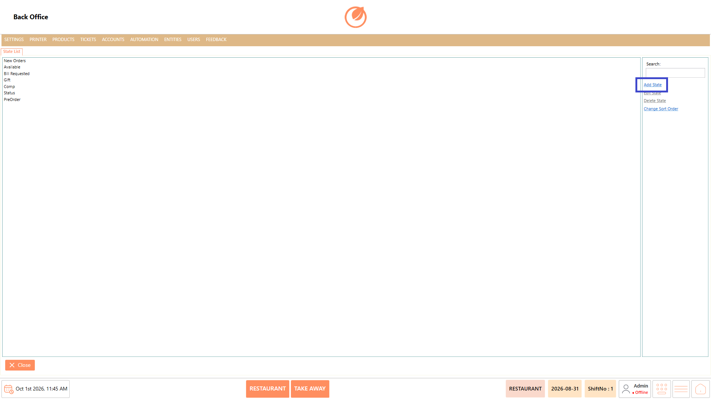
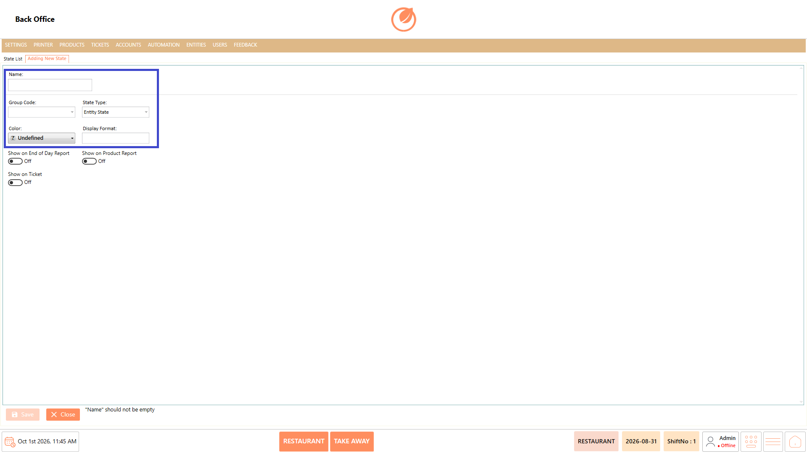
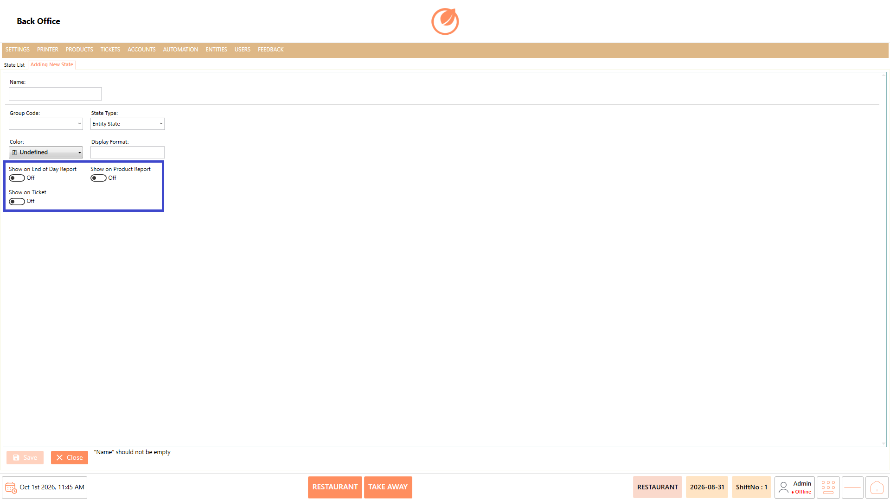
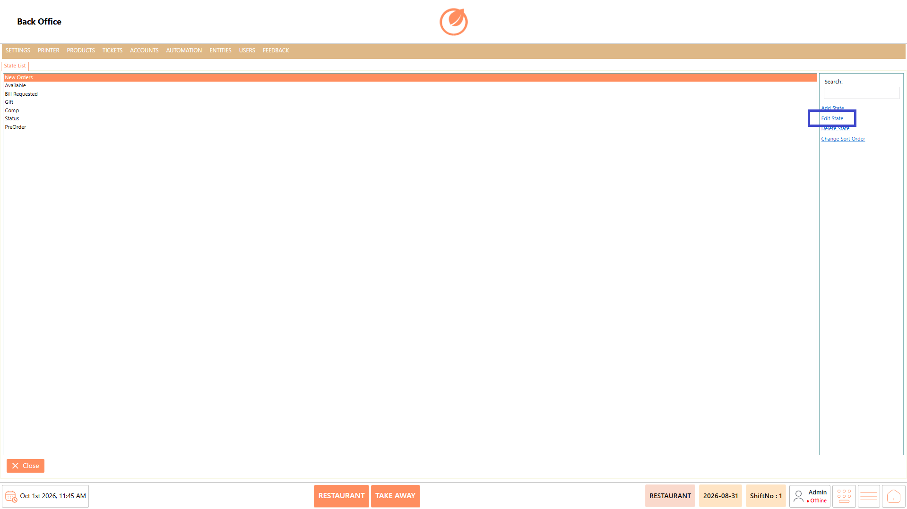
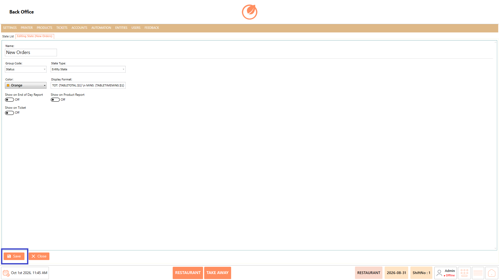
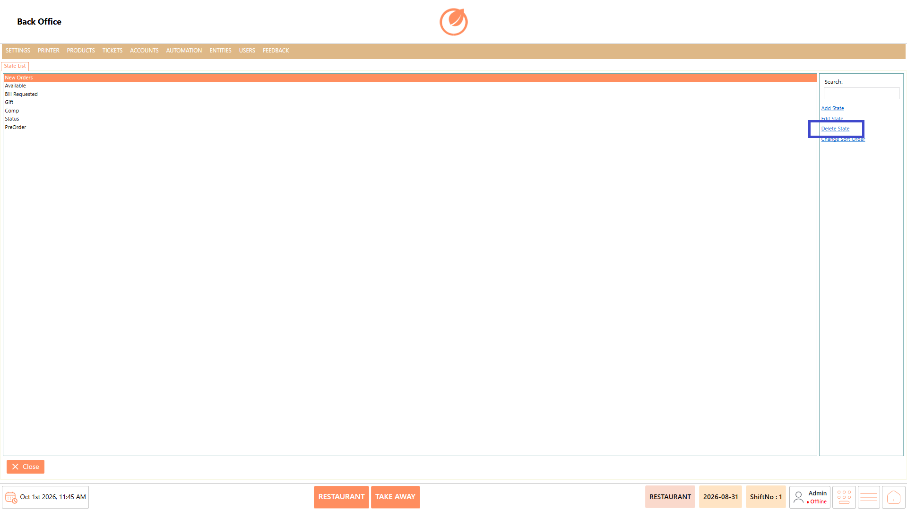
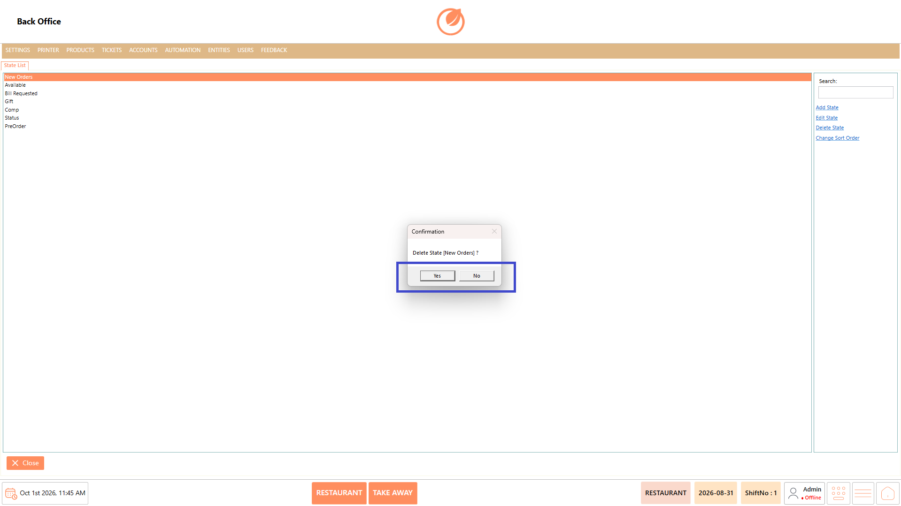
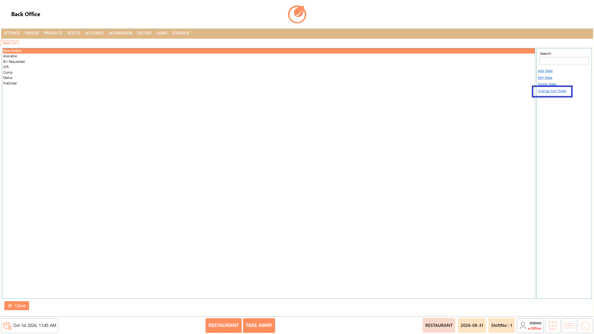

# State

### **Overview** 

The State feature in Back Office allows administrators to manage the different states used to represent the progress or status of orders within the system. Users can create new states, modify existing state details, remove states that are no longer required, and arrange the order in which states are displayed.

Each state can also be configured with options such as Group Code, State Type, Color, Display Format, and whether it should appear in specific reports or on tickets. This provides flexibility to configure order states according to the operational requirements of the restaurant.

<figure><figcaption></figcaption></figure>

### **Screen Elements** 

| **Screen Element**        | **Description**                                                    |
| ------------------------- | ------------------------------------------------------------------ |
| State List                | Displays the available states configured in the system.            |
| Search                    | Allows users to search for a specific state.                       |
| "Add State"               | Opens the screen to create a new state.                            |
| "Edit State"              | Allows users to modify the selected state.                         |
| "Delete State"            | Allows users to remove the selected state after confirmation.      |
| "Change Sort Order"       | Allows users to rearrange the order in which states are displayed. |
| Name                      | Specifies the name of the state.                                   |
| Group Code                | Allows a group code to be assigned to the state.                   |
| State Type                | Specifies the type of state.                                       |
| Color                     | Allows a color to be assigned to the state.                        |
| Display Format            | Specifies the display format for the state.                        |
| Show on End of Day Report | Controls whether the state is displayed on the End of Day Report.  |
| Show on Product Report    | Controls whether the state is displayed on the Product Report.     |
| Show on Ticket            | Controls whether the state is displayed on tickets.                |
| "Save"                    | Saves a newly created or updated state.                            |
| "Close"                   | Closes the State screen.                                           |
| "Yes"                     | Confirms deletion of the selected state.                           |
| "No"                      | Cancels the deletion.                                              |
| "OK"                      | Saves the updated sort order.                                      |
| "CANCEL"                  | Cancels the sort-order changes.                                    |

### **Working** 

#### **Add State** 

1. Open the State List from the Back Office.
2. Select "Add State".

<figure><figcaption></figcaption></figure>

3. Enter the required state name in Name.
4. Configure the Group Code, State Type, Color, and Display Format as required.

<figure><figcaption></figcaption></figure>

5. Enable or disable Show on End of Day Report, Show on Product Report, and Show on Ticket as required.

<figure><figcaption></figcaption></figure>

6. Select "Save" to add the state to the list.

<figure><figcaption></figcaption></figure>

#### **Edit State** 

1. Select the state you want to modify.
2. Select "Edit State".

<figure><figcaption></figcaption></figure>

3. Update the state details as required.
4. Select "Save" to save the changes.

<figure><figcaption></figcaption></figure>

#### **Delete State** 

1. Select the state you want to remove.
2. Select "Delete State".

<figure><figcaption></figcaption></figure>

3. A confirmation message is displayed.
4. Select "Yes" to delete the state or "No" to cancel.

<figure><figcaption></figcaption></figure>

#### **Sort States** 

1. Select "Change Sort Order".

<figure><figcaption></figcaption></figure>

2. The list of states is displayed in the sort-order window.
3. Arrange the states in the required order.

### **Use Case** 

* Create new states to represent additional order statuses required for restaurant operations.
* Edit existing states when their configuration or display settings need to be updated.
* Delete states that are no longer required in the system.
* Arrange states in a preferred order for easier identification and workflow management.
* Configure whether a state should appear on the End of Day Report.
* Configure whether a state should appear on the Product Report.
* Control whether a state is displayed on tickets using Show on Ticket.
* Use Search to quickly locate a specific state when managing a larger list.

### **Notes** 

* The Name field is required when creating a state.
* Select the appropriate State Type while configuring a state.
* Report and ticket display options can be enabled or disabled based on the required configuration.
* Review the selected state before using "Delete State", as deletion requires confirmation.
* Use "CANCEL" when you do not want to apply changes made to the sort order.
