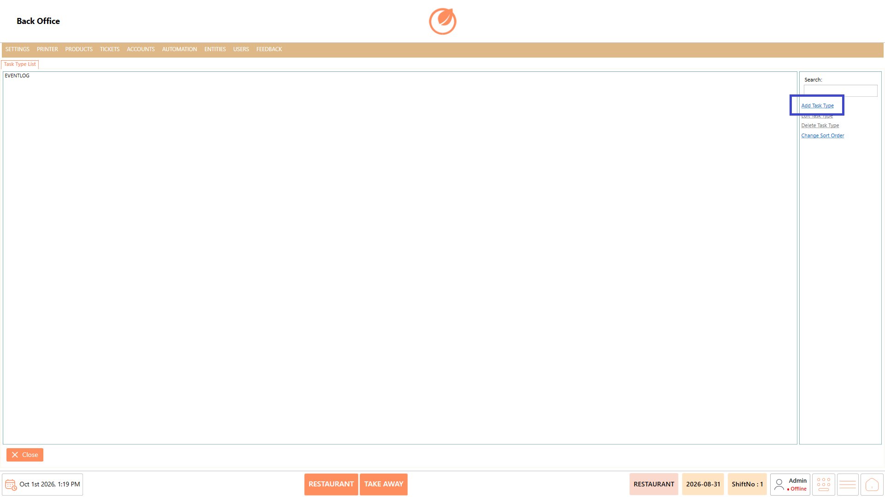
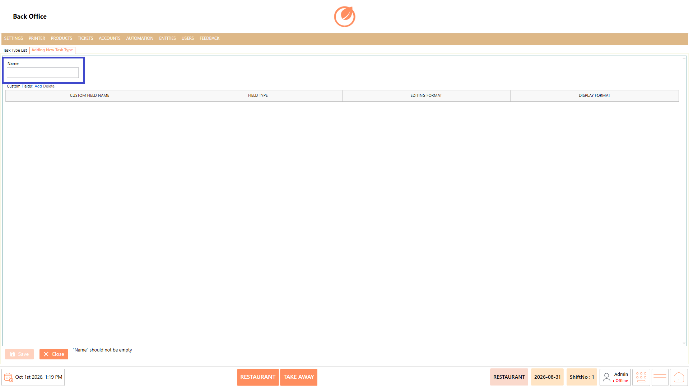
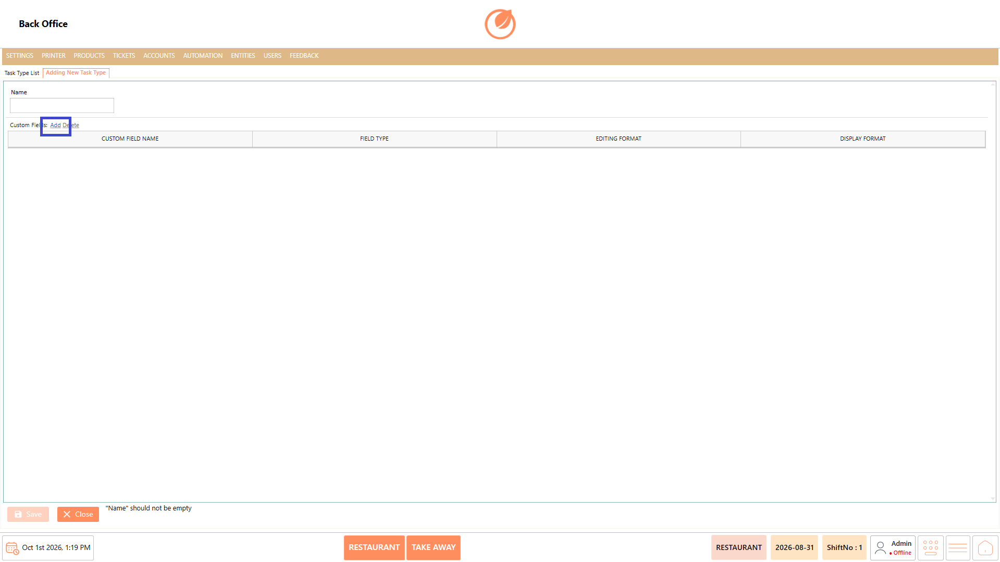
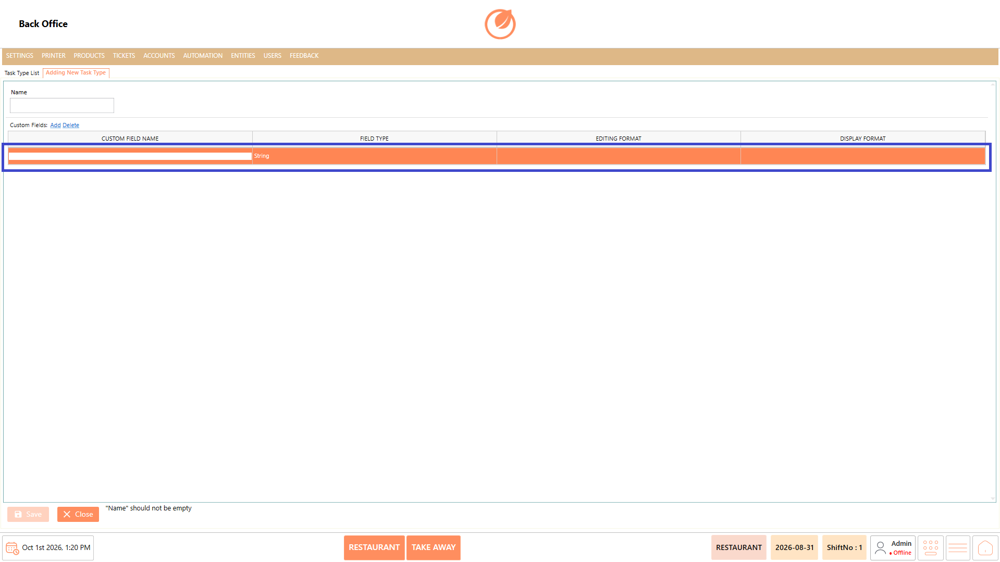
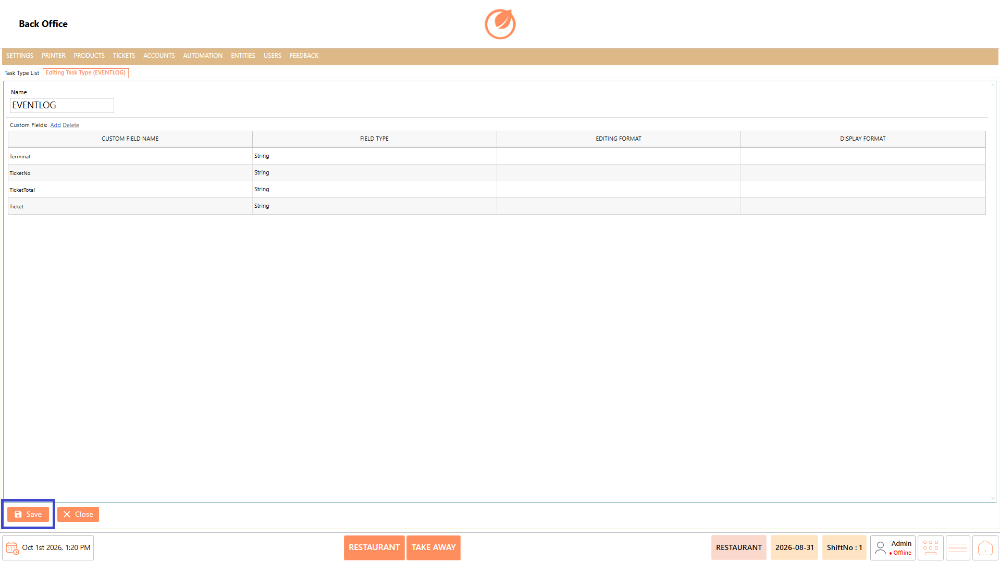
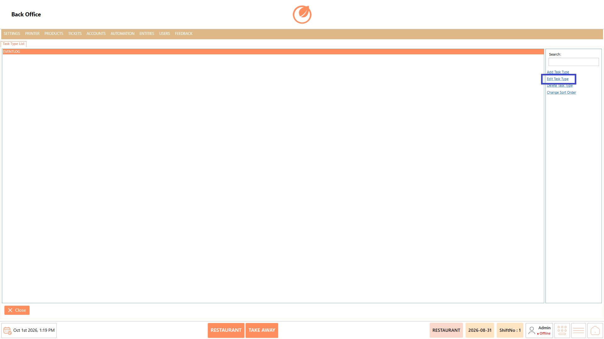
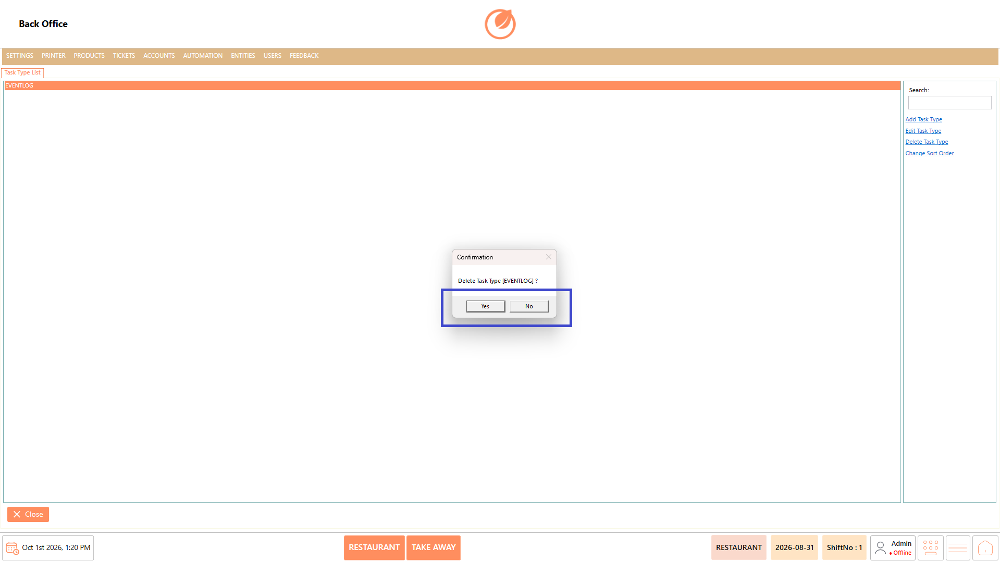
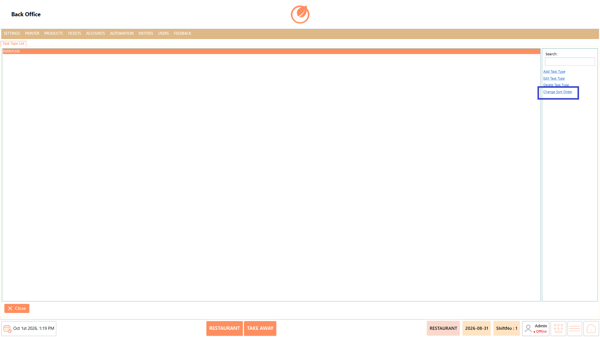

# Task Type

### **Overview** 

The Task Type feature allows administrators to create and manage the different task categories available in DinePlan. These task types help organize operational tasks by defining meaningful classifications such as Eventlog and other custom task categories.

Administrators can add new task types, modify existing task type details, delete task types that are no longer required, and arrange their display order to maintain an organized and structured task list.

The feature also supports configuring custom fields for each task type, allowing additional information to be captured based on business requirements.

<figure><figcaption></figcaption></figure>

### **Screen Elements** 

| **Screen Element** | **Description**                                                          |
| ------------------ | ------------------------------------------------------------------------ |
| Task Type List     | Displays the available task types.                                       |
| Search             | Allows users to search for a specific task type.                         |
| Add Task Type      | Opens the screen to create a new task type.                              |
| Edit Task Type     | Opens the selected task type for editing.                                |
| Delete Task Type   | Deletes the selected task type after confirmation.                       |
| Change Sort Order  | Allows users to rearrange the order of task types.                       |
| Name               | Specifies the name of the task type.                                     |
| Custom Fields      | Displays the custom fields configured for the task type.                 |
| Add                | Adds a new custom field to the task type.                                |
| Delete             | Removes the selected custom field.                                       |
| Custom Field Name  | Specifies the name of the custom field.                                  |
| Field Type         | Specifies the type of data for the custom field.                         |
| Editing Format     | Defines the format used when entering or editing the custom field value. |
| Display Format     | Defines how the custom field value is displayed.                         |
| Save               | Saves the task type and its configuration.                               |
| Close              | Closes the Task Type screen.                                             |

### **Working** 

#### **Add a Task Type** 

1. From the Task Type List, select "Add Task Type".

<figure><figcaption></figcaption></figure>

2. Enter the task type name in "Name".

<figure><figcaption></figcaption></figure>

3. Select "Add" under Custom Fields if additional fields are required.

<figure><figcaption></figcaption></figure>

4. Enter the required details for "Custom Field Name", "Field Type", "Editing Format", and "Display Format".

<figure><figcaption></figcaption></figure>

5. Repeat the process to add multiple custom fields if required.
6. Select "Save" to save the new task type.

<figure><figcaption></figcaption></figure>

7. The newly created task type is displayed in the Task Type List.

#### **Edit a Task Type** 

1. From the Task Type List, select the required task type.
2. Select "Edit Task Type".

<figure><figcaption></figcaption></figure>

3. Update the task type name or modify the custom field configuration as required.
4. Select "Save" to save the changes.

<figure><figcaption></figcaption></figure>

#### **Delete a Task Type** 

1. Select the task type you want to remove from the Task Type List.
2. Select "Delete Task Type".

<figure><figcaption></figcaption></figure>

3. A confirmation message is displayed.
4. Select "Yes" to delete the task type or "No" to cancel the operation.

<figure><figcaption></figcaption></figure>

#### **Change Sort Order** 

1. From the Task Type List, select "Change Sort Order".

<figure><figcaption></figcaption></figure>

2. Drag and drop the task types to arrange them in the required order.
3. Select "OK" to save the updated sort order.

### **Use Case** 

* Create different task categories for organizing operational activities within DinePlan.
* Define task types such as event-related, maintenance, housekeeping, or other business-specific task classifications.
* Configure custom fields to capture additional information required for specific task types.
* Standardize task data entry by defining appropriate field types and editing formats.
* Customize how task-related information is displayed using display formats.
* Update existing task type configurations when operational requirements change.
* Remove obsolete task types that are no longer used in the system.
* Arrange task types in a preferred order for easier navigation and efficient task management.

### **Notes** 

* The "Name" field is required when creating a task type.
* Custom fields can be added or deleted based on business requirements.
* Deleting a task type requires confirmation before removal.
* Use "Change Sort Order" to rearrange the order in which task types are displayed.
