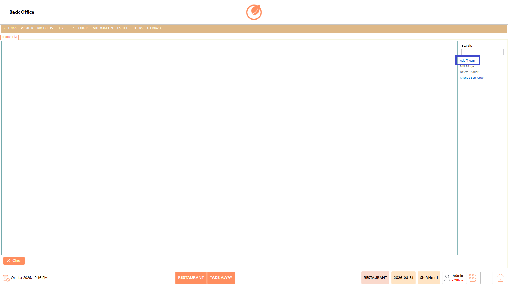
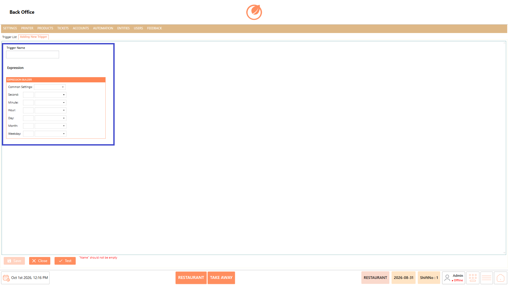
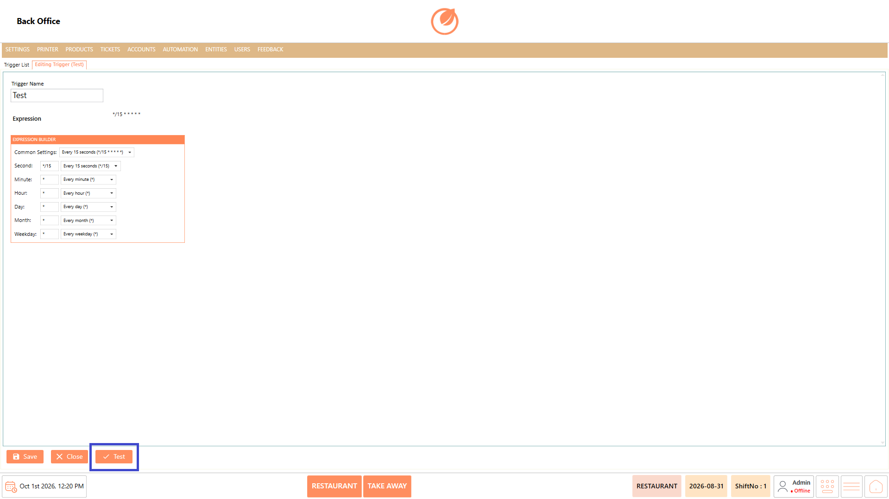
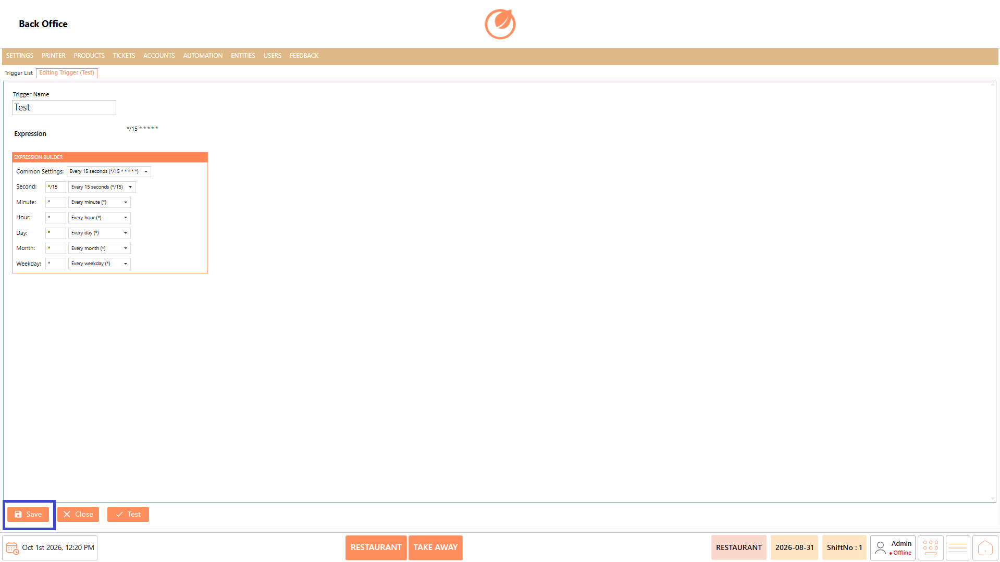
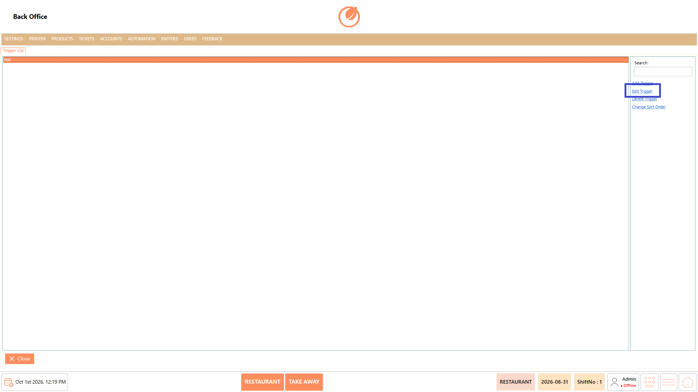
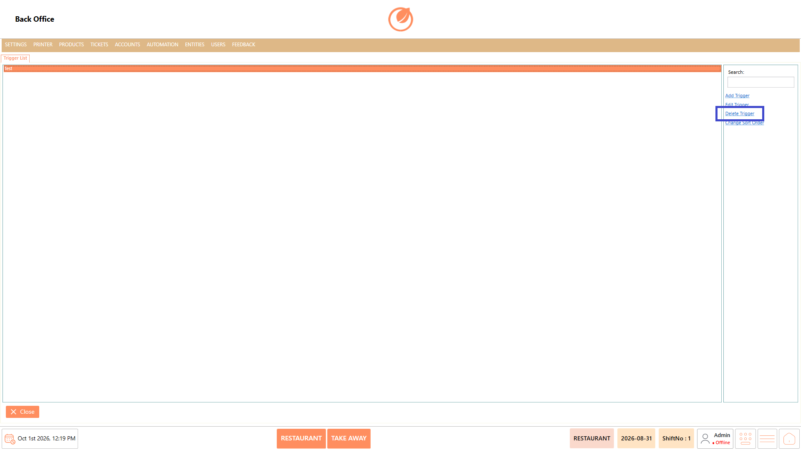
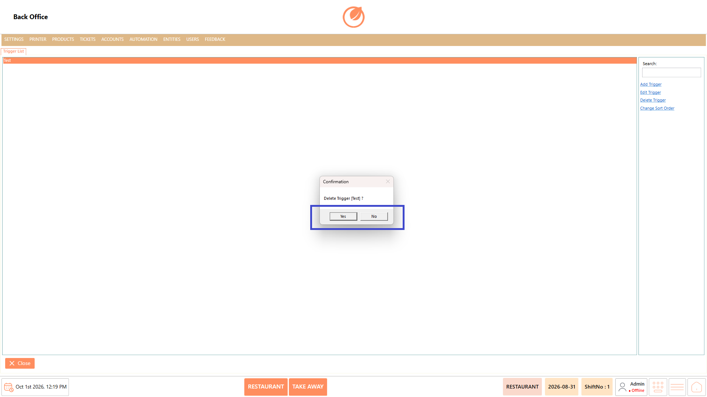
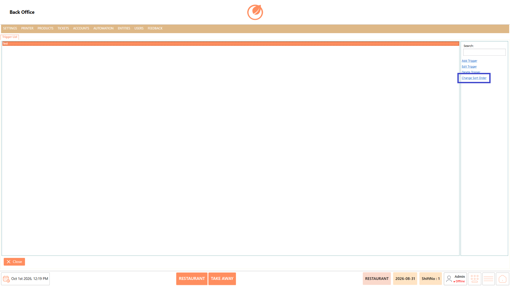

# Trigger

### **Overview** 

The **Trigger** feature allows administrators to create and manage triggers that can be used to define automated actions based on a specified time-based expression. Triggers can be added, edited, deleted, and reordered as required.

<figure><figcaption></figcaption></figure>

### **Screen Elements** 

| **Screen Element** | **Description**                                                |
| ------------------ | -------------------------------------------------------------- |
| Trigger List       | Displays the available triggers.                               |
| Search             | Allows users to search for a specific trigger.                 |
| Add Trigger        | Opens the screen to create a new trigger.                      |
| Edit Trigger       | Allows users to modify the selected trigger.                   |
| Delete Trigger     | Removes the selected trigger after confirmation.               |
| Change Sort Order  | Allows users to change the order in which triggers are listed. |
| Trigger Name       | Field used to enter the name of the trigger.                   |
| Expression         | Defines the time-based condition for the trigger.              |
| Common Settings    | Provides settings used to configure the trigger expression.    |
| Second             | Specifies the second value for the expression.                 |
| Minute             | Specifies the minute value for the expression.                 |
| Hour               | Specifies the hour value for the expression.                   |
| Day                | Specifies the day value for the expression.                    |
| Month              | Specifies the month value for the expression.                  |
| Weekday            | Specifies the weekday value for the expression.                |
| Save               | Saves the trigger configuration.                               |
| Close              | Closes the trigger configuration screen.                       |
| Test               | Tests the configured trigger expression.                       |

### **Working** 

#### **Add a Trigger** 

1. Select "Add Trigger" from the Trigger List.

<figure><figcaption></figcaption></figure>

2. Enter the trigger name in "Trigger Name".
3. Configure the "Expression" using the "Common Settings" fields.
4. Specify the required values for "Second", "Minute", "Hour", "Day", "Month", and "Weekday".

<figure><figcaption></figcaption></figure>

5. Select "Test" to test the configured expression, if required.

<figure><figcaption></figcaption></figure>

6. Select "Save" to create the trigger.

<figure><figcaption></figcaption></figure>

#### **Edit a Trigger** 

1. Select the required trigger from the Trigger List.
2. Select "Edit Trigger".

<figure><figcaption></figcaption></figure>

3. Modify the required trigger details or expression.
4. Select "Save" to save the changes.

<figure><figcaption></figcaption></figure>

#### **Delete a Trigger** 

1. Select the trigger you want to remove.
2. Select "Delete Trigger".

<figure><figcaption></figcaption></figure>

3. Confirm the deletion when prompted.

<figure><figcaption></figcaption></figure>

#### **Change Sort Order** 

1. Select "Change Sort Order".

<figure><figcaption></figcaption></figure>

2. Change the order of the triggers as required.
3. Save or confirm the updated order, if prompted.

### **Use Case** 

* Schedule automated processes to run at specific times without requiring staff to start them manually.
* Configure recurring actions that need to occur at fixed intervals, such as every minute, hour, day, or week.
* Set different execution times for processes that need to run at specific hours or on specific days.
* Schedule routine operational tasks to run automatically during predefined business hours.
* Configure triggers for processes that need to run on particular days of the month or specific weekdays.
* Support time-dependent automation where an action needs to occur based on a defined date or time pattern.
* Create multiple triggers for different automated processes that require different execution schedules.
* Organize multiple triggers in a preferred order to make them easier to manage when several time-based processes are configured.

### **Notes** 

* A Trigger Name is required when creating a trigger.
* Configure the expression using the available time fields.
* Use "Test" to verify the configured expression before saving, if required.
* Deleting a trigger requires confirmation.
* Triggers can be reordered using "Change Sort Order".
