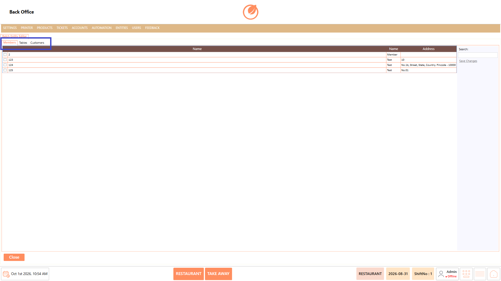
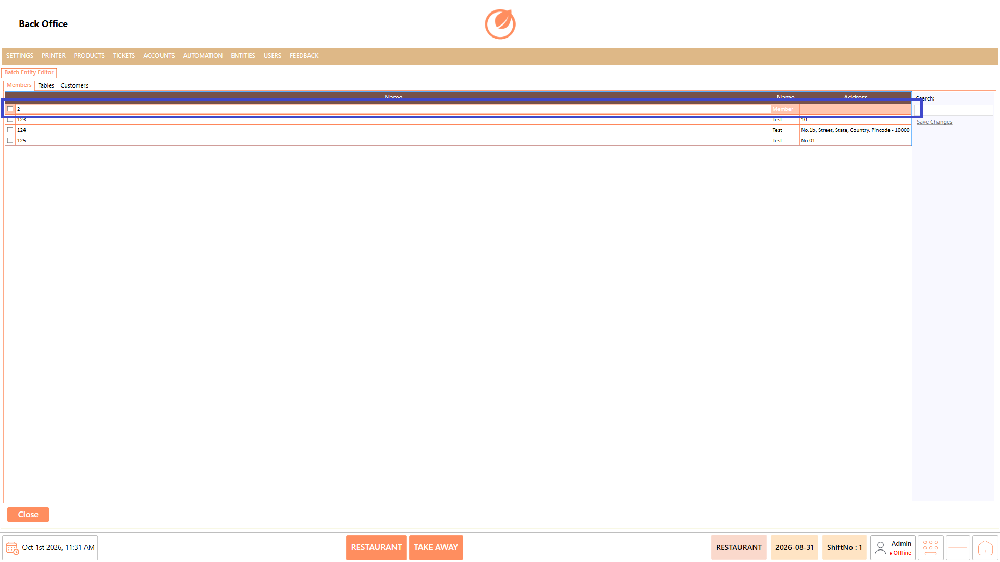
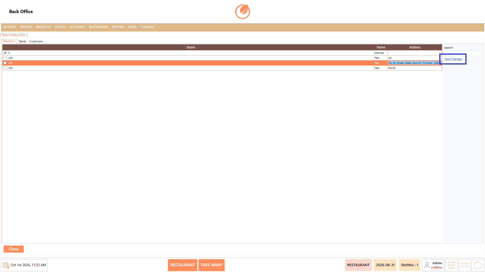
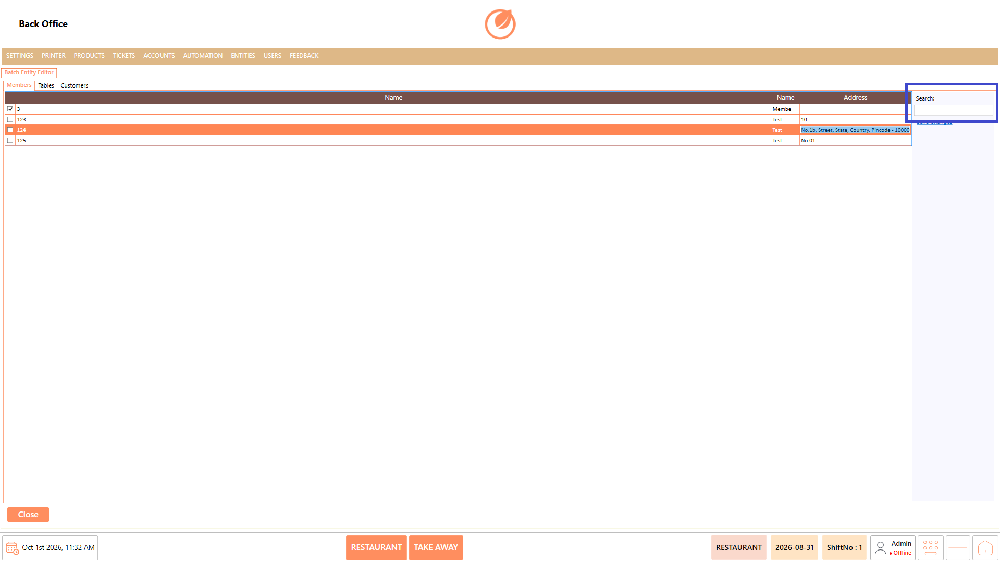
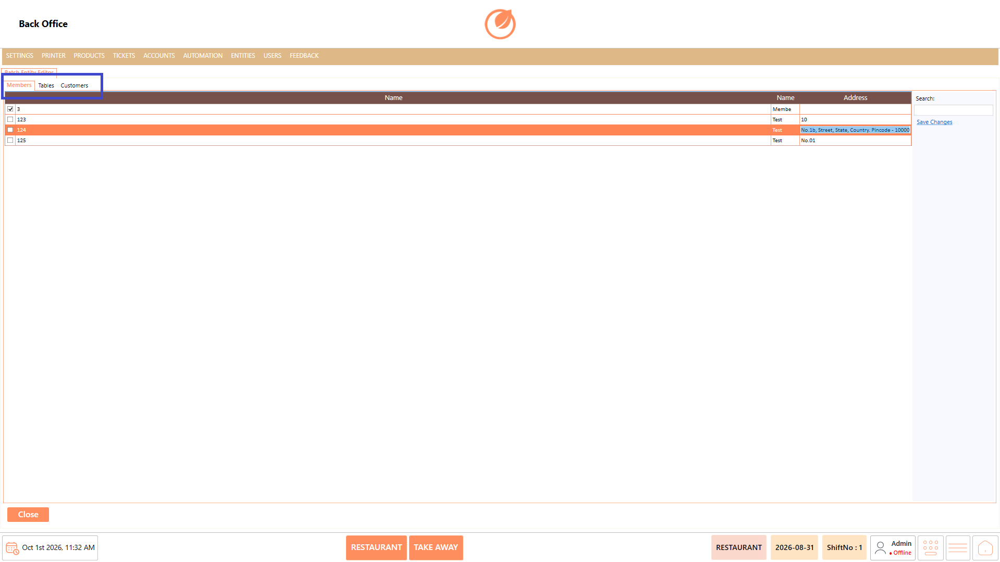

# Batch Entity

### **Overview** 

The Batch Entity Editor allows users to view and update multiple entities directly from a single screen. Entities are organized under separate tabs such as Members, Tables, and Customers. Users can search for entities, edit the displayed details, and save the changes without opening each entity individually.

<figure><figcaption></figcaption></figure>

### **Screen Elements** 

| **Screen Element** | **Description**                                                             |
| ------------------ | --------------------------------------------------------------------------- |
| Members            | Displays the available member entities for viewing and editing.             |
| Tables             | Displays the available table entities for viewing and editing.              |
| Customers          | Displays the available customer entities for viewing and editing.           |
| Name               | Displays the name or identifier of the entity.                              |
| Address            | Displays the address associated with the entity, where applicable.          |
| TaxId              | Displays the tax identification details for the customer, where applicable. |
| Test               | Displays the customer name details, where applicable.                       |
| CompanyName        | Displays the company name associated with the customer, where applicable.   |
| Email              | Displays the email address associated with the customer, where applicable.  |
| Search             | Allows users to search for a specific entity.                               |
| Save Changes       | Saves the changes made to the entities.                                     |
| Close              | Closes the Batch Entity Editor.                                             |

### **Working** 

#### **Edit an Entity** 

1. From the Batch Entity Editor, select the required entity type, such as "Members", "Tables", or "Customers".

<figure><figcaption></figcaption></figure>

2. Locate the required entity from the list.
3. Double-click the required entity field to make it editable.

<figure><figcaption></figcaption></figure>

4. Update the required details.
5. Select "Save Changes" to save the updates.

<figure><figcaption></figcaption></figure>

#### **Search for an Entity** 

1. Select the required entity type.
2. Enter the entity name or relevant details in "Search".

<figure><figcaption></figcaption></figure>

3. Review the filtered results.

#### **Switch Entity Type** 

1. Select "Members", "Tables", or "Customers" to view the corresponding entities.

<figure><figcaption></figcaption></figure>

2. Select the required entity and update the details as needed.

### **Use Case** 

* Update multiple member details from a single screen.
* Modify table names or details without opening individual entities.
* Update customer information such as name, address, company name, or email.
* Search for a specific entity when the list contains multiple records.
* Switch between Members, Tables, and Customers for different entity types.
* Make quick changes directly within the entity list.
* Save multiple updates together using "Save Changes".
* Manage entity information efficiently from a centralized screen.

### **Notes** 

* Existing entity details can be edited by double-clicking the required field.
* Select "Save Changes" after making updates.
* The available fields may vary depending on the selected entity type.
* Use the "Search" option to quickly locate an entity.
