# Entity Screen

## **Overview** 

The Entity Screen setting allows users to create and manage screens for displaying entities in DinePlan. Users can configure the screen settings, select the entities to be displayed, define mappings, and organize the order of available Entity Screens.

<figure><figcaption></figcaption></figure>

## **Screen Elements** 

#### **Entity Screen List** 

| **Screen Element**           | **Description**                                              |
| ---------------------------- | ------------------------------------------------------------ |
| Entity Screen List           | Displays the available Entity Screens.                       |
| Search                       | Allows users to search for an Entity Screen.                 |
| Add Entity Screen            | Creates a new Entity Screen.                                 |
| Edit Entity Screen           | Opens the selected Entity Screen for editing.                |
| Delete Entity Screen         | Deletes the selected Entity Screen.                          |
| Sort Entity Screens          | Allows users to change the display order of Entity Screens.  |
| Close                        | Closes the Entity Screen settings.                           |
| Name                         | Specifies the name of the Entity Screen.                     |
| Ticket Type                  | Specifies the Ticket Type associated with the Entity Screen. |
| View Mode                    | Specifies the view mode for the Entity Screen.               |
| Background Image             | Specifies the background image for the screen.               |
| Ask Ticket Type              | Enables or disables asking for the Ticket Type.              |
| Search Value Replace Pattern | Specifies the search value replacement pattern.              |
| Background Color             | Specifies the background color of the screen.                |
| Row Count                    | Specifies the number of rows displayed.                      |
| Column Count                 | Specifies the number of columns displayed.                   |
| Button Height                | Specifies the height of the buttons.                         |
| Fly Button Height            | Specifies the height of the fly buttons.                     |
| Page Count                   | Specifies the number of pages displayed.                     |
| Font Size                    | Specifies the font size used on the screen.                  |
| Use State DisplayFormat      | Enables or disables the state display format.                |
| Refresh Entities             | Enables or disables entity refreshing.                       |

## Working 

#### **Add an Entity Screen** 

1. From the Entity Screen List, select "Add Entity Screen".

<figure>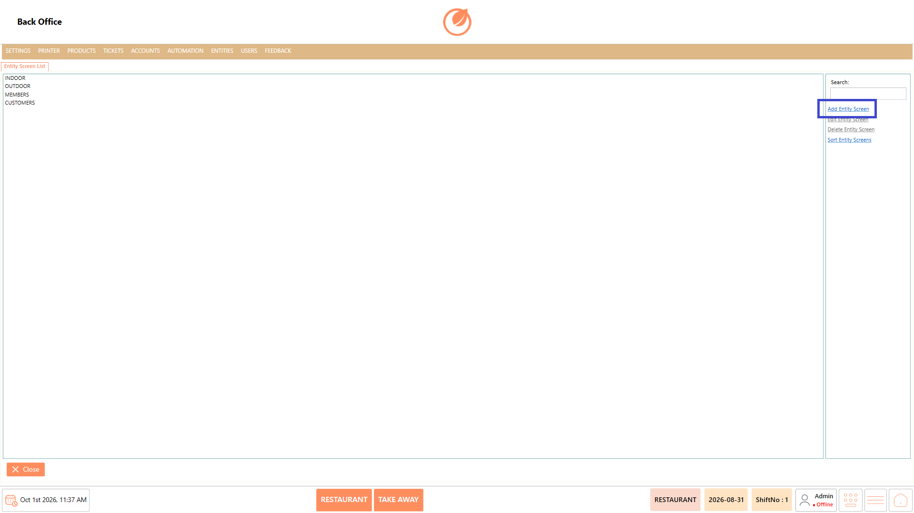<figcaption></figcaption></figure>

2. Enter the Entity Screen name in "Name".

<figure>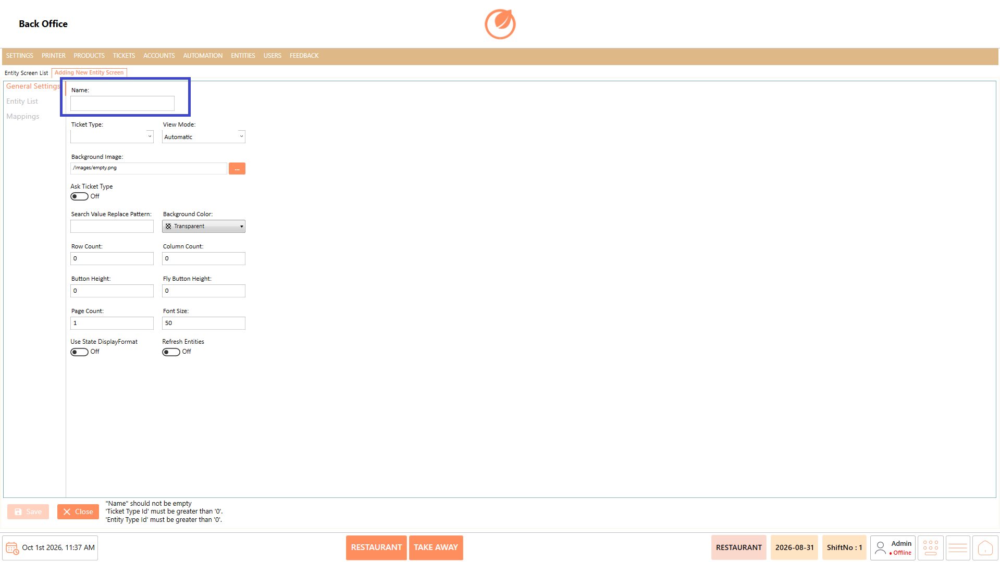<figcaption></figcaption></figure>

3. Configure the required details under "General Settings".

<figure>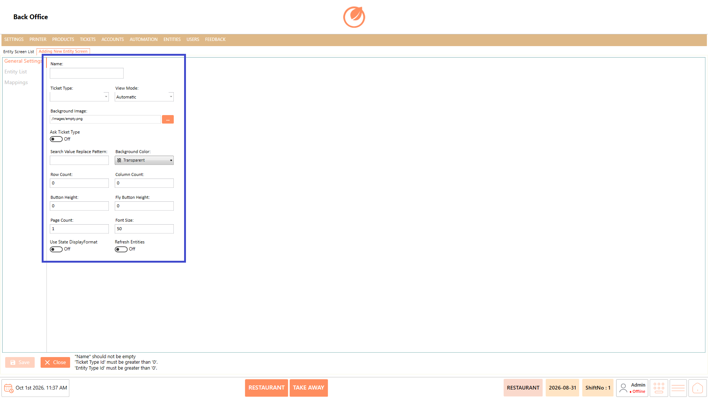<figcaption></figcaption></figure>

4. Under "Entity List", select the required "Entity Type" and entities.

<figure>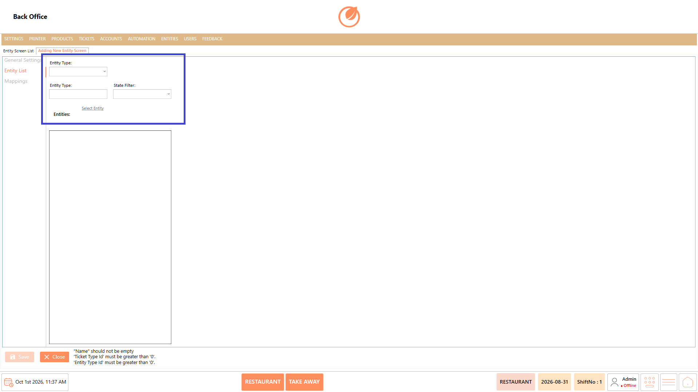<figcaption></figcaption></figure>

5. Under "Mappings", select "Add" and configure the required mapping details.

<figure>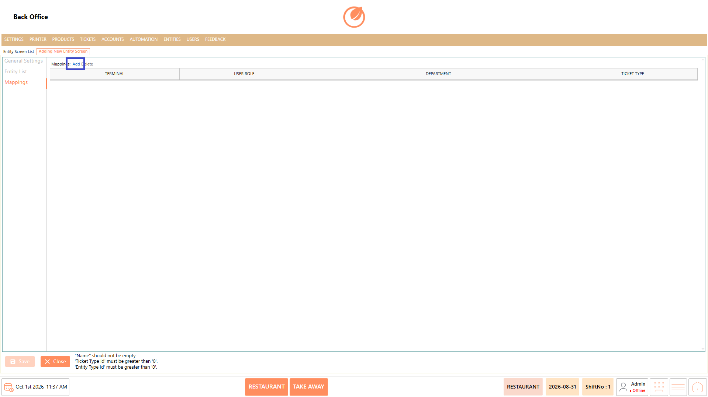<figcaption></figcaption></figure>

6. Select "Save" to save the Entity Screen.

<figure><figcaption></figcaption></figure>

#### **Edit an Entity Screen** 

1. From the Entity Screen List, select the required Entity Screen.
2. Select "Edit Entity Screen".

<figure>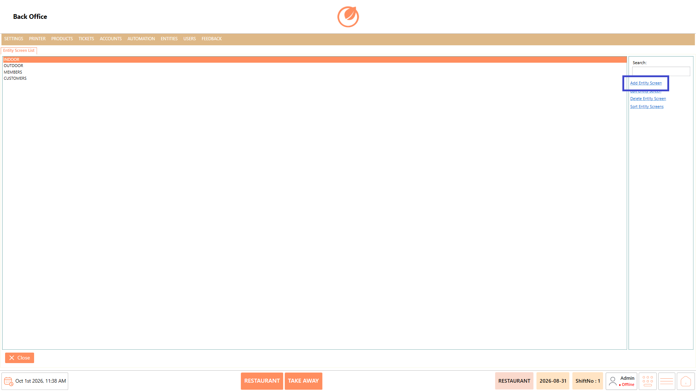<figcaption></figcaption></figure>

3. Update the required details.
4. Select "Save" to save the changes.

<figure>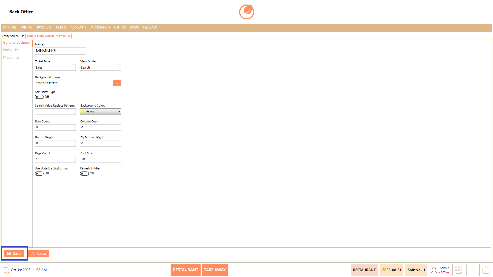<figcaption></figcaption></figure>

#### **Delete an Entity Screen** 

1. From the Entity Screen List, select the Entity Screen you want to remove.
2. Select "Delete Entity Screen".

<figure>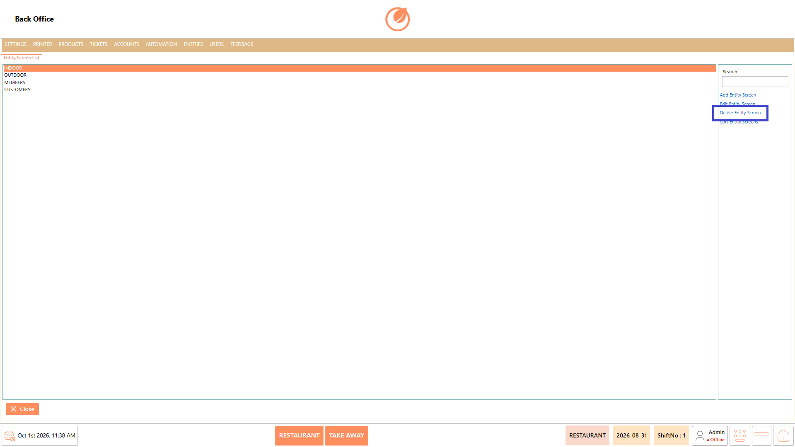<figcaption></figcaption></figure>

3. A confirmation message is displayed.
4. Select "Yes" to delete the Entity Screen or "No" to cancel the operation.

<figure>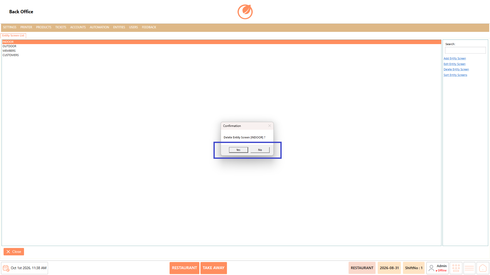<figcaption></figcaption></figure>

#### **Change Sort Order** 

1. From the Entity Screen List, select "Sort Entity Screens".

<figure>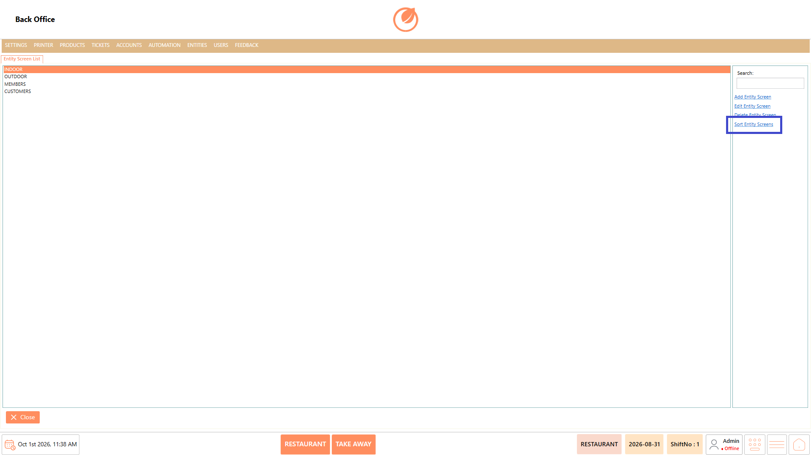<figcaption></figcaption></figure>

2. Drag the Entity Screens to arrange them in the required order.

<figure>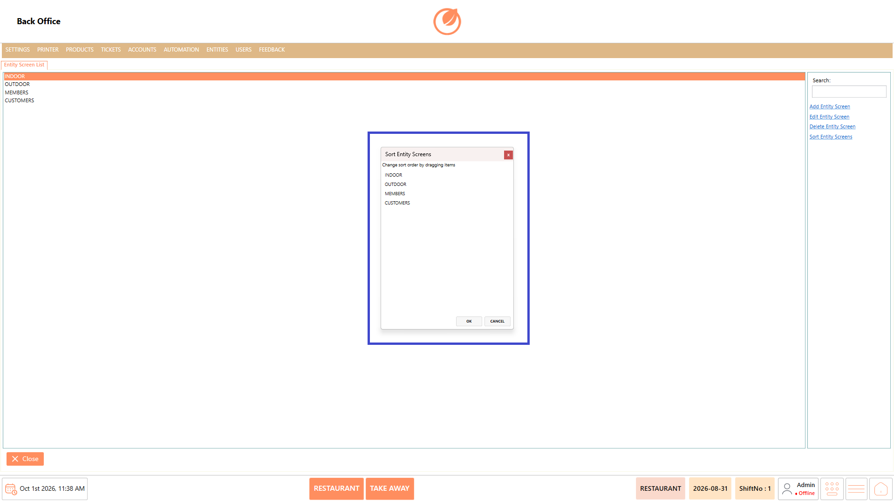<figcaption></figcaption></figure>

3. Select "OK" to save the new order.

<figure>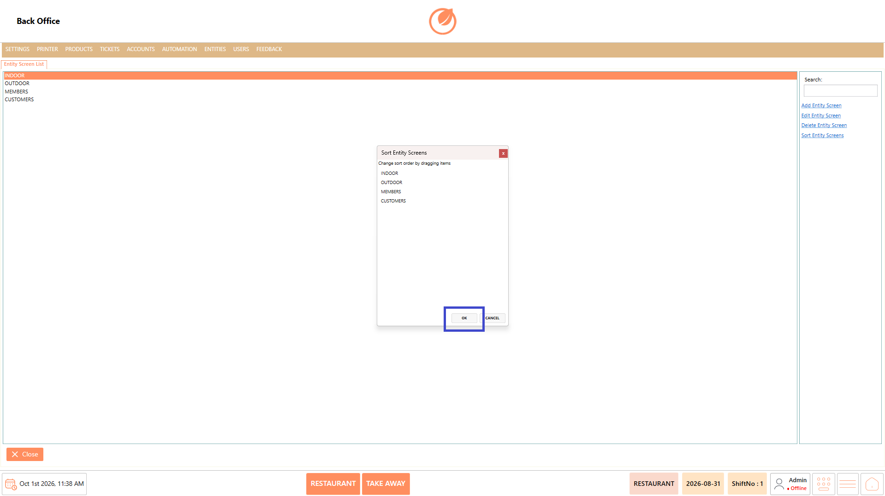<figcaption></figcaption></figure>

## **Use Case** 

* Create separate screens for different entity types.
* Configure how entities are displayed on the screen.
* Assign specific Ticket Types to an Entity Screen.
* Select the entities that should be displayed on a screen.
* Configure screen appearance using background images, colors, rows, columns, and font size.
* Configure mappings based on terminals, user roles, departments, and Ticket Types.
* Edit existing Entity Screens when configuration changes are required.
* Arrange Entity Screens in the required display order.

## **Notes** 

* The Name field is required when creating an Entity Screen.
* Ticket Type and Entity Type must be configured before saving the Entity Screen.
* Use "Search" to quickly locate an existing Entity Screen.
* Select "Yes" in the confirmation message to permanently delete the selected Entity Screen.
