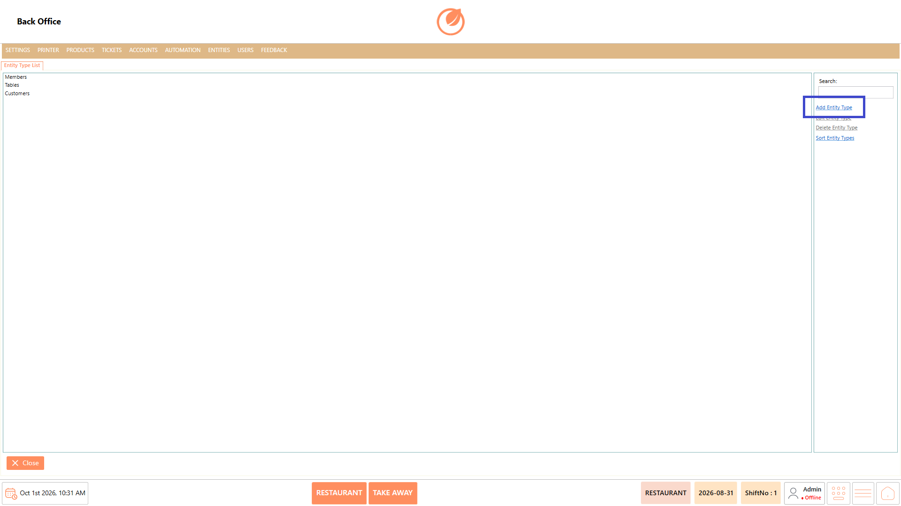
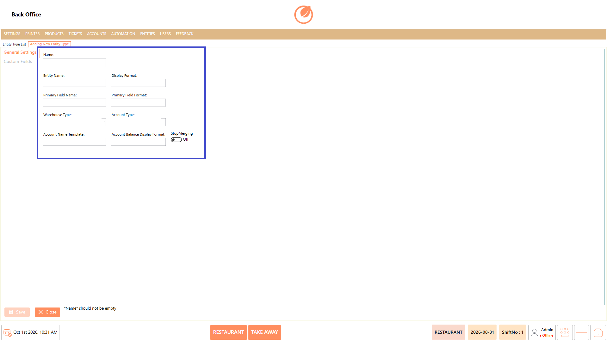
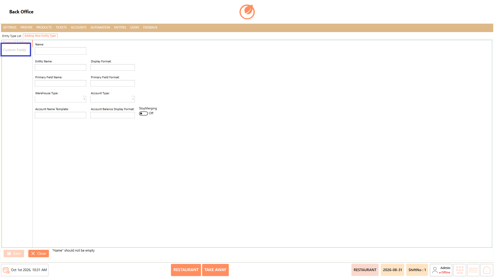
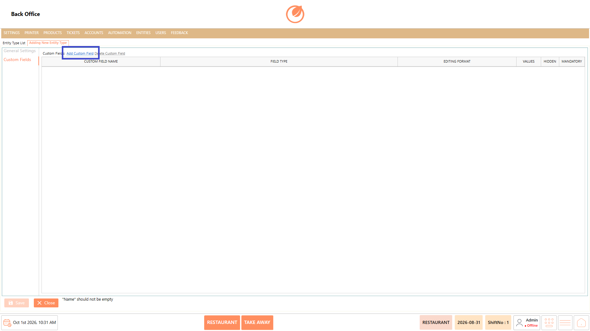
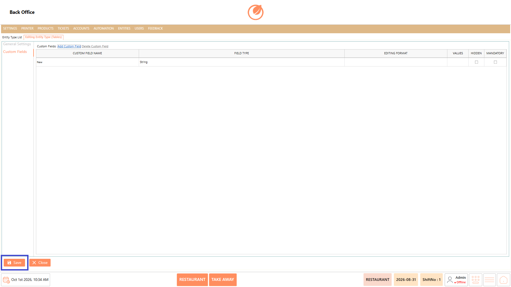
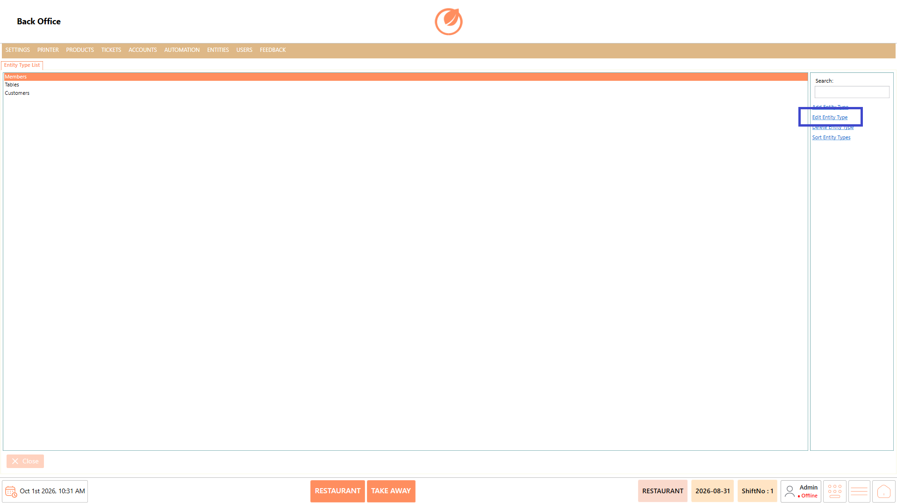
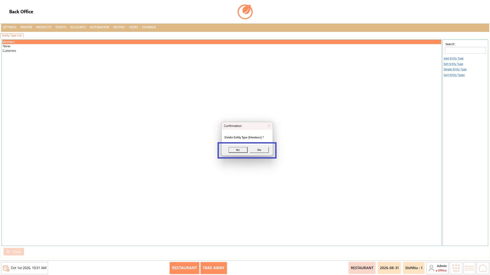
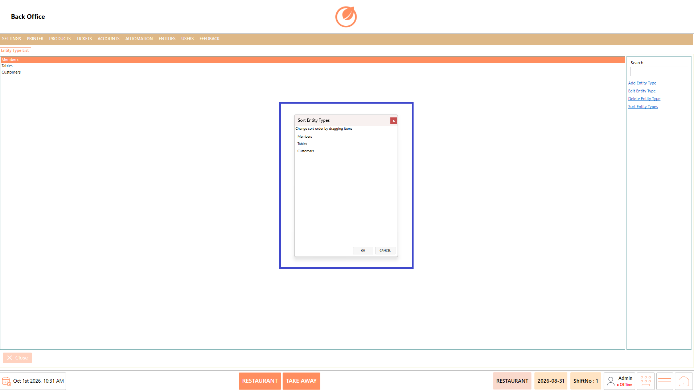
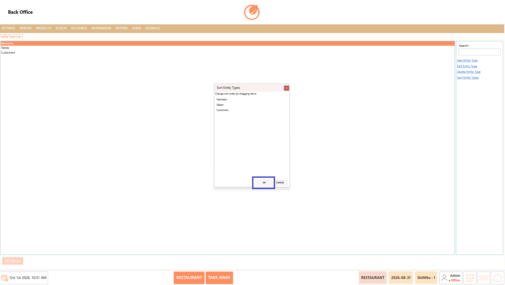

# Entity Type

### **Overview** 

The Entity Type feature allows administrators to manage different types of entities used in DinePlan, such as Members, Tables, and Customers. Administrators can create new entity types, configure their general settings and custom fields, modify existing configurations, remove entity types when they are no longer required, and arrange the entity types in a preferred order.

<figure><figcaption></figcaption></figure>

### **Screen Elements** 

| **Screen Element**             | **Description**                                                      |
| ------------------------------ | -------------------------------------------------------------------- |
| Entity Type List               | Displays the available entity types.                                 |
| Search                         | Search for a specific entity type.                                   |
| Add Entity Type                | Opens the screen to create a new entity type.                        |
| Edit Entity Type               | Opens the selected entity type for modification.                     |
| Delete Entity Type             | Deletes the selected entity type after confirmation.                 |
| Sort Entity Types              | Allows entity types to be reordered.                                 |
| General Settings               | Contains the basic configuration options for the entity type.        |
| Name                           | Specifies the name of the entity type.                               |
| Entity Name                    | Specifies the entity name.                                           |
| Display Format                 | Specifies the display format for the entity.                         |
| Primary Field Name             | Specifies the primary field name.                                    |
| Primary Field Format           | Specifies the format of the primary field.                           |
| Warehouse Type                 | Specifies the warehouse type.                                        |
| Account Type                   | Specifies the account type.                                          |
| Account Name Template          | Specifies the account name template.                                 |
| Account Balance Display Format | Specifies the format for displaying the account balance.             |
| Stop Merging                   | Controls the Stop Merging option.                                    |
| Custom Fields                  | Allows custom fields to be added and configured for the entity type. |
| Add Custom Field               | Adds a new custom field.                                             |
| Delete Custom Field            | Deletes a selected custom field.                                     |
| Custom Field Name              | Specifies the name of the custom field.                              |
| Field Type                     | Specifies the type of the custom field.                              |
| Editing Format                 | Specifies the editing format for the custom field.                   |
| Values                         | Specifies the values available for the custom field.                 |
| Hidden                         | Controls whether the custom field is hidden.                         |
| Mandatory                      | Specifies whether the custom field is mandatory.                     |
| Close                          | Closes the Entity Type screen.                                       |

### **Working** 

#### **Add an Entity Type** 

1. From the Entity Type List, select "Add Entity Type".

<figure><figcaption></figcaption></figure>

2. Enter the required entity type name in "Name".
3. Enter the required details in "Entity Name", "Display Format", "Primary Field Name", and "Primary Field Format".
4. Configure "Warehouse Type", "Account Type", "Account Name Template", "Account Balance Display Format", and "Stop Merging" as required.

<figure><figcaption></figcaption></figure>

5. Select "Custom Fields" to add custom fields, if required.

<figure><figcaption></figcaption></figure>

6. Select "Add Custom Field" and configure the required custom field details.

<figure><figcaption></figcaption></figure>

7. Select "Save" to save the entity type.

<figure><figcaption></figcaption></figure>

#### **Edit an Entity Type** 

1. From the Entity Type List, select the required entity type.
2. Select "Edit Entity Type".

<figure><figcaption></figcaption></figure>

3. Update the required general settings or custom fields.
4. Select "Save" to save the changes.

<figure><figcaption></figcaption></figure>

#### **Delete an Entity Type** 

1. Select the entity type you want to remove from the Entity Type List.
2. Select "Delete Entity Type".

<figure><figcaption></figcaption></figure>

3. A confirmation message is displayed.
4. Select "Yes" to delete the entity type or "No" to cancel the operation.

<figure><figcaption></figcaption></figure>

#### **Change Sort Order** 

1. From the Entity Type List, select "Sort Entity Types".

<figure><figcaption></figcaption></figure>

2. Drag and drop the entity types to arrange them in the required order.

<figure><figcaption></figcaption></figure>

3. Select "OK" to save the new sort order.

<figure><figcaption></figcaption></figure>

### **Use Case** 

* Create entity types for different types of records such as Members, Tables, and Customers.
* Configure general settings according to the requirements of the entity type.
* Define a primary field to identify the entity.
* Configure display and account-related formats for the entity type.
* Add custom fields to capture additional information for an entity.
* Mark custom fields as "Hidden" or "Mandatory" based on the required configuration.
* Edit existing entity types when their configuration needs to be updated.
* Arrange entity types in a preferred order for easier access and management.

### **Notes** 

* The "Name" field is required when creating an entity type.
* Custom fields can be added and configured from the "Custom Fields" section.
* Deleting an entity type requires confirmation.
* Use "Sort Entity Types" to change the display order of entity types.
