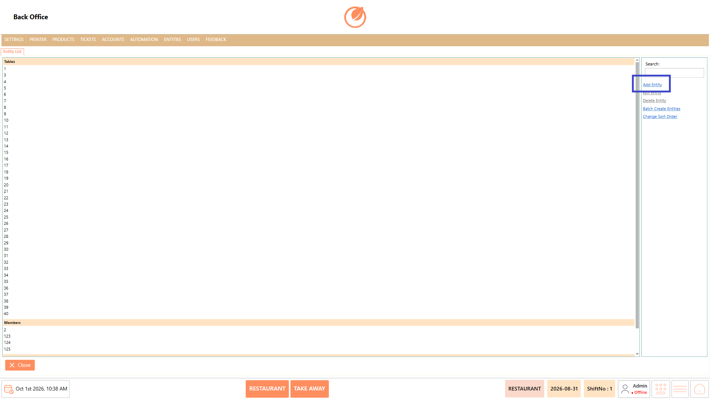
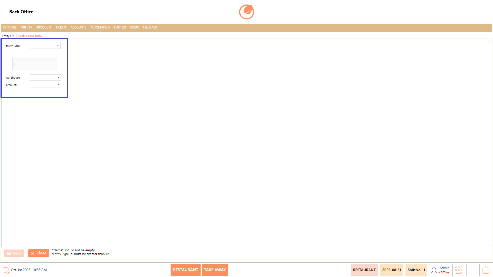
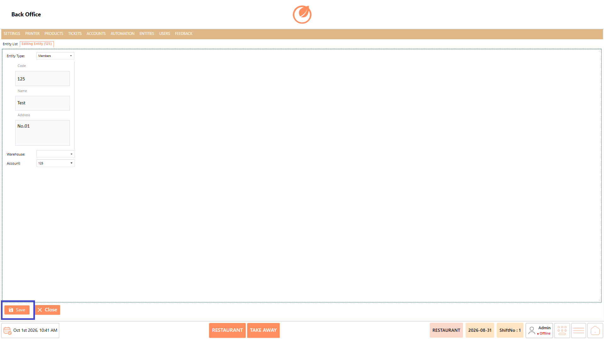
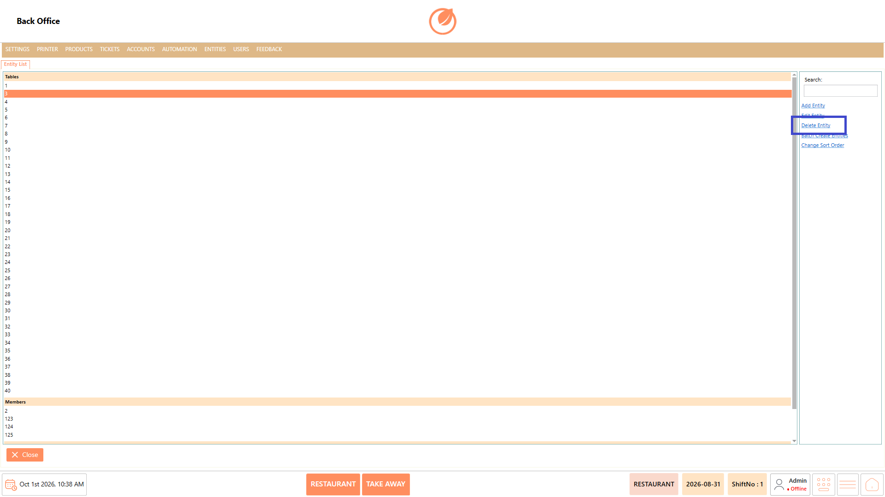
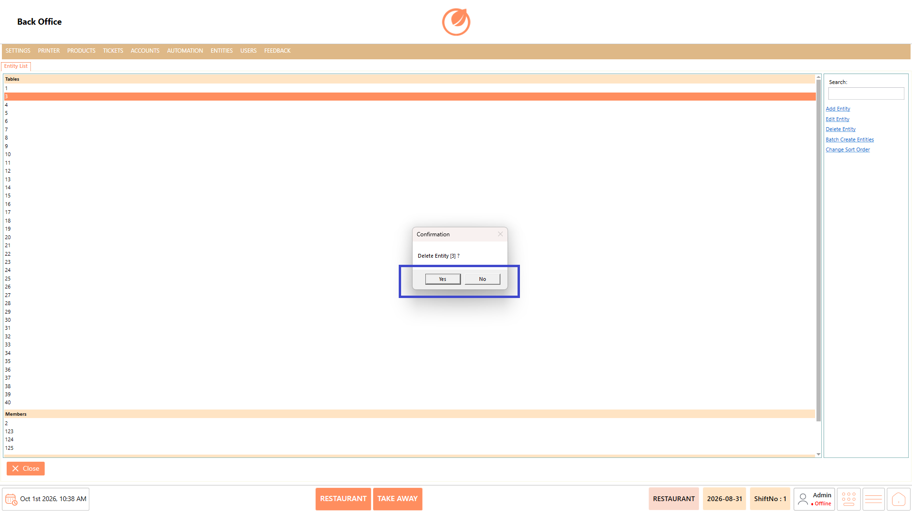
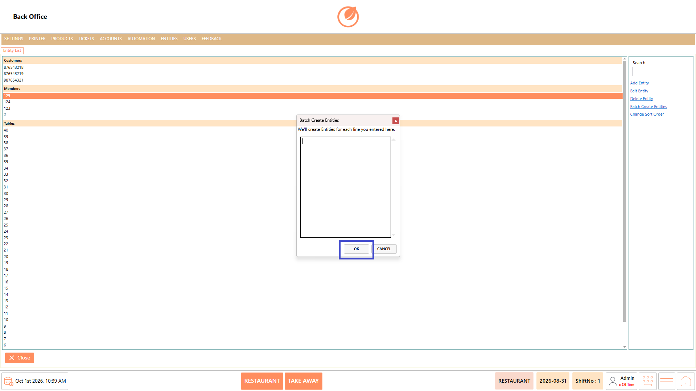
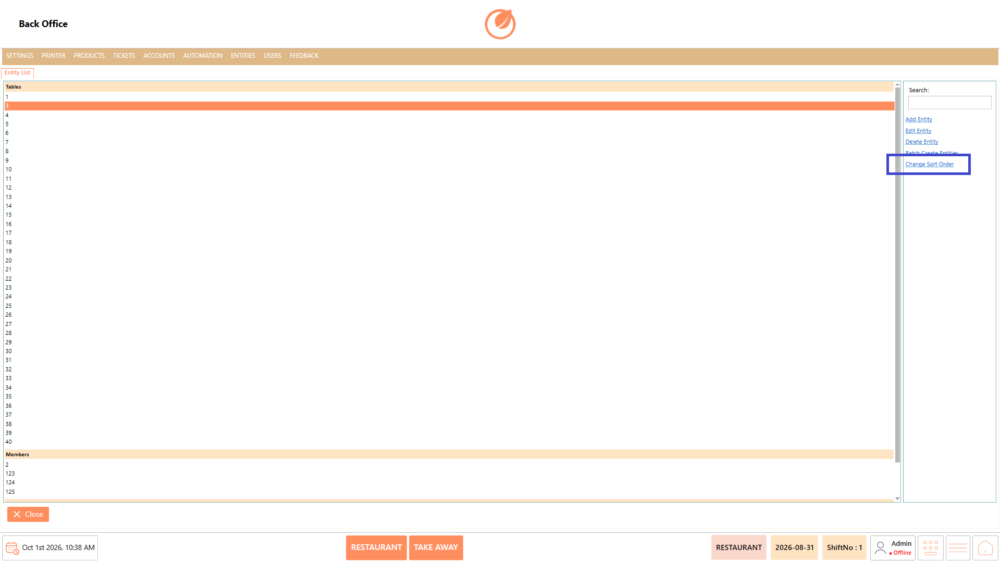

# Entity

### **Overview** 

The Entity feature allows administrators to create and manage entities such as tables and members within DinePlan. It provides options to add individual entities, edit existing entities, delete entities, create multiple entities at once using Batch Create Entities, and change the order in which entities are displayed.

This helps administrators maintain entity records efficiently and organize them according to operational requirements.

<figure><figcaption></figcaption></figure>

### **Screen Elements** 

| **Screen Element**    | **Description**                                          |
| --------------------- | -------------------------------------------------------- |
| Entity List           | Displays the available entities grouped by entity type.  |
| Search                | Allows users to search for a specific entity.            |
| Add Entity            | Opens the screen to create a new entity.                 |
| Edit Entity           | Opens the selected entity for editing.                   |
| Delete Entity         | Deletes the selected entity after confirmation.          |
| Batch Create Entities | Allows multiple entities to be created at the same time. |
| Change Sort Order     | Allows users to rearrange the order of entities.         |
| Entity Type           | Specifies the type of entity being created.              |
| Warehouse             | Specifies the warehouse associated with the entity.      |
| Account               | Specifies the account associated with the entity.        |
| OK                    | Confirms the batch creation or sort order changes.       |
| Cancel                | Cancels the current operation.                           |
| Close                 | Closes the Entity screen.                                |

### **Working** 

#### **Add an Entity** 

1. From the Entity List, select "Add Entity".

<figure><figcaption></figcaption></figure>

2. Select the required entity type in "Entity Type".
3. Enter or select the required "Warehouse".
4. Enter or select the required "Account".

<figure><figcaption></figcaption></figure>

5. Select "Save" to save the entity.

<figure><figcaption></figcaption></figure>

#### **Edit an Entity** 

1. From the Entity List, select the required entity.
2. Select "Edit Entity".

<figure><figcaption></figcaption></figure>

3. Update the required entity details.
4. Select "Save" to save the changes.

<figure><figcaption></figcaption></figure>

#### **Delete an Entity** 

1. From the Entity List, select the entity you want to remove.
2. Select "Delete Entity".

<figure><figcaption></figcaption></figure>

3. A confirmation message is displayed.
4. Select "Yes" to delete the entity or "No" to cancel the operation.

<figure><figcaption></figcaption></figure>

#### **Batch Create Entities** 

1. From the Entity List, select "Batch Create Entities".

<figure><figcaption></figcaption></figure>

2. Enter the entity names, with each entity on a separate line.
3. Select "OK" to create the entities.

<figure><figcaption></figcaption></figure>

#### **Change Sort Order** 

1. From the Entity List, select "Change Sort Order".

<figure><figcaption></figcaption></figure>

2. Adjust the order of the entities as required.

### **Use Case** 

* Create individual entities for managing operational records such as tables or members.
* Create multiple entities at once using the "Batch Create Entities" option.
* Edit existing entity details when configuration or operational requirements change.
* Delete entities that are no longer required.
* Search for specific entities when managing a large list of records.
* Associate an entity with the required warehouse and account during configuration.
* Arrange entities in a preferred order for easier identification and navigation.
* Maintain organized entity records according to the operational requirements of the restaurant.

### **Notes** 

* The "Entity Type" must be selected when creating an entity.
* The "Batch Create Entities" option creates an entity for each line entered.
* Deleting an entity requires confirmation before removal.
* Use "Change Sort Order" to rearrange the display order of entities.
