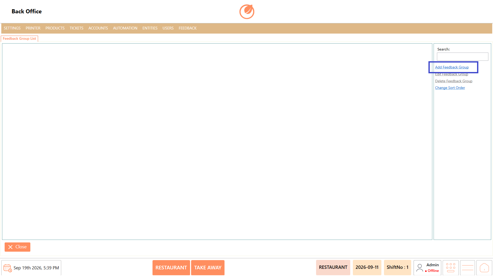
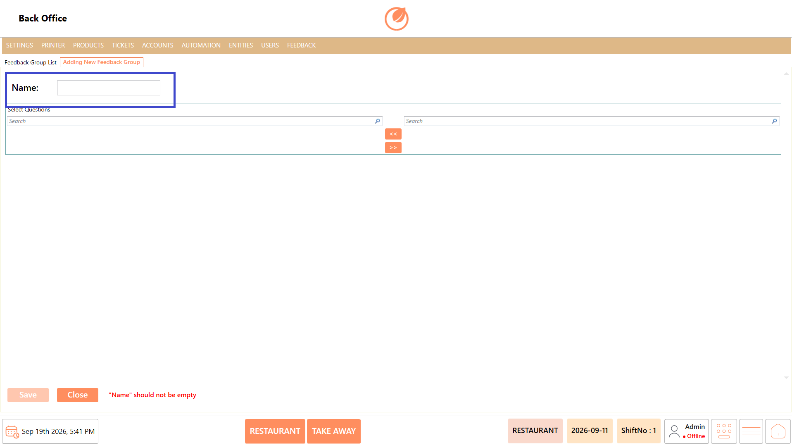
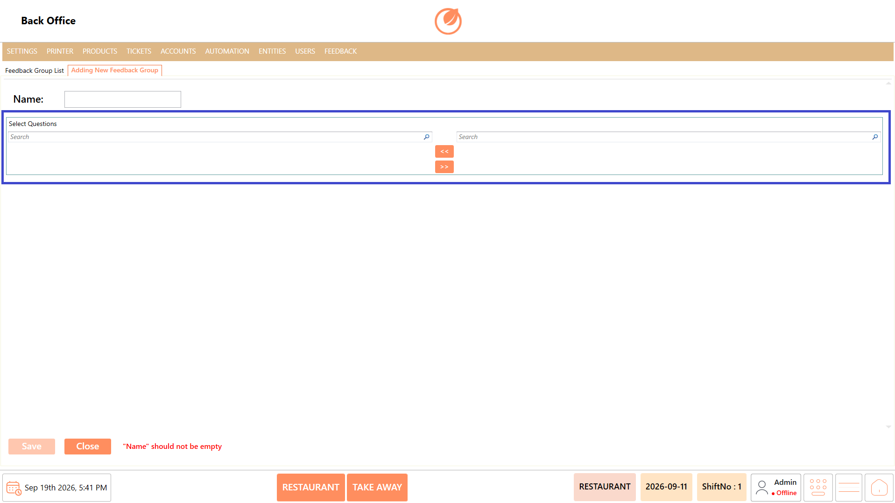
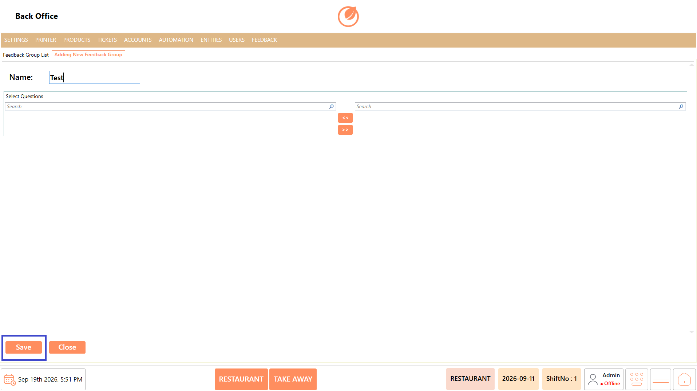
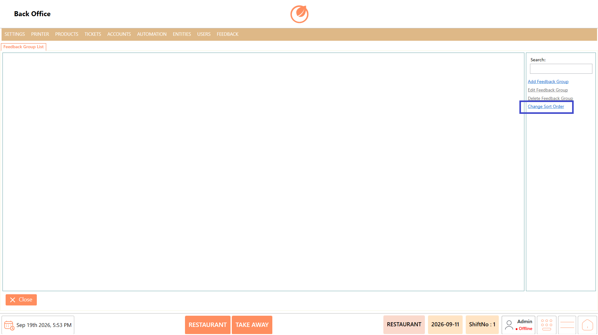

# Feedback Groups

### **Overview** 

The Feedback Group setting allows administrators to create and manage groups of feedback questions. Questions can be selected and assigned to a feedback group based on the required feedback structure. Existing feedback groups can also be edited, deleted, or arranged in the required order.

<figure><figcaption></figcaption></figure>

### **Screen Elements** 

| **Screen Element**    | **Description**                                                           |
| --------------------- | ------------------------------------------------------------------------- |
| Feedback Group List   | Displays the list of existing feedback groups.                            |
| Search                | Allows users to search for a specific feedback group.                     |
| Add Feedback Group    | Creates a new feedback group.                                             |
| Edit Feedback Group   | Opens the selected feedback group for editing.                            |
| Delete Feedback Group | Deletes the selected feedback group after confirmation.                   |
| Change Sort Order     | Allows users to change the display order of feedback groups.              |
| Name                  | Specifies the name of the feedback group.                                 |
| Select Questions      | Displays the available questions that can be added to the feedback group. |
| Search                | Allows users to search for questions.                                     |
| >>                    | Moves the selected questions to the feedback group.                       |
| <<                    | Removes questions from the feedback group.                                |
| Save                  | Saves the feedback group and its selected questions.                      |
| Close                 | Closes the Feedback Group screen.                                         |

### **Working** 

#### **Add Feedback Group** 

1. Select "Add Feedback Group".

<figure><figcaption></figcaption></figure>

2. Enter the "Name" of the feedback group.

<figure><figcaption></figcaption></figure>

3. Search for the required questions using the "Search" option.
4. Select the required questions.
5. Select ">>" to add the questions to the feedback group.

<figure><figcaption></figcaption></figure>

6. Select "Save" to create the feedback group.

<figure><figcaption></figcaption></figure>

#### **Edit Feedback Group** 

1. Select the required feedback group from the list.
2. Select "Edit Feedback Group".

<figure><figcaption></figcaption></figure>

3. Update the feedback group name or modify the selected questions.
4. Use "<<" or ">>" to remove or add questions as required.
5. Select "Save" to save the changes.

<figure><figcaption></figcaption></figure>

#### **Delete Feedback Group** 

1. Select the feedback group you want to delete.
2. Select "Delete Feedback Group".

<figure><figcaption></figcaption></figure>

3. Confirm the deletion when prompted.

<figure><figcaption></figcaption></figure>

#### **Change Sort Order** 

1. Select "Change Sort Order".

<figure><figcaption></figcaption></figure>

2. Arrange the feedback groups in the required order.
3. Confirm the updated order.

### **Use Case** 

* Create separate groups for different feedback requirements.
* Assign relevant questions to a feedback group.
* Search for specific questions when creating a group.
* Add multiple questions to a feedback group.
* Remove questions from an existing feedback group.
* Edit the name of an existing feedback group.
* Delete feedback groups that are no longer required.
* Arrange feedback groups in the required display order.

### **Notes** 

* A Name is required when creating a feedback group.
* Questions must be selected and moved to the feedback group using >>.
* Use << to remove questions from the selected group.
* The deletion and sorting procedures are the same as those used for User Roles.
* Select "Save" after making changes to retain the updated configuration.
