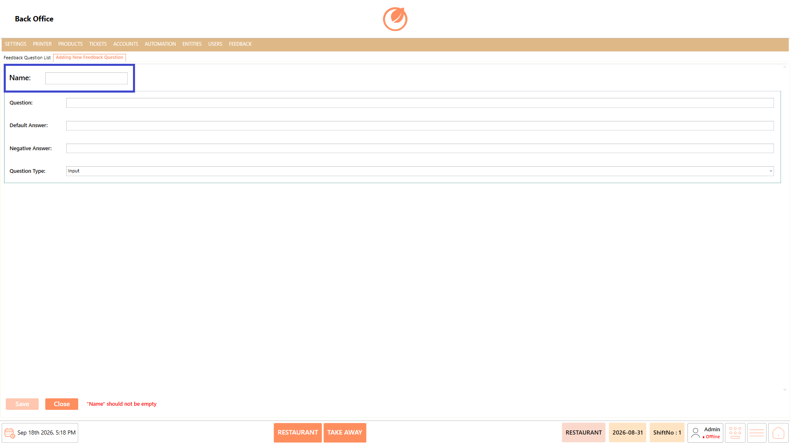
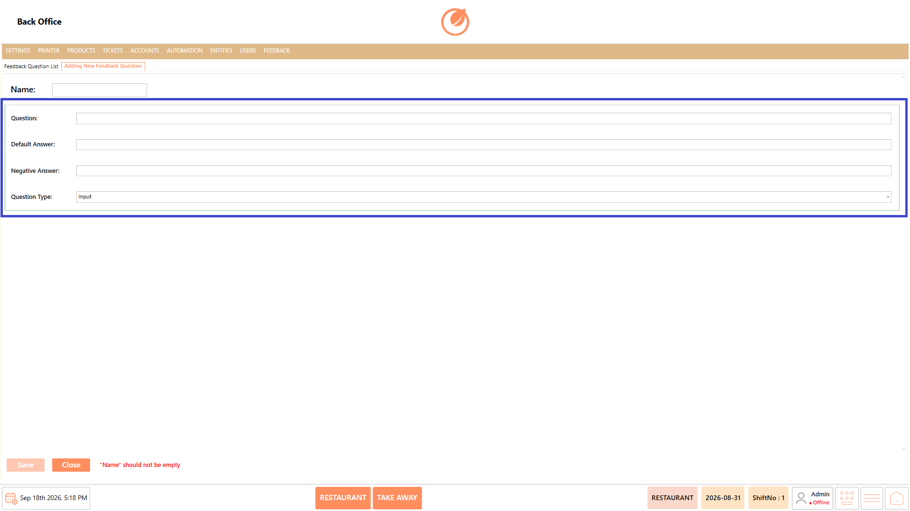
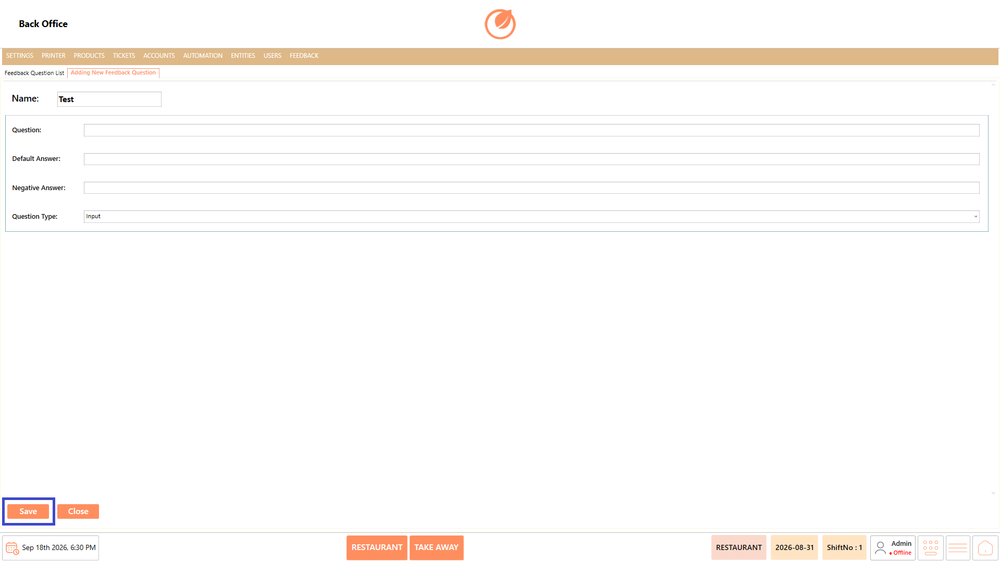

# Feedback Questions

### **Overview** 

The Feedback Question setting allows administrators to create and manage individual questions used for collecting feedback. Each question can be configured with a question name, question text, default answer, negative answer, and question type.

Existing questions can also be edited, deleted, or arranged in the required order.

<figure><figcaption></figcaption></figure>

### **Screen Elements** 

| **Screen Element**       | **Description**                                                 |
| ------------------------ | --------------------------------------------------------------- |
| Feedback Question List   | Displays the list of existing feedback questions.               |
| Search                   | Allows users to search for a specific feedback question.        |
| Add Feedback Question    | Creates a new feedback question.                                |
| Edit Feedback Question   | Opens the selected feedback question for editing.               |
| Delete Feedback Question | Deletes the selected feedback question after confirmation.      |
| Change Sort Order        | Allows users to change the display order of feedback questions. |
| Name                     | Specifies the name of the feedback question.                    |
| Question                 | Specifies the feedback question to be displayed.                |
| Default Answer           | Specifies the default answer for the question.                  |
| Negative Answer          | Specifies the negative answer associated with the question.     |
| Question Type            | Specifies the type of response required for the question.       |
| Save                     | Saves the new or updated feedback question.                     |
| Close                    | Closes the Feedback Question screen.                            |

### **Working** 

#### **Add Feedback Question** 

1. Select "Add Feedback Question".

<figure><figcaption></figcaption></figure>

2. Enter a name in "Name".

<figure><figcaption></figcaption></figure>

3. Enter the required question in "Question".
4. Enter the "Default Answer".
5. Enter the "Negative Answer".
6. Select the required "Question Type".

<figure><figcaption></figcaption></figure>

7. Select "Save" to create the feedback question.

<figure><figcaption></figcaption></figure>

#### **Edit Feedback Question** 

1. Select the required feedback question.
2. Select "Edit Feedback Question".

<figure><figcaption></figcaption></figure>

3. Update the required details.
4. Select "Save" to save the changes.

<figure><figcaption></figcaption></figure>

#### **Delete Feedback Question** 

1. Select the feedback question you want to delete.
2. Select "Delete Feedback Question".

<figure><figcaption></figcaption></figure>

3. Confirm the deletion when prompted.

<figure><figcaption></figcaption></figure>

#### **Change Sort Order** 

1. Select "Change Sort Order".

<figure><figcaption></figcaption></figure>

2. Arrange the feedback questions in the required order.
3. Confirm the updated order.

### **Use Case** 

1. Create questions to collect customer feedback.
2. Define a name for each feedback question.
3. Configure the question text displayed to users.
4. Set a default answer for a question.
5. Define a negative answer where required.
6. Select the appropriate question type.
7. Edit existing questions when feedback requirements change.
8. Arrange questions in the required display order.

### **Notes** 

* A Name is required when creating a feedback question.
* The Question Type determines the type of response configured for the question.
* Select "Save" after adding or editing a question.
* The deletion and sorting procedures are the same as those used for User Role.
