# Printer Job

### **Overview** 

The Printer Job section is used to manage the print jobs configured in the system. You can add new print jobs, edit existing print jobs, delete print jobs, and change the order in which print jobs are displayed.

<figure><figcaption></figcaption></figure>

### **Screen Elements** 

| **Screen Element** | **Description**                                      |
| ------------------ | ---------------------------------------------------- |
| Print Job List     | Displays the print jobs configured in the system.    |
| Search             | Used to search for a specific print job.             |
| Add Print Job      | Used to add a new print job.                         |
| Edit Print Job     | Used to modify the details of an existing print job. |
| Delete Print Job   | Used to remove a selected print job.                 |
| Change Sort Order  | Used to change the display order of the print jobs.  |
| Close              | Closes the Printer Job section.                      |

### **Working** 

#### **Add Print Job** 

1. Select "Add Print Job".

<figure>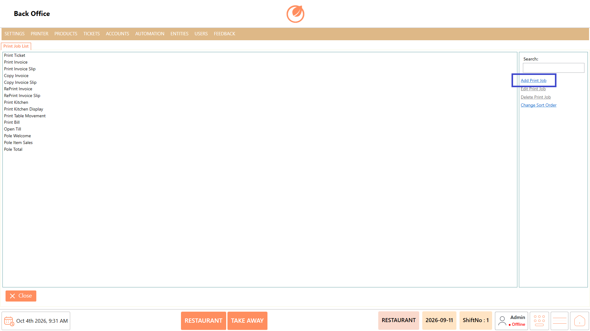<figcaption></figcaption></figure>

2. Enter the "Print Job Name" and "Group".

<figure>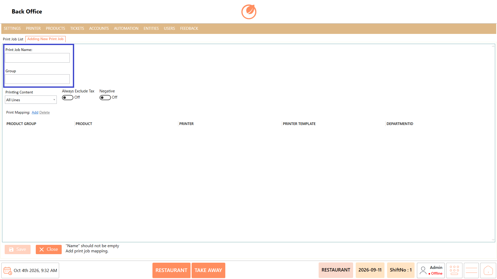<figcaption></figcaption></figure>

3. Select the required option under "Printing Content".

<figure>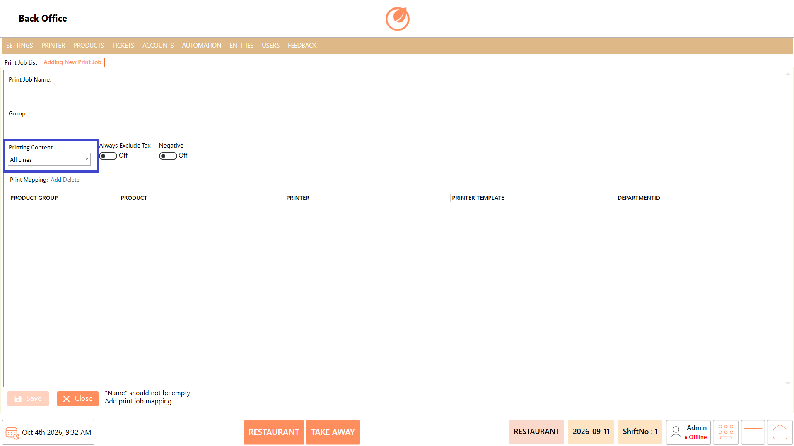<figcaption></figcaption></figure>

4. Configure "Always Exclude Tax" and "Negative" as required.

<figure>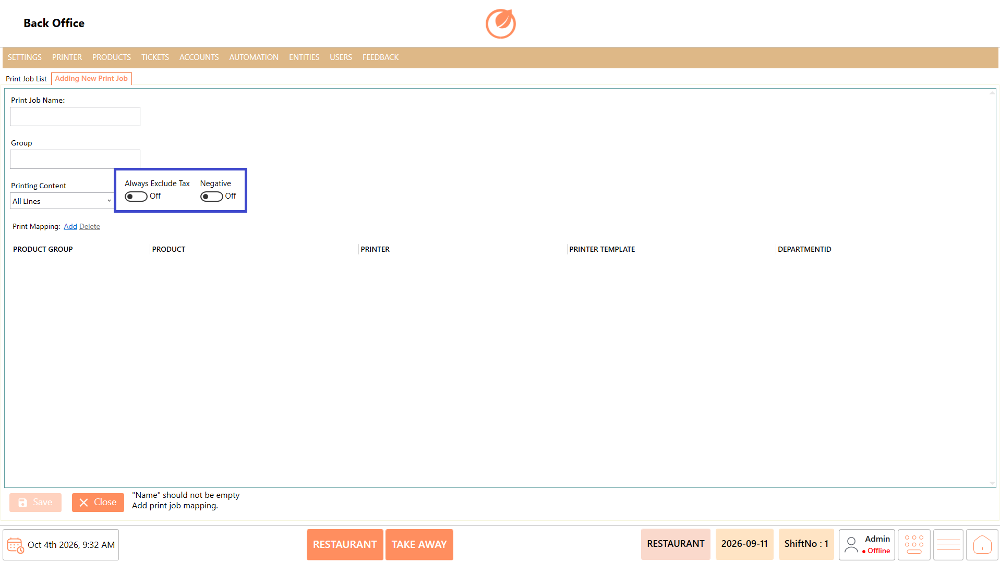<figcaption></figcaption></figure>

5. Under "Print Mapping", select "Add" to add a mapping.

<figure>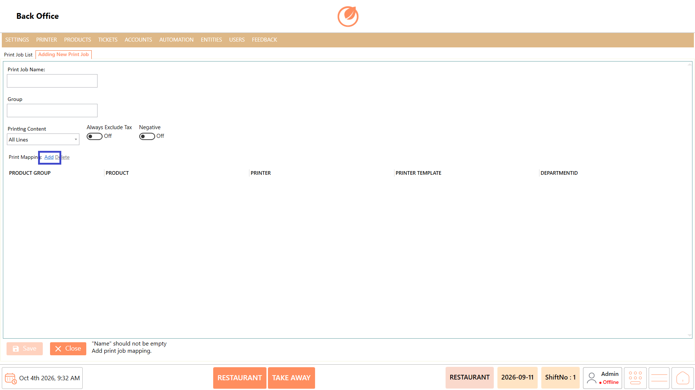<figcaption></figcaption></figure>

6. Select the required "Product Group", "Product", "Printer", "Printer Template", and "DepartmentID".
7. Add additional mappings as required.

<figure>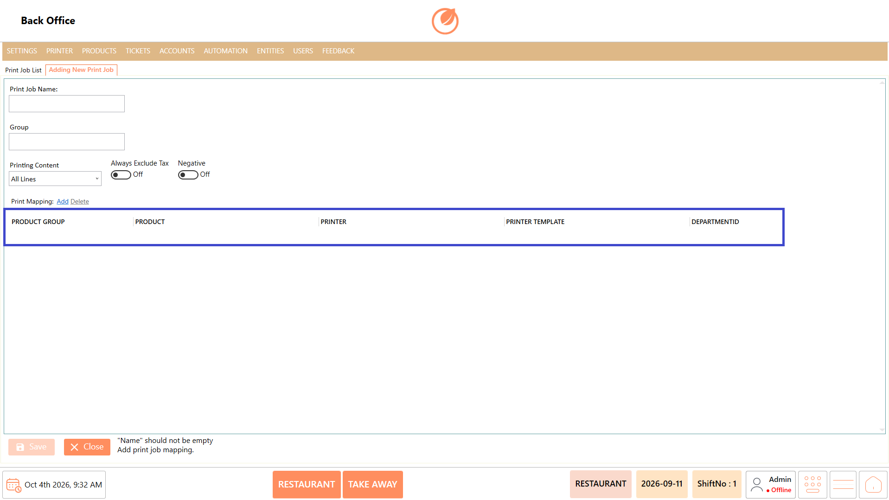<figcaption></figcaption></figure>

8. Select "Save" to add the print job.

<figure>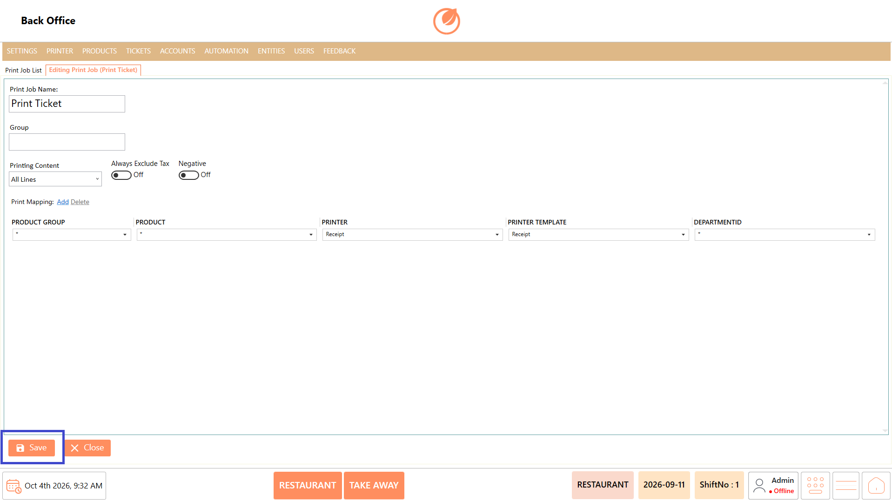<figcaption></figcaption></figure>

#### **Edit Print Job** 

1. Select the required print job from the Print Job List.
2. Select "Edit Print Job".

<figure>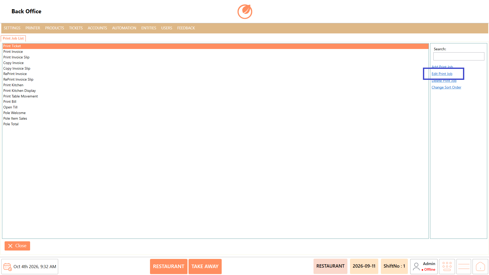<figcaption></figcaption></figure>

3. Update the required print job details.
4. To add a new mapping, select "Add" under "Print Mapping" and select the required items.
5. To remove an existing mapping, select the required mapping and select "Delete".
6. Select "Save" to save the changes.

<figure><figcaption></figcaption></figure>

#### **Delete Print Job** 

1. Select the print job you want to remove.
2. Select "Delete Print Job".

<figure>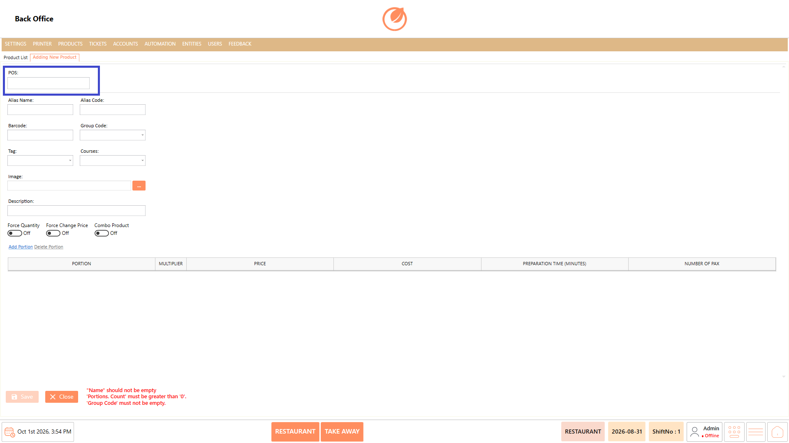<figcaption></figcaption></figure>

3. In the confirmation message, select "Yes" to delete the print job.

<figure>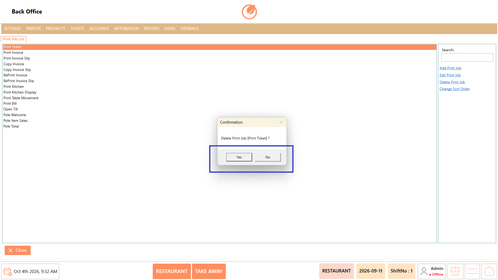<figcaption></figcaption></figure>

#### **Change Sort Order** 

1. Select "Change Sort Order".

<figure>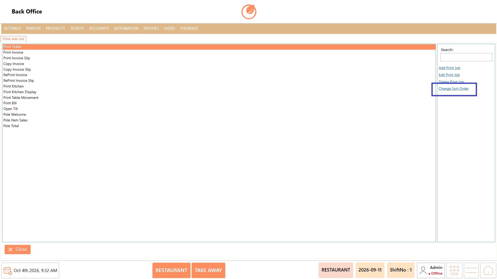<figcaption></figcaption></figure>

2. Adjust the order of the print jobs as required.

### **Use Case** 

* Configure specific print jobs for different types of content that need to be printed from the POS.
* Route different product groups or individual products to the appropriate printer based on the configured requirements.
* Direct kitchen-related products to a kitchen printer while routing other products to their respective printers.
* Configure separate print jobs for different departments when printing requirements vary between operational areas.
* Apply different printer templates when the format or content of printed output needs to vary.
* Control how tax information is handled in printed output using the available printing options.
* Maintain multiple print mappings within a single print job when different products or groups need to be routed to different printers.
* Update or remove print mappings when products, printers, departments, or printing requirements change.

### **Notes** 

* Select the required print job before using "Edit Print Job" or "Delete Print Job".
* Enter the Print Job Name before saving a new print job.
* Configure the print mapping details as required for the print job.
* Verify the selected print job before deleting it.
* Deleting a print job requires confirmation.
* Use "Change Sort Order" to organize the print job list according to your requirement.
