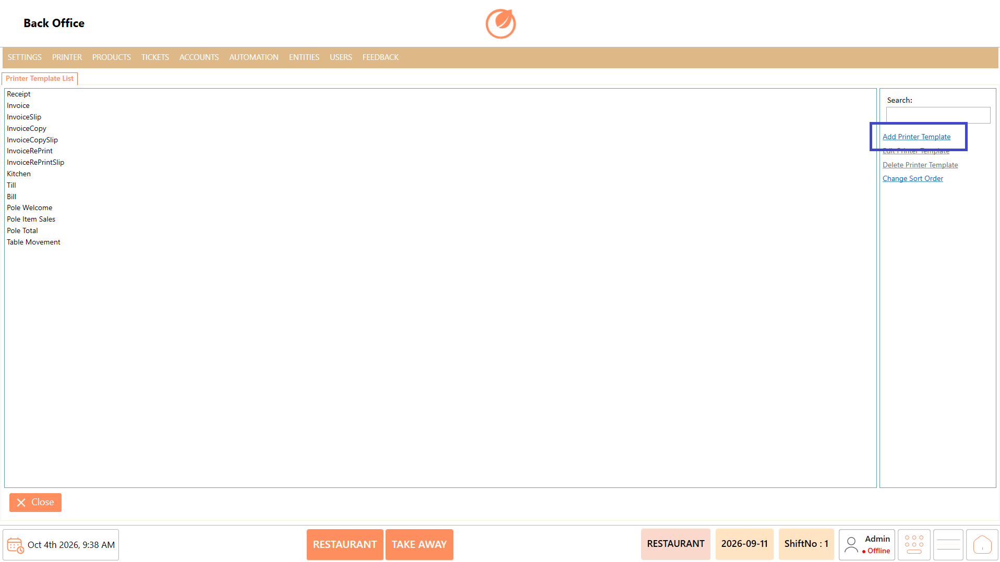
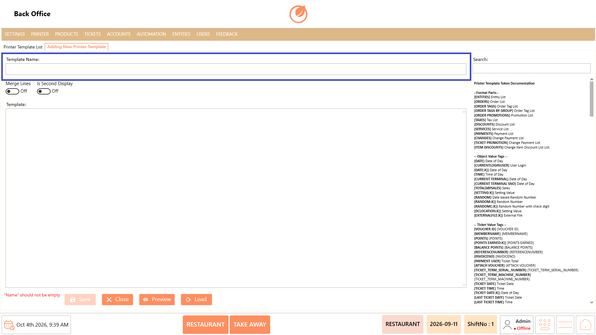
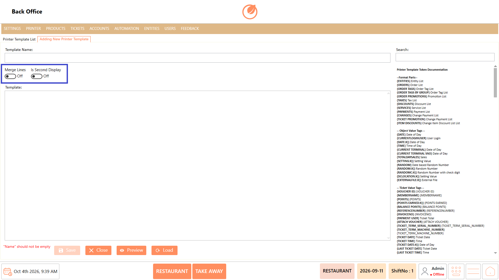
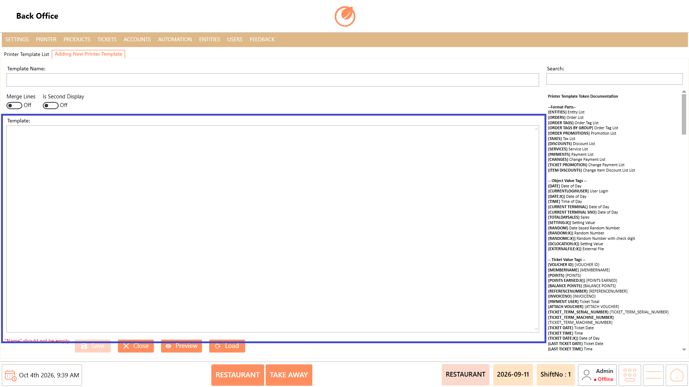
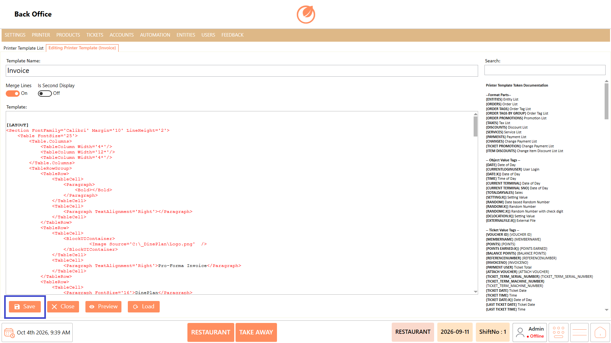
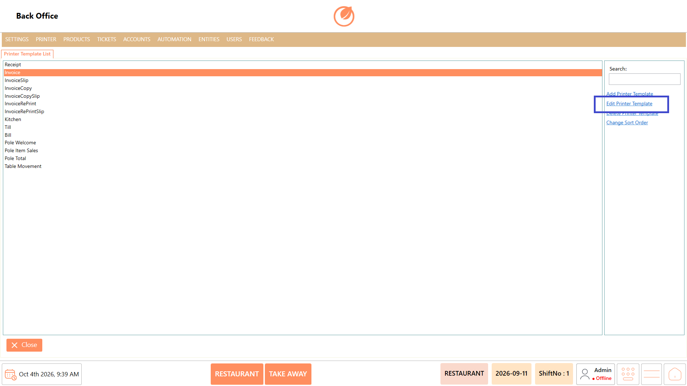
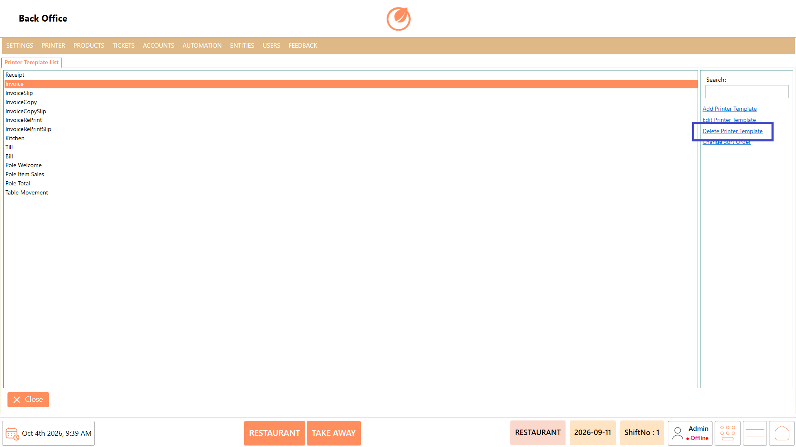
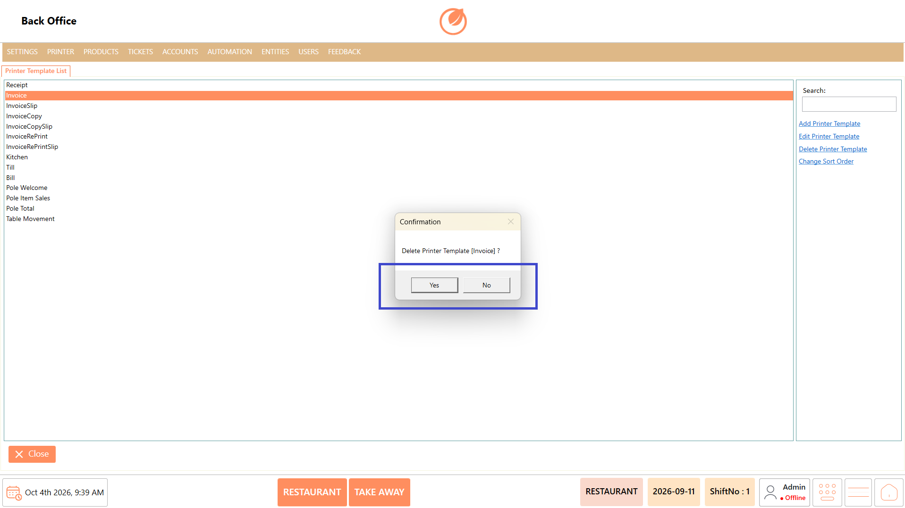
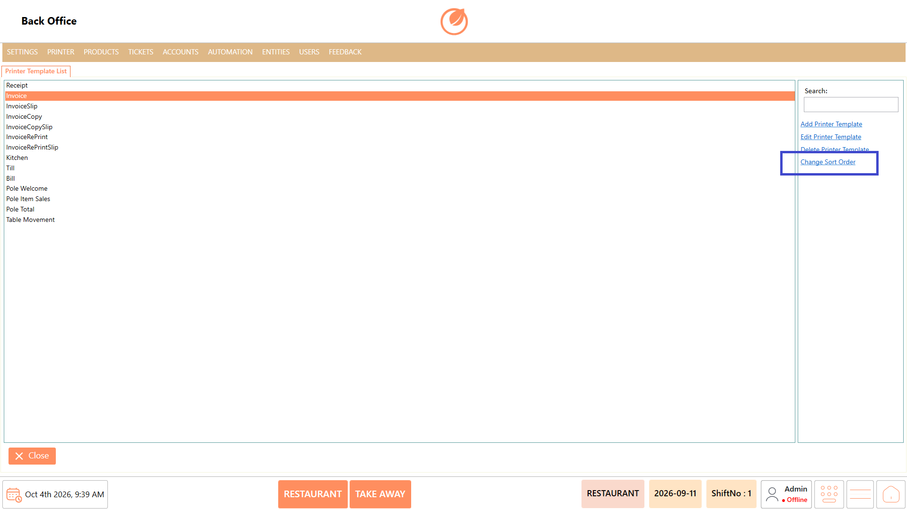

# Printer Template

### **Overview** 

The Printer Template section is used to manage the templates used for printing different types of documents. You can add new printer templates, edit existing templates, delete templates, and change the order in which templates are displayed.

<figure><figcaption></figcaption></figure>

### **Screen Elements** 

| **Screen Element**      | **Description**                                            |
| ----------------------- | ---------------------------------------------------------- |
| Printer Template List   | Displays the printer templates configured in the system.   |
| Search                  | Used to search for a specific printer template.            |
| Add Printer Template    | Used to add a new printer template.                        |
| Edit Printer Template   | Used to modify an existing printer template.               |
| Delete Printer Template | Used to remove a selected printer template.                |
| Change Sort Order       | Used to change the display order of the printer templates. |
| Close                   | Closes the Printer Template section.                       |

### **Working** 

#### **Add Printer Template** 

1. Select "Add Printer Template".

<figure><figcaption></figcaption></figure>

2. Enter the Template Name.

<figure><figcaption></figcaption></figure>

3. Configure the required options such as Merge Lines and Second Display

<figure><figcaption></figcaption></figure>

4. Enter the required template content in the Template field.

<figure><figcaption></figcaption></figure>

5. Select "Save" to add the printer template.

<figure><figcaption></figcaption></figure>

#### **Edit Printer Template** 

1. Select the required printer template from the Printer Template List.
2. Select "Edit Printer Template".

<figure><figcaption></figcaption></figure>

3. Update the required template details.
4. Select "Save" to save the changes.

<figure><figcaption></figcaption></figure>

#### **Delete Printer Template** 

1. Select the printer template you want to remove.
2. Select "Delete Printer Template".

<figure><figcaption></figcaption></figure>

3. In the confirmation message, select "Yes" to delete the printer template.

<figure><figcaption></figcaption></figure>

#### **Change Sort Order** 

1. Select "Change Sort Order".

<figure><figcaption></figcaption></figure>

2. Adjust the order of the printer templates as required.

### **Use Case** 

* Create customized printing formats for different types of documents generated from the POS.
* Configure separate templates when different operational areas require different print layouts or content.
* Design a specific template for kitchen printing to display the information required by kitchen staff.
* Create dedicated templates for bills, receipts, or other documents when their printing formats differ.
* Configure "Merge Lines" when related information needs to be combined in the printed output.
* Configure "Second Display" when the template needs to support the required second-display printing setup.
* Modify existing templates when the printed content or format needs to be updated.
* Maintain multiple printer templates and organize them in a preferred order for easier identification and management.

### **Notes** 

* Enter a Template Name before saving a new printer template.
* Configure the template options according to the required printing format.
* Verify the template content before selecting "Save".
* Select the required printer template before using "Edit Printer Template" or "Delete Printer Template".
* Deleting a printer template requires confirmation.
* Use "Change Sort Order" to organize the printer template list according to your requirement.
