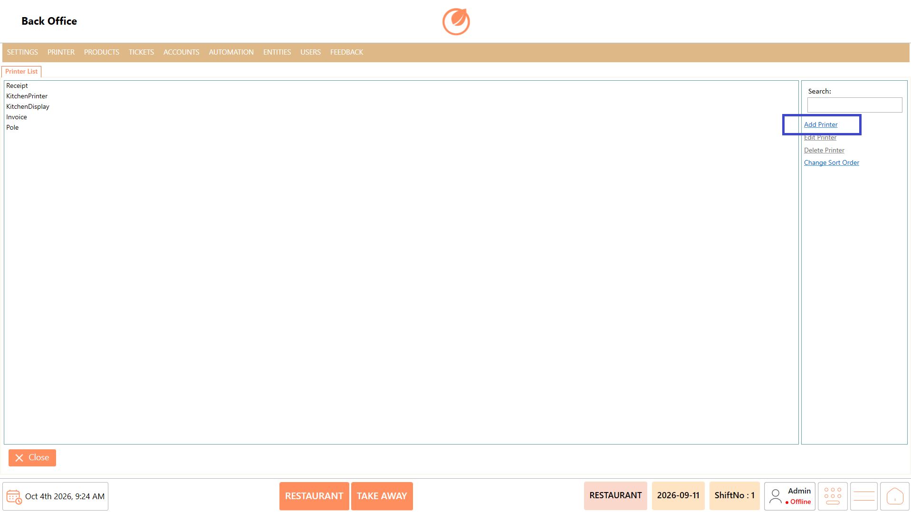
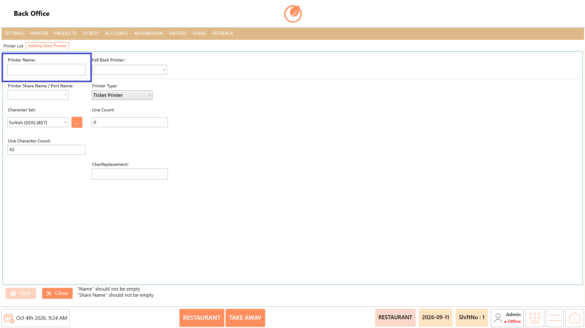
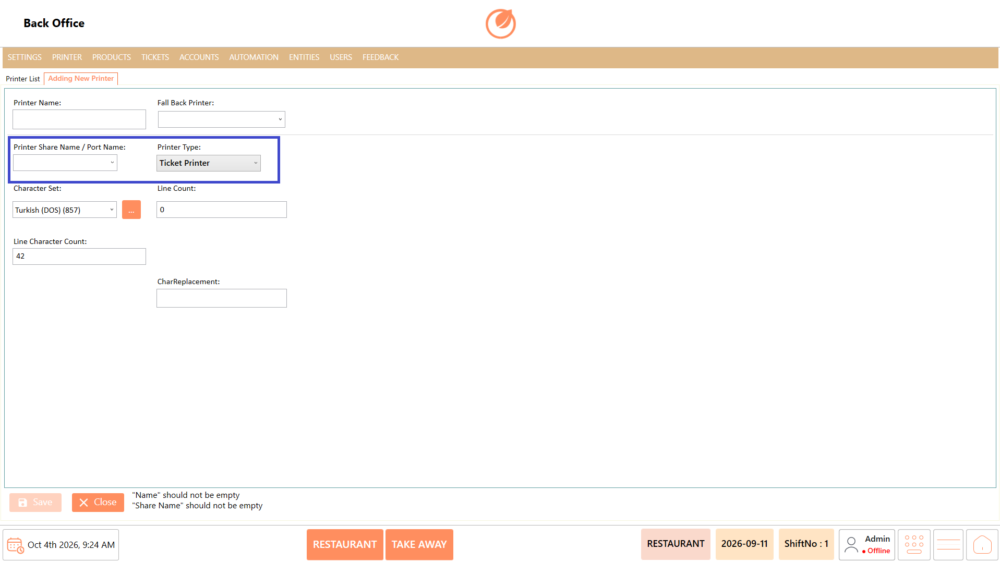
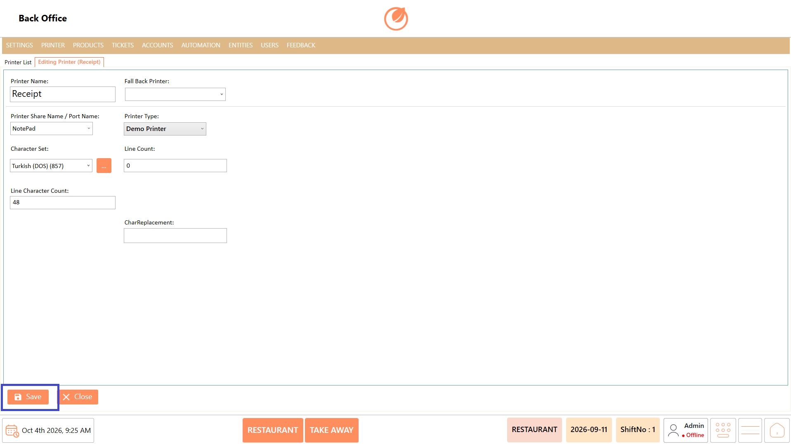
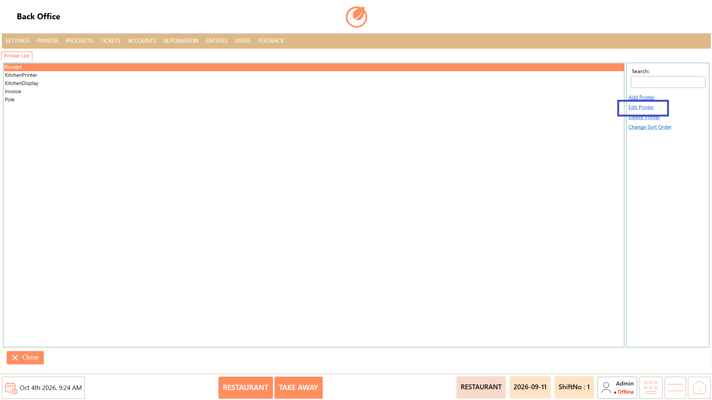
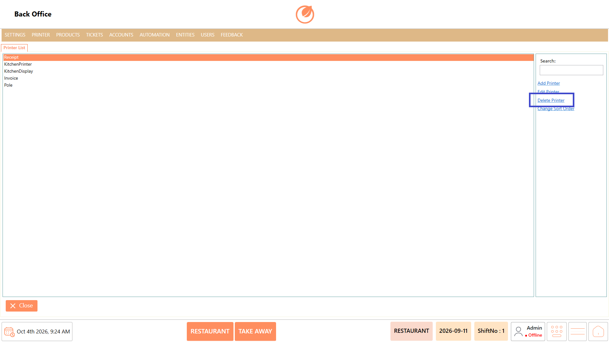
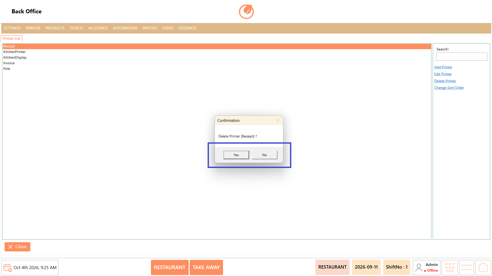
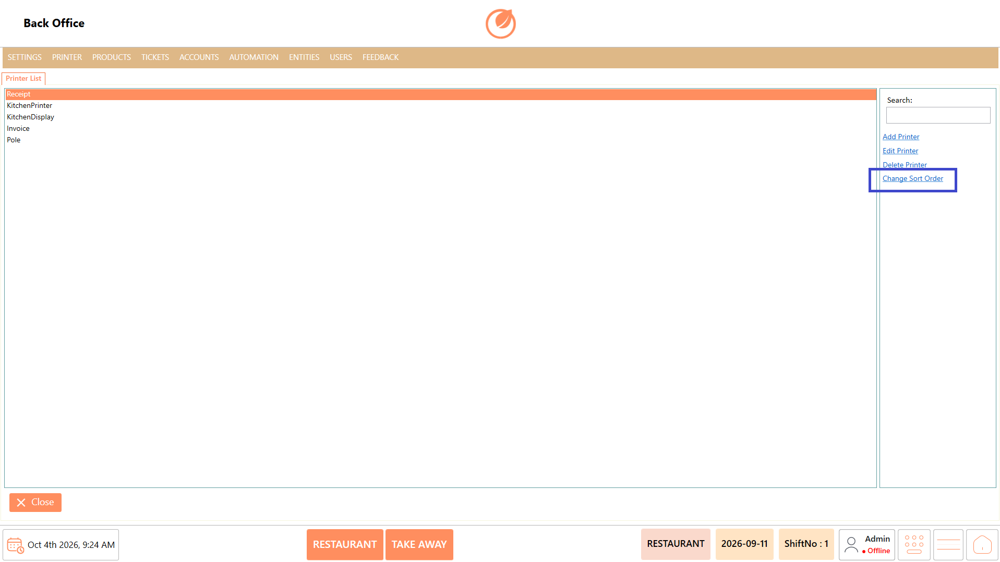

# Printer

## **Overview** 

The Printer section is used to manage the printers configured in the system. You can add new printers, edit existing printer details, delete printers, and change the order in which printers are displayed.

<figure><figcaption></figcaption></figure>

### **Screen Elements** 

| **Screen Element** | **Description**                                    |
| ------------------ | -------------------------------------------------- |
| Printer List       | Displays the printers configured in the system.    |
| Search             | Used to search for a specific printer.             |
| Add Printer        | Used to add a new printer.                         |
| Edit Printer       | Used to modify the details of an existing printer. |
| Delete Printer     | Used to remove a selected printer.                 |
| Change Sort Order  | Used to change the display order of the printers.  |
| Close              | Closes the Printer section.                        |

### **Working** 

#### **Add Printer** 

1. Select "Add Printer".

<figure><figcaption></figcaption></figure>

2. Enter the required "Printer Name".

<figure><figcaption></figcaption></figure>

3. Under "Printer Share Name / Port Name", select the required printer from the dropdown. The default printer connected to the system is displayed automatically.
4. Select the required "Printer Type" and configure the available printer settings.

<figure><figcaption></figcaption></figure>

5. Select "Save" to add the printer.

<figure><figcaption></figcaption></figure>

#### **Edit Printer** 

1. Select the required printer from the Printer List.
2. Select "Edit Printer".

<figure><figcaption></figcaption></figure>

3. Update the required printer details.
4. Select "Save" to save the changes.

<figure><figcaption></figcaption></figure>

#### **Delete Printer** 

1. Select the printer you want to remove.
2. Select "Delete Printer".

<figure><figcaption></figcaption></figure>

3. In the confirmation message, select "Yes" to delete the printer.

<figure><figcaption></figcaption></figure>

#### **Change Sort Order** 

1. Select "Change Sort Order".

<figure><figcaption></figcaption></figure>

2. Adjust the order of the printers as required.
3. Save the updated order.

### **Use Case** 

* Configure printers used for printing orders, bills, receipts, or other required POS documents.
* Add a new printer when a restaurant installs an additional printer for a specific operational requirement.
* Configure different printers when separate areas such as the kitchen, bar, billing counter, or service area require dedicated printing.
* Update printer settings when an existing printer is replaced, reconfigured, or connected through a different port.
* Maintain separate printer configurations when different printer types are required for different printing purposes.
* Remove printers that are no longer connected, operational, or required in the POS setup.
* Organize multiple configured printers in a preferred order for easier identification and management.
* Maintain an up-to-date printer configuration so the POS can use the appropriate printer for the required printing operations.

### **Notes** 

* Select the required printer before using "Edit Printer" or "Delete Printer".
* Verify the printer details before selecting "Save".
* Deleting a printer requires confirmation.
* Use "Change Sort Order" to organize the printer list according to your requirement.
