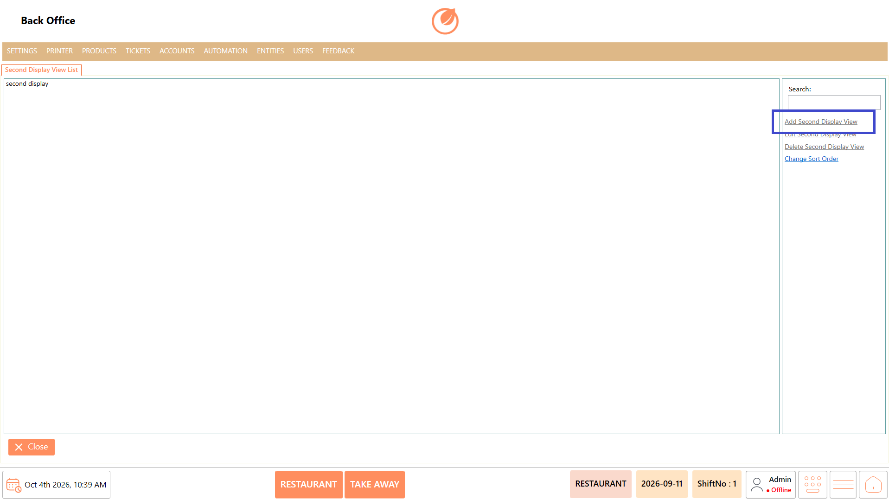
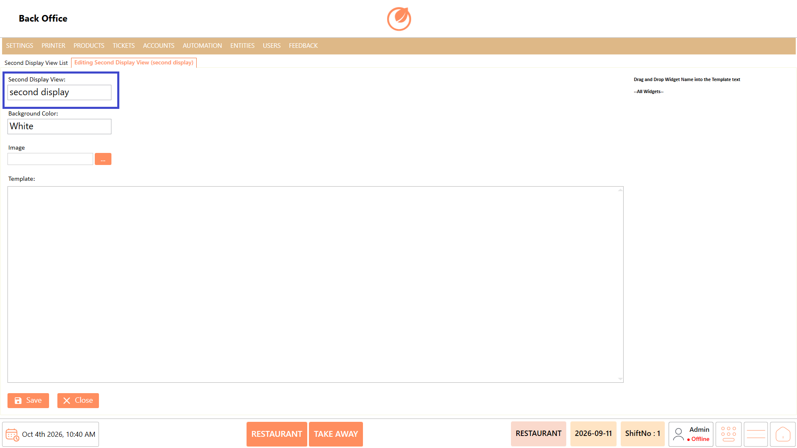
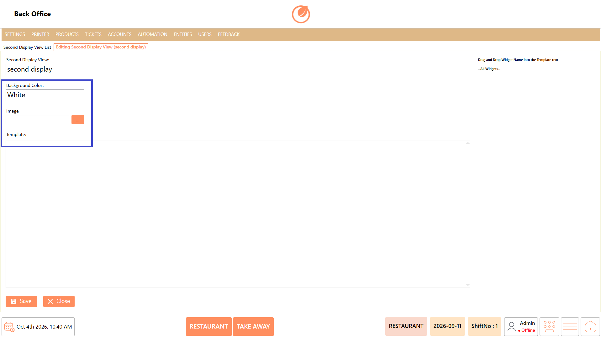
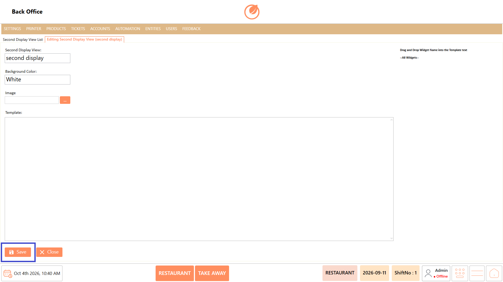
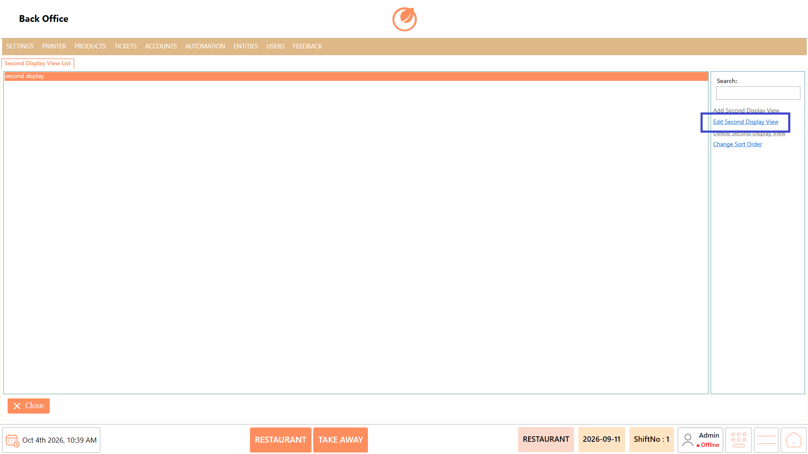
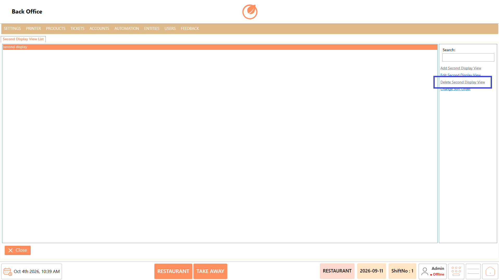
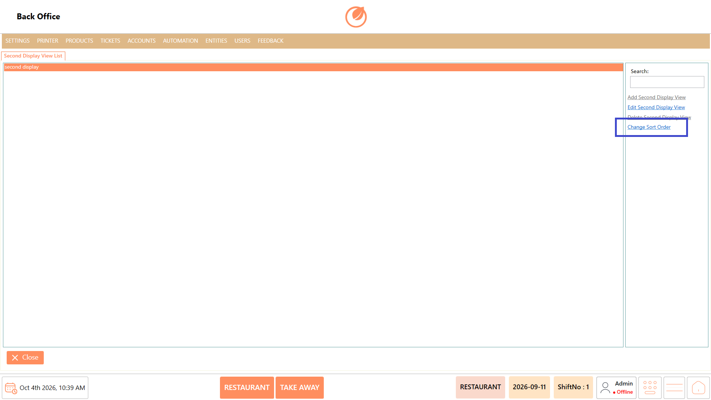

# Second Display

### **Overview** 

The Second Display setting allows you to configure the customer-facing display connected to the POS. You can configure the display name, background color, image, and template.

Only one Second Display system can be added in DinePlan.

<figure><figcaption></figcaption></figure>

### **Screen Elements** 

| **Screen Element**         | **Description**                                                   |
| -------------------------- | ----------------------------------------------------------------- |
| Second Display View List   | Displays the configured second display view.                      |
| Search                     | Allows you to search for a second display view.                   |
| Add Second Display View    | Allows you to add a second display view.                          |
| Edit Second Display View   | Allows you to edit the selected second display view.              |
| Delete Second Display View | Allows you to delete the selected second display view.            |
| Change Sort Order          | Allows you to change the order of the display views.              |
| Second Display View        | Specifies the name of the second display view.                    |
| Background Color           | Specifies the background color of the second display.             |
| Image                      | Allows you to select an image for the second display.             |
| Template                   | Provides the area to configure the content of the second display. |
| Save                       | Saves the second display configuration.                           |
| Close                      | Closes the current screen.                                        |

### **Working** 

1. Select "Add Second Display View" to add a second display view.

<figure><figcaption></figcaption></figure>

2. Enter the required "Second Display View" name.

<figure><figcaption></figcaption></figure>

3. Configure the "Background Color", "Image", and "Template" as required.

<figure><figcaption></figcaption></figure>

4. Select "Save" to save the configuration.

<figure><figcaption></figcaption></figure>

5. To modify an existing display, select the display and select "Edit Second Display View".

<figure><figcaption></figcaption></figure>

6. To remove a display, select the display and select "Delete Second Display View".

**Note:** The second display cannot be deleted from this screen. To remove the second display, open the XML code and locate the second display entry in the connection string. Change its value from positive to negative to remove the second display.

<figure><figcaption></figcaption></figure>

7. Select "Change Sort Order" to change the order of the display views.

<figure><figcaption></figcaption></figure>

### **Use Case** 

* Display order details to customers while the cashier processes the order at the POS.
* Provide customers with a clear view of the items being added to their order before payment.
* Configure a customer-facing display at the billing counter to improve order transparency.
* Customize the background color and image to match the restaurant's preferred display appearance.
* Apply a suitable template to control how order information is presented on the customer-facing screen.
* Configure the display layout based on the requirements of different restaurant counters or service areas.
* Update the display content or appearance when the restaurant changes its customer-facing presentation.
* Maintain a consistent customer-facing display experience across POS transactions.

### **Notes** 

* Only one Second Display system can be added in DinePlan.
* The Second Display cannot be deleted directly from DinePlan.
* To delete the Second Display, first remove it from the Program Files.
* After removing it from the Program Files, the Second Display can be deleted from DinePlan.
* Ensure that you select "Save" after making any changes.
