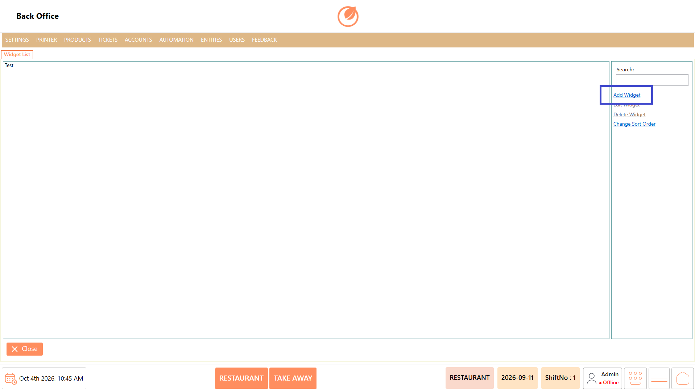
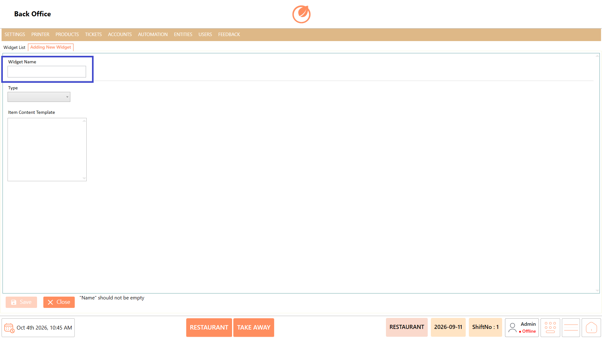
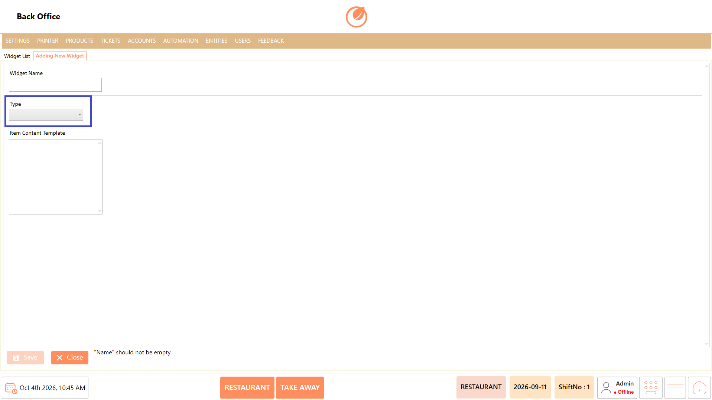
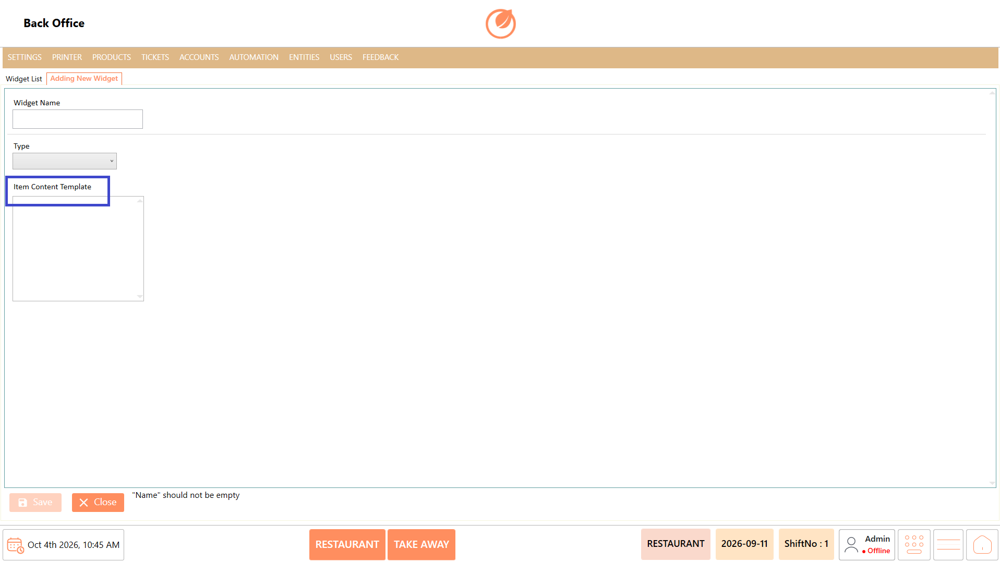
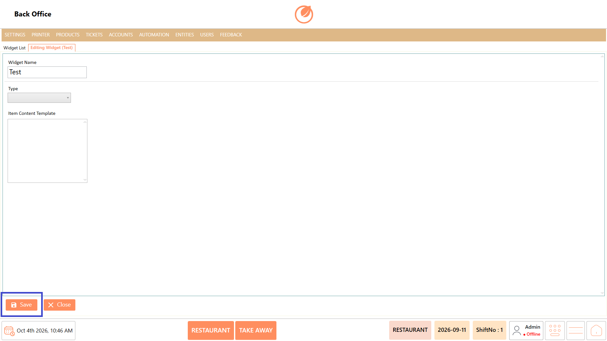
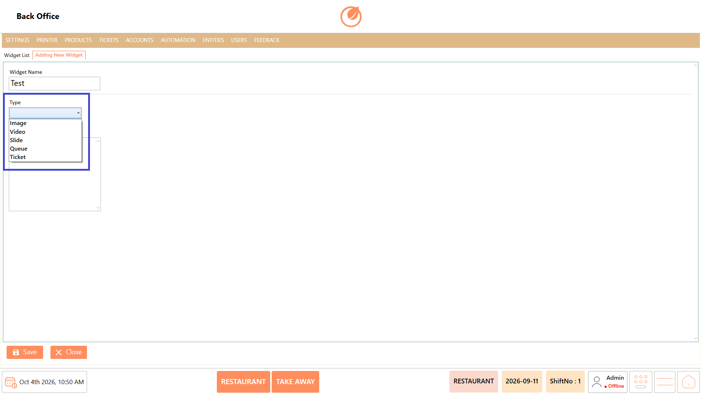
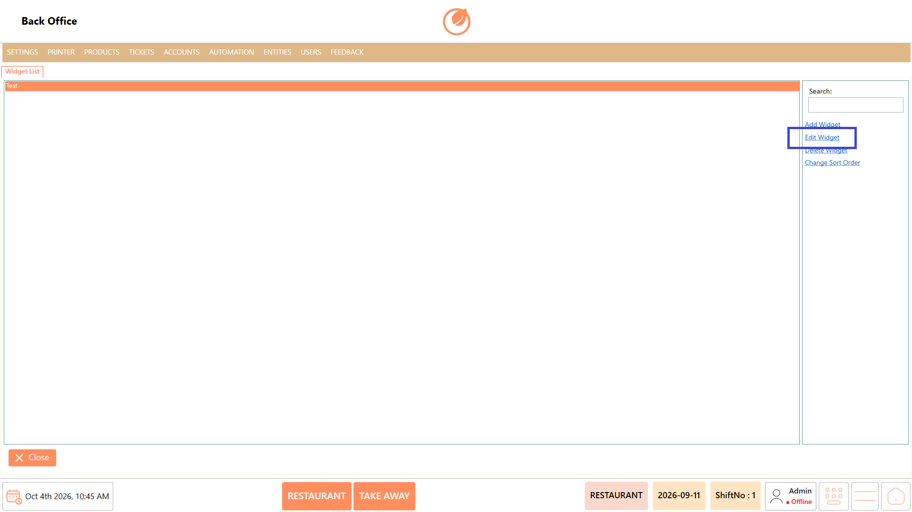
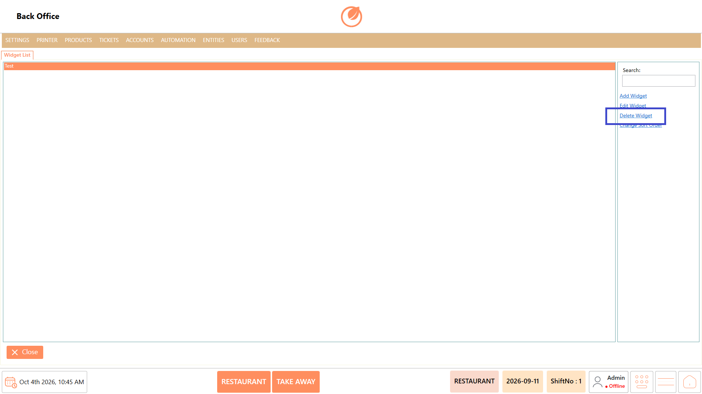
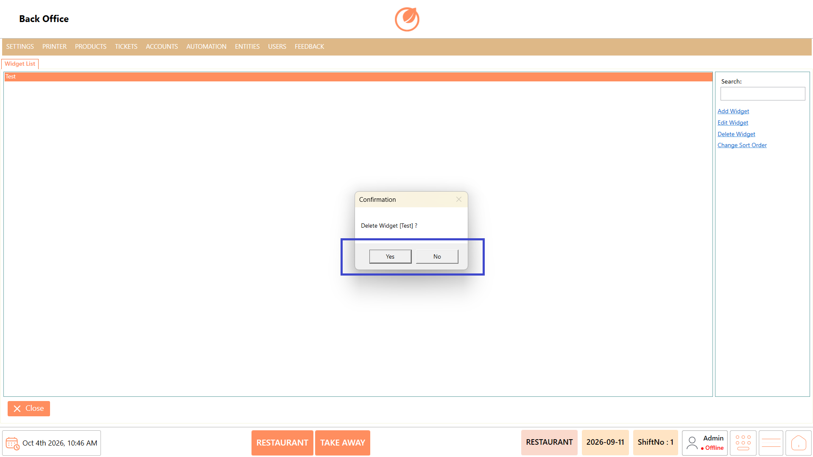
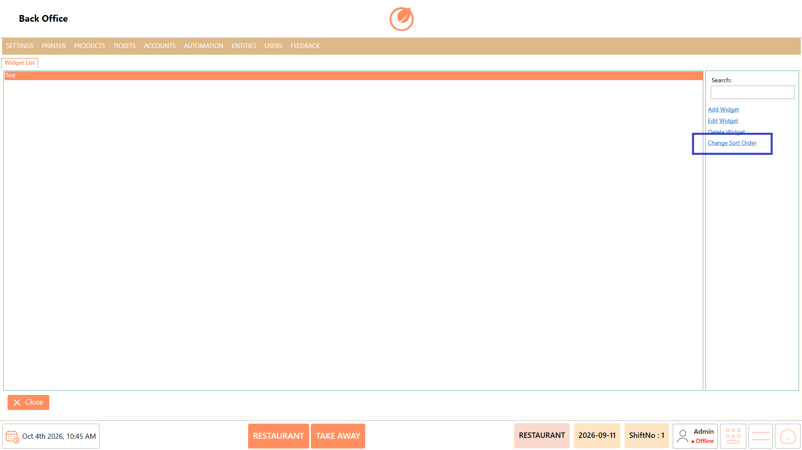

# Widget

### **Overview** 

The Widget setting allows you to create and manage widgets used in the system. Widgets can be configured with different types, and the available options may vary depending on the selected type.

You can add, edit, delete, and change the display order of widgets.

<figure><figcaption></figcaption></figure>

### **Screen Elements** 

| **Screen Element**    | **Description**                                                                                            |
| --------------------- | ---------------------------------------------------------------------------------------------------------- |
| Widget List           | Displays the widgets configured in the system.                                                             |
| Search                | Allows you to search for a specific widget.                                                                |
| Add Widget            | Opens the screen to create a new widget.                                                                   |
| Edit Widget           | Allows you to modify the selected widget.                                                                  |
| Delete Widget         | Allows you to remove the selected widget after confirmation.                                               |
| Change Sort Order     | Allows you to change the order in which widgets are displayed.                                             |
| Widget Name           | Specifies the name of the widget.                                                                          |
| Type                  | Allows you to select the widget type. The available configuration options vary based on the selected type. |
| Item Content Template | Provides the area to enter the content template for the widget.                                            |
| Save                  | Saves the widget configuration.                                                                            |
| Close                 | Closes the current screen.                                                                                 |

### **Working** 

#### **Add a Widget** 

1. Select “Add Widget."

<figure><figcaption></figcaption></figure>

2. Enter the widget name in Widget Name.

<figure><figcaption></figcaption></figure>

3. Select the required “Type."

<figure><figcaption></figcaption></figure>

4. Configure the fields available for the selected type.
5. Enter the required content in Item Content Template, where applicable.

<figure><figcaption></figcaption></figure>

6. Select “Save" to create the widget.

<figure><figcaption></figcaption></figure>

#### **Widget Types** 

The Type field provides different widget types, including:

* Image
* Video
* Slide
* Queue
* Ticket

<figure><figcaption></figcaption></figure>

The configuration options available on the screen may differ based on the selected widget type.

#### **Edit a Widget** 

1. Select the widget you want to modify from the Widget List.
2. Select “Edit Widget."

<figure><figcaption></figcaption></figure>

3. Modify the required widget details.
4. Select “Save" to apply the changes.

<figure><figcaption></figcaption></figure>

#### **Delete a Widget** 

1. Select the widget you want to remove.
2. Select “Delete Widget."

<figure><figcaption></figcaption></figure>

3. A confirmation message is displayed.
4. Select “Yes" to delete the widget, or select “No" to cancel the action.

<figure><figcaption></figcaption></figure>

#### **Change Sort Order** 

1. Select the widget from the list.
2. Select “Change Sort Order."

<figure><figcaption></figcaption></figure>

3. Adjust the widget's position as required.

### **Use Case** 

* Display promotional images or visual content on screens used within the restaurant.
* Present videos to customers for promotions, announcements, or other relevant information.
* Create slideshows to display multiple images or messages in sequence.
* Display queue information to help customers track their position or waiting status.
* Present ticket-related information on screens where customers or staff need to view ticket details.
* Configure different types of content based on the purpose of the display or the information that needs to be presented.
* Update widget content when promotional materials, displayed information, or operational requirements change.
* Organize multiple widgets in a preferred order to control how the configured content is presented.

### **Notes** 

* The available configuration fields depend on the selected Type.
* A Widget Name is required to save a widget.
* Select Save after adding or editing a widget to apply the changes.
* Select Yes in the confirmation dialog to permanently delete a selected widget.
* Select No to cancel a deletion.
* Widgets can be searched using the Search field.
* You can add, edit, delete, and change the sort order of widgets.
* Ensure that the appropriate widget Type is selected before configuring its additional options.

 
