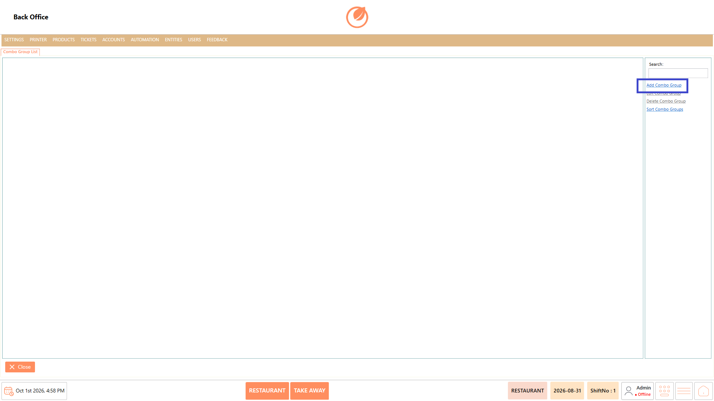
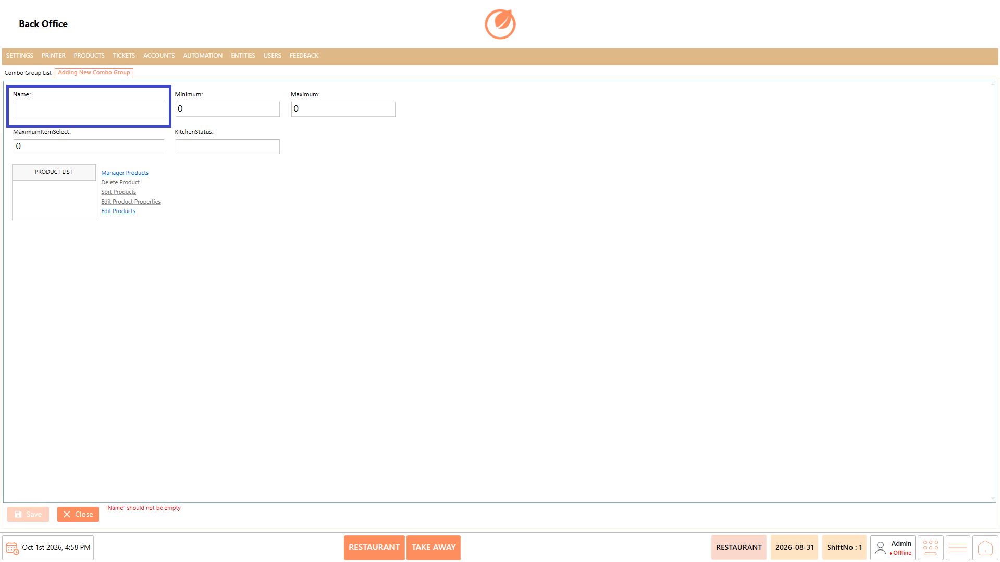
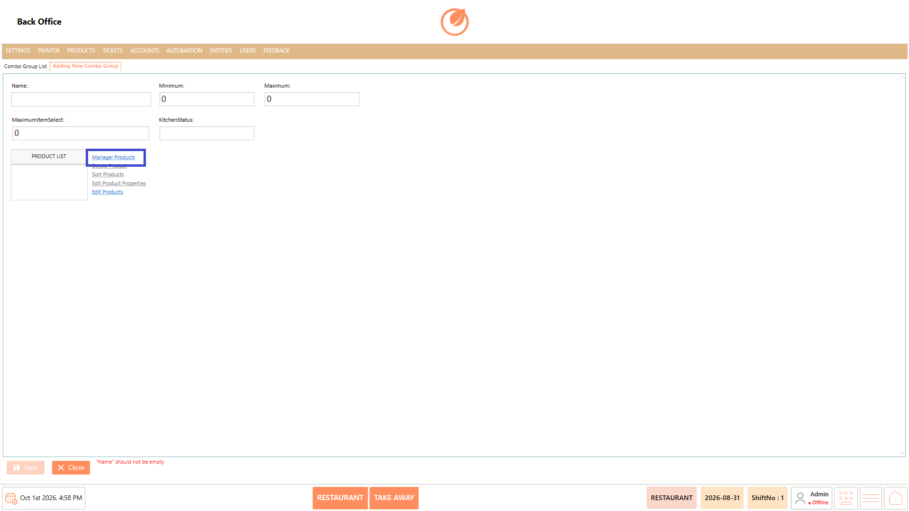
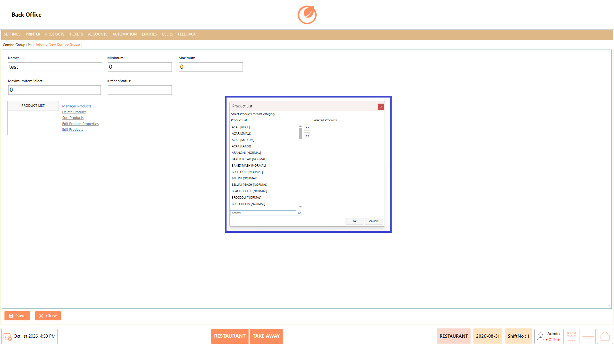
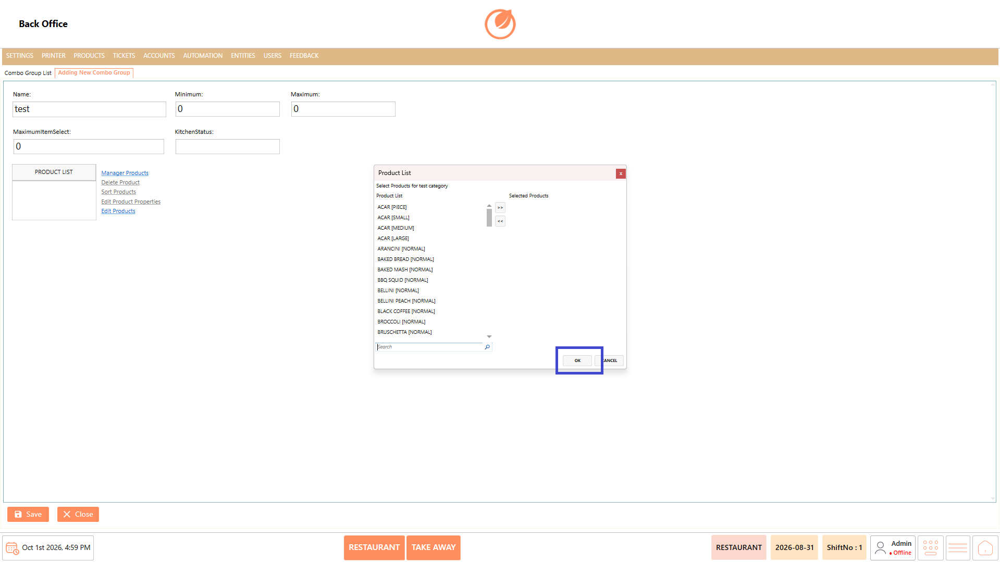
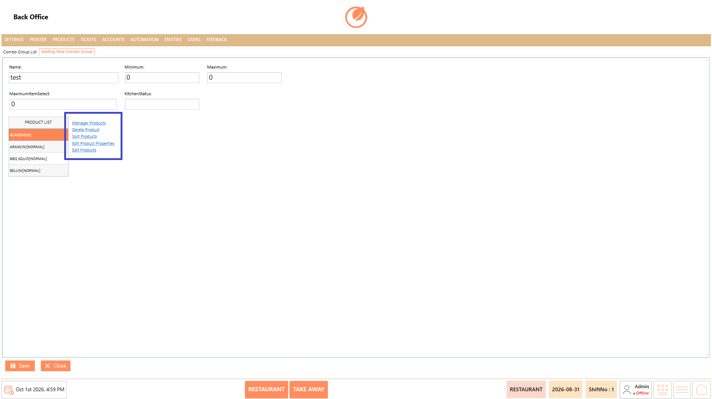
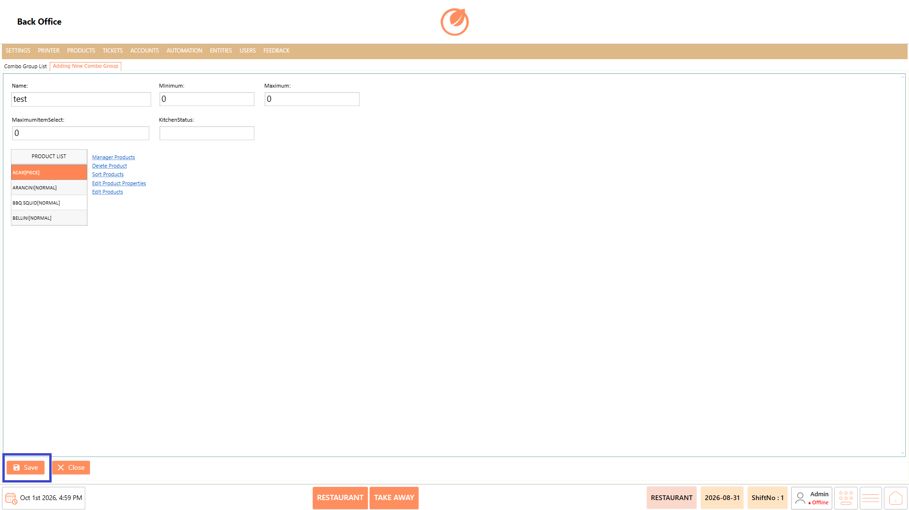
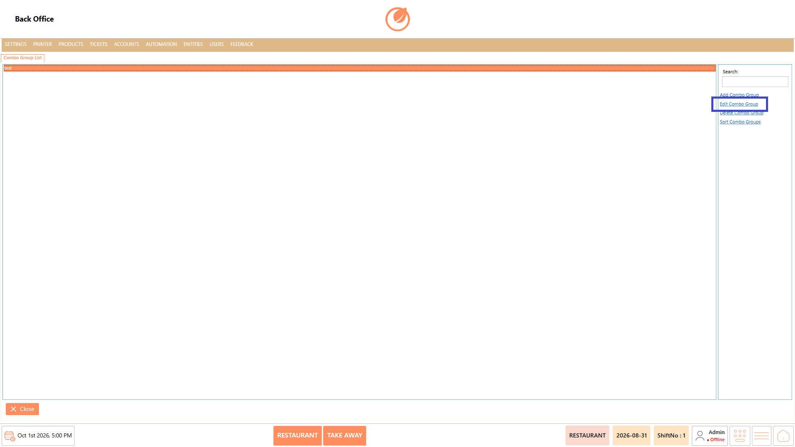
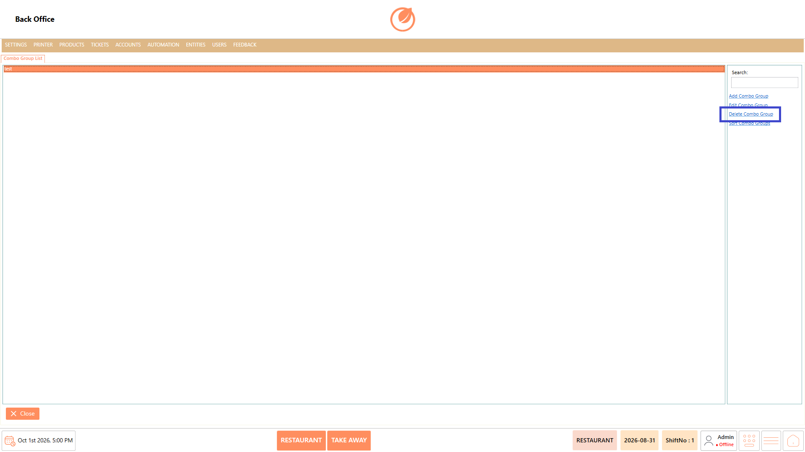
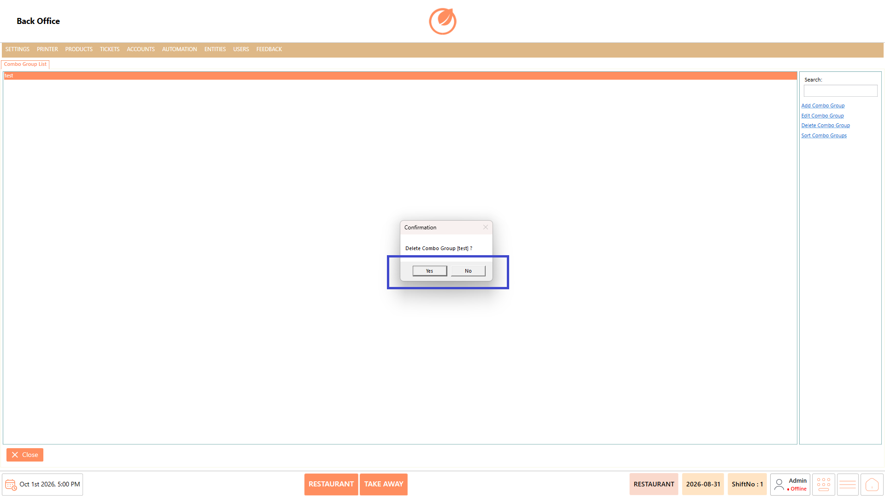

# Combo Group

### **Overview** 

The Combo Group setting allows you to create and manage groups of products that can be included in a combo. You can add products to a combo group and define the minimum and maximum number of items that can be selected.

You can add, edit, delete, and sort combo groups.

<figure><figcaption></figcaption></figure>

### **Screen Elements** 

| **Screen Element**      | **Description**                                                               |
| ----------------------- | ----------------------------------------------------------------------------- |
| Search                  | Searches for a specific combo group.                                          |
| Add Combo Group         | Creates a new combo group.                                                    |
| Edit Combo Group        | Modifies an existing combo group.                                             |
| Delete Combo Group      | Deletes the selected combo group.                                             |
| Sort Combo Groups       | Changes the display order of combo groups.                                    |
| Name                    | Specifies the name of the combo group.                                        |
| Minimum                 | Specifies the minimum number of products that can be selected from the group. |
| Maximum                 | Specifies the maximum number of products that can be selected from the group. |
| Maximum Item Select     | Specifies the maximum number of items that can be selected.                   |
| Kitchen Status          | Specifies the kitchen status for the combo group.                             |
| PRODUCT LIST            | Displays the products added to the combo group.                               |
| Manager Products        | Opens the product selection window to add products to the combo group.        |
| Delete Product          | Removes the selected product from the combo group.                            |
| Sort Products           | Changes the order of products in the combo group.                             |
| Edit Product Properties | Opens the properties of the selected product.                                 |
| Edit Products           | Allows the products in the combo group to be edited.                          |
| Save                    | Saves the combo group details.                                                |
| Close                   | Closes the current screen.                                                    |

### **Working** 

#### **Add Combo Group** 

1. Select "Add Combo Group".

<figure><figcaption></figcaption></figure>

2. Enter a name in the "Name" field.

<figure><figcaption></figcaption></figure>

3. Enter the required values in "Minimum", "Maximum", and "Maximum Item Select".
4. Select "Manager Products" to open the Product List window.

<figure><figcaption></figcaption></figure>

5. Select the required products from the Product List.
6. Use the ">>" button to move the selected products to Selected Products.

<figure><figcaption></figcaption></figure>

7. Select "OK" to add the products to the combo group.

<figure><figcaption></figcaption></figure>

8. Use "Edit Product Properties" or "Edit Products" if required.

<figure><figcaption></figcaption></figure>

9. Select "Save" to save the combo group.

<figure><figcaption></figcaption></figure>

#### **Edit Combo Group** 

1. Select the required combo group from the list.
2. Select "Edit Combo Group".

<figure><figcaption></figcaption></figure>

3. Modify the required combo group details or products.
4. Select "Save" to save the changes.

<figure><figcaption></figcaption></figure>

#### **Delete Combo Group** 

1. Select the combo group you want to remove.
2. Select "Delete Combo Group".

<figure><figcaption></figcaption></figure>

3. Complete the deletion action as prompted.

<figure><figcaption></figcaption></figure>

#### **Sort Combo Groups** 

1. Select "Sort Combo Groups".

<figure><figcaption></figcaption></figure>

2. In the Sort Combo Groups window, drag the items to change their order.
3. Select "OK" to apply the new order.

### **Use Case** 

* Create separate product groups within a combo, such as beverages, side dishes, desserts, or main-course items.&#x20;
* Define how many products a customer can select from a particular group when ordering a combo.&#x20;
* Set minimum selections when a combo requires customers to choose at least a specific number of items.&#x20;
* Set maximum selections when the number of items that can be selected from a group needs to be limited.&#x20;
* Offer customers multiple product choices while keeping the combo selection within the configured limits.&#x20;
* Organize products that are commonly offered together as part of different combo options.&#x20;
* Modify the products or selection limits when the available items or combo structure changes.&#x20;
* Arrange combo groups and their products in a preferred order to make combo configuration and selection easier.&#x20;

### **Notes** 

* A Name is required when creating a combo group.
* Products must be added to the PRODUCT LIST for the combo group.
* The Minimum and Maximum values define the selection limits for the combo group.
* Products can be reordered using "Sort Products".
* Combo groups can be reordered using "Sort Combo Groups".
* Use "Edit Product Properties" to modify the properties of a selected product.
* Use "Delete Product" to remove a product from the combo group.
* Changes made to a combo group must be saved using "Save".
