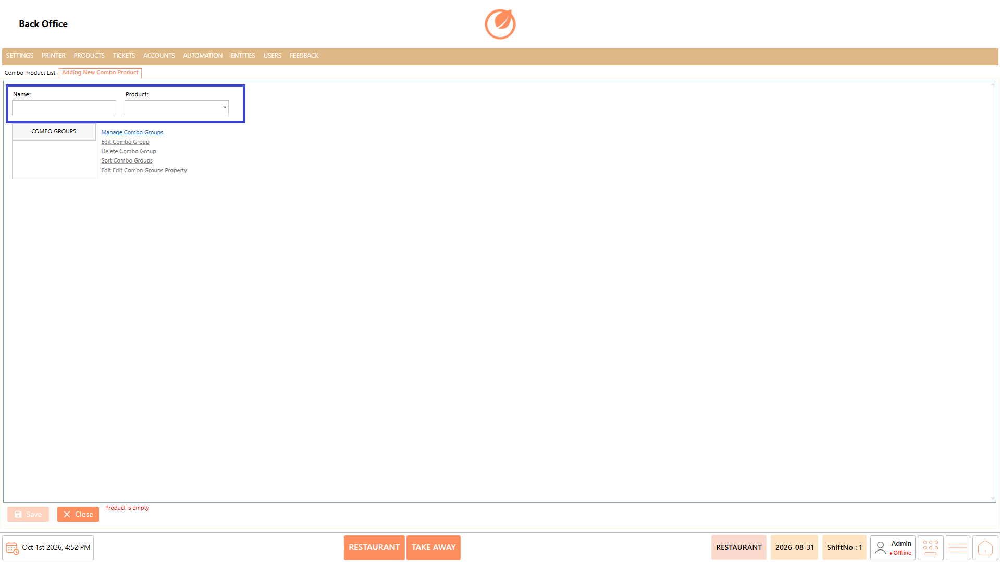
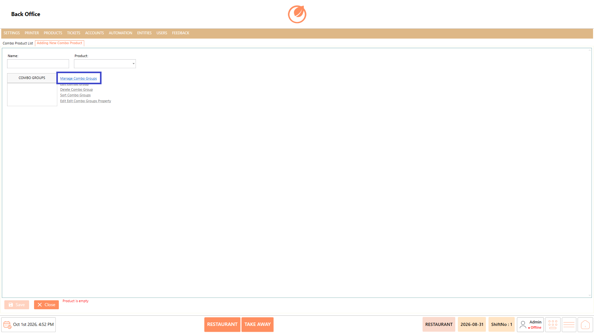
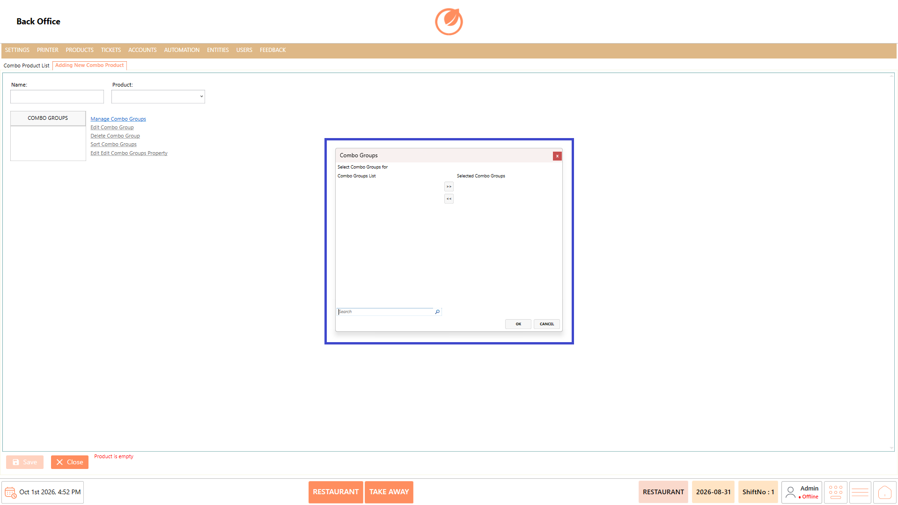
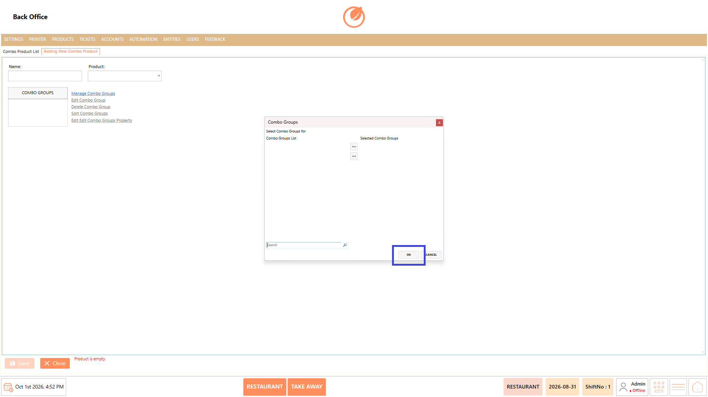
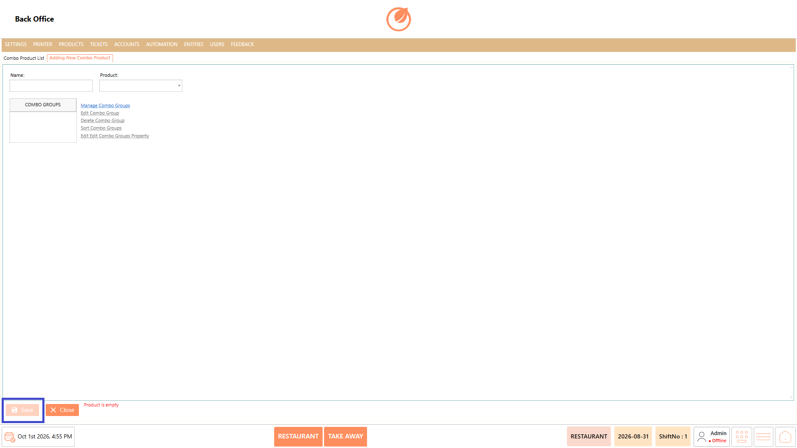
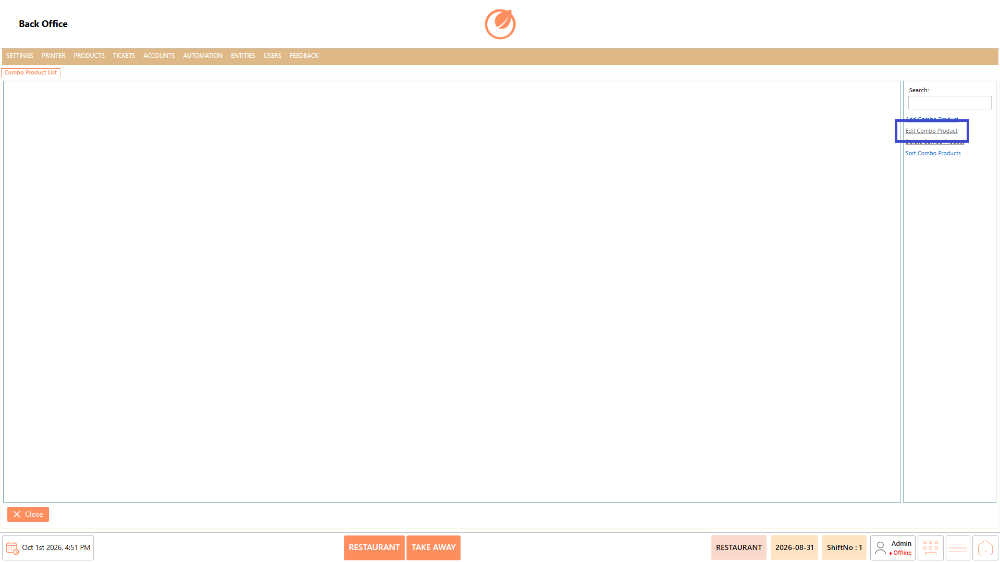
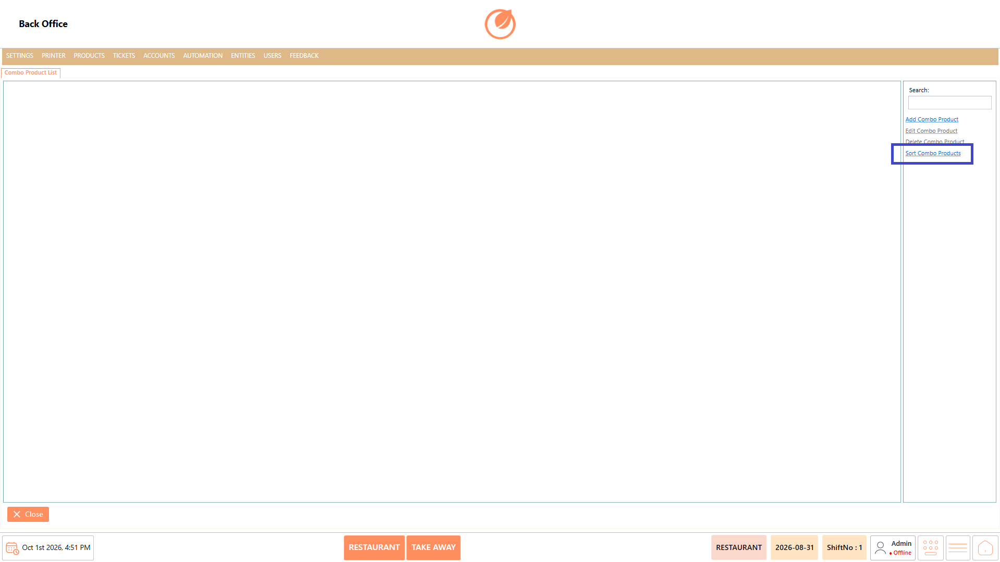

# Combo Product

### **Overview** 

The Combo Product setting is used to create and manage combo products. A combo product can be linked to an existing Product and configured with one or more Combo Groups.

You can add, edit, delete, and sort combo products.

<figure><figcaption></figcaption></figure>

### **Screen Elements** 

#### **Combo Product List** 

| **Screen Element**   | **Description**                                       |
| -------------------- | ----------------------------------------------------- |
| Combo Product List   | Displays the combo products configured in the system. |
| Search               | Allows you to search for a specific combo product.    |
| Add Combo Product    | Opens the screen to create a new combo product.       |
| Edit Combo Product   | Allows you to modify an existing combo product.       |
| Delete Combo Product | Allows you to delete an existing combo product.       |
| Sort Combo Products  | Allows you to change the order of combo products.     |
| Close                | Closes the Combo Product screen.                      |

#### **Add/Edit Combo Product** 

| **Screen Element**         | **Description**                                              |
| -------------------------- | ------------------------------------------------------------ |
| Name                       | Enter the name of the combo product.                         |
| Product                    | Select the product to associate with the combo.              |
| Combo Groups               | Displays the combo groups associated with the combo product. |
| Manage Combo Groups        | Opens the option to select and manage combo groups.          |
| Edit Combo Group           | Allows you to modify a selected combo group.                 |
| Delete Combo Group         | Allows you to remove a selected combo group.                 |
| Sort Combo Groups          | Allows you to change the order of combo groups.              |
| Edit Combo Groups Property | Allows you to modify the properties of combo groups.         |
| Save                       | Saves the combo product.                                     |
| Close                      | Closes the current screen without continuing the process.    |

#### **Combo Groups Selection** 

| **Screen Element**    | **Description**                                                           |
| --------------------- | ------------------------------------------------------------------------- |
| Combo Groups List     | Displays the available combo groups.                                      |
| Selected Combo Groups | Displays the combo groups selected for the combo product.                 |
| >>                    | Moves the selected combo group to the **Selected Combo Groups** list.     |
| <<                    | Removes the selected combo group from the **Selected Combo Groups** list. |
| Search                | Allows you to search for a combo group.                                   |
| OK                    | Confirms the selected combo groups.                                       |
| Cancel                | Closes the selection window without applying the changes.                 |

### **Working** 

#### **Add a Combo Product** 

1. Select "Add Combo Product".

<figure><figcaption></figcaption></figure>

2. Enter the combo product name in "Name".
3. Select the required product from "Product".

<figure><figcaption></figcaption></figure>

4. Select "Manage Combo Groups" to configure the combo groups.

<figure><figcaption></figcaption></figure>

5. Select the required combo groups from "Combo Groups List".
6. Use >> to move the selected groups to "Selected Combo Groups".

<figure><figcaption></figcaption></figure>

7. Select "OK" to apply the selection.

<figure><figcaption></figcaption></figure>

8. Select "Save" to create the combo product.

<figure><figcaption></figcaption></figure>

#### **Edit a Combo Product** 

1. Select the combo product you want to modify.
2. Select "Edit Combo Product".

<figure><figcaption></figcaption></figure>

3. Update the required Name, Product, or Combo Groups.
4. Select "Save" to save the changes.

<figure><figcaption></figcaption></figure>

#### **Delete a Combo Product** 

1. Select the combo product you want to remove.
2. Select "Delete Combo Product".

<figure><figcaption></figcaption></figure>

3. Confirm the deletion when prompted.

#### **Sort Combo Products** 

1. Select "Sort Combo Products".

<figure><figcaption></figcaption></figure>

2. Change the order of the combo products as required.
3. Save the updated order.

### **Use Case** 

* Configure products that are offered together as a single combination or package.
* Link a combo product with an existing product to maintain the required product association.
* Organize related products into "Combo Groups" for easier management of combo selections.
* Add multiple combo groups to a single combo product when different groups are required for the combination.
* Update the combo configuration when the product, name, or associated combo groups change.
* Remove combo products that are no longer offered or required in the POS.
* Arrange combo products in a preferred order to make them easier to manage in the Back Office.
* Maintain and manage combo offerings centrally within the Products section of the POS Back Office.

### **Notes** 

* A Product must be selected when creating a combo product.
* Combo Groups can be associated with a combo product through "Manage Combo Groups".
* Use >> to add a combo group to "Selected Combo Groups".
* Use << to remove a selected combo group.
* Combo groups can be edited, deleted, and sorted using the available options.
* Use "Edit Combo Product" to modify an existing combo product.
* Use "Delete Combo Product" to remove a combo product.
* Use "Sort Combo Products" to change the display order of combo products.
