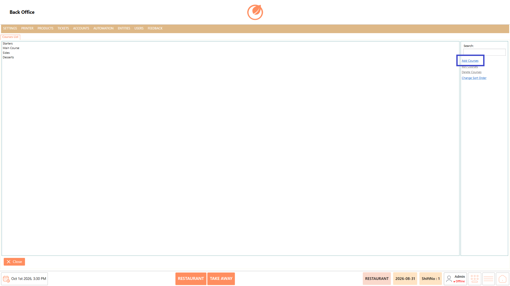
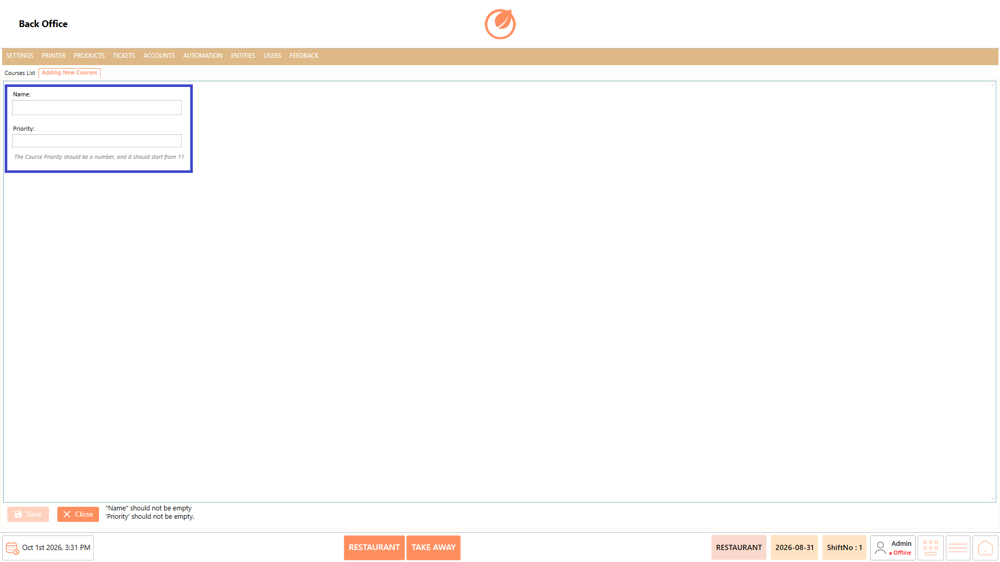
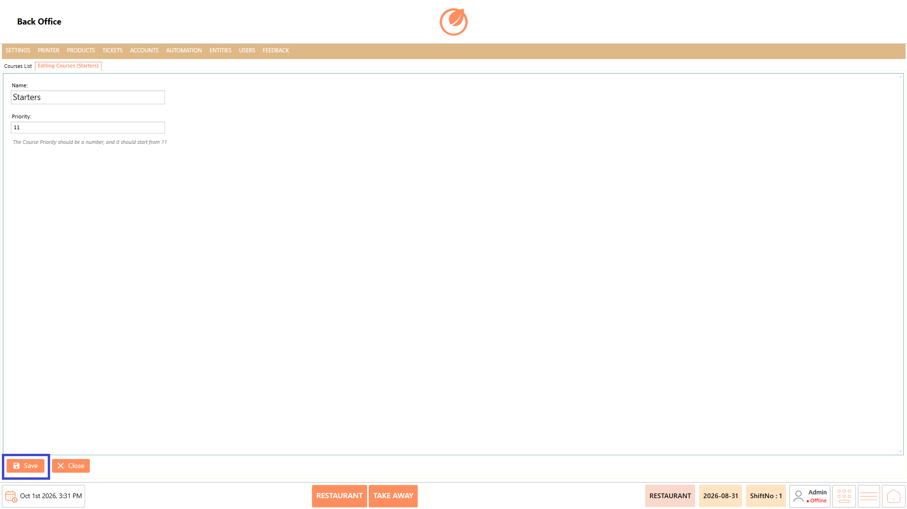
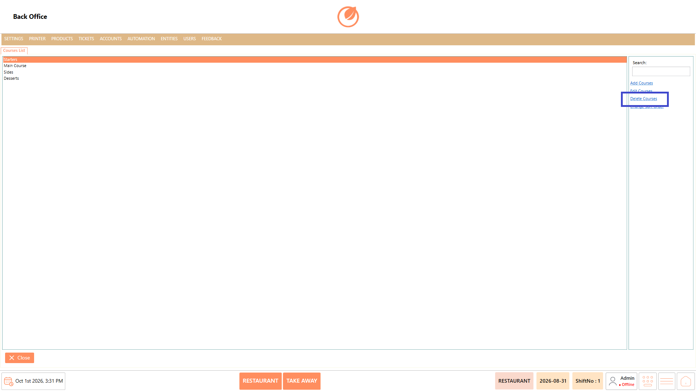
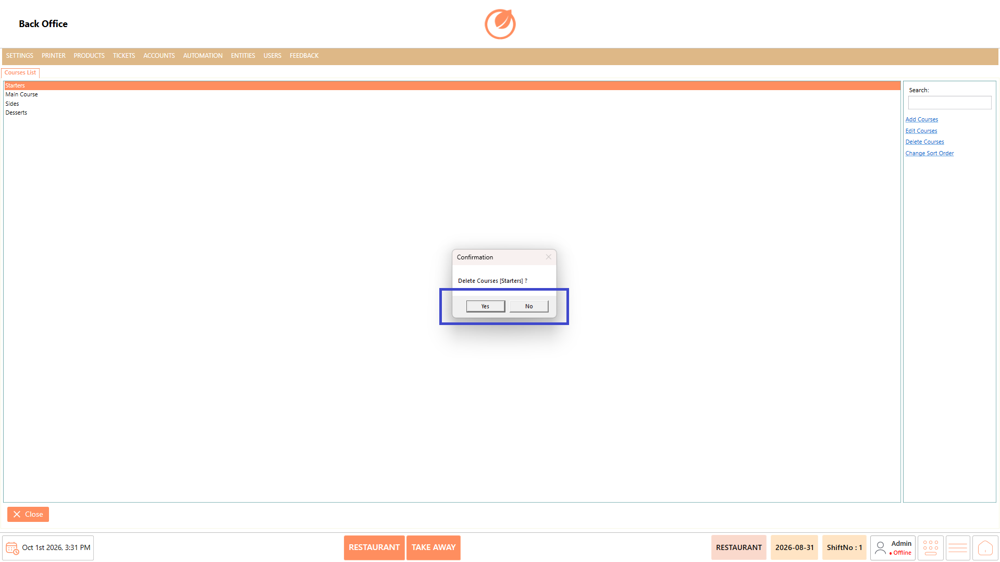
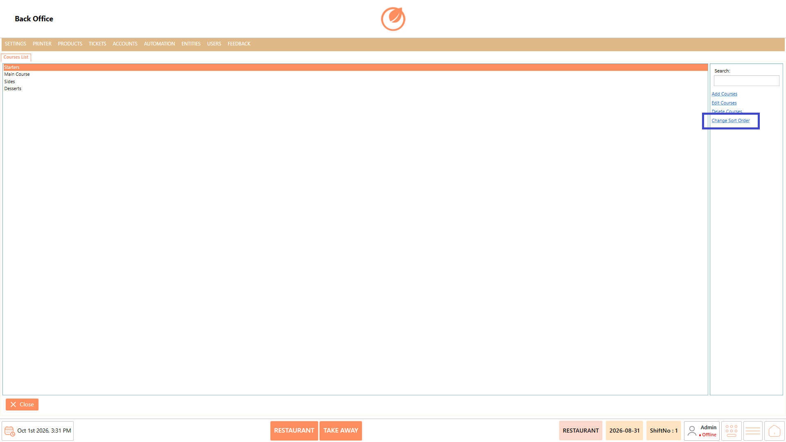

# Course

### **Overview** 

The Course section is used to configure the priority order in which items are sent to the kitchen. You can add new courses, edit existing courses, delete courses, and change the order in which courses are displayed.

<figure><figcaption></figcaption></figure>

### **Screen Elements** 

| **Screen Element** | **Description**                                   |
| ------------------ | ------------------------------------------------- |
| Courses List       | Displays the courses configured in the system.    |
| Search             | Used to search for a specific course.             |
| Add Courses        | Used to add a new course.                         |
| Edit Courses       | Used to modify the details of an existing course. |
| Delete Courses     | Used to remove a selected course.                 |
| Change Sort Order  | Used to change the display order of the courses.  |
| Name               | Used to enter the name of the course.             |
| Priority           | Used to specify the priority order of the course. |
| Save               | Used to save the course configuration.            |
| Close              | Closes the Course section.                        |

### **Working** 

#### **Add Course** 

1. Select "Add Courses".

<figure><figcaption></figcaption></figure>

2. Enter the required "Name".
3. Enter the required "Priority".

<figure><figcaption></figcaption></figure>

4. Select "Save" to add the course.

<figure><figcaption></figcaption></figure>

**Note:** The Course Priority should be a number and should start from 11.

#### **Edit Course** 

1. Select the required course from the Courses List.
2. Select "Edit Courses".

<figure><figcaption></figcaption></figure>

3. Update the required course details.
4. Select "Save" to save the changes.

<figure><figcaption></figcaption></figure>

#### **Delete Course** 

1. Select the course you want to remove.
2. Select "Delete Courses".

<figure><figcaption></figcaption></figure>

3. In the confirmation message, select "Yes" to delete the course.

<figure><figcaption></figcaption></figure>

#### **Change Sort Order** 

1. Select "Change Sort Order".

<figure><figcaption></figcaption></figure>

2. Adjust the order of the courses as required.
3. Save the updated order.

### **Use Case** 

* Arrange dishes according to the order in which they should be prepared and sent to the kitchen.
* Ensure starters such as soup are sent to the kitchen before main-course items such as fried rice or biriyani.
* Manage different preparation stages when an order contains multiple types of dishes.
* Coordinate kitchen operations by establishing a consistent sequence for preparing different courses.
* Prioritize time-sensitive dishes so they can be prepared at the appropriate stage of the order.
* Maintain a standard course sequence across orders to support consistent kitchen operations.
* Adjust the course priority when the restaurant changes its serving or preparation sequence.
* Organize and maintain multiple courses so kitchen staff can follow the configured preparation order.

### **Notes** 

* Select the required course before using "Edit Courses" or "Delete Courses".
* Enter a "Name" and "Priority" when adding a new course.
* The "Priority" determines the order in which the course is sent to the kitchen.
* The "Priority" should be entered as a number.
* Use "Change Sort Order" to organize the course order according to the required kitchen sequence.
* Deleting a course requires confirmation.
