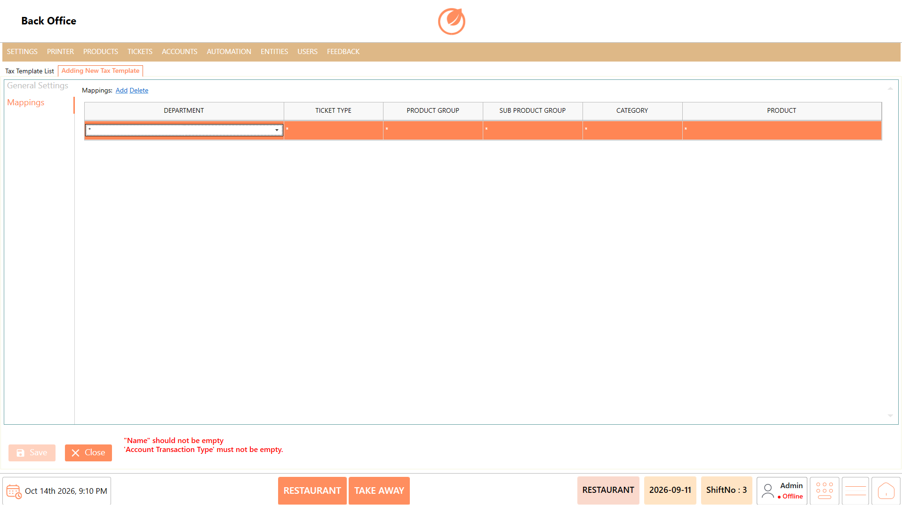

# FAQ's

## 1. How do I create a new menu item in BackOffice Products?

To add a new product to your menu catalog:

1. Open **BackOffice** and navigate to the **Product List** section.
2. Select **"Add Product"**.
3. In the **"POS"** field, enter the name of the product.
4. Click the **"Group Code"** dropdown menu and select the required category group (e.g., Starters, Main course, Drinks).
5. Enter optional product identification details if needed, such as **"Alias Name"**, **"Alias Code"**, **"Barcode"**, **"Tag"**, **"Courses"**, **"Image"**, or **"Description"**.
6. Select **"Add Portion"** to create a portion size for the product.
7. Enter portion configuration details, including **"Portion"** name (e.g., Normal), **"Multiplier"**, **"Price"**, **"Cost"**, **"Preparation Time (Minutes)"**, and **"Number of Pax"**.
8. Select **"Save"** to create the product.

<figure><figcaption></figcaption></figure>

**Note:** Selecting a **Group Code** and adding at least one **Portion** are mandatory requirements before saving a new product. Product price and portion-level details are stored separately for each portion.

## 2. How do I create multiple menu items at once using Batch Create Products?

To quickly add several products by name without filling in detailed fields individually:

1. Go to the **Product List** screen in BackOffice.
2. Select **"Batch Create Products"**.
3. In the pop-up text box, enter the names of the products you want to create.
4. Select **"OK"** to generate the product records.

<figure><figcaption></figcaption></figure>

**Note:** Use **Batch Create Products** when you need to set up multiple items simultaneously; you can edit individual portion pricing and details later.

## 3. How do I update department-specific product prices using the Price List Editor?

When different operational departments (e.g., Bar, Dining Room, Takeaway) charge different prices for the same product:

1. Open the **Price List Editor** in BackOffice.
2. Use the **"Search"** bar to locate the product you want to update.
3. Locate the corresponding **Department Column** for the target department.
4. Double-click the price field under the relevant department column.
5. Enter or update the new price for that specific product and department.
6. Click **"Save"** to store the updated price.

<figure><figcaption></figcaption></figure>

**Note:** The department columns displayed are generated dynamically based on the departments configured in your system. Always click **Save** after making price changes.

## 4. How do I export and import product prices in bulk using Excel in the Price List Editor?

To update pricing across departments outside the POS using an Excel spreadsheet:

* **To Export the Template:**
  1. Open the **Price List Editor**.
  2. Select **"Export Template"** to download the template containing product and department price details.
  3. Save the file and update the prices in Excel.
* **To Import Updated Data:**
  1. Return to the **Price List Editor**.
  2. Select **"Import Data"**.
  3. Upload the completed price template to apply the updated prices across departments.
  4. Click **"Save"**.

<figure><figcaption></figcaption></figure>

## 5. How do I set up kitchen priority courses for ordering sequence?

To configure the priority sequence in which dishes are dispatched to the kitchen (e.g., Starters before Mains):

1. Navigate to the **Course** section in BackOffice.
2. Select **"Add Courses"**.
3. In the **"Name"** field, enter the course title (e.g., Soup or Starter).
4. In the **"Priority"** field, enter a numerical priority value.
5. Select **"Save"** to create the course.

<figure><figcaption></figcaption></figure>

**Note:** The **Priority** field must be a number and must start from **11**. The priority number determines the kitchen preparation order.

## 6. How do I reorder display positions of kitchen courses?

To change how courses appear in selection lists:

1. Open the **Course** section.
2. Select **"Change Sort Order"**.
3. Adjust the order of the courses as required.
4. Save the updated display sequence.

<figure><figcaption></figcaption></figure>

## 7. How do I set up custom reason options for Gift or Comp items?

To create mandatory reasons that staff must select when marking items as Gift or Comp on orders:

1. Open the **Reason** section in BackOffice.
2. Select **"Add Reason"**.
3. Enter the description in the **"Reason"** field.
4. Enter an **"Alias Name"**, **"Sub Group"**, or select a **"Group Code"** if required by your administrative setup.
5. Select **"Save"**.

<figure><figcaption></figcaption></figure>

## 8. How do I configure a Product Timer for time-based items?

To create a timer for products billed or tracked by duration:

1. Open the **Product Timer** setting and select **"Add Product Timer"**.
2. Enter a descriptor in the **"Name"** field.
3. Set duration parameters under **General Settings**:
   * **Price Duration Type:** Select the duration type (displays **Minute**).
   * **Price Duration:** Enter the price duration value.
   * **Min Time:** Enter the minimum billing time.
   * **Time Rounding:** Enter the time-rounding interval.
   * **Start Time:** Enter the start time value.
4. Go to the **"Mappings"** section and select **"Add"** to link the timer to a specific **User Role**, **Department**, **Ticket Type**, **Product Group**, or **Product**.
5. Select **"Save"**.

<figure><figcaption></figcaption></figure>

## 9. How do I create a Combo Group and assign selection limits to items?

To configure a group of choice items (e.g., Choice of Drinks or Sides) with min/max selection rules:

1. Go to **Combo Group** and select **"Add Combo Group"**.
2. Enter the name in the **"Name"** field.
3. Enter selection constraints in **"Minimum"**, **"Maximum"**, and **"Maximum Item Select"**.
4. Select **"Manager Products"** to open the product selection window.
5. Highlight the desired items in the **Product List** and click **">>"** to move them into **Selected Products**.
6. Click **"OK"** to apply product selections.
7. Select **"Save"** to store the combo group.

<figure><figcaption></figcaption></figure>

## 10. How do I create a new Combo Product and link it to Combo Groups?

To combine a parent product with choice groups into a single package meal:

1. Open **Combo Product** and select **"Add Combo Product"**.
2. Enter the package title in the **"Name"** field.
3. Select the parent product from the **"Product"** dropdown menu.
4. Select **"Manage Combo Groups"**.
5. Select the required groups in the **"Combo Groups List"** and click **">>"** to transfer them to **"Selected Combo Groups"**.
6. Click **"OK"** to confirm group selection.
7. Select **"Save"**.

<figure><figcaption></figcaption></figure>

## 11. How do I add and manage multiple portions for a single product?

To set up different serving sizes (e.g., Small, Medium, Large) for a dish:

1. Open **Product List**, select the target product, and click **"Edit Product"** (or click **"Add Product"**).
2. Under the portions panel, select **"Add Portion"** to create a new portion row.
3. In the **"Portion"** field, enter the portion name.
4. Configure **"Multiplier"**, **"Price"**, **"Cost"**, **"Preparation Time (Minutes)"**, and **"Number of Pax"** for that specific size.
5. To remove an unwanted portion size, highlight the portion row and select **"Delete Portion"**.
6. Select **"Save"**.

<figure><figcaption></figcaption></figure>

## 12. How do I create a new Price Definition and assign a Price Tag?

To create standardized pricing templates or tags:

1. Open **Price Definition** and select **"Add Price Definition"**.
2. Enter a description in **"Price Definition Name"**.
3. Enter the tag value in **"Price Tag"**.
4. Select **"Save"**.

<figure><figcaption></figcaption></figure>

**Note:** Both **Price Definition Name** and **Price Tag** are mandatory fields. Leaving either field empty triggers a validation error message.

## 13. How do I delete an unneeded Price Definition?

To remove a price definition from BackOffice:

1. Go to **Price Definition**.
2. Highlight the target record in the **Price Definition List**.
3. Select **"Delete Price Definition"**.
4. On the confirmation popup window, select **"Yes"** to permanently delete (or **"No"** to cancel).

<figure><figcaption></figcaption></figure>

## 14. How do I set up a new Menu in Menu List?

To create a new menu structure for your POS terminals:

1. Open **Menu List** and select **"Add Menu"**.
2. Enter the title in **"Menu Name"**.
3. Configure categories and menu properties using available configuration controls.
4. Select **"Save"**.

<figure><figcaption></figcaption></figure>

## 15. How do I restrict menu item availability to specific times and days using Menu Schedule?

To make items automatically available only during designated service hours (e.g., Breakfast or Happy Hour):

1. Open **Menu Schedule**.
2. Enter a description in **"Menu Name"**.
3. Select **"Add"** to insert a schedule row.
4. In the **"Menu Item"** dropdown, select the target item.
5. Select the **"Start Hour"** and **"Start Minute"**.
6. Select the **"End Hour"** and **"End Minute"**.
7. Check or specify the applicable **"Days"**.
8. Select **"Save"**.

<figure><figcaption></figcaption></figure>

## 16. How do I create a Tax Template and map it to specific departments and categories?

To set up tax rules (e.g., GST or Service Tax) and apply them to menu items:

1. Go to **Tax Templates** and select **"Add Tax Template"**.
2. In **General Settings**, enter the **"Name"**.
3. Select the **"Account Transaction Type"**.
4. Enter the numerical values for **"Rate"**, **"Tag"**, and **"Rounding"**.
5. Open the **"Mappings"** tab/section and select **"Add"**.
6. Specify target rules across **"Department"**, **"Ticket Type"**, **"Product Group"**, **"Sub Product Group"**, **"Category"**, or **"Product"**.
7. Select **"Save"**.

<figure><figcaption></figcaption></figure>

## 17. How do I export the Product Template to Excel for offline data maintenance?

To back up or edit product catalog data in Excel:

1. Navigate to the **Product List** screen.
2. Select **"Export Template"**.
3. Choose your destination directory and save the exported Excel file.

<figure><figcaption></figcaption></figure>

## 18. How do I permanently delete an item from the Product List?

To remove a discontinued product from BackOffice:

1. Open **Product List**.
2. Select the item you wish to remove.
3. Select **"Delete Product"**.
4. When the confirmation pop-up message appears, select **"Yes"** to delete the item.

<figure><figcaption></figcaption></figure>

## 19. How do I configure forced quantity entry or allow price overrides during ordering?

To enforce operational prompt controls when cashiers order specific products:

1. Open **Product List**, select the product, and click **"Edit Product"** (or click **"Add Product"**).
2. Enable **"Force Quantity"** if cashiers must explicitly specify item quantities when selecting the item.
3. Enable **"Force Change Price"** if cashiers are permitted to alter the selling price at the POS screen.
4. Select **"Save"**.

<figure><figcaption></figcaption></figure>

## 20. How do I edit an existing Tax Template's rate or category mappings?

To modify tax percentages or target assignment rules:

1. Open **Tax Templates**.
2. Use **"Search"** or scroll to select the tax template from the list.
3. Select **"Edit Tax Template"**.
4. Update general fields (**Name**, **Account Transaction Type**, **Rate**, **Tag**, or **Rounding**).
5. In **"Mappings"**, click **"Add"** to append new mapping rules or click **"Delete"** to remove existing mappings.
6. Select **"Save"** to apply the changes.

<figure><figcaption></figcaption></figure>
