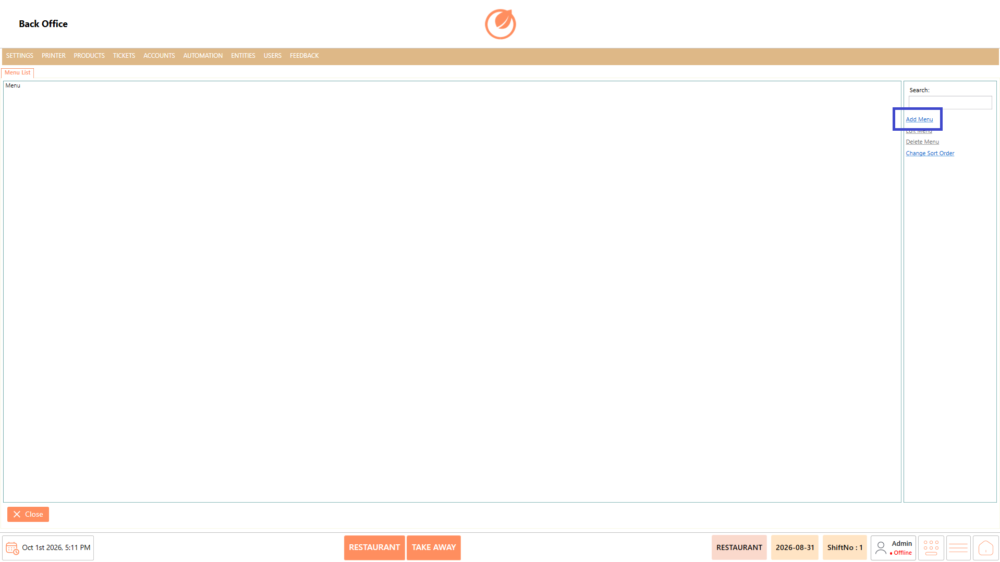
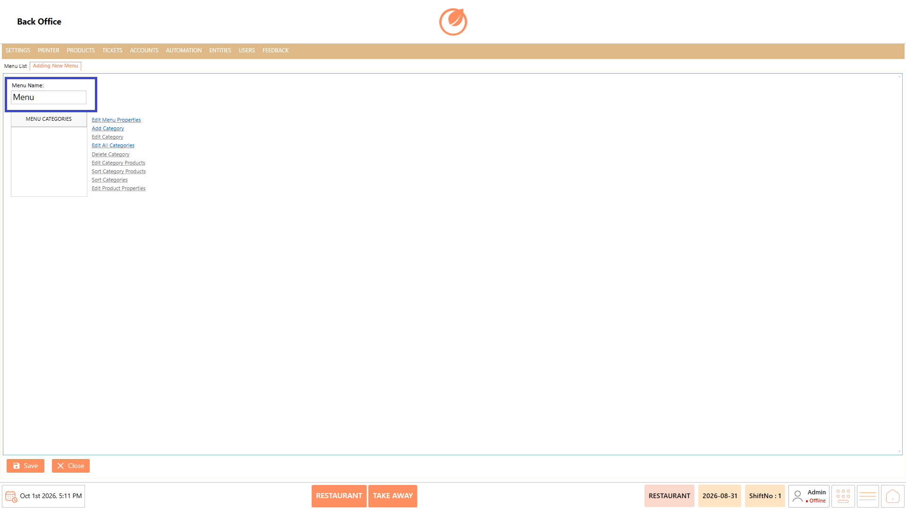
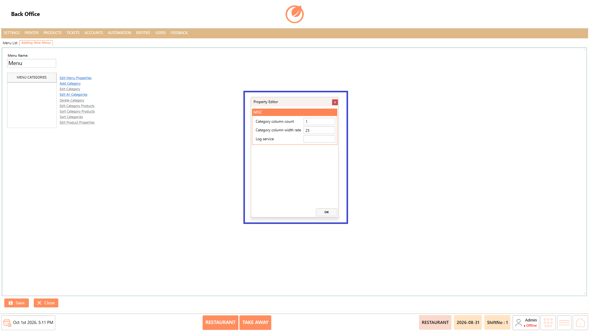
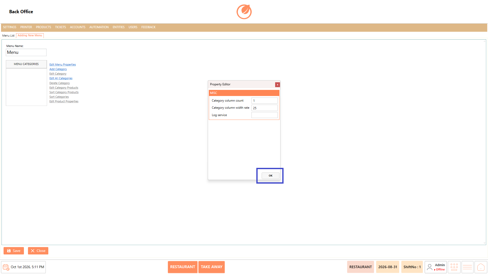
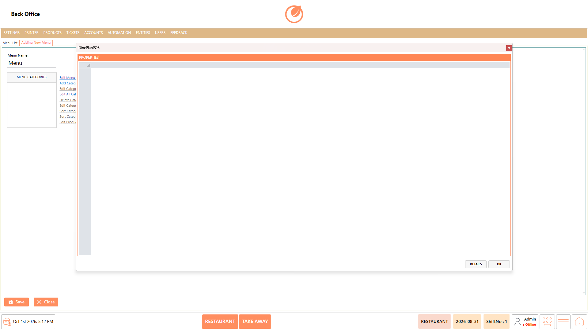
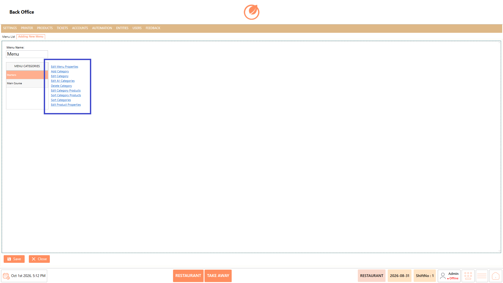
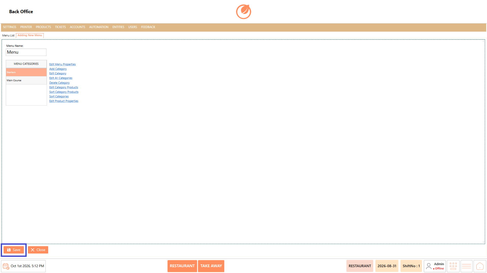
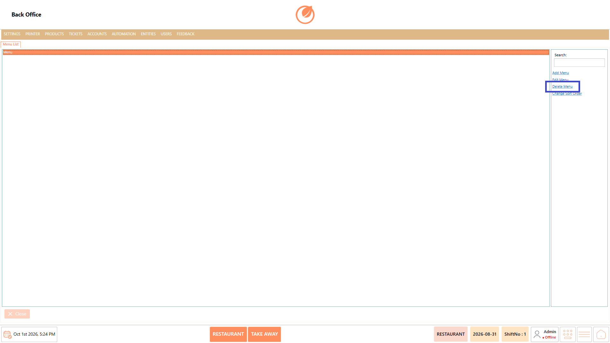
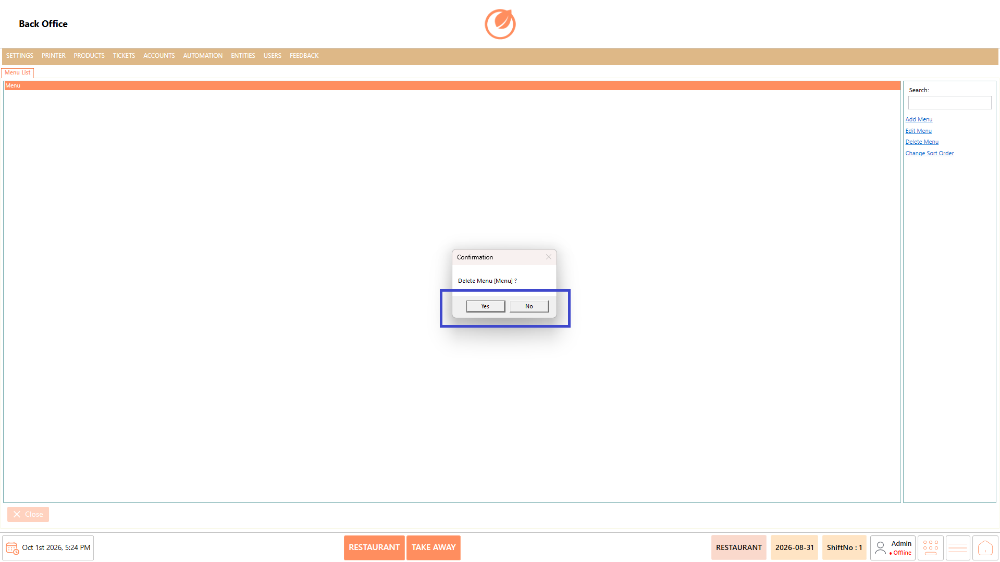
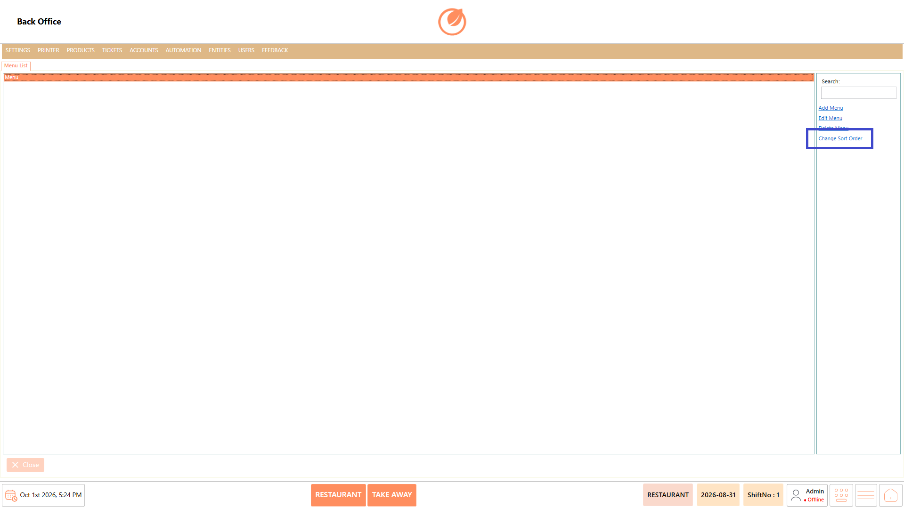

# Menu List

### **Overview** 

The Menu List setting allows you to manage the menus available in the system. You can add new menus, edit existing menus, delete menus, and change the order in which menus are displayed.

<figure><figcaption></figcaption></figure>

### **Screen Elements** 

| **Screen Element** | **Description**                                                               |
| ------------------ | ----------------------------------------------------------------------------- |
| Search             | Searches for a specific menu in the menu list.                                |
| Add Menu           | Creates a new menu and allows you to configure its categories and properties. |
| Edit Menu          | Opens the selected menu for editing.                                          |
| Delete Menu        | Deletes the selected menu after confirmation.                                 |
| Change Sort Order  | Changes the display order of the menus.                                       |

### **Working** 

#### **Add Menu** 

Use Add Menu to create a new menu.

1. Select "Add Menu”.

<figure><figcaption></figcaption></figure>

2. Enter the required menu name in "Menu Name".

<figure><figcaption></figcaption></figure>

3. Select "Edit Menu Properties" and configure the required menu properties, such as "Category column count", "Category column width rate", and "Log service".

<figure><figcaption></figcaption></figure>

4. Select "OK" to save the menu property configuration.

<figure><figcaption></figcaption></figure>

5. Use "Add Category" to add the required menu categories.

<figure><figcaption></figcaption></figure>

6. Use the available menu options such as "Edit Category", "Edit All Categories", "Delete Category", "Edit Category Products", "Sort Category Products", "Sort Categories", and "Edit Product Properties" to configure the menu as required.

<figure><figcaption></figcaption></figure>

7. Select "Save" to create the menu.

<figure><figcaption></figcaption></figure>

#### **Edit Menu** 

Use Edit Menu to modify an existing menu.

1. Select the menu you want to modify.
2. Select "Edit Menu”.

<figure><figcaption></figcaption></figure>

3. Update the required menu details or categories.
4. Select “Save” to apply the changes.

<figure><figcaption></figcaption></figure>

#### **Delete Menu** 

Use Delete Menu to remove an existing menu.

1. Select the menu you want to delete.
2. Select "Delete Menu”.

<figure><figcaption></figcaption></figure>

3. In the confirmation message, select Yes to delete the menu.

<figure><figcaption></figcaption></figure>

#### **Change Sort Order** 

Use Change Sort Order to change the order in which menus are displayed.

1. Select “Change Sort Order”.

<figure><figcaption></figcaption></figure>

2. Arrange the menus in the required order.
3. Save the changes.

### **Use Case** 

* Create separate menus for different restaurant offerings, such as breakfast, lunch, dinner, or special menus.
* Configure different menus based on the type of products or dishes offered to customers.
* Organize products into categories within a menu to make items easier to find during order processing.
* Maintain separate menus when different outlets, dining areas, or service types require different product offerings.
* Update menu categories and products when the restaurant changes its offerings or introduces new items.
* Configure menu properties to control how categories and products are displayed on the POS.
* Remove menus that are no longer active or required for order processing.
* Arrange menus in a preferred order so staff can quickly locate the required menu while taking orders.

### **Notes** 

* Select the required menu before using Edit Menu or Delete Menu.
* Deleting a menu requires confirmation.
* A menu can be configured with categories after it is created.
* Use Search to quickly locate a menu when multiple menus are available.
