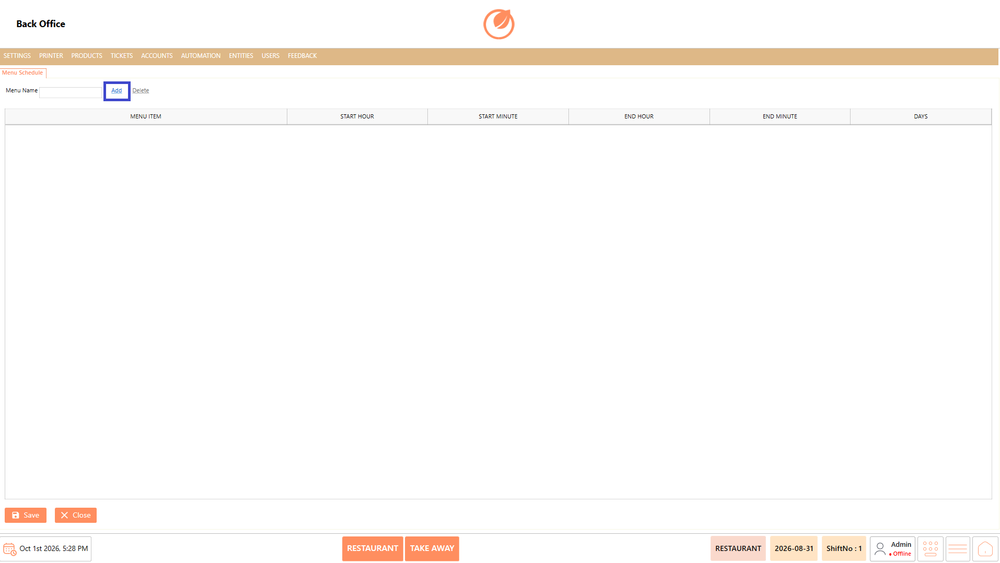
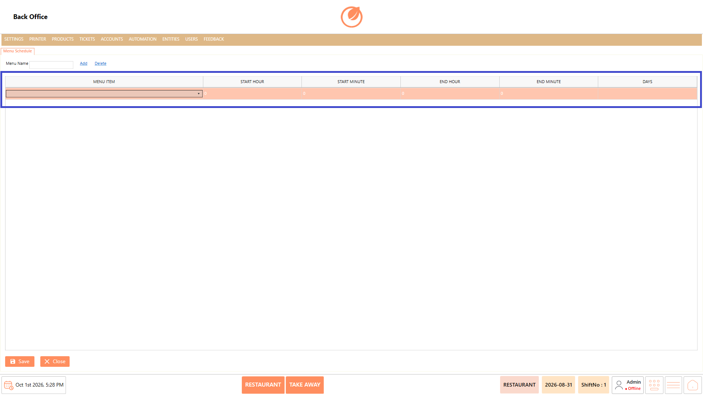
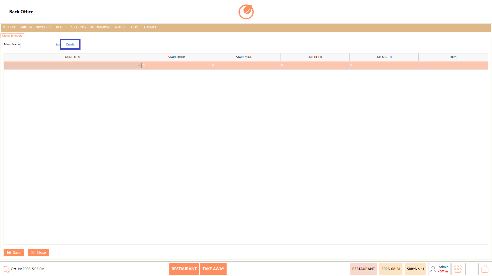
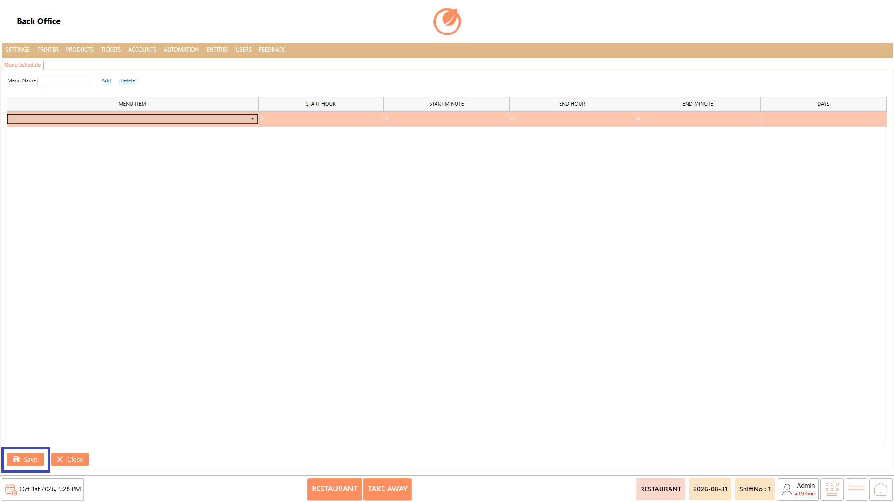

# Menu Schedule

### **Overview** 

The Menu Schedule setting allows you to define when specific menu items are available. You can create a menu schedule by selecting menu items and specifying their start time, end time, and applicable days.

<figure><figcaption></figcaption></figure>

### **Screen Elements** 

| **Screen Element** | **Description**                                                     |
| ------------------ | ------------------------------------------------------------------- |
| Menu Name          | Enter the name of the menu schedule.                                |
| Add                | Adds a new menu schedule row.                                       |
| Delete             | Deletes the selected menu schedule.                                 |
| Menu Item          | Select the menu item for which the schedule needs to be configured. |
| Start Hour         | Select the hour at which the menu item becomes available.           |
| Start Minute       | Select the minute at which the menu item becomes available.         |
| End Hour           | Select the hour at which the menu item availability ends.           |
| End Minute         | Select the minute at which the menu item availability ends.         |
| Days               | Specify the days for which the menu schedule applies.               |
| Save               | Saves the configured menu schedule.                                 |
| Close              | Closes the Menu Schedule screen.                                    |

### **Working** 

1. Enter a name in the Menu Name field.
2. Select "Add" to create a schedule entry.

<figure><figcaption></figcaption></figure>

3. In the Menu Item field, select the required menu item from the available list.
4. Select the Start Hour and Start Minute to define when the menu item starts.
5. Select the End Hour and End Minute to define when the menu item ends.
6. Specify the applicable Days.

<figure><figcaption></figcaption></figure>

7. To delete a schedule, select the schedule that needs to be deleted and select "Delete".

<figure><figcaption></figcaption></figure>

8. Select "Save" to save the menu schedule.

<figure><figcaption></figcaption></figure>

9. You can add multiple menu items to a menu schedule by adding additional rows and configuring the required timings for each item.

### **Use Case** 

* Set specific time periods during which particular menu items are available for ordering.
* Configure breakfast items to appear only during morning hours and switch to other menu items later in the day.
* Manage different menu availability for weekdays, weekends, or specific days based on the restaurant's operating schedule.
* Schedule lunch and dinner menus to become available at their respective serving times.
* Control the availability of seasonal or limited-time menu items without manually enabling or disabling them each day.
* Configure different availability periods for the same menu item when its serving times vary across different days.
* Add multiple menu items with individual timings when several items need to follow different availability schedules.
* Prevent customers from ordering menu items outside their configured serving periods.

### **Notes** 

* A Menu Item must be selected when creating a schedule entry.
* Configure both the start and end time for the required availability period.
* Select the applicable Days for the schedule.
* Use Add to configure additional menu items within the schedule.
* Select Save after making changes to retain the configuration.
