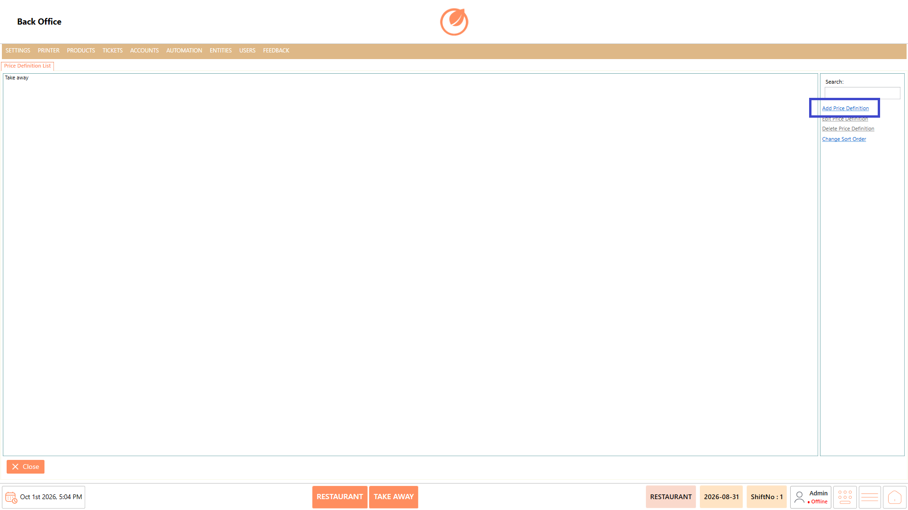
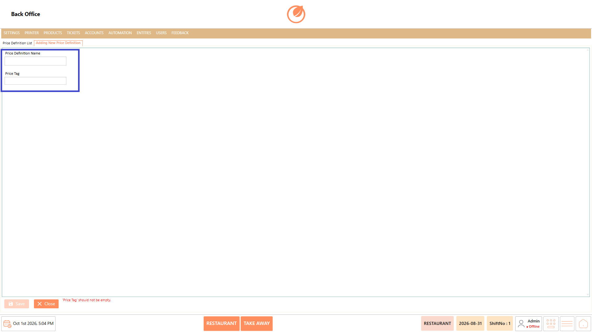
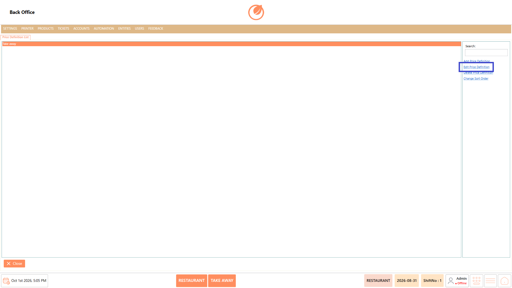
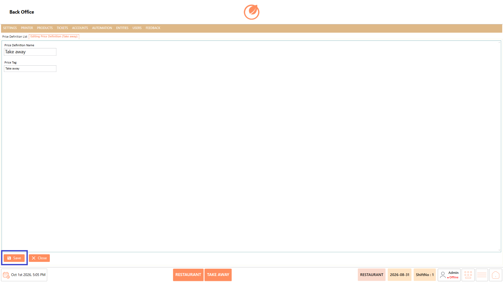
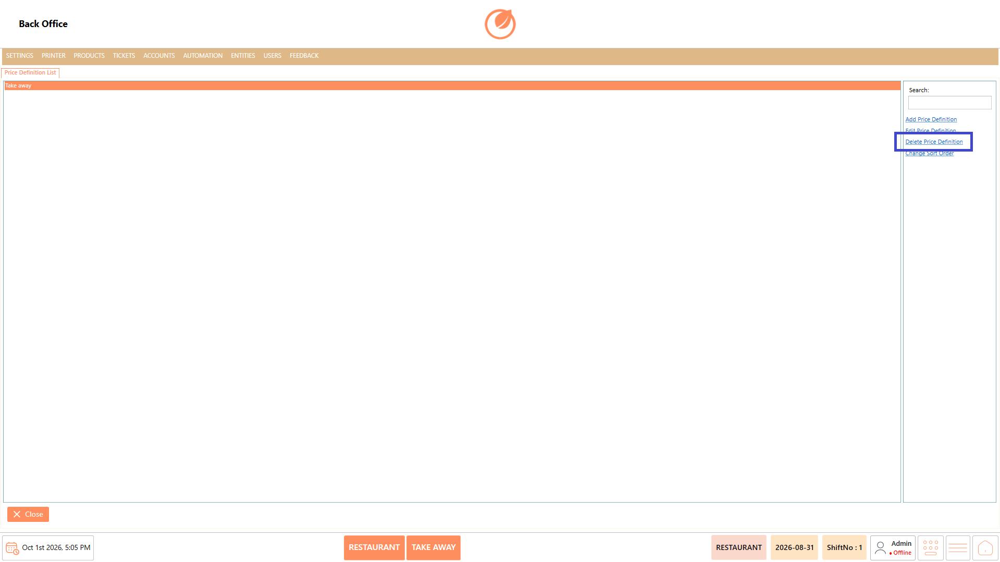
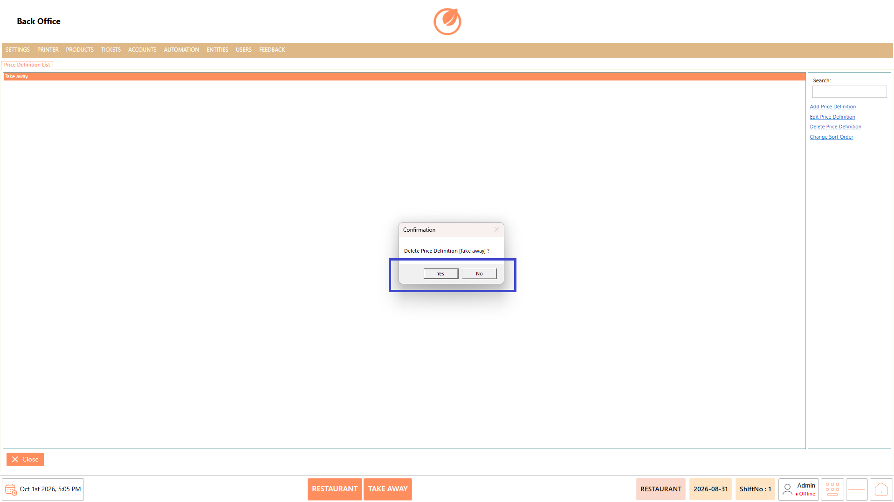
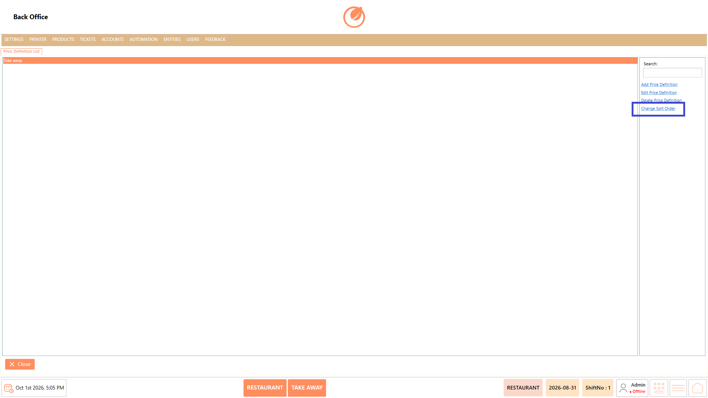

# Price Definition

### **Overview** 

The Price Definition setting allows you to create and manage price definitions used in the product. You can add new price definitions, edit existing ones, delete them, and change their display order.

<figure><figcaption></figcaption></figure>

### **Screen Elements** 

#### **Price Definition List** 

| **Screen Element**      | **Description**                                                    |
| ----------------------- | ------------------------------------------------------------------ |
| Price Definition List   | Displays the available price definitions.                          |
| Search                  | Allows you to search for a specific price definition.              |
| Add Price Definition    | Opens the screen to create a new price definition.                 |
| Edit Price Definition   | Allows you to modify the selected price definition.                |
| Delete Price Definition | Deletes the selected price definition after confirmation.          |
| Change Sort Order       | Opens the sorting window to change the order of price definitions. |
| Close                   | Closes the Price Definition screen.                                |

#### **Adding New Price Definition** 

| **Screen Element**    | **Description**                               |
| --------------------- | --------------------------------------------- |
| Price Definition Name | Enter the name of the price definition.       |
| Price Tag             | Enter the price tag for the price definition. |
| Save                  | Saves the new price definition.               |
| Close                 | Closes the screen without saving the changes. |

### **Working** 

#### **Add a Price Definition** 

1. Select "Add Price Definition".

<figure><figcaption></figcaption></figure>

2. Enter the required value in "Price Definition Name".
3. Enter the required value in "Price Tag".

<figure><figcaption></figcaption></figure>

4. Select "Save" to create the price definition.

<figure><figcaption></figcaption></figure>

5. The system displays a validation message if a required field is left empty.

#### **Edit a Price Definition** 

1. Select the required price definition from the list.
2. Select "Edit Price Definition".

<figure><figcaption></figcaption></figure>

3. Update the required details.
4. Select "Save" to save the changes.

<figure><figcaption></figcaption></figure>

#### **Delete a Price Definition** 

1. Select the required price definition.
2. Select "Delete Price Definition".

<figure><figcaption></figcaption></figure>

3. In the confirmation window, select "Yes" to delete the price definition or "No" to cancel the action.

<figure><figcaption></figcaption></figure>

#### **Change Sort Order** 

1. Select "Change Sort Order".

<figure><figcaption></figcaption></figure>

2. In the Sort Price Definitions window, change the order of the items as required.
3. Select "OK" to apply the changes.

### **Use Case** 

* Create different price definitions when a product needs to have multiple pricing options.
* Maintain separate pricing labels for different pricing structures configured within the product.
* Assign meaningful price tags to help identify the applicable pricing definition.
* Organize pricing definitions when products are offered with different price variations.
* Update existing price definitions when pricing requirements or labels change.
* Remove outdated price definitions that are no longer required for product pricing.
* Arrange price definitions in a preferred order to make them easier to locate and manage.
* Maintain standardized price definitions across products for consistent pricing configuration in the POS Back Office.

### **Notes** 

* Price Definition Name is required when creating a price definition.
* Price Tag is required when creating a price definition.
* Use Search to quickly locate a price definition in the list.
* Select the required price definition before using "Edit Price Definition" or "Delete Price Definition".
* Deleting a price definition requires confirmation.
* Select "No" in the confirmation window to cancel the deletion.
* Use "Change Sort Order" to organize the order of the listed price definitions.
* Select "Save" after adding or editing a price definition to retain the changes.
* Select "Close" to exit the Price Definition screen.
