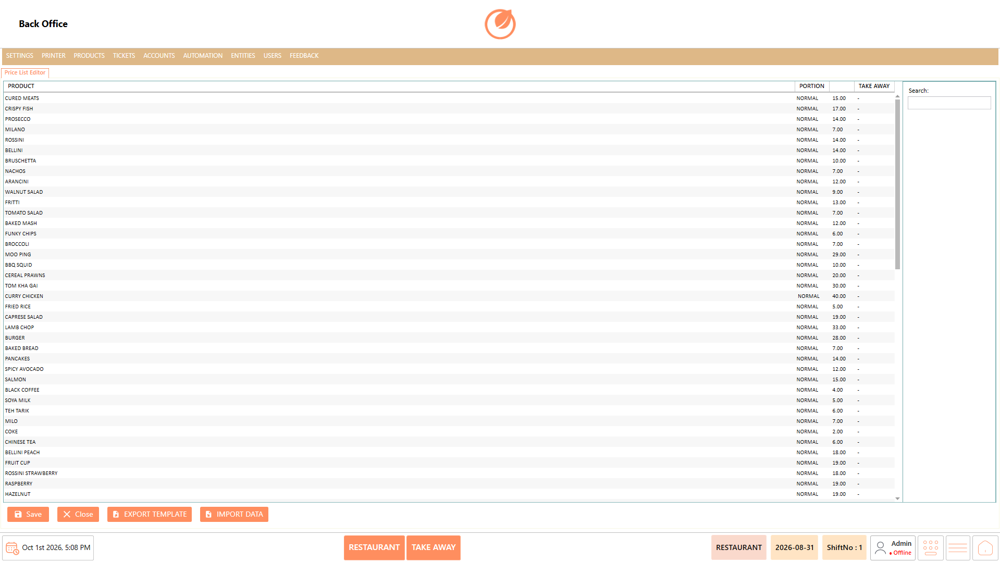
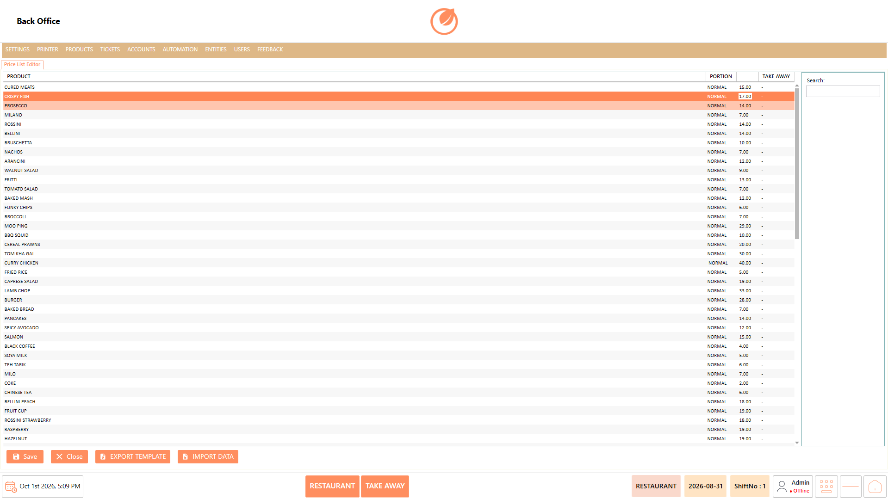
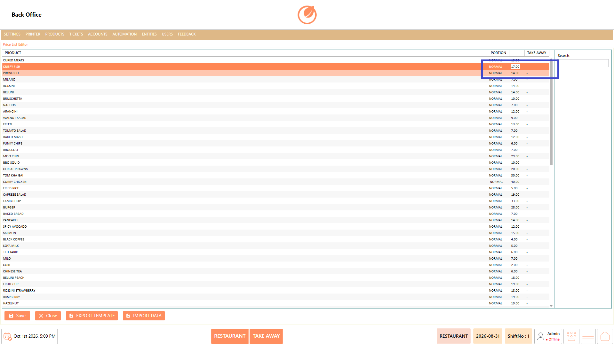
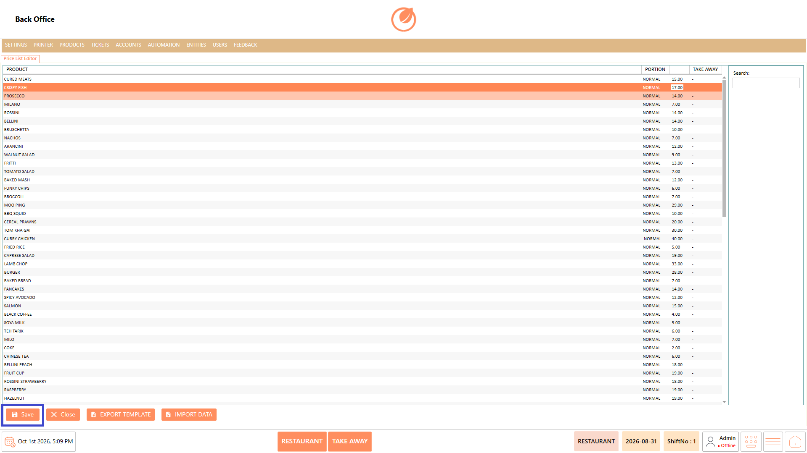

# Price List Editor

### **Overview** 

The Price List Editor allows you to manage product prices for the departments configured in the system. The created departments appear as separate columns, allowing you to maintain different prices for the same product based on the selected department.

<figure><figcaption></figcaption></figure>

### **Screen Elements** 

| **Screen Element** | **Description**                                                                                                                                                                        |
| ------------------ | -------------------------------------------------------------------------------------------------------------------------------------------------------------------------------------- |
| Product            | Displays the list of products available for price configuration.                                                                                                                       |
| Department Columns | Displays the departments created in the system as separate columns.                                                                                                                    |
| Price              | Displays the current price configured for a product under the corresponding department.                                                                                                |
| Search             | Allows you to search for a specific product in the price list.                                                                                                                         |
| Save               | Saves the updated product prices.                                                                                                                                                      |
| Close              | Closes the Price List Editor.                                                                                                                                                          |
| Export Template    | Downloads a template containing the product and department price details. The template can be used to prepare or update price information outside the system before importing it back. |
| Import Data        | Allows you to upload the completed price template to update product prices for the respective departments in the Price List Editor.                                                    |

### **Working** 

1. The departments created in the system are displayed as separate columns in the Price List Editor.

<figure><figcaption></figcaption></figure>

2. Locate the product for which you want to update the price.
3. Select the required product and double-click the price under the relevant department column.

<figure><figcaption></figcaption></figure>

4. Enter or update the price for that particular product and department.

<figure><figcaption></figcaption></figure>

5. Click “Save” to save the updated price.

<figure><figcaption></figcaption></figure>

**For example,** if a product has different prices for different departments, you can update each price separately in its corresponding department column.

### **Use Case** 

* Maintain different selling prices for the same product across multiple departments.
* Adjust the price of a product when different departments follow different pricing structures.
* Update department-specific prices when there is a change in the selling price of a product.
* Manage prices for products that are offered at different rates based on the department handling the sale.
* Review existing product prices across departments from a single screen before making updates.
* Make bulk price changes easier by managing product pricing through the available template options.
* Maintain consistent and accurate pricing for products across all configured departments.
* Quickly locate and update the required product price when pricing changes need to be applied to a specific department.

### **Notes** 

* The department columns displayed in the Price List Editor are based on the departments created in the system.
* Ensure that the correct product and department column are selected before updating a price.
* Double-click the relevant price field to edit it.
* Click Save after making price changes.
* Use Search to quickly locate a product in the list.
* Use Export Template and Import Data when managing price information through the provided template.
