# Product List

### **Overview** 

The Product setting is used to create and manage the products available for ordering. Products can be organized under different groups, such as Starters, Main course, Drinks, Vegetables, etc.

You can add new products, edit existing products, delete products, change their sort order, and create multiple products at once.

<figure><figcaption></figcaption></figure>

### **Screen Elements** 

#### **Product List** 

| **Screen Element**     | **Description**                                                  |
| ---------------------- | ---------------------------------------------------------------- |
| Product List           | Displays the products grouped under their respective categories. |
| Search                 | Allows you to search for a product in the list.                  |
| Add Product            | Opens the screen to create a new product.                        |
| Edit Product           | Allows you to modify the selected product.                       |
| Delete Product         | Deletes the selected product after confirmation.                 |
| Batch Create Products  | Allows you to create multiple products by entering their names.  |
| Change Sort Order      | Allows you to change the order in which products are displayed.  |
| Export Template        | Exports the product template as an Excel file.                   |
| Locate Template        | Allows you to locate the product template.                       |
| UrbanPiper Item Update | Provides the option to update items for UrbanPiper.              |

#### **Add Product** 

| **Screen Element**         | **Description**                                          |
| -------------------------- | -------------------------------------------------------- |
| POS                        | Enter the product name.                                  |
| Alias Name                 | Enter an alternate name for the product.                 |
| Alias Code                 | Enter an alternate code for the product.                 |
| Barcode                    | Enter the barcode associated with the product.           |
| Group Code                 | Select the group to which the product belongs.           |
| Tag                        | Select a tag for the product.                            |
| Courses                    | Select the course associated with the product.           |
| Image                      | Add an image for the product.                            |
| Description                | Enter a description for the product.                     |
| Force Quantity             | Enables quantity to be specified for the product.        |
| Force Change Price         | Enables the product price to be changed during ordering. |
| Combo Product              | Marks the product as a combo product.                    |
| Add Portion                | Adds a portion for the product.                          |
| Delete Portion             | Removes a selected portion.                              |
| Portion                    | Displays the portion name, such as Normal.               |
| Multiplier                 | Specifies the multiplier for the portion.                |
| Price                      | Specifies the selling price of the portion.              |
| Cost                       | Specifies the cost of the portion.                       |
| Preparation Time (Minutes) | Specifies the preparation time for the portion.          |
| Number of Pax              | Specifies the number of people the portion serves.       |
| Save                       | Saves the product details.                               |
| Close                      | Closes the product screen.                               |

### **Working** 

#### **Add a Product** 

1. Select "Add Product".

<figure>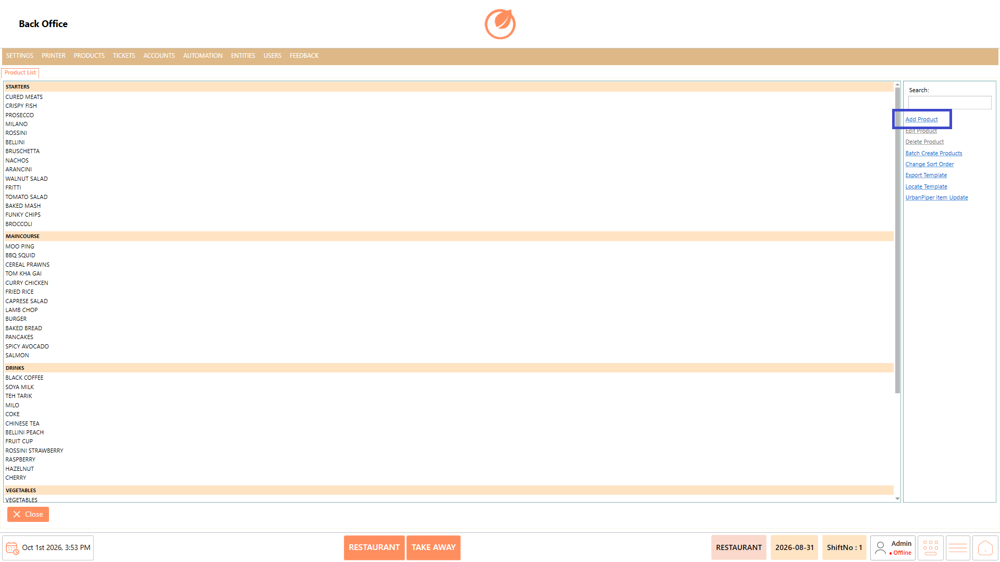<figcaption></figcaption></figure>

2. Enter the product name in "POS".

<figure><figcaption></figcaption></figure>

3. Select the required "Group Code".
4. Enter or select the other product details as required.

<figure>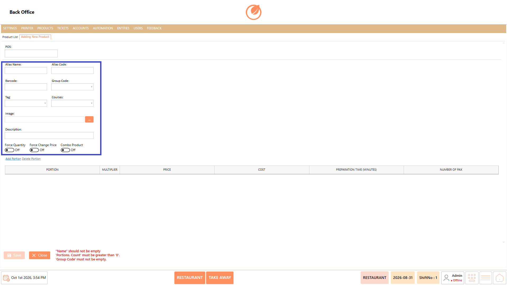<figcaption></figcaption></figure>

5. Select "Add Portion" to add a portion.

<figure>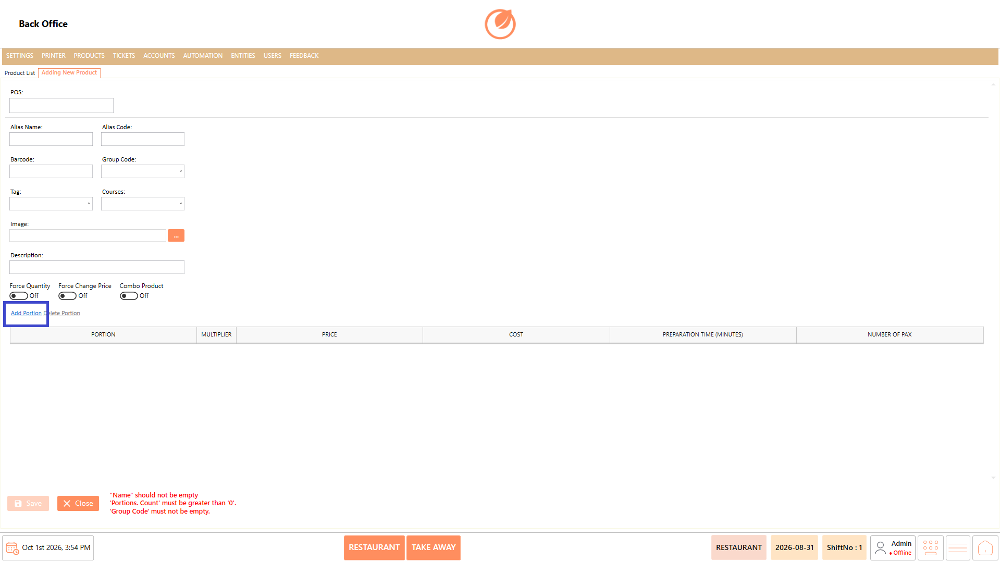<figcaption></figcaption></figure>

6. Enter the portion details, such as "Multiplier", "Price", "Cost", "Preparation Time (Minutes)", and "Number of Pax".

<figure>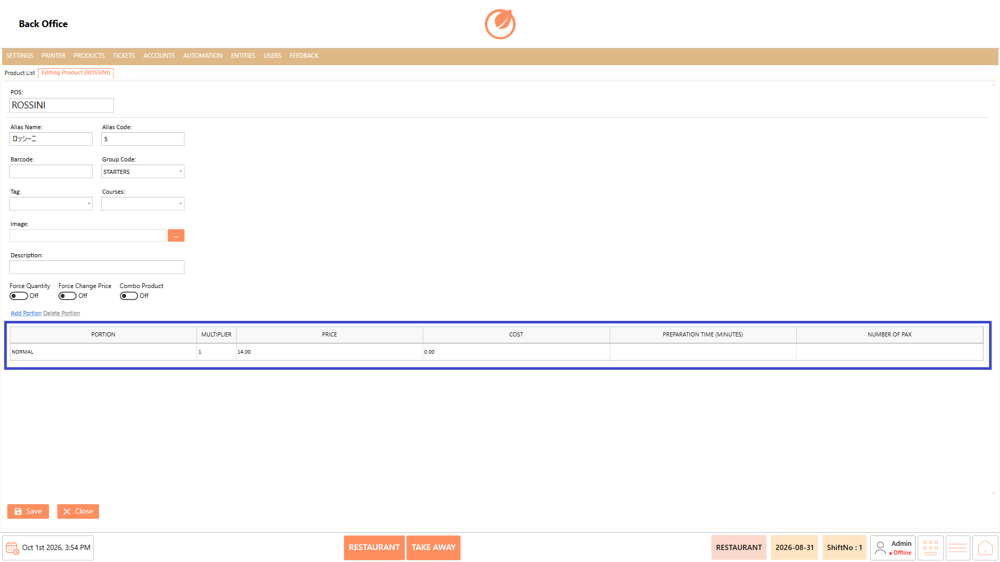<figcaption></figcaption></figure>

7. Select "Save" to create the product.

<figure>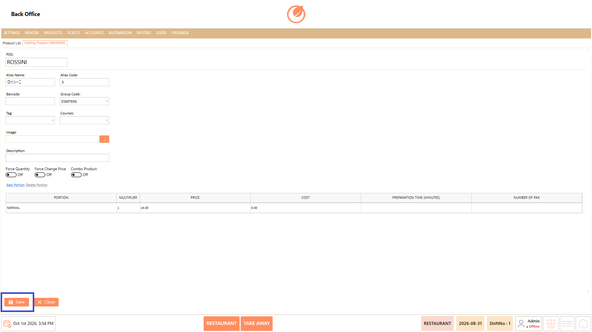<figcaption></figcaption></figure>

#### **Edit a Product** 

1. Select the required product from the Product List.
2. Select "Edit Product".

<figure><figcaption></figcaption></figure>

3. Update the required details.
4. Select "Save" to apply the changes.

<figure><figcaption></figcaption></figure>

#### **Delete a Product** 

1. Select the product you want to remove.
2. Select "Delete Product".

<figure>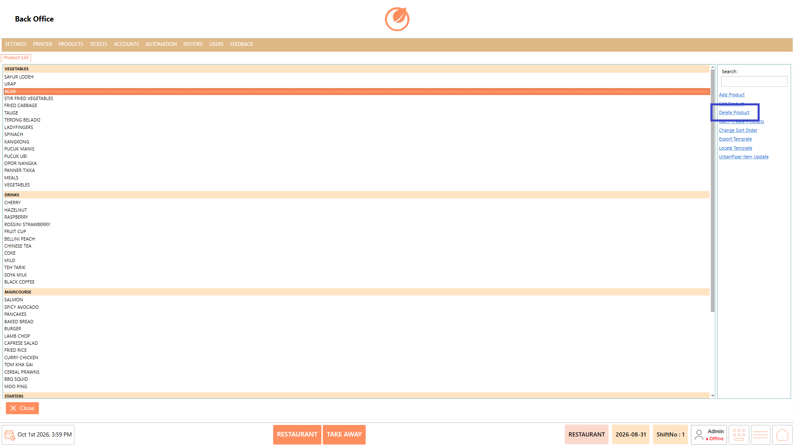<figcaption></figcaption></figure>

3. In the confirmation message, select "Yes" to delete the product.

<figure>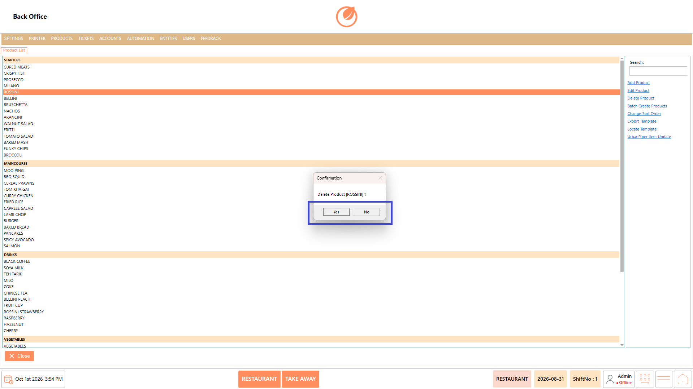<figcaption></figcaption></figure>

#### **Batch Create Products** 

1. Select "Batch Create Products".

<figure>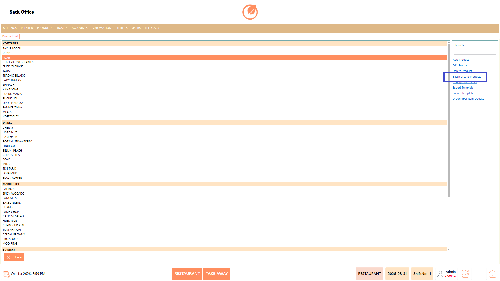<figcaption></figcaption></figure>

2. Enter the product names in the text box.

<figure>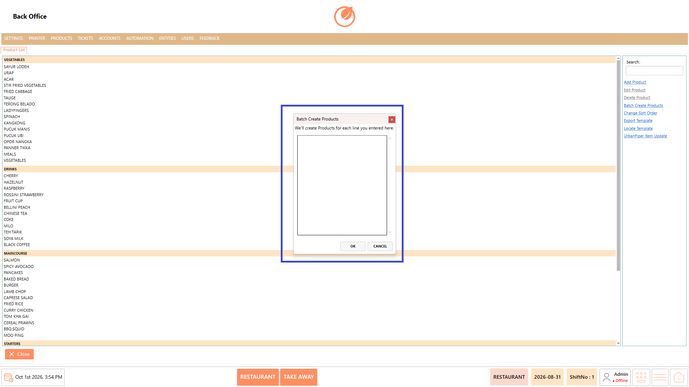<figcaption></figcaption></figure>

3. Select "OK" to create the products.

<figure>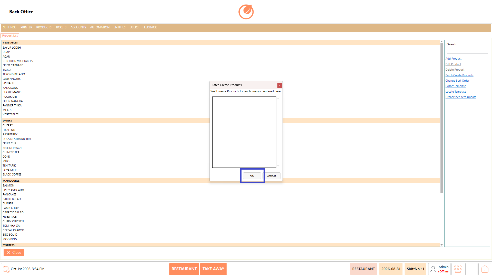<figcaption></figcaption></figure>

#### **Change Sort Order** 

1. Select "Change Sort Order".

<figure><figcaption></figcaption></figure>

2. Change the order of the products as required.

#### **Export Product Template** 

1. Select "Export Template".

<figure>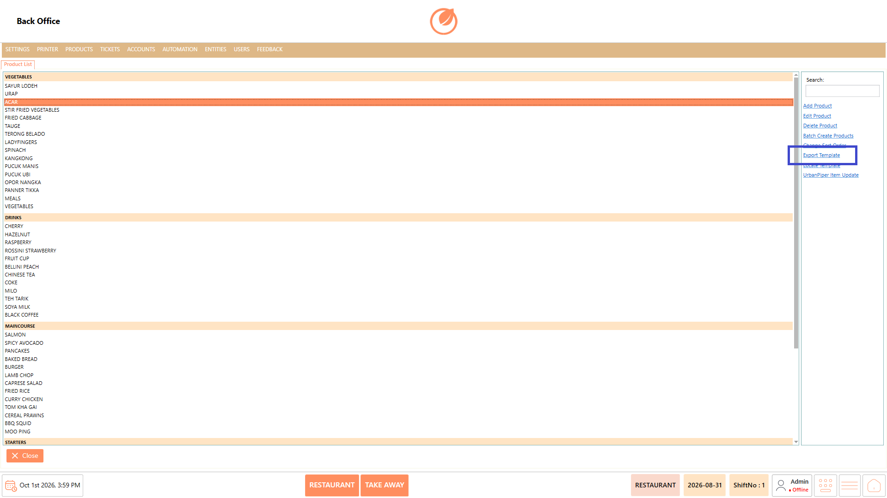<figcaption></figcaption></figure>

2. Save the exported Excel template to the required location.

<figure>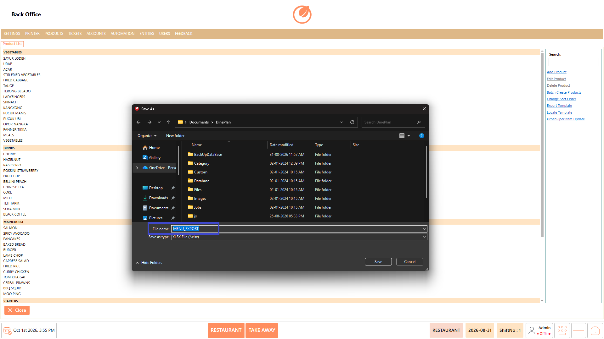<figcaption></figcaption></figure>

#### **Locate Template** 

1. Select "Locate Template".

<figure>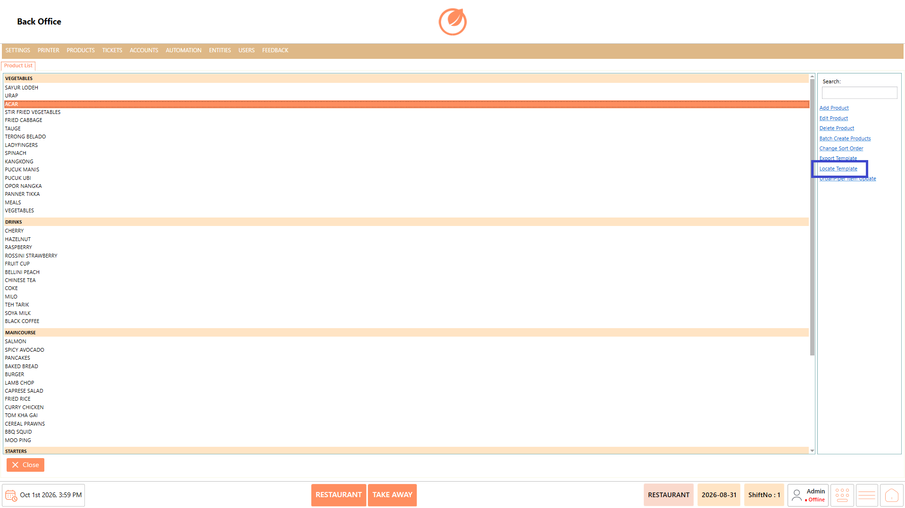<figcaption></figcaption></figure>

2. It will open where the template is in your system.

<figure>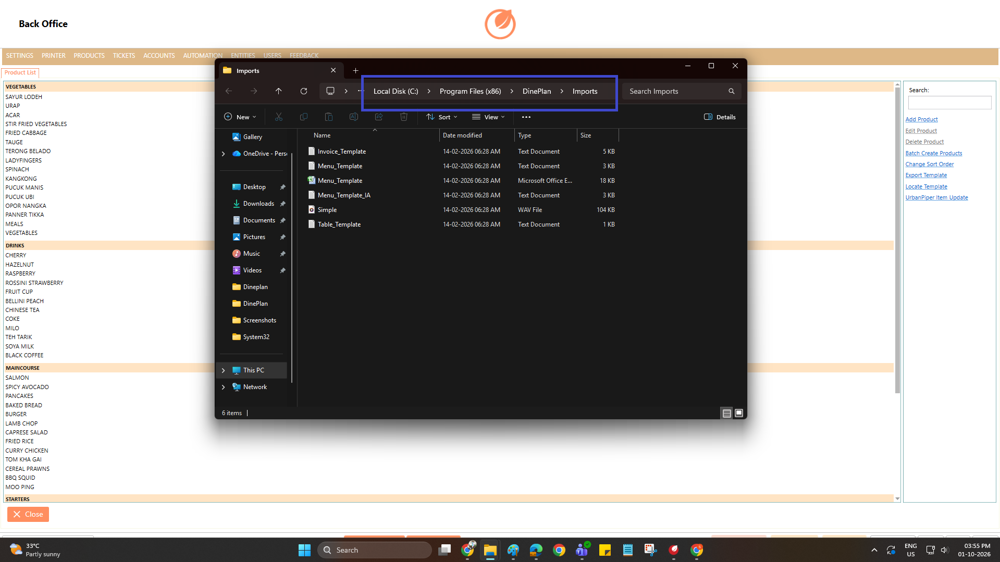<figcaption></figcaption></figure>

#### **UrbanPiper Item Update** 

1. Select "UrbanPiper Item Update".

<figure>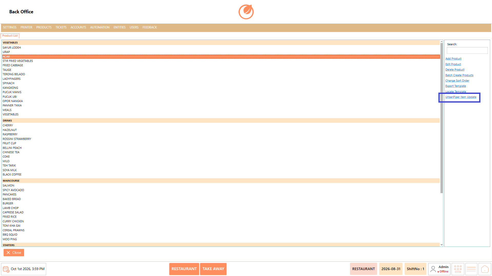<figcaption></figcaption></figure>

2. Update the items accordingly and “Push” them.

<figure>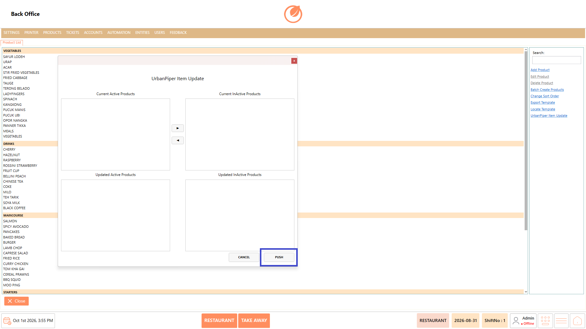<figcaption></figcaption></figure>

### **Use Case** 

The Product setting is used to maintain the restaurant's product list and ensure that the required products are available during the ordering process. It can be used when:

* Adding a new product to the menu.
* Updating existing product information.
* Removing products that are no longer available.
* Creating multiple products at once.
* Organizing the display order of products.
* Maintaining product information using the Excel template.

### **Notes** 

* A Group Code must be selected when creating a product.
* At least one portion must be added to a product before saving.
* Select the appropriate Group Code to organize the product under the required category.
* Use Batch Create Products when multiple products need to be created at the same time.
* Deleting a product requires confirmation before the product is removed.
* Product portions can be added or removed using "Add Portion" and "Delete Portion".
* The product price and other portion-level details are maintained separately for each portion.
* Use "Change Sort Order" to control the order in which products are displayed.
* The product template can be exported using "Export Template" to maintain product data in Excel.
* Review the product details before selecting "Save" to ensure the product is configured correctly.
