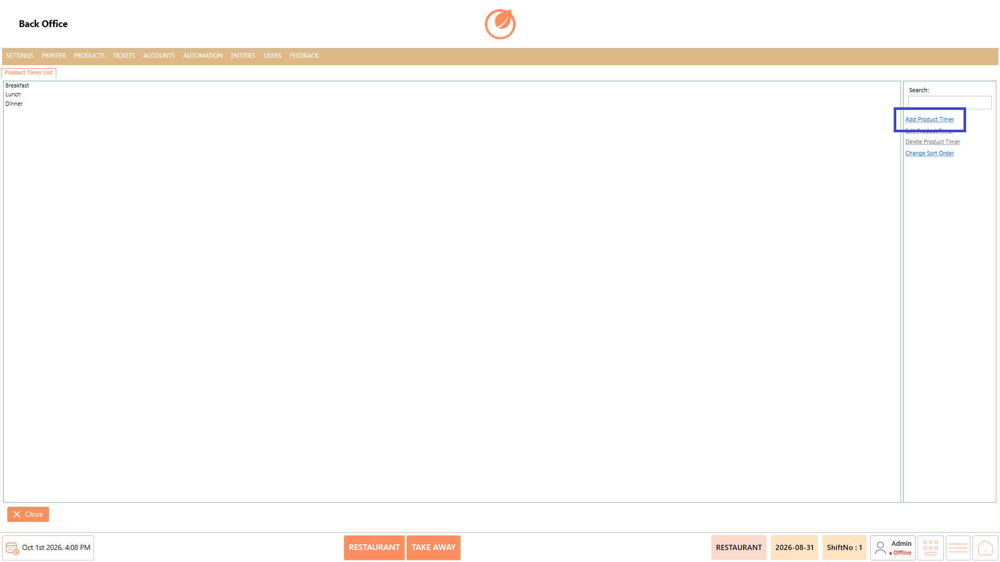
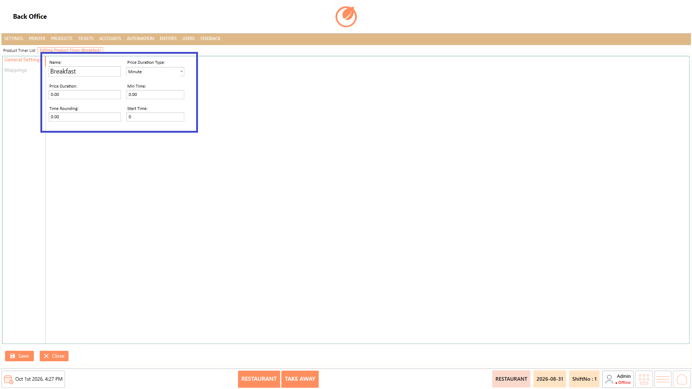
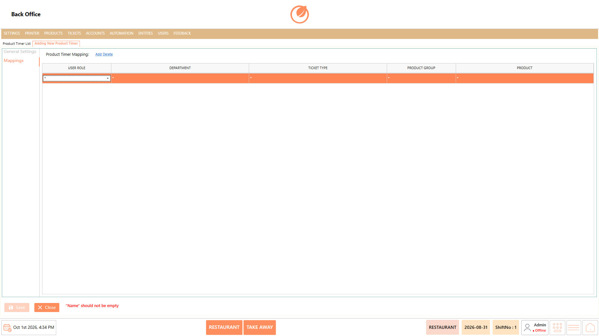
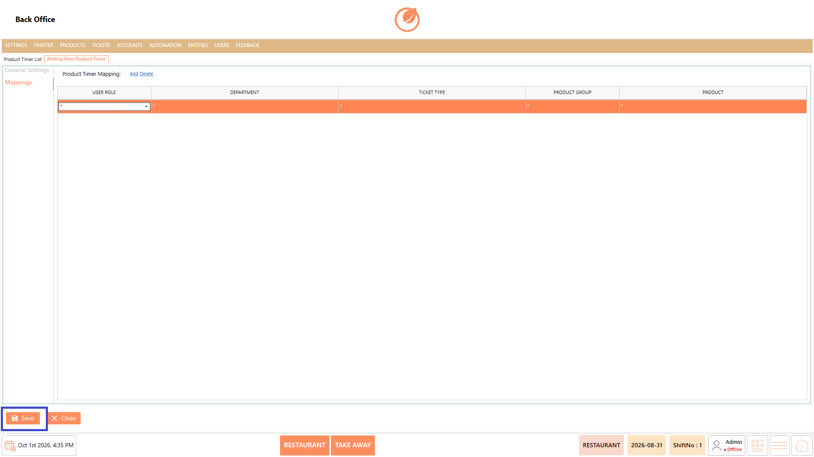
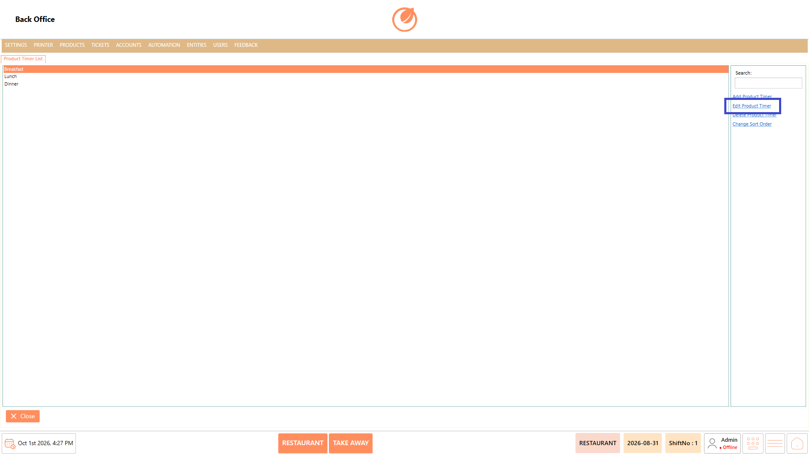
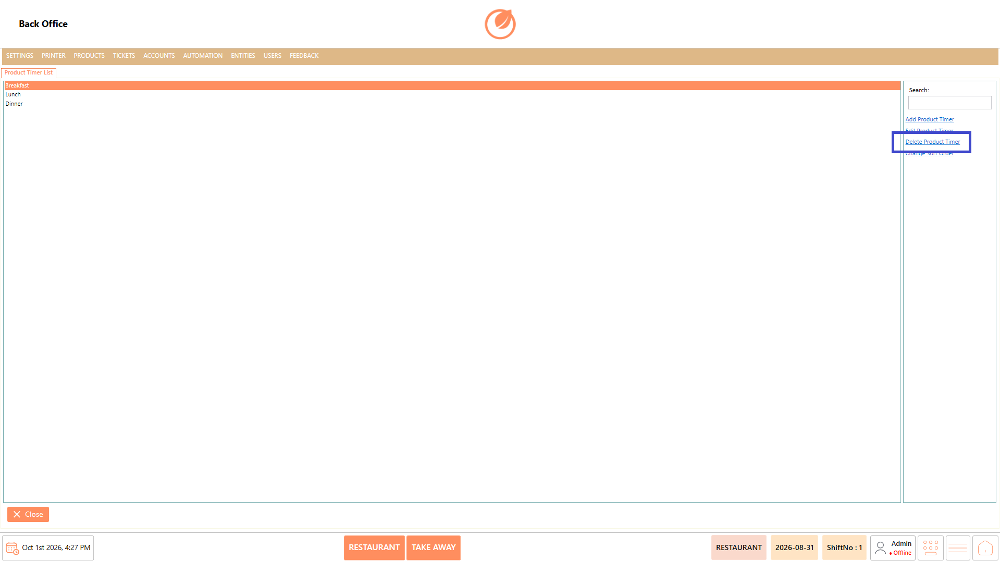
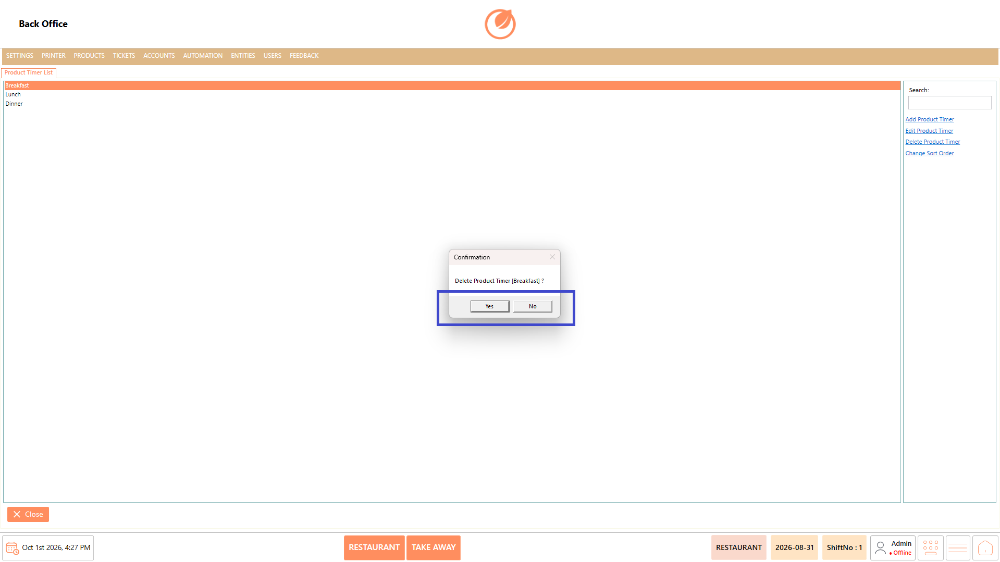
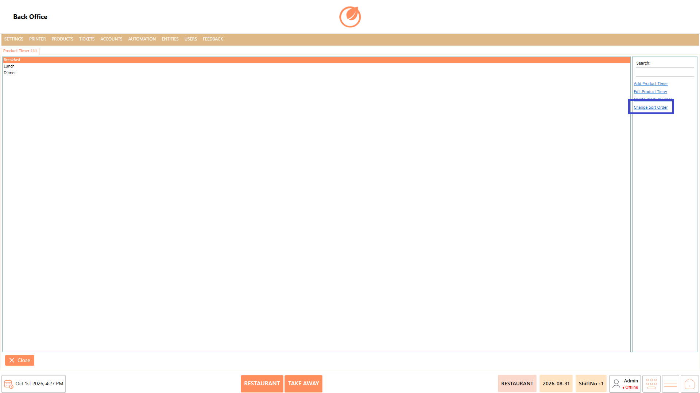

# Product Timer

### **Overview** 

The Product Timer setting is used to create and manage timers associated with products. You can configure the timer duration, minimum time, rounding, and start time. Product timers can also be mapped to specific User Roles, Departments, Ticket Types, Product Groups, and Products.

You can add, edit, delete, and sort product timers.

<figure><figcaption></figcaption></figure>

### **Screen Elements** 

#### **Product Timer List** 

| **Screen Element**   | **Description**                                                               |
| -------------------- | ----------------------------------------------------------------------------- |
| Product Timer List   | Displays the product timers configured in the system.                         |
| Search               | Allows you to search for a specific product timer.                            |
| Add Product Timer    | Opens the screen to create a new product timer.                               |
| Edit Product Timer   | Allows you to modify an existing product timer.                               |
| Delete Product Timer | Allows you to delete an existing product timer.                               |
| Change Sort Order    | Allows you to change the order in which product timers are displayed.         |
| Name                 | Enter the name of the product timer.                                          |
| Price Duration Type  | Select the duration type for the timer. The available option shown is Minute. |
| Price Duration       | Enter the price duration for the timer.                                       |
| Min Time             | Enter the minimum time for the timer.                                         |
| Time Rounding        | Enter the time-rounding value.                                                |
| Start Time           | Enter the start time for the timer.                                           |
| Close                | Closes the Product Timer screen.                                              |

### **Working** 

#### **Add a Product Timer** 

1. Select "Add Product Timer" from the Product Timer List.

<figure><figcaption></figcaption></figure>

2. Enter a name in "Name".
3. Configure the required duration settings, including "Price Duration Type", "Price Duration", "Min Time", "Time Rounding", and "Start Time".

<figure><figcaption></figcaption></figure>

4. Open "Mappings" to associate the timer with the required User Role, Department, Ticket Type, Product Group, and Product.

<figure><figcaption></figcaption></figure>

5. Select "Save" to create the product timer.

<figure><figcaption></figcaption></figure>

#### **Edit a Product Timer** 

1. Select the product timer you want to modify.
2. Select "Edit Product Timer".

<figure><figcaption></figcaption></figure>

3. Update the required settings or mappings.
4. Select "Save" to save the changes.

<figure><figcaption></figcaption></figure>

#### **Delete a Product Timer** 

1. Select the product timer you want to remove.
2. Select **"**&#x44;elete Product Timer".

<figure><figcaption></figcaption></figure>

3. Confirm the deletion when prompted.

<figure><figcaption></figcaption></figure>

#### **Change Sort Order** 

1. Select "Change Sort Order".

<figure><figcaption></figcaption></figure>

2. Adjust the order of the product timers as required.

### **Use Case** 

* Configure timers for products that require time-based tracking or duration settings.&#x20;
* Set the required "Price Duration" to define the duration associated with a product.&#x20;
* Use "Min Time" to configure the minimum time applicable to the product timer.&#x20;
* Configure "Time Rounding" when the product timer requires time values to be rounded according to specific intervals.&#x20;
* Set "Start Time" to control when the timer should begin based on the configured requirement.&#x20;
* Map timers to specific "Products" or "Product Groups" to apply the required timer configuration.&#x20;
* Apply different timer configurations based on "User Role", "Department", or "Ticket Type".&#x20;
* Maintain multiple product timers and organize them in the required order for easier management in the Back Office.&#x20;
* Product Timer can be used when products require time-based configuration.&#x20;
* The timer can be configured with duration-related settings and mapped to specific products or other criteria such as user roles, departments, and ticket types.

### **Notes** 

* A Name is required when creating a product timer.
* Price Duration Type is available for configuring the duration type.
* The Mappings section allows a timer to be associated with specific products and other criteria.
* Use "Add" and "Delete" in the Mappings section to manage mapping entries.
* Product timers can be modified using "Edit Product Timer".
* Use "Delete Product Timer" to remove an existing timer.
* Use "Change Sort Order" to organize the product timers in the required order.
