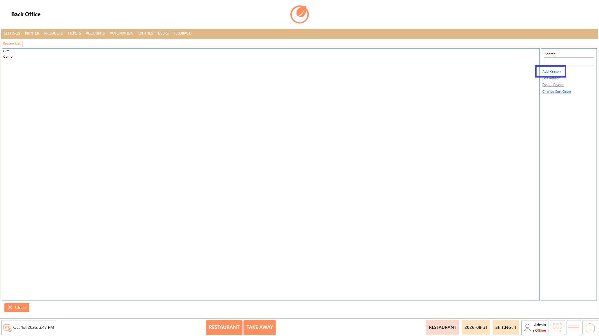
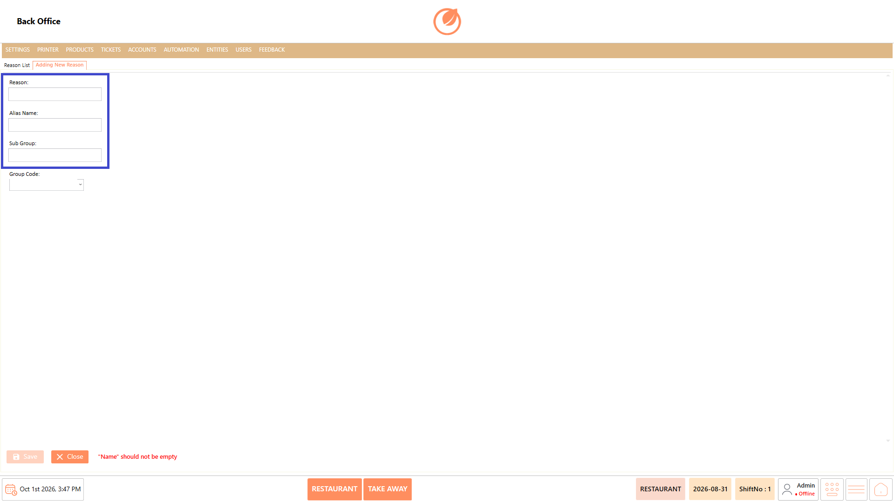
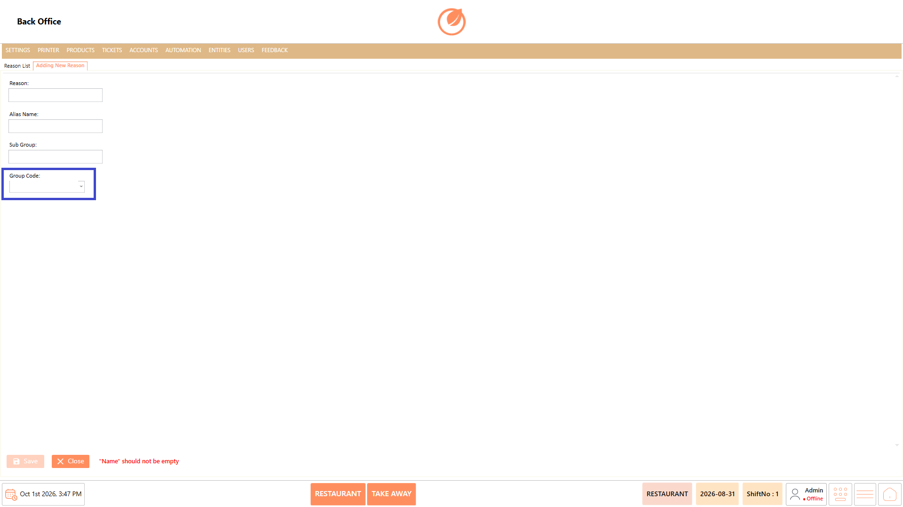
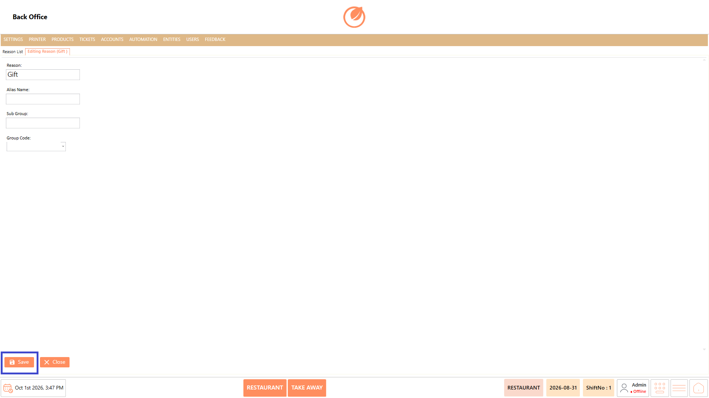
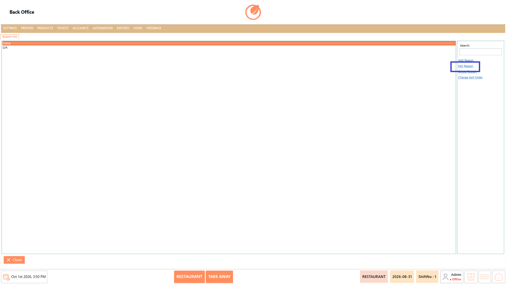
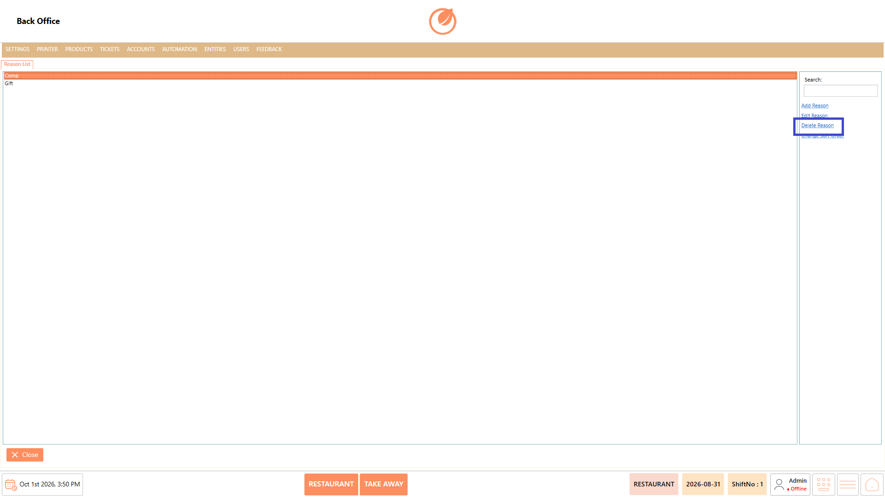
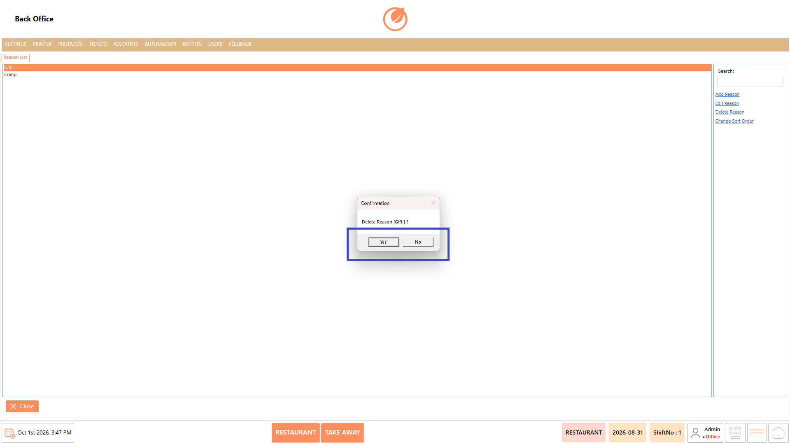
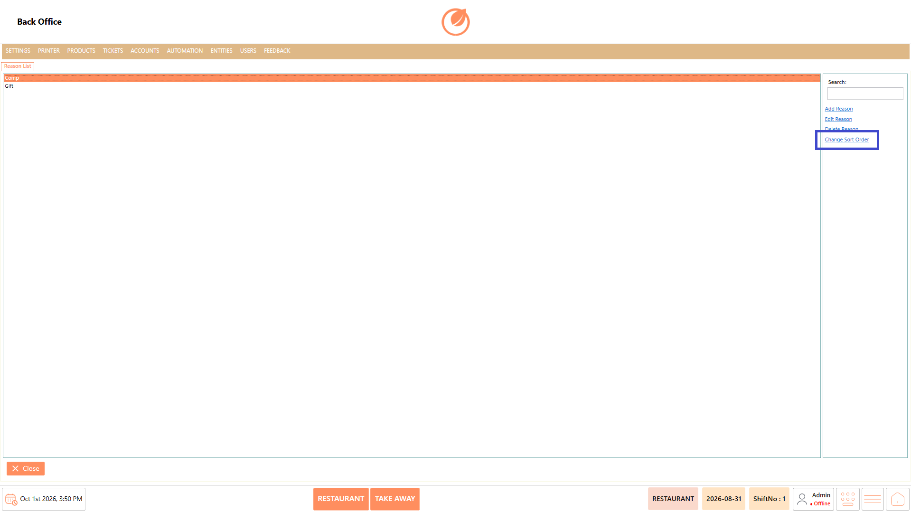

# Reason

### **Overview** 

The Reason section is used to create and manage reasons that can be selected during the ordering process. These reasons can be used when items are marked as Gift or Comp. You can add new reasons, edit existing reasons, delete reasons, and change the order in which reasons are displayed.

<figure><figcaption></figcaption></figure>

### **Screen Elements** 

| **Screen Element** | **Description**                                   |
| ------------------ | ------------------------------------------------- |
| Reason List        | Displays the reasons configured in the system.    |
| Search             | Used to search for a specific reason.             |
| Add Reason         | Used to add a new reason.                         |
| Edit Reason        | Used to modify the details of an existing reason. |
| Delete Reason      | Used to remove a selected reason.                 |
| Change Sort Order  | Used to change the display order of the reasons.  |
| Close              | Closes the Reason section.                        |

### **Working** 

#### **Add Reason** 

1. Select "Add Reason".

<figure><figcaption></figcaption></figure>

2. Enter the required Reason.
3. Enter the Alias Name, if required.
4. Enter the Sub Group, if required.

<figure><figcaption></figcaption></figure>

5. Select the required Group Code.

<figure><figcaption></figcaption></figure>

6. Select "Save" to add the reason.

<figure><figcaption></figcaption></figure>

#### **Edit Reason** 

1. Select the required reason from the Reason List.
2. Select "Edit Reason".

<figure><figcaption></figcaption></figure>

3. Update the required reason details.
4. Select "Save" to save the changes.

<figure><figcaption></figcaption></figure>

#### **Delete Reason** 

1. Select the reason you want to remove.
2. Select "Delete Reason".

<figure><figcaption></figcaption></figure>

3. In the confirmation message, select "Yes" to delete the reason.

<figure><figcaption></figcaption></figure>

#### **Change Sort Order** 

1. Select "Change Sort Order".

<figure><figcaption></figcaption></figure>

2. Adjust the order of the reasons as required.
3. Save the updated order.

### **Use Case** 

* Record the reason when an item is provided to a customer free of charge.
* Provide products as complimentary items or goodwill gestures for customers.
* Document the reason for offering an item free of charge as part of customer service recovery.
* Manage products given at no charge as part of promotional offers or special campaigns.
* Maintain a clear reason when products are provided as Gift or Comp with management approval.
* Track why specific items were provided without charging the customer.
* Provide staff with predefined reasons to select during the ordering process instead of entering explanations manually.
* Organize multiple Gift or Comp reasons so staff can quickly identify and select the appropriate option during order processing.

### **Notes** 

* Enter the Reason before selecting "Save".
* Alias Name, Sub Group, and Group Code can be configured when adding a reason, based on the required setup.
* Select the required reason before using "Edit Reason" or "Delete Reason".
* Verify the reason details before selecting "Save".
* Deleting a reason requires confirmation.
* Use "Change Sort Order" to organize the reason list according to your requirement.
* Create appropriate reasons so users can select the correct reason during the ordering process.
