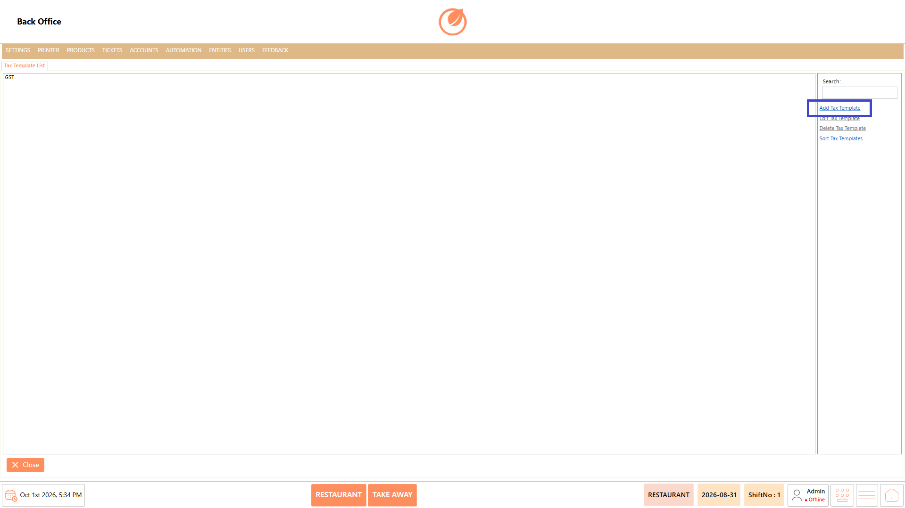
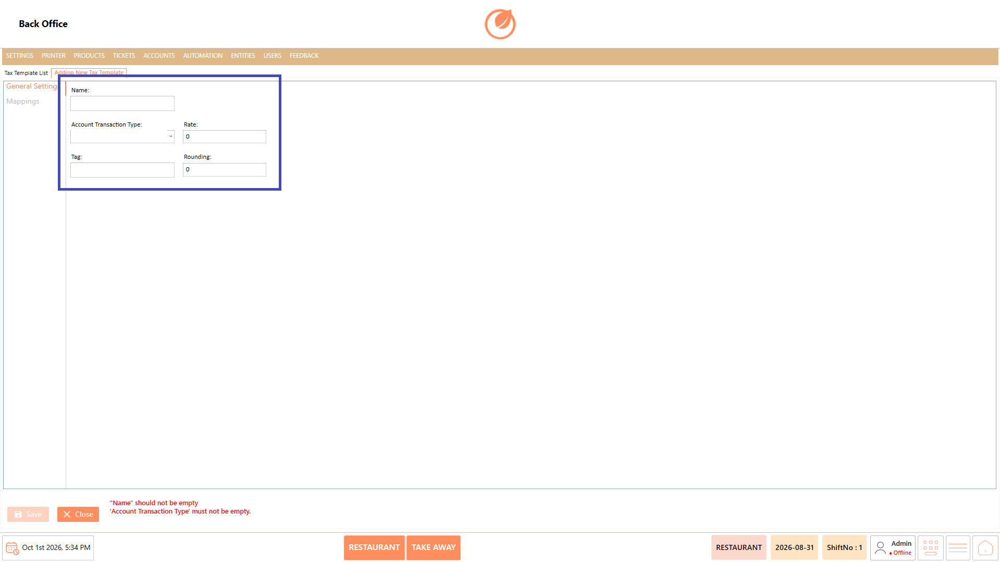
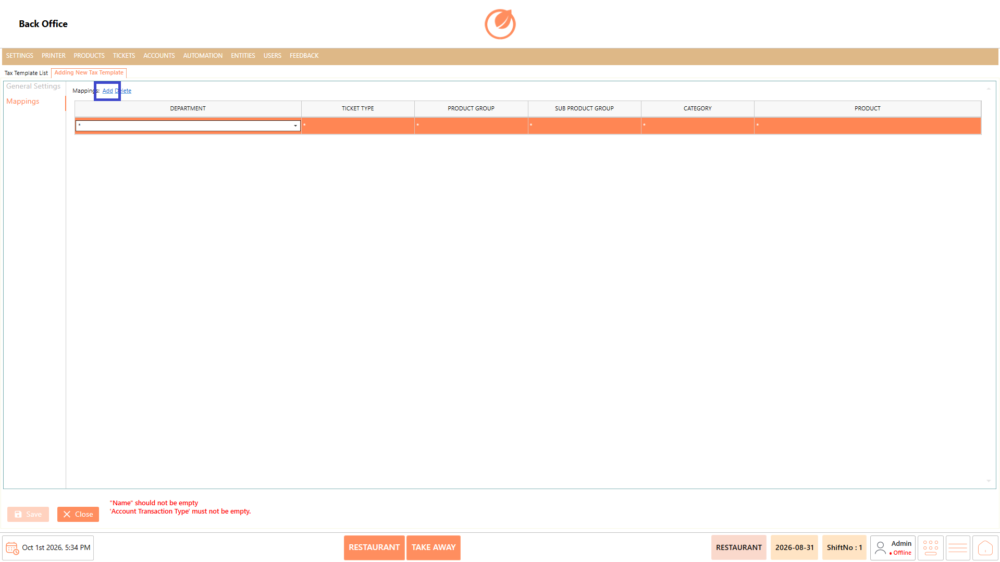
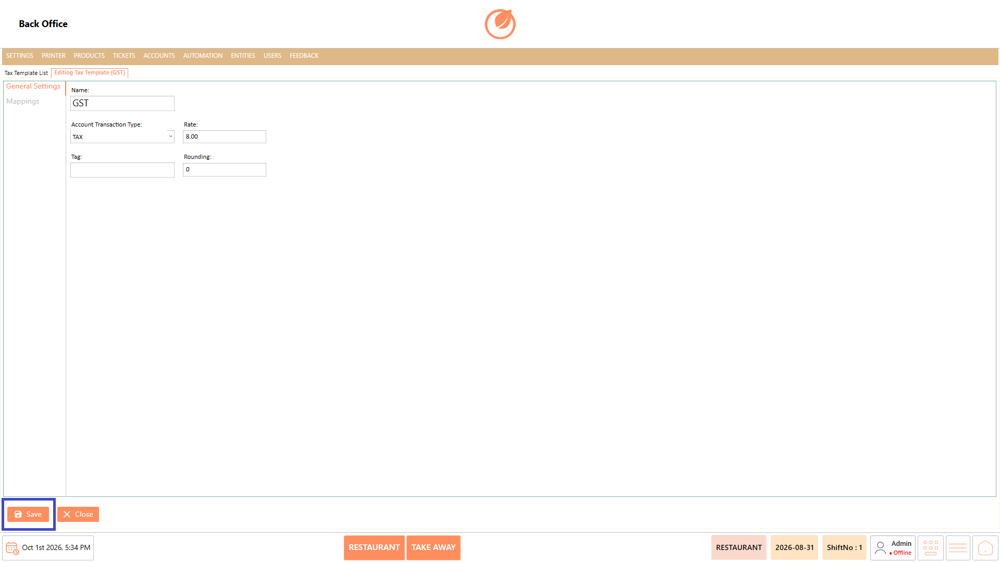
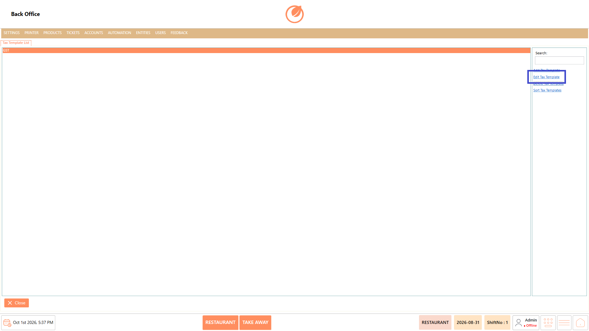
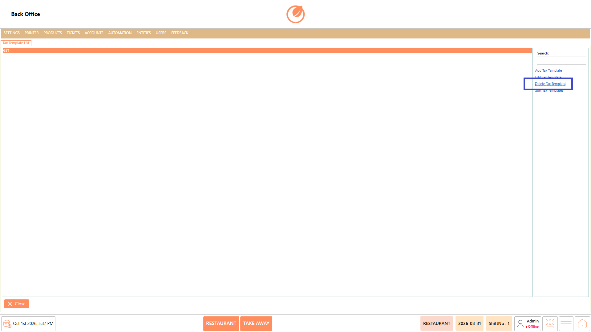
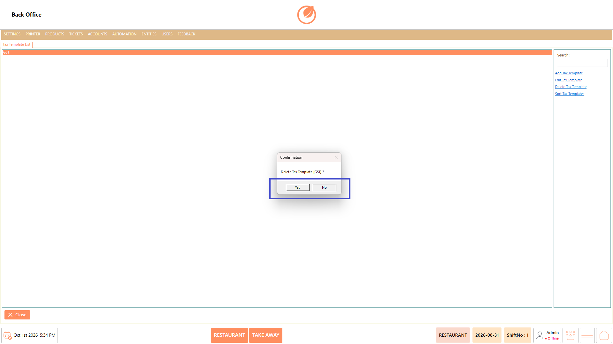
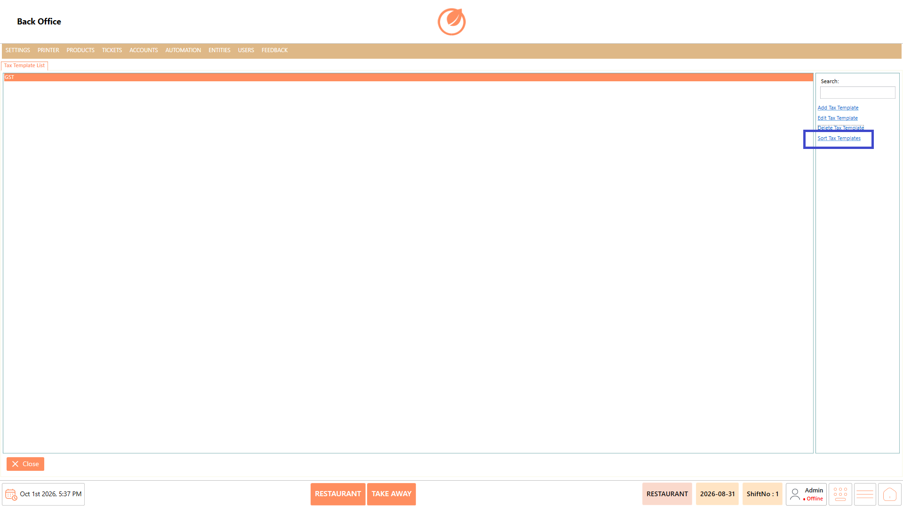

# Tax Templates

### **Overview** 

The Tax Templates setting allows you to create and manage tax templates used for applying tax configurations to products and transactions. You can add, edit, delete, and sort tax templates.

<figure><figcaption></figcaption></figure>

### **Screen Elements** 

| **Screen Element**  | **Description**                                |
| ------------------- | ---------------------------------------------- |
| Search              | Searches for a tax template by name.           |
| Add Tax Template    | Opens the screen to create a new tax template. |
| Edit Tax Template   | Opens the selected tax template for editing.   |
| Delete Tax Template | Deletes the selected tax template.             |
| Sort Tax Templates  | Allows you to sort the tax templates.          |
| Close               | Closes the Tax Template List screen.           |

#### **Add/Edit Tax Template – General Settings** 

| **Screen Element**       | **Description**                                                  |
| ------------------------ | ---------------------------------------------------------------- |
| Name                     | Specifies the name of the tax template.                          |
| Account Transaction Type | Specifies the account transaction type for the tax template.     |
| Rate                     | Specifies the tax rate.                                          |
| Tag                      | Specifies a tag for the tax template.                            |
| Rounding                 | Specifies the rounding value for the tax calculation.            |
| General Settings         | Displays the general configuration options for the tax template. |
| Mappings                 | Displays the mapping options for the tax template.               |
| Save                     | Saves the tax template.                                          |
| Close                    | Closes the tax template configuration screen.                    |

#### **Mappings** 

| **Screen Element** | **Description**                                  |
| ------------------ | ------------------------------------------------ |
| Add                | Adds a mapping to the tax template.              |
| Delete             | Deletes the selected mapping.                    |
| Department         | Specifies the department for the mapping.        |
| Ticket Type        | Specifies the ticket type for the mapping.       |
| Product Group      | Specifies the product group for the mapping.     |
| Sub Product Group  | Specifies the sub product group for the mapping. |
| Category           | Specifies the category for the mapping.          |
| Product            | Specifies the product for the mapping.           |

### **Working** 

#### **Add a Tax Template** 

1. Select "Add Tax Template" from the Tax Template List.

<figure><figcaption></figcaption></figure>

2. Enter the required Name.
3. Select the Account Transaction Type.
4. Enter the Rate, Tag, and Rounding values as required.

<figure><figcaption></figcaption></figure>

5. Select "Mappings" to configure the mapping details.
6. Select "Add" to add a mapping and specify the required mapping details.

<figure><figcaption></figcaption></figure>

7. Select "Save" to create the tax template.

<figure><figcaption></figcaption></figure>

#### **Edit a Tax Template** 

1. Select the tax template that needs to be modified.
2. Select "Edit Tax Template".

<figure><figcaption></figcaption></figure>

3. Update the required tax template details.
4. Modify the mappings if required.
5. Select "Save" to save the changes.

<figure><figcaption></figcaption></figure>

#### **Delete a Tax Template** 

1. Select the tax template that needs to be deleted.
2. Select "Delete Tax Template".

<figure><figcaption></figcaption></figure>

3. In the confirmation message, select "Yes" to delete the tax template.

<figure><figcaption></figcaption></figure>

#### **Sort Tax Templates** 

1. Select "Sort Tax Templates".

<figure><figcaption></figcaption></figure>

2. Arrange the tax templates as required.
3. Save the updated order, if prompted.

### **Use Case** 

* Configure the tax rates that need to be applied to products or transactions.
* Apply different tax configurations when products or services are subject to different tax rates.
* Associate specific tax configurations with departments that follow different tax requirements.
* Apply the appropriate tax configuration to different ticket types based on the transaction being processed.
* Assign tax configurations to specific product groups or categories when different products require different tax treatment.
* Apply a specific tax configuration to individual products when their tax requirement differs from other products in the same category.
* Maintain separate tax templates when the business needs to manage multiple tax configurations across its product and transaction setup.
* Update existing tax configurations when tax rates, rounding requirements, or applicable products and categories change.

### **Notes** 

* Name and Account Transaction Type are required when creating a tax template.
* Verify the tax Rate and Rounding values before saving.
* Review the mappings to ensure the tax template is associated with the intended items.
* Deleting a tax template requires confirmation.
* Use "Search" to quickly locate a tax template in the list.
* Use "Edit Tax Template" to update an existing configuration instead of creating a new template.
