# Database

## **Database** 

### **Overview** 

The Database section provides tools for managing the DinePlan database, including database backups, database tasks, data import and export, database archival, training mode, and database maintenance.

<figure>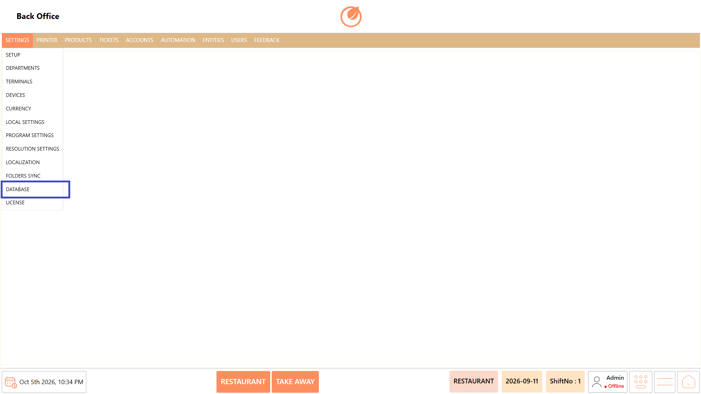<figcaption></figcaption></figure>

## **Backup Database** 

### **Overview** 

The Backup Database section is used to configure and create backups of the DinePlan database. It also provides options to automatically create backups after a work period ends or before upgrading to a new version.

<figure>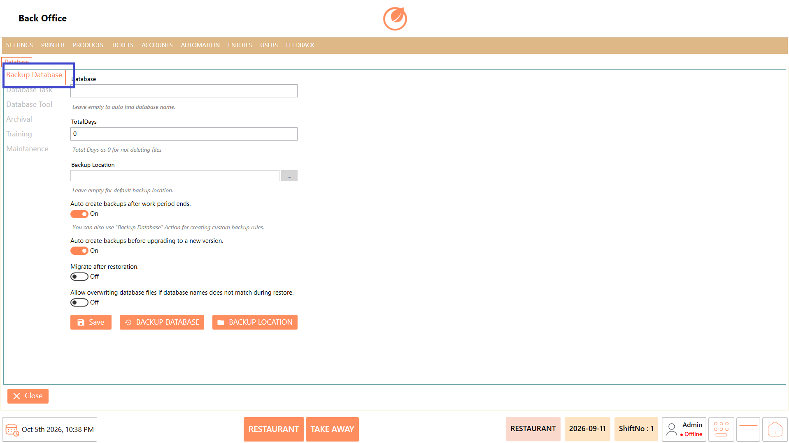<figcaption></figcaption></figure>

### **Screen Elements** 

| **Screen Element**                                                               | **Description**                                                                                                               |
| -------------------------------------------------------------------------------- | ----------------------------------------------------------------------------------------------------------------------------- |
| Database                                                                         | Specifies the database to be backed up. Leave empty to automatically find the database name.                                  |
| TotalDays                                                                        | Specifies the number of days to retain backup files. A value of 0 indicates that files are not deleted based on this setting. |
| Backup Location                                                                  | Specifies the location where the database backup is stored. Leave empty to use the default backup location.                   |
| Auto create backups after work period ends                                       | Automatically creates a database backup when the work period ends.                                                            |
| Auto create backups before upgrading to a new version                            | Automatically creates a backup before the application is upgraded to a new version.                                           |
| Migrate after restoration                                                        | Enables migration after restoring the database.                                                                               |
| Allow overwriting database files if database names does not match during restore | Allows database files to be overwritten when the database names do not match during restoration.                              |
| "Save"                                                                           | Saves the configured database backup settings.                                                                                |
| "Backup Database"                                                                | Creates a database backup based on the configured settings.                                                                   |
| "Backup Location"                                                                | Opens the backup location configuration or selection.                                                                         |

### **Working** 

#### **Configure Database Backup** 

1. Open "Database" and select "Backup Database".
2. Enter the required database name in "Database", or leave it empty to automatically find the database name.

<figure>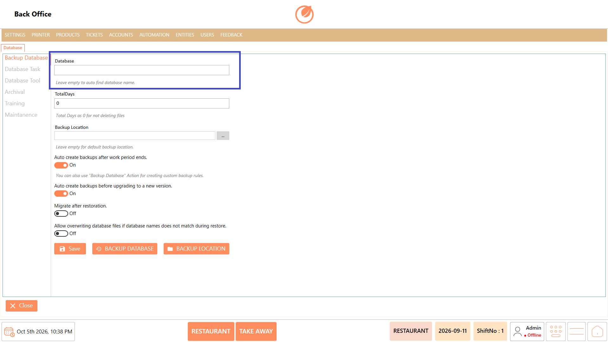<figcaption></figcaption></figure>

3. Enter the required number of days in "TotalDays" to retain backup files.

<figure>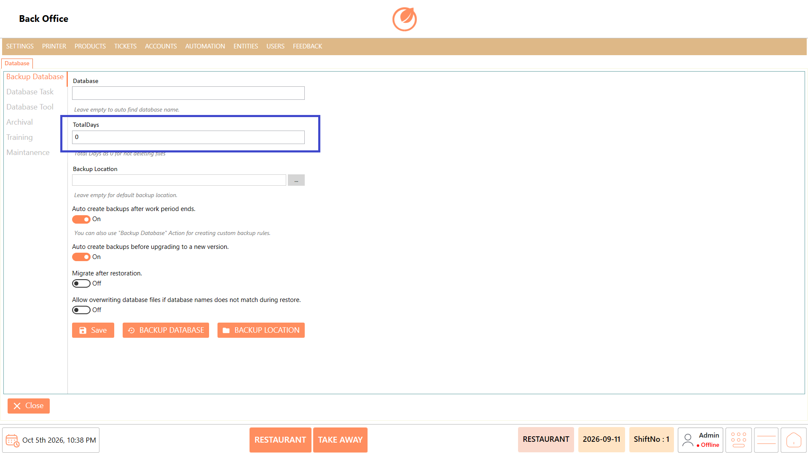<figcaption></figcaption></figure>

4. Specify the required location in "Backup Location", or leave it empty to use the default location.

<figure>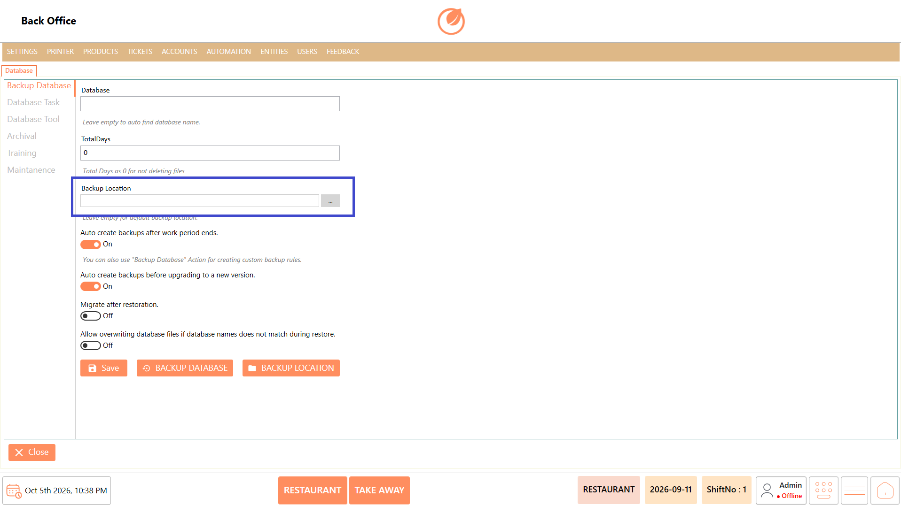<figcaption></figcaption></figure>

5. Enable the required automatic backup options.
6. Enable "Migrate after restoration" if migration is required after restoring the database.

<figure>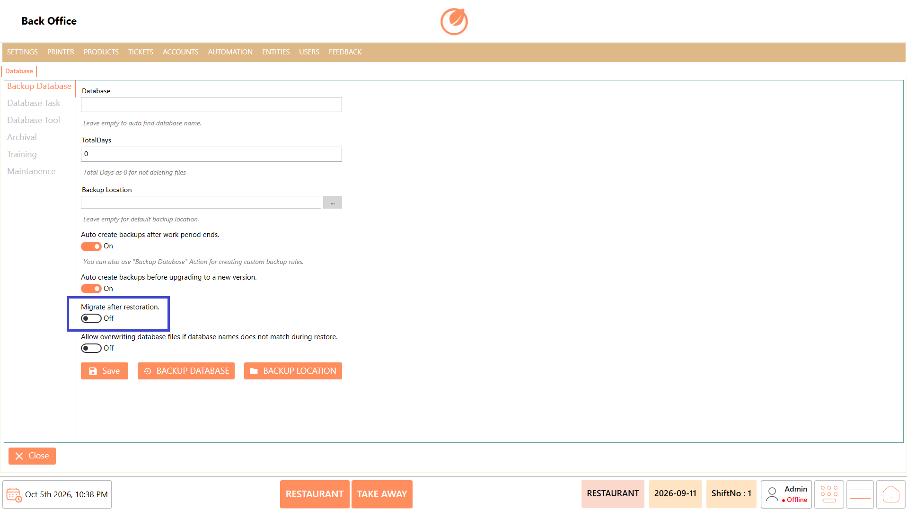<figcaption></figcaption></figure>

7. Enable "Allow overwriting database files if database names does not match during restore" when required.

<figure>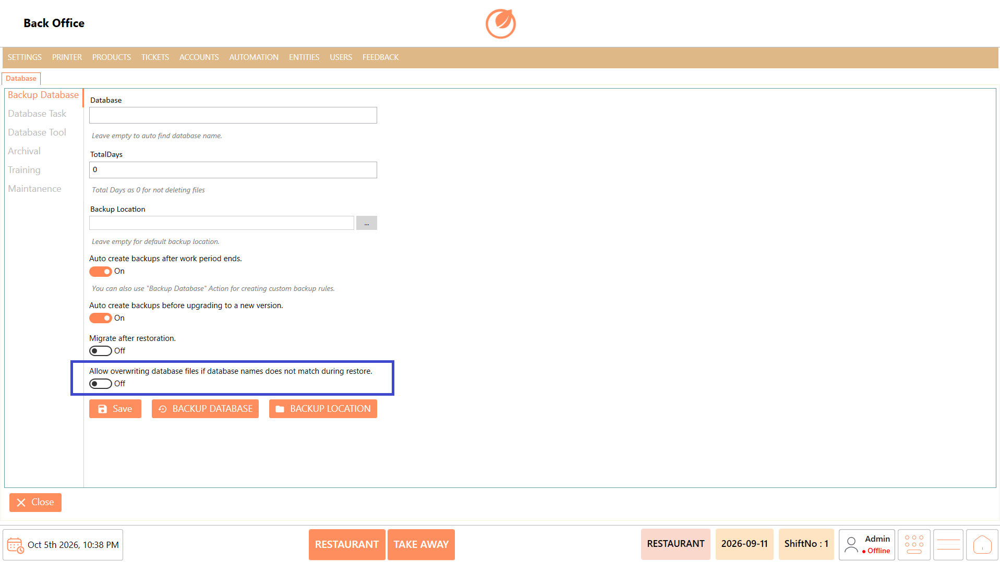<figcaption></figcaption></figure>

8. Click "Save" to save the configuration.

<figure>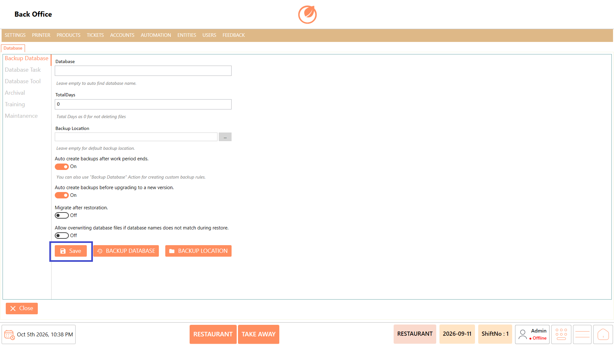<figcaption></figcaption></figure>

9. Click "Backup Database" to create a backup when required.

<figure>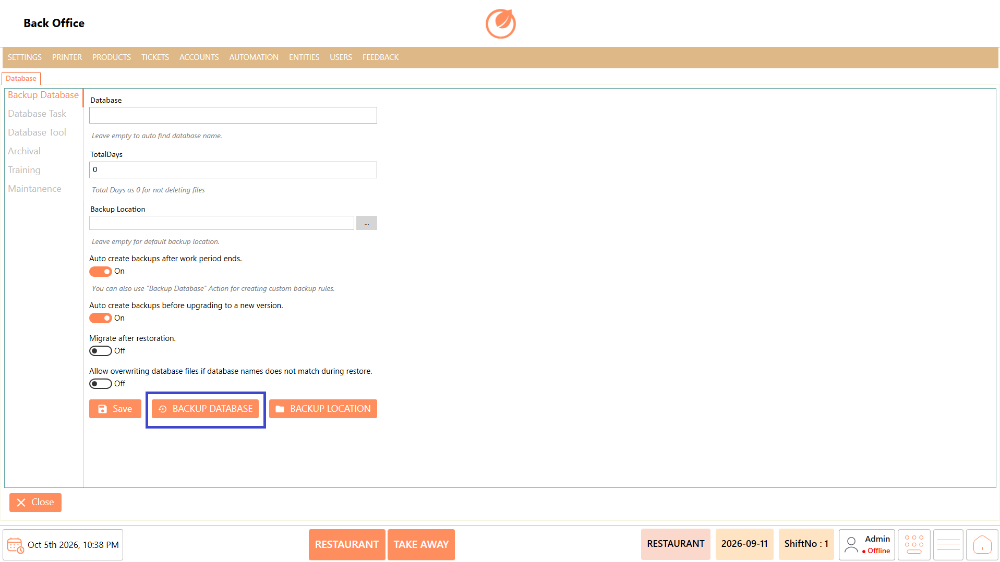<figcaption></figcaption></figure>

10. To view the location of the existing backup data, select "Backup Location".

<figure>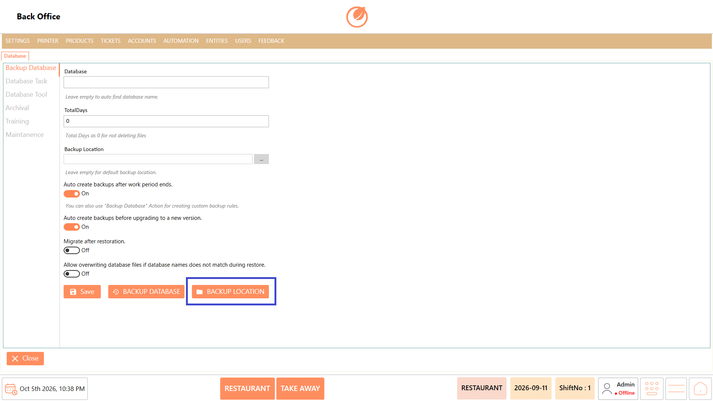<figcaption></figcaption></figure>

### **Use Case** 

1. Create a backup of the DinePlan database before making major changes.
2. Configure automatic backups after a work period ends.
3. Create a backup before upgrading DinePlan to a new version.
4. Define how long backup files should be retained.
5. Store backups in a specified location.
6. Enable migration after database restoration when required.
7. Allow database files to be overwritten during restoration when required.
8. Maintain a backup of database data for recovery purposes.

### **Notes** 

* Leave "Database" empty when the database name should be detected automatically.
* "Total Days" set to 0 indicates that files are not deleted based on this setting.
* Leave "Backup Location" empty to use the default backup location.
* Configure automatic backup options according to the customer's requirements.

## **Database Task** 

### **Overview** 

The Database Task section allows configured database tasks to be viewed and executed. Additional tasks can be created in the DatabaseTasks folder using supported .sql or .bat files.

<figure>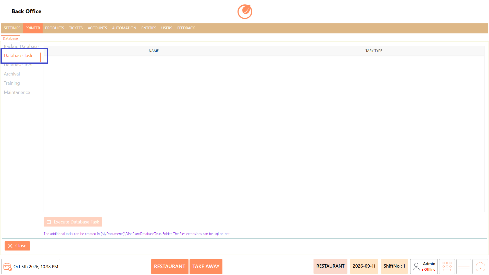<figcaption></figcaption></figure>

### **Screen Elements** 

| **Screen Element**      | **Description**                                    |
| ----------------------- | -------------------------------------------------- |
| Name                    | Displays the name of the configured database task. |
| Task Type               | Displays the type of database task.                |
| "Execute Database Task" | Executes the selected database task.               |

### **Working** 

1. Open "Database" and select "Database Task".
2. Review the available database tasks.
3. Select the required task.
4. Click "Execute Database Task" to run the selected task.

<figure>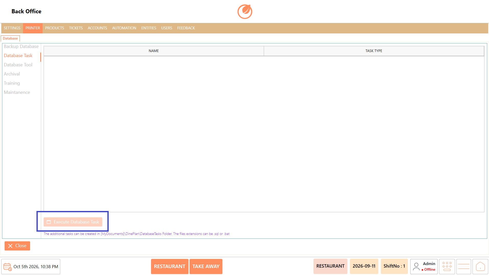<figcaption></figcaption></figure>

### **Use Case** 

1. View the database tasks available in DinePlan.
2. Identify the required database task.
3. Execute a configured task when database-level processing is required.
4. Run SQL-based database tasks when applicable.
5. Run batch-based database tasks when applicable.
6. Use predefined tasks for required database operations.
7. Execute tasks without manually accessing the database.
8. Maintain commonly required database operations as reusable tasks.

### **Notes** 

* Additional database tasks can be created in the DatabaseTasks folder.
* The displayed information indicates that .sql and .bat files are supported.
* Execute database tasks only when the required operation is known.

## **Database Tool** 

### **Overview** 

The Database Tool section provides options to export and import selected database configuration data. It also provides an option to automatically create a backup before importing data.

<figure>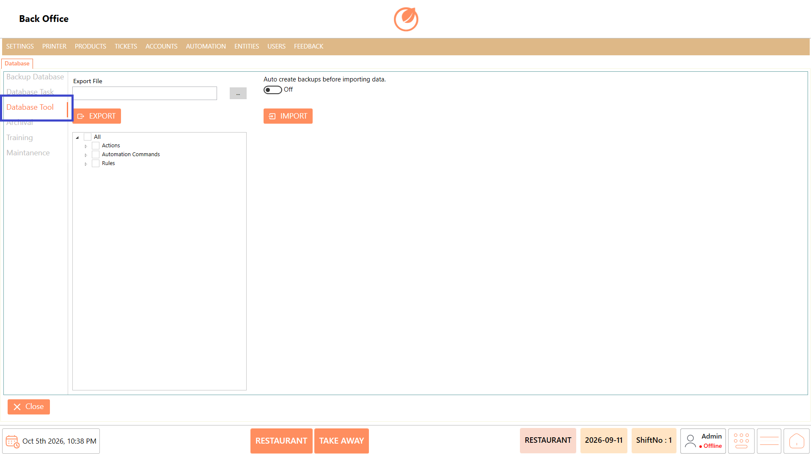<figcaption></figcaption></figure>

### **Screen Elements** 

| **Screen Element**                        | **Description**                                                    |
| ----------------------------------------- | ------------------------------------------------------------------ |
| Export File                               | Specifies the file location for the exported data.                 |
| "Export"                                  | Exports the selected database data.                                |
| Auto Create backups before importing data | Automatically creates a backup before importing data when enabled. |
| "Import"                                  | Imports data from the selected file.                               |
| All                                       | Allows all available data categories to be selected.               |
| Actions                                   | Data category available for export or import.                      |
| Automation Commands                       | Data category available for export or import.                      |
| Rules                                     | Data category available for export or import.                      |

### **Working** 

#### **Export Data** 

1. Open "Database" and select "Database Tool".
2. Select the required data categories.
3. Specify the required location in "Export File".

<figure>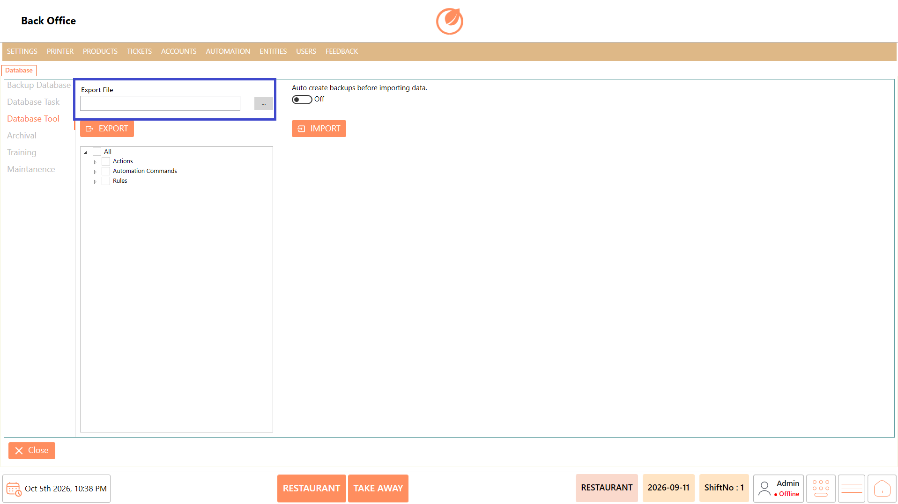<figcaption></figcaption></figure>

4. Click "Export" to export the selected data.

<figure>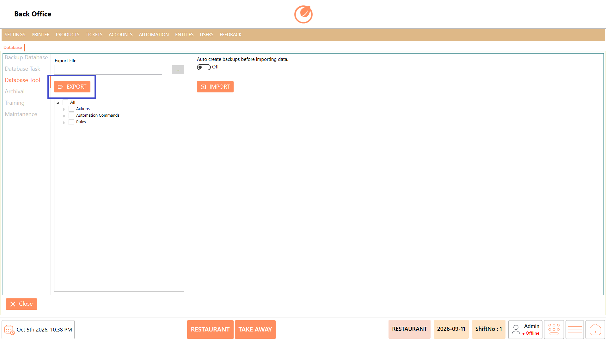<figcaption></figcaption></figure>

#### **Import Data** 

1. Open "Database" and select "Database Tool".
2. Enable "Auto Create backups before importing data" if a backup is required before the import.

<figure>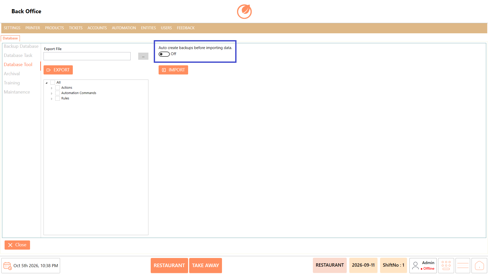<figcaption></figcaption></figure>

3. Select the required data categories.
4. Select the required import file.

<figure>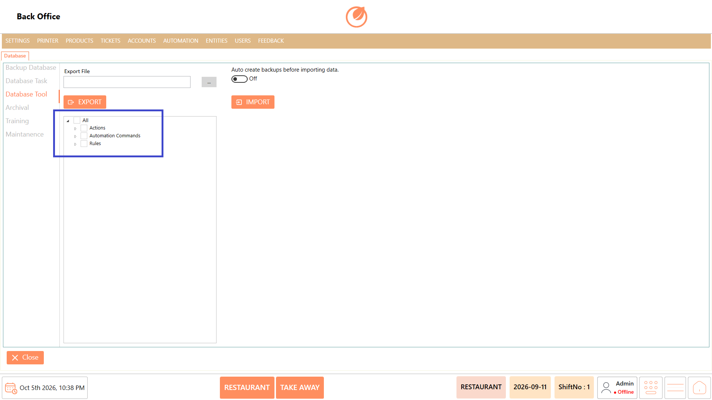<figcaption></figcaption></figure>

5. Click "Import" to import the selected data.

<figure>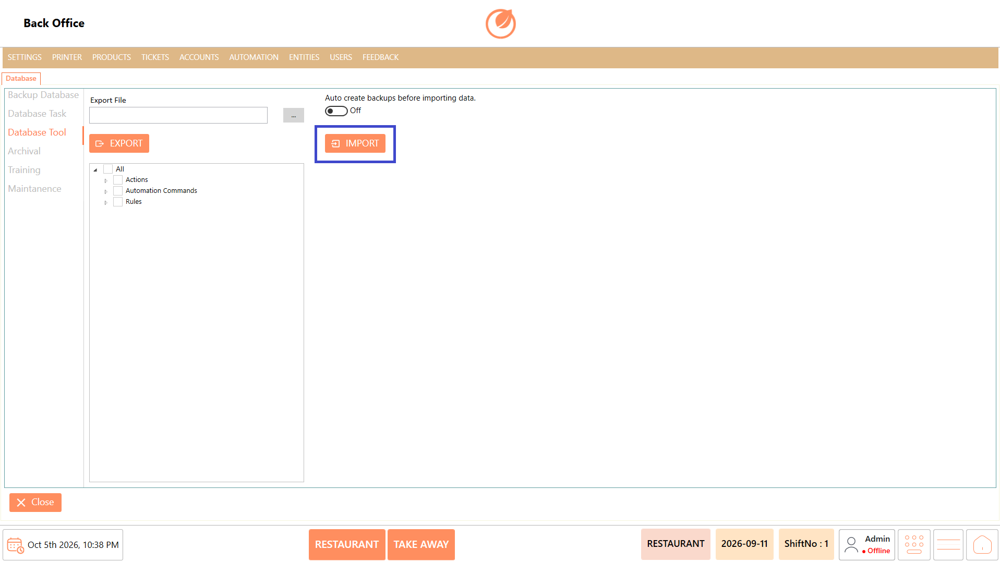<figcaption></figcaption></figure>

### **Use Case** 

1. Export selected database configuration data.
2. Create a copy of selected configuration data for another environment.
3. Import previously exported configuration data.
4. Select specific data categories instead of importing or exporting all available data.
5. Create an automatic backup before importing data.
6. Transfer configured actions between environments.
7. Transfer automation commands when required.
8. Transfer rules using the database tool.

### **Notes** 

* Select the required categories before performing an import or export.
* Enable "Auto Create backups before importing data" when a backup is required before importing.
* Verify the selected file and data categories before importing.

&#x20;

## **Archival** 

### **Overview** 

The **Archival** section is used to configure database archival settings. It allows you to specify how many days of data should be retained and provides an option to automatically archive the database when the workday ends.

<figure>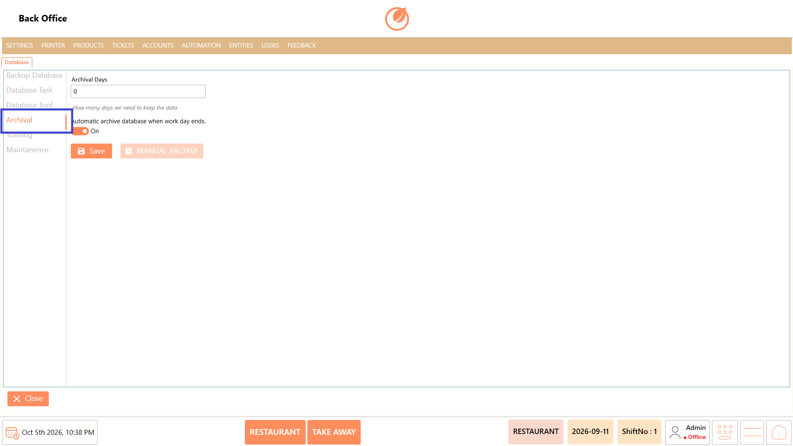<figcaption></figcaption></figure>

### **Screen Elements** 

| **Screen Element**                            | **Description**                                                 |
| --------------------------------------------- | --------------------------------------------------------------- |
| Archival Days                                 | Specifies the number of days for which data should be retained. |
| Automatic archive database when work day ends | Automatically archives the database when the workday ends.      |
| "Save"                                        | Saves the archival configuration.                               |
| "Manual Archive"                              | Manually archives the database.                                 |

### **Working** 

1. Open "Database" and select "Archival".
2. Enter the required number of days in "Archival Days".

<figure>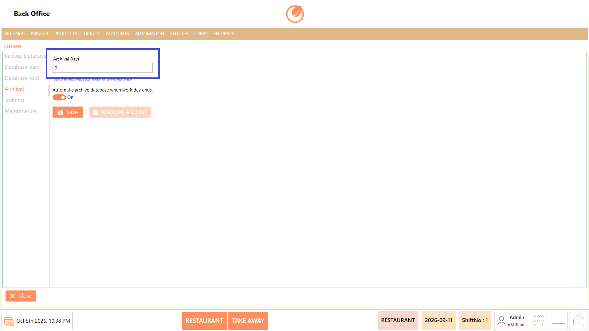<figcaption></figcaption></figure>

3. Enable "Automatic archive database when work day ends" if automatic archival is required.

<figure>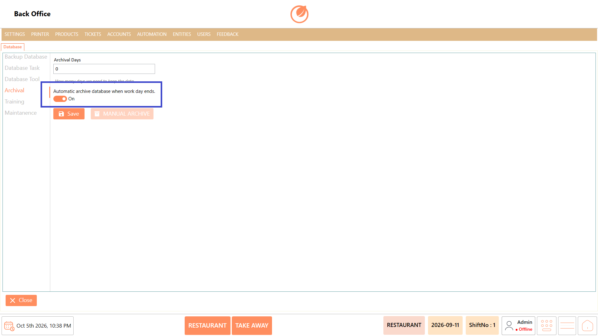<figcaption></figcaption></figure>

4. Click "Save" to save the configuration.

<figure>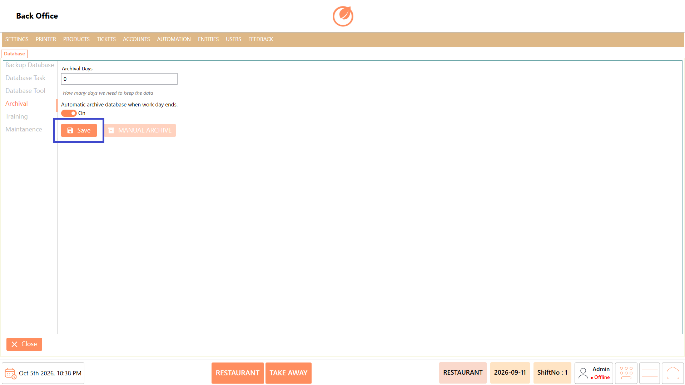<figcaption></figcaption></figure>

5. Click "Manual Archive" when a manual archival operation is required.

<figure>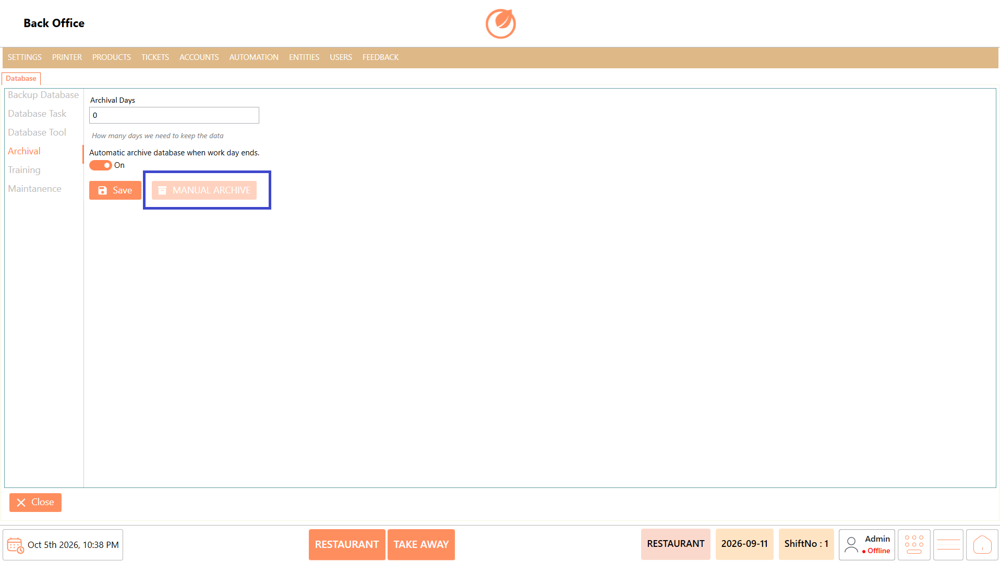<figcaption></figcaption></figure>

### **Use Case** 

1. Define the number of days for which database data should be retained.
2. Automatically archive database data when the workday ends.
3. Perform a manual database archive when required.
4. Maintain older database data through archival.
5. Configure archival based on the customer's data-retention requirements.
6. Reduce the amount of active database data when archival is enabled.
7. Maintain a regular archival process at the end of the workday.
8. Perform archival manually when automatic archival is not required.

### **Notes** 

* Configure "Archival Days" according to the required data-retention period.
* Enable automatic archival only when it is required for the customer's setup.
* Use "Manual Archive" when an immediate manual archival operation is required.

## **Training** 

### **Overview** 

The **Training** section provides options to enable or disable the training functionality.

<figure>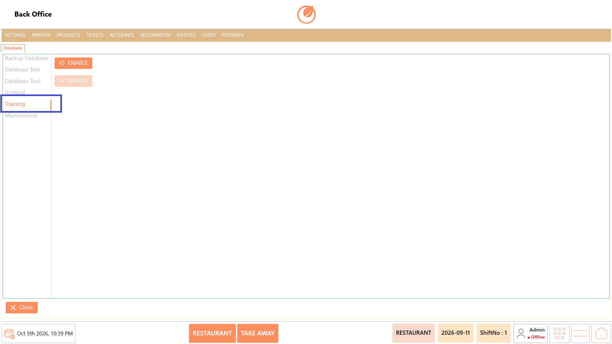<figcaption></figcaption></figure>

### **Screen Elements** 

| **Screen Element** | **Description**                      |
| ------------------ | ------------------------------------ |
| "Enable"           | Enables the training functionality.  |
| "Disable"          | Disables the training functionality. |

### **Working** 

1. Open "Database" and select "Training".
2. Click "Enable" to enable training functionality.
3. Click "Disable" to disable training functionality when it is no longer required.

<figure>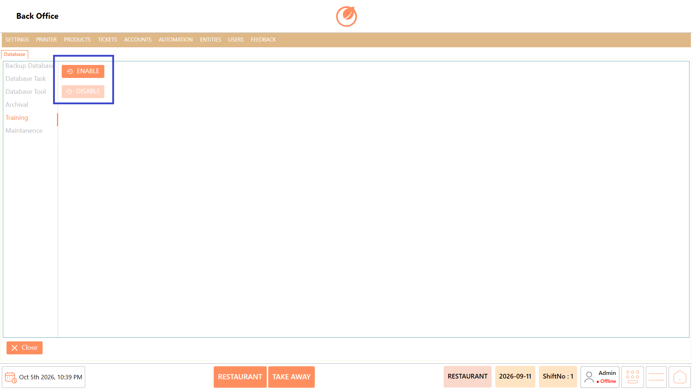<figcaption></figcaption></figure>

### **Use Case** 

1. Enable training functionality when the system is being used for training.
2. Provide a separate environment for training activities.
3. Disable training functionality when normal operations are required.
4. Switch between training and normal operational requirements as needed.
5. Enable training during staff onboarding.
6. Use training functionality for user practice.
7. Disable training after training activities are completed.
8. Control the availability of training functionality from the Database settings.

### **Notes** 

* Enable or disable training according to the customer's requirements.
* Ensure the appropriate setting is selected before users begin their activities.

## **Maintenance** 

### **Overview** 

The Maintenance section provides a database maintenance option to automatically adjust the database size.

<figure>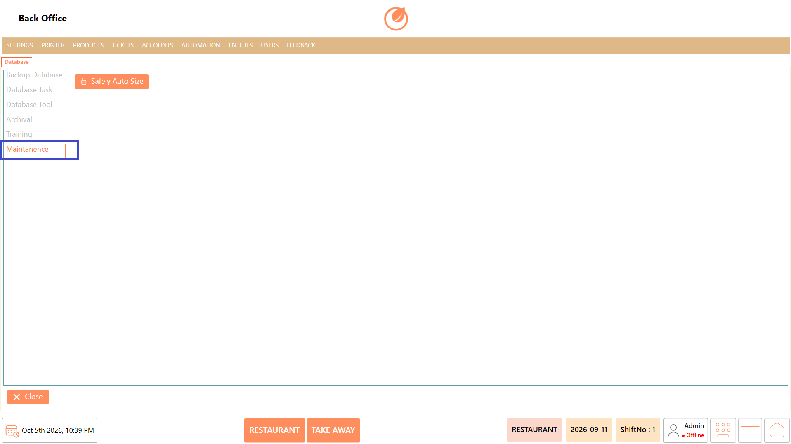<figcaption></figcaption></figure>

### **Screen Elements** 

| **Screen Element** | **Description**                                        |
| ------------------ | ------------------------------------------------------ |
| "Safely Auto Size" | Performs the available database auto-sizing operation. |

### **Working** 

1. Open "Database" and select "Maintenance".
2. Click "Safely Auto Size" to perform the database sizing operation.

<figure>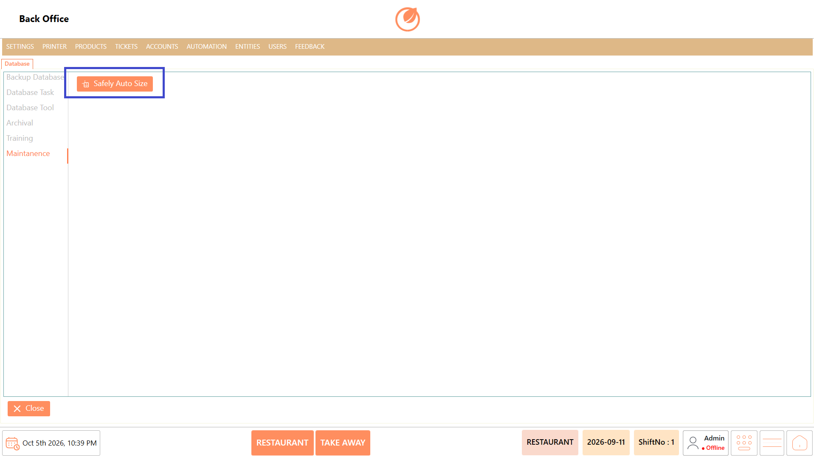<figcaption></figcaption></figure>

### **Use Case** 

1. Perform database maintenance when required.
2. Adjust the database size using the available maintenance option.
3. Perform the operation through the DinePlan interface.
4. Use the maintenance option when database sizing needs to be addressed.
5. Carry out routine database maintenance when required.
6. Perform maintenance without manually accessing database files.
7. Use the available maintenance function as part of database administration.
8. Maintain the database according to operational requirements.

### **Notes** 

* Use **"**&#x53;afely Auto Size" only when database maintenance is required.
* Database maintenance should be performed carefully, preferably by an authorized user.
