# Department

## **Overview** 

The Department section is used to create and manage different service departments based on the restaurant's requirements. Departments can represent different service types, such as Restaurant, Take Away, Walk Through, or Drive Through.

Users can create, edit, delete, and sort departments as required.

<figure>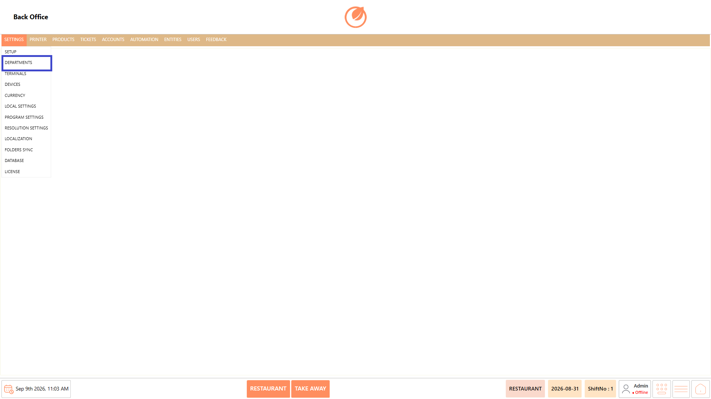<figcaption></figcaption></figure>

### **Screen Elements** 

<figure>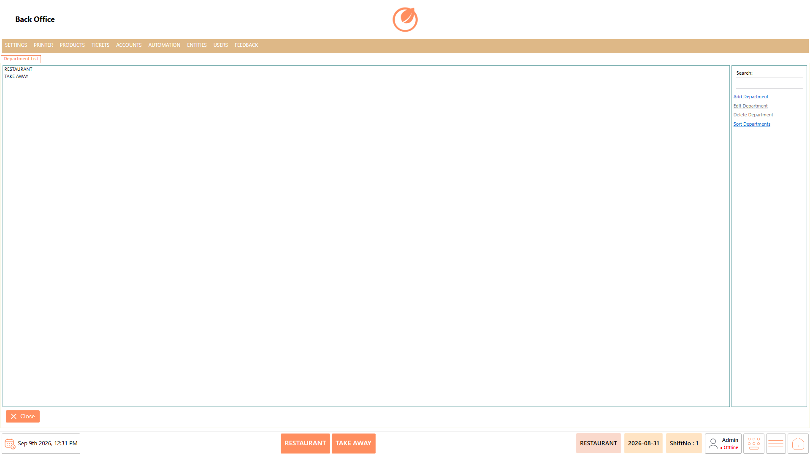<figcaption></figcaption></figure>

| **Screen Element** | **Description**                                    |
| ------------------ | -------------------------------------------------- |
| Department List    | Displays the departments configured in the system. |
| Search             | Used to search for a specific department.          |
| Add Department     | Used to create a new department.                   |
| Edit Department    | Used to modify the selected department.            |
| Delete Department  | Used to remove the selected department.            |
| Sort Departments   | Used to arrange the department list.               |
| Close              | Closes the Department screen.                      |

### **Working** 

#### **Create a Department** 

1. Select "Add Department" from the Department List.

<figure>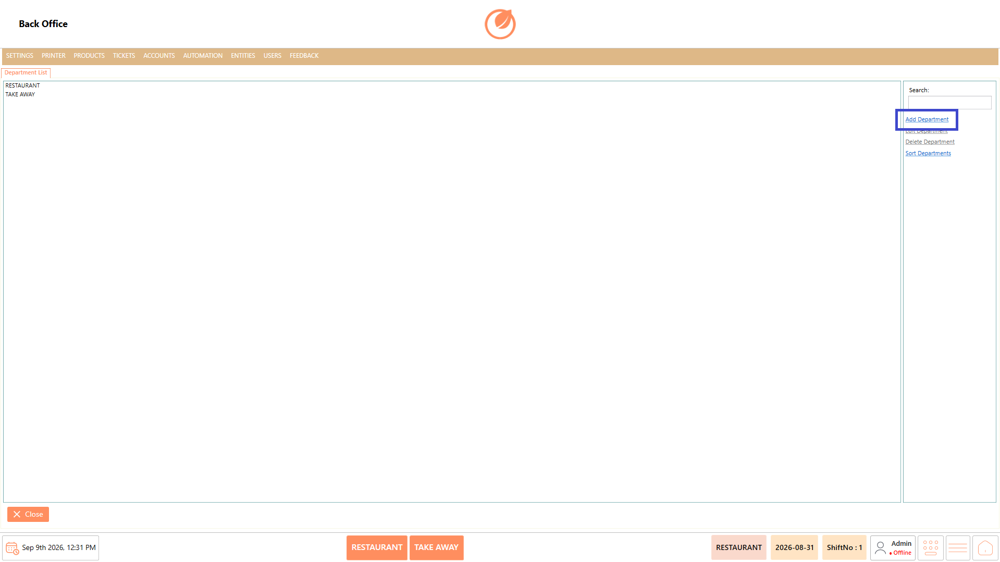<figcaption></figcaption></figure>

2. Enter the required "Department Name".

<figure>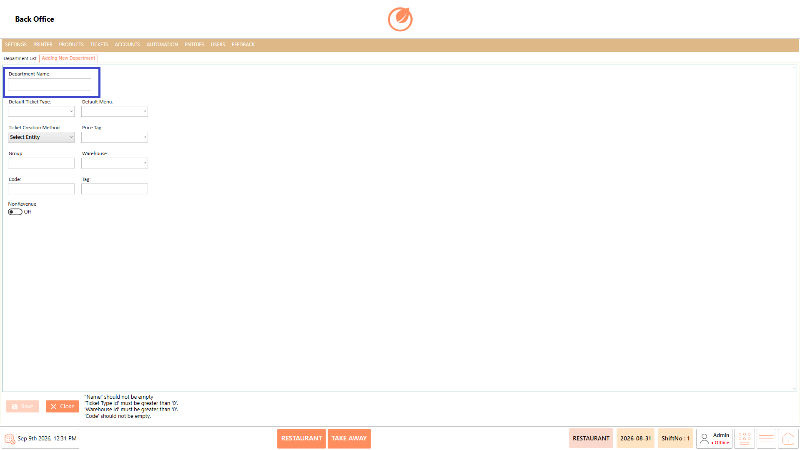<figcaption></figcaption></figure>

3. Select the required "Default Ticket Type" and "Default Menu".

<figure>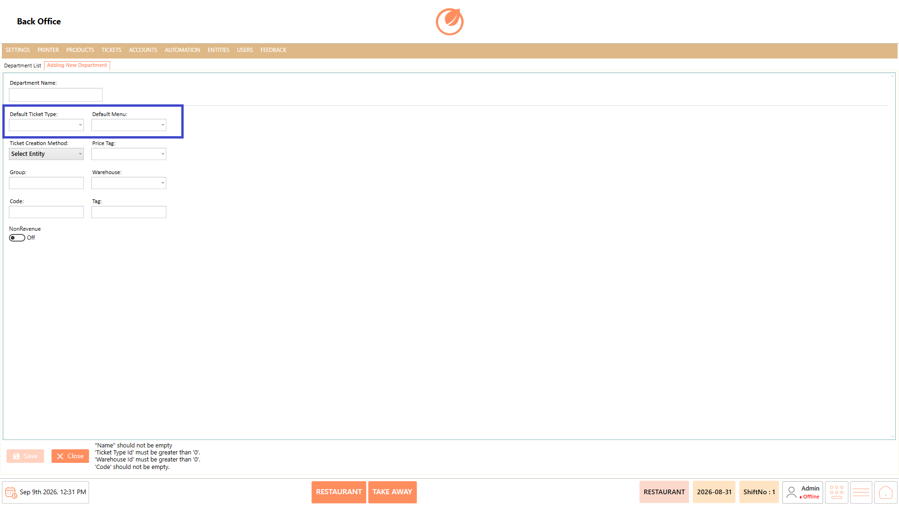<figcaption></figcaption></figure>

4. Select the required "Ticket Creation Method", "Price Tag", and "Warehouse".

<figure>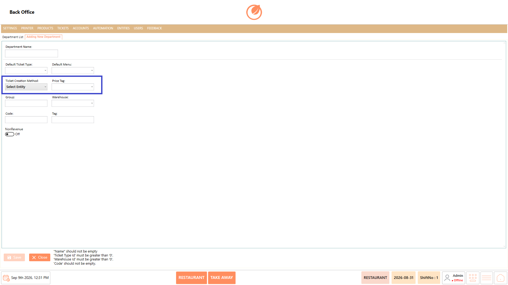<figcaption></figcaption></figure>

5. Enter the required "Group", "Code", and "Tag" information.

<figure>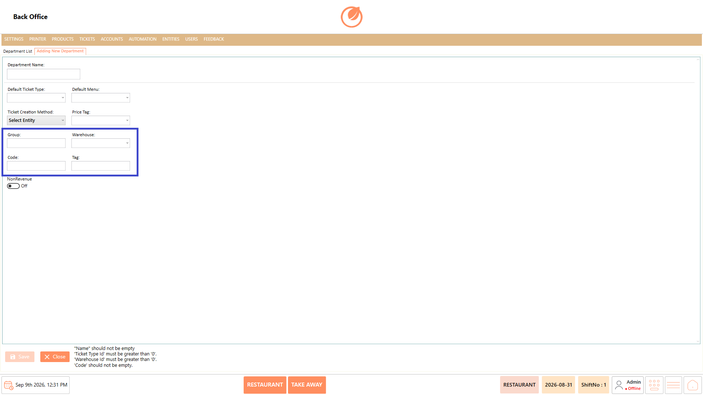<figcaption></figcaption></figure>

6. Enable "NonRevenue" if the department should be treated as non-revenue.

<figure>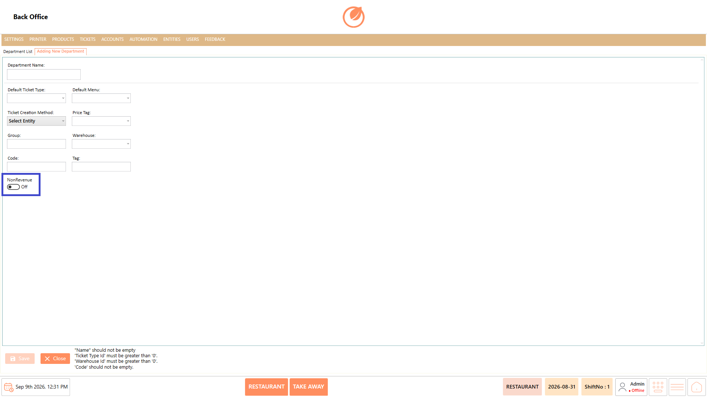<figcaption></figcaption></figure>

7. Select "Save" to create the department.

<figure>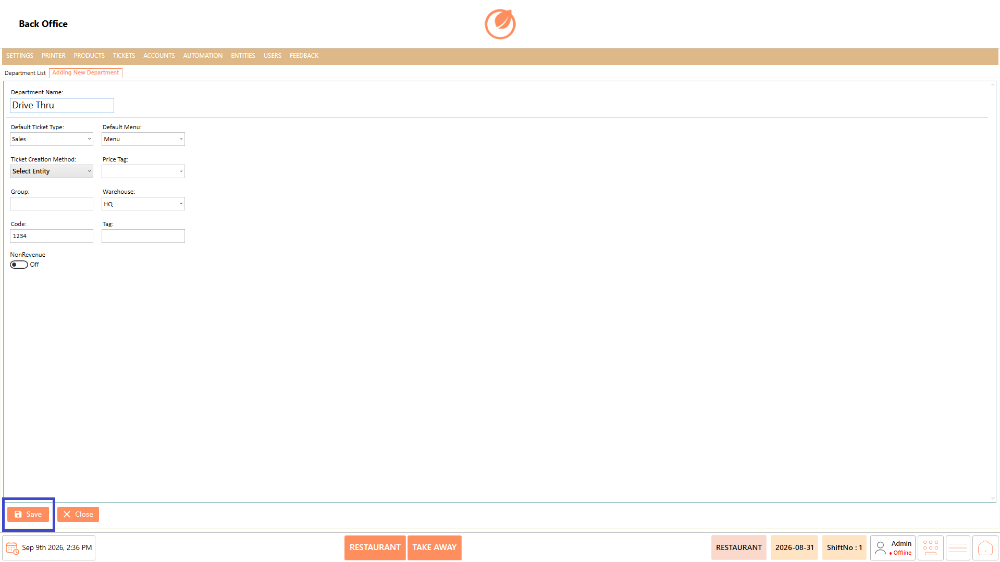<figcaption></figcaption></figure>

#### **Edit a** **Department** 

1. Select the required department from the Department List.

<figure>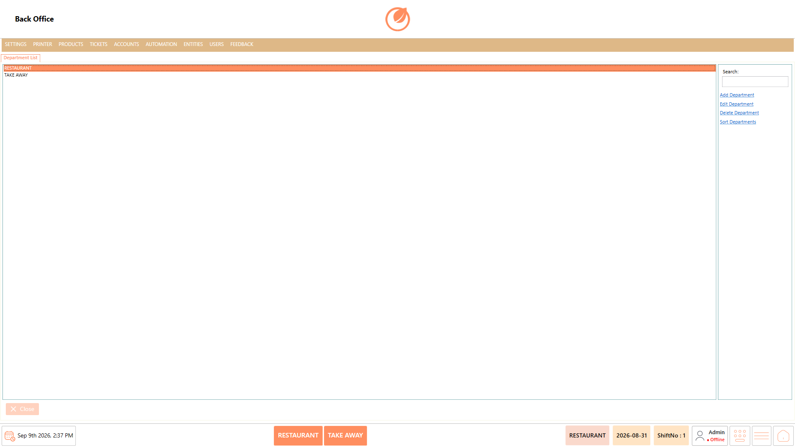<figcaption></figcaption></figure>

2. Select "Edit Department".

<figure>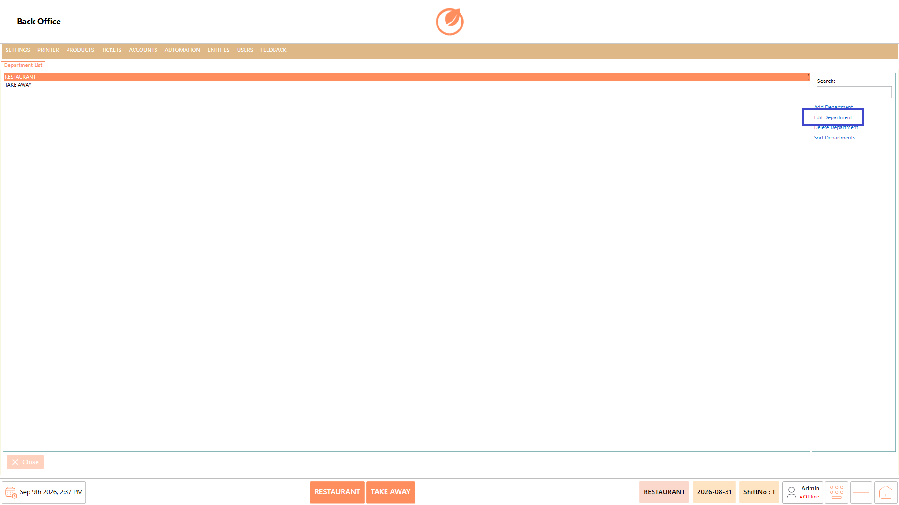<figcaption></figcaption></figure>

3. Update the required information.
4. Select "Save" to apply the changes.

<figure><figcaption></figcaption></figure>

#### **Delete a Department** 

1. Select the department to be deleted from the Department List.

<figure><figcaption></figcaption></figure>

2. Select "Delete Department".

<figure><figcaption></figcaption></figure>

3. A confirmation message appears asking whether to delete the selected department.
4. Select "Yes" to confirm the deletion or "No" to cancel.

<figure>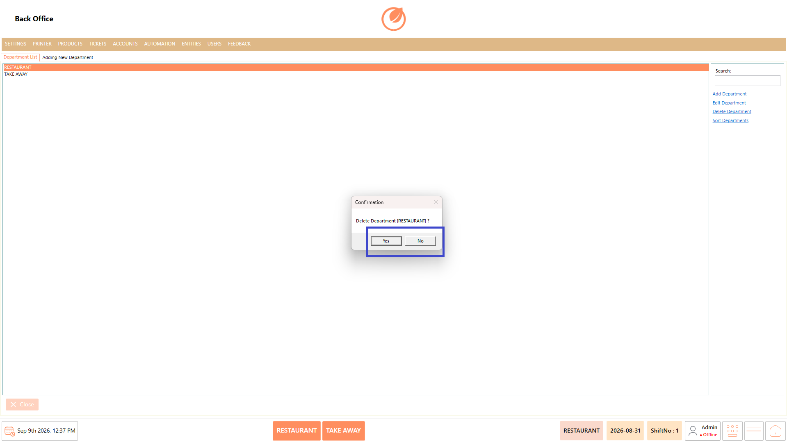<figcaption></figcaption></figure>

#### **Sort Departments** 

1. Select "Sort Departments".

<figure>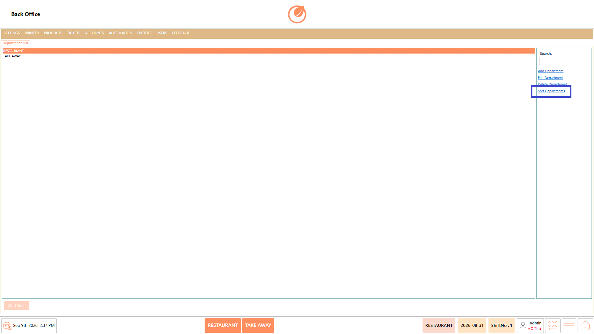<figcaption></figcaption></figure>

2. The "Sort Departments" pop-up appears with the configured departments.

<figure>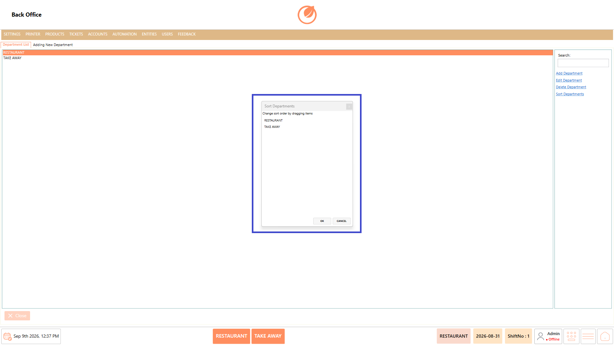<figcaption></figcaption></figure>

3. Drag and drop the departments to arrange them in the required order.
4. Select "OK" to save the new order or "Cancel" to discard the changes.

<figure>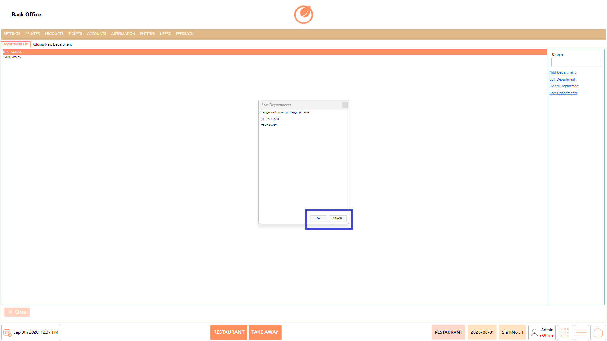<figcaption></figcaption></figure>

### **Use Case** 

* Departments can be created according to the restaurant's service requirements, for example:
  * Restaurant
  * Take Away
  * Walk Through
  * Drive Through
* Configure separate service types such as Restaurant, Take Away, Walk Through, or Drive Through within the POS.
* Manage different ordering channels separately when each service type has its own operational requirements.
* Assign a default menu to a department so the appropriate menu is available for that service type.
* Configure different ticket creation methods based on how orders are received and processed.
* Apply different price tags when product pricing varies between service types or departments.
* Associate a department with the appropriate warehouse when stock or product availability needs to be managed separately.
* Configure non-revenue departments for service areas or transactions that should not be treated as revenue-generating.
* Maintain and organize multiple departments so staff can select the appropriate service type while processing orders.

### **Notes** 

* Configure departments based on the restaurant's operational requirements.
* Ensure the correct department name and settings are entered when creating a department.
* Review the selected department before editing or deleting it.
* Deleting a department should be performed only when it is no longer required.
