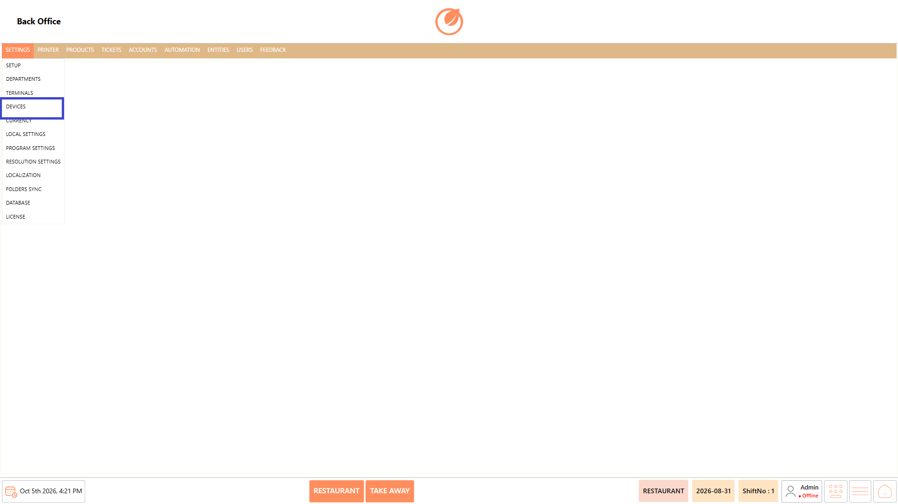
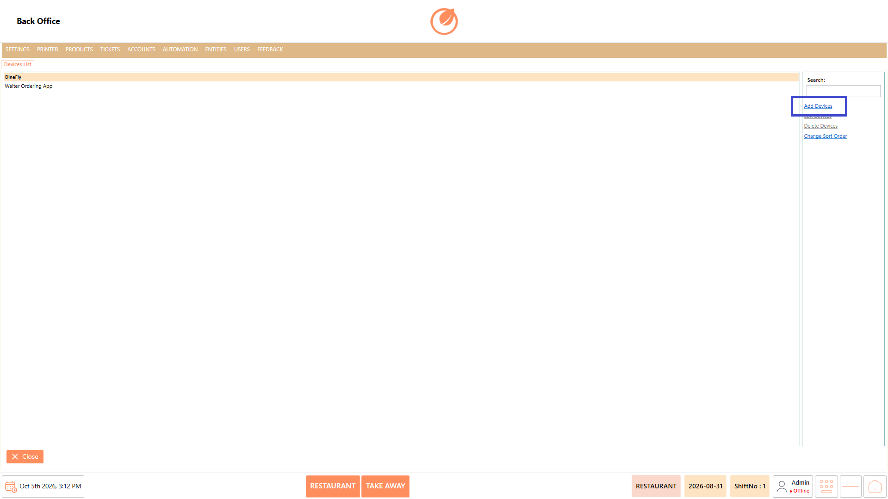
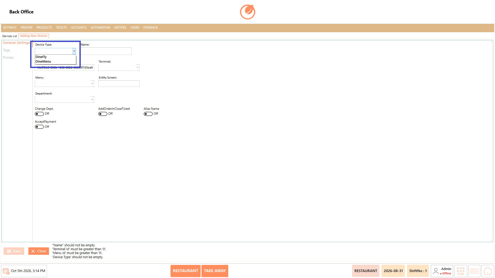
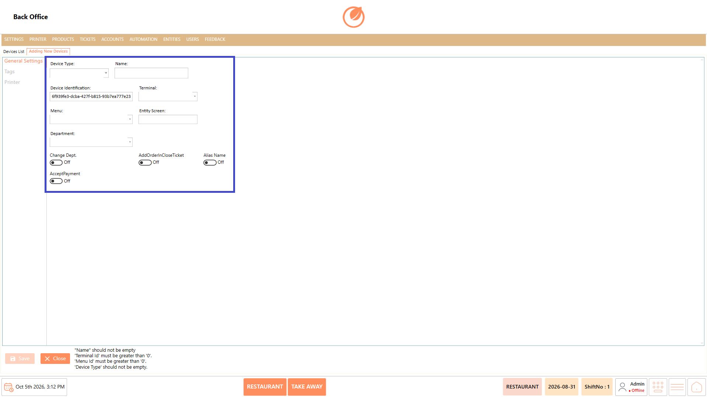
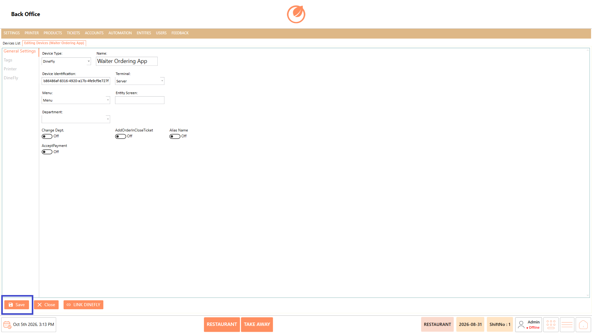
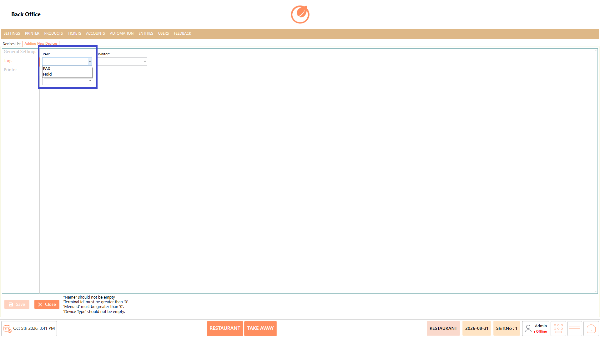
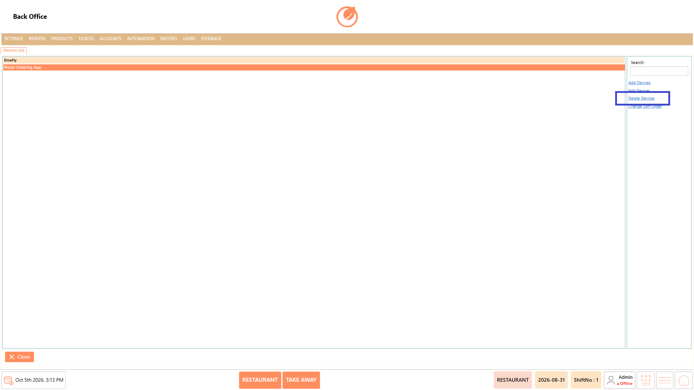
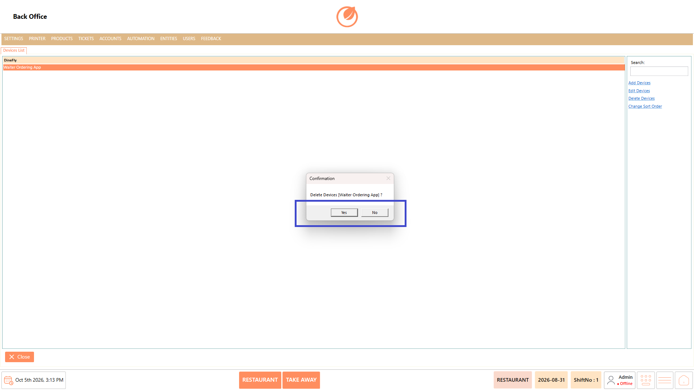
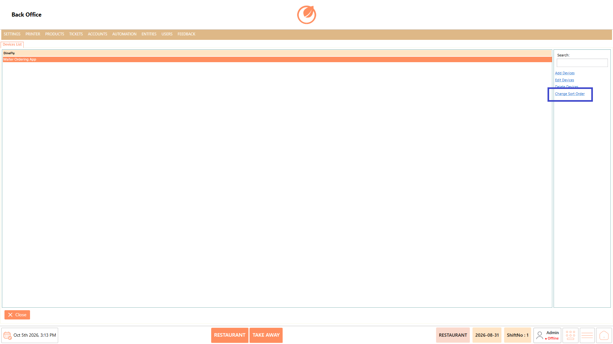

# Devices

## **Overview** 

The Devices section is used to configure devices that can be connected to DinePlan according to the restaurant's requirements. By default, the available device types are DineFly, used as a waiter ordering app, and DineMenu, used as a tablet menu.

The section also allows users to create, edit, delete, and sort configured devices.

<figure><figcaption></figcaption></figure>

### **Screen Elements** 

| **Screen Element** | **Description**                                |
| ------------------ | ---------------------------------------------- |
| Device List        | Displays the devices configured in the system. |
| Search             | Used to search for a specific device.          |
| Add Device         | Used to create a new device.                   |
| Edit Device        | Used to modify the selected device.            |
| Delete Device      | Used to remove the selected device.            |
| Change Sort Order  | Used to change the order of the devices.       |
| Close              | Closes the Devices screen.                     |

### **Working** 

#### **Create a Device** 

1. Select "Add Device".

<figure><figcaption></figcaption></figure>

2. Select the required "Device Type", such as "DineFly" or "DineMenu".

<figure><figcaption></figcaption></figure>

3. Enter the device "Name" and select the required "Terminal", "Menu", and "Department".
4. Configure the required options under "General Settings" and "Tags".
5. Select the required "Bill Template" and "Printer" under "Printer".

<figure><figcaption></figcaption></figure>

6. Select "Save" to create the device.

<figure><figcaption></figcaption></figure>

#### **Configure PAX and Hold** 

* Select "PAX" when the device needs to capture the number of customers seated at the table.
* Select "Hold" when an order needs to be held for later preparation. For example, starters can be sent first and the main course can be held until it is required.

<figure><figcaption></figcaption></figure>

#### **Edit a Device** 

1. Select the required device from the Device List.
2. Select "Edit Device".

<figure><figcaption></figcaption></figure>

3. Update the required configuration.
4. Select "Save" to apply the changes.

<figure><figcaption></figcaption></figure>

#### **Delete a Device** 

1. Select the device to be deleted.
2. Select "Delete Device".

<figure><figcaption></figcaption></figure>

3. Confirm the deletion when prompted.

<figure><figcaption></figcaption></figure>

#### **Sort Devices** 

1. Select "Change Sort Order".

<figure><figcaption></figcaption></figure>

2. Arrange the devices in the required order.
3. Confirm or save the new order as prompted.

### **Use Case** 

* Devices can be configured based on how the restaurant operates:
  * **DineFly** – Used as a waiter ordering app.
  * **DineMenu** – Used as a tablet menu where menu items are displayed for customers.
* Configure **DineFly** devices for waiters to take and submit customer orders directly from the table.
* Configure **DineMenu** devices to provide customers with a tablet-based menu for viewing available products.
* Assign devices to specific terminals, menus, and departments when different service areas require different configurations.
* Capture the number of customers seated at a table through **PAX** when the guest count is required for the ordering process.
* Hold selected items when different courses need to be prepared or served at different times during the same order.
* Configure separate devices for different restaurant areas when each area follows a different ordering workflow.
* Assign appropriate bill templates and printers when devices in different service areas require different printing configurations.
* Maintain and organize multiple connected devices so each device can support the required ordering and service operations.

### **Notes** 

* Select the appropriate "Device Type" when creating a device.
* Assign the correct terminal, menu, and department to the device.
* Use "PAX" to capture the number of customers seated at the table.
* Use "Hold" when items need to be prepared at different times during an order.
* Configure payment, department, and other options only when required.
* Select the appropriate "Bill Template" and "Printer" for the device.
