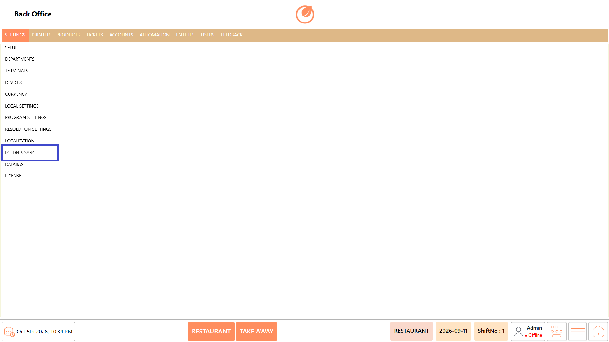
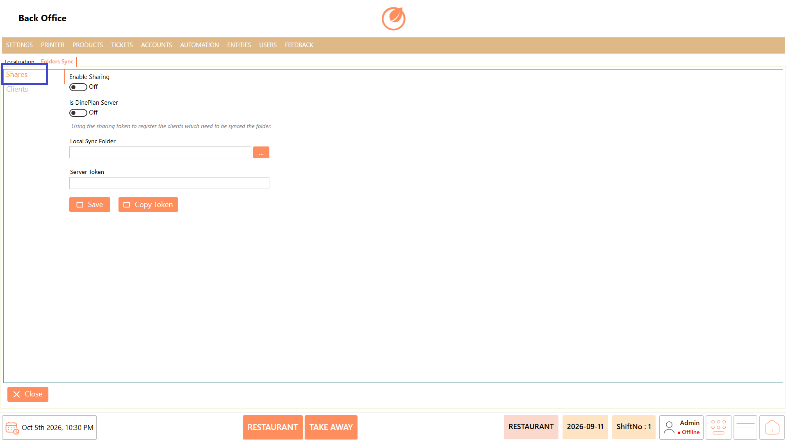
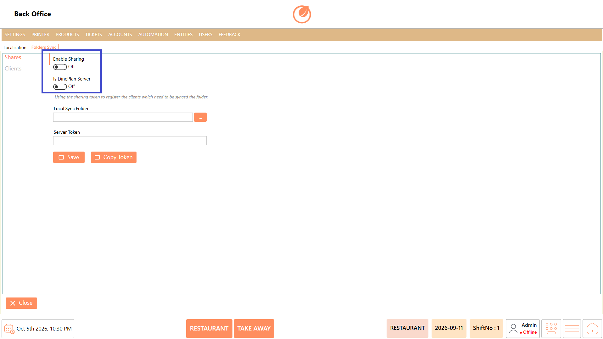
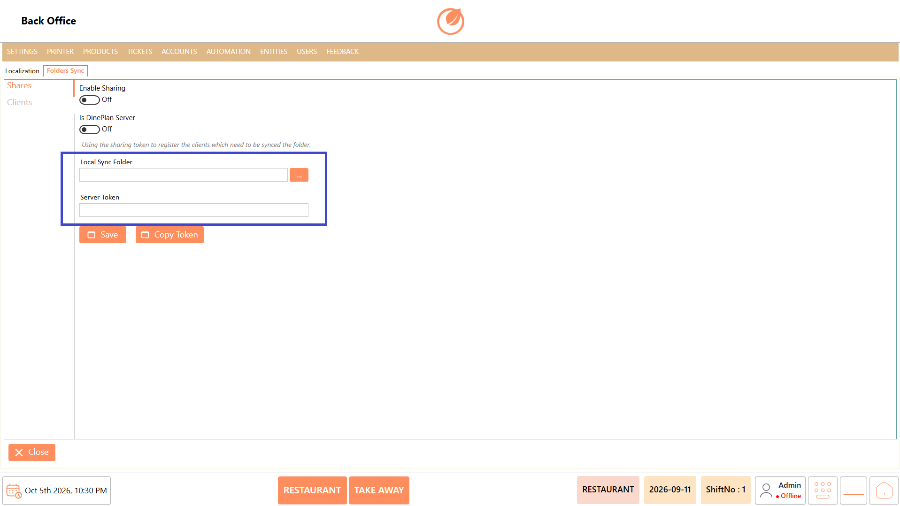
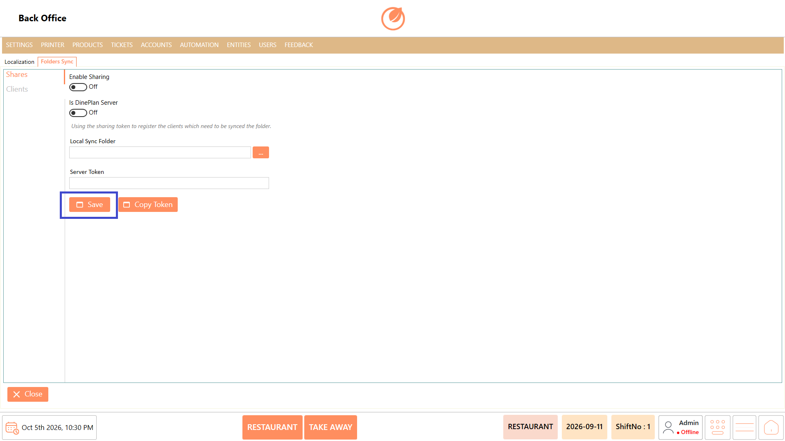
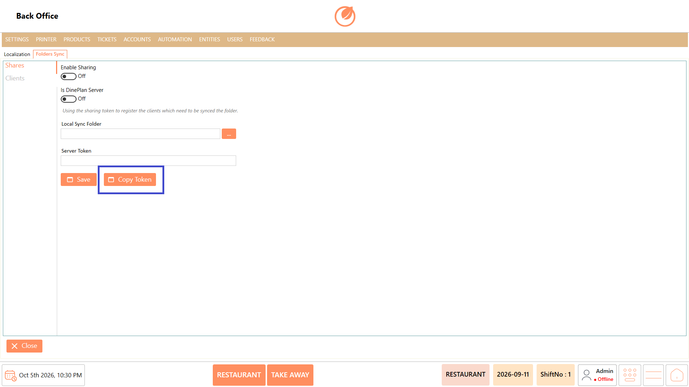
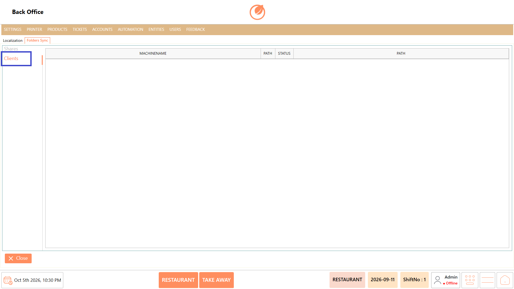
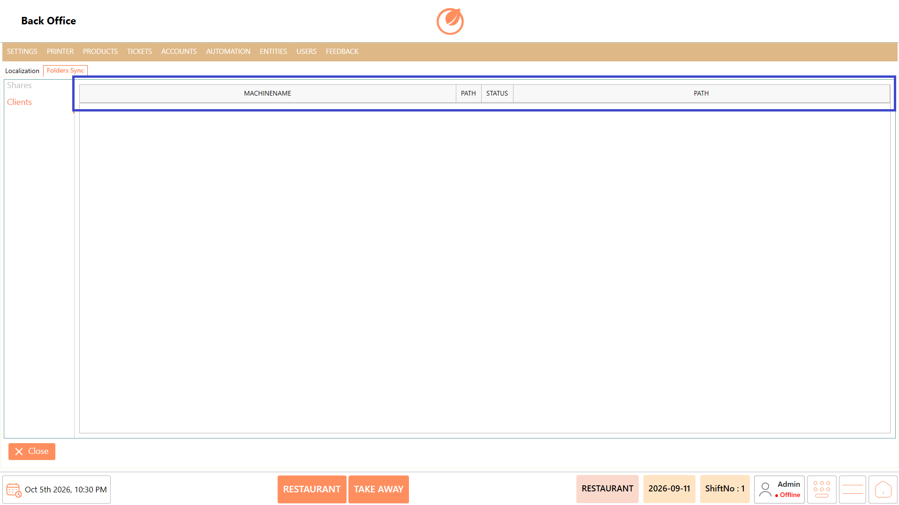

# Folder Sync

### **Overview** 

Folder Sync is used to configure folder sharing and synchronization between the DinePlan Server and connected client machines. It allows a shared folder to be configured on the server and clients to be registered using a sharing token for folder synchronization.

<figure><figcaption></figcaption></figure>

### **Screen Elements** 

#### **Shares** 

| **Screen Element** | **Description**                                                            |
| ------------------ | -------------------------------------------------------------------------- |
| Enable Sharing     | Enables or disables folder sharing.                                        |
| Is DinePlan Server | Specifies whether the current system is configured as the DinePlan Server. |
| Share Folder       | Specifies the folder that is shared for synchronization.                   |
| Share Token        | Displays the token used to register client systems for synchronization.    |
| "Save"             | Saves the folder sharing configuration.                                    |
| "Copy Token"       | Copies the sharing token for use when registering clients.                 |

#### **Clients** 

| **Screen Element** | **Description**                                                                |
| ------------------ | ------------------------------------------------------------------------------ |
| Machine Name       | Displays the name of the client machine registered for folder synchronization. |
| Path               | Displays the configured folder path associated with the client.                |
| Status             | Displays the synchronization status of the client.                             |
| Path               | Displays the folder path configured for synchronization.                       |

### **Working** 

#### **Configure Folder Sharing** 

1. Open "Folder Sync".
2. Select "Shares".

<figure><figcaption></figcaption></figure>

3. Enable "Enable Sharing".
4. Enable "Is DinePlan Server" if the system is configured as the DinePlan Server.

<figure><figcaption></figcaption></figure>

5. Specify the required folder in "Share Folder".
6. Configure the "Share Token" used to register client systems.

<figure><figcaption></figcaption></figure>

7. Click "Save" to save the folder-sharing configuration.

<figure><figcaption></figcaption></figure>

8. Click "Copy Token" to copy the sharing token when it is required for client registration.

<figure><figcaption></figcaption></figure>

#### **Register and View Clients** 

1. Open "Folder Sync".
2. Select "Clients".

<figure><figcaption></figcaption></figure>

3. Review the registered client machines in the list.
4. Verify the "Machine Name", "Path", and "Status" of the required client.

<figure><figcaption></figcaption></figure>

5. Ensure that the configured path and synchronization status are correct.

### **Use Case** 

1. Configure a central folder for sharing between DinePlan systems.
2. Set a system as the DinePlan Server for folder synchronization.
3. Share required folders with connected client systems.
4. Register client systems using the generated sharing token.
5. Synchronize required folder data between the server and clients.
6. Verify the machines registered for folder synchronization.
7. Check the synchronization status of connected clients.
8. Maintain a centralized folder-sharing setup for multiple DinePlan systems.

### **Notes** 

* Configure "Enable Sharing" when folder sharing is required.
* "Is DinePlan Server" should be enabled only on the system configured as the DinePlan Server.
* The "Share Token" is used to register clients that need to synchronize with the shared folder.
* Verify the "Machine Name", "Path", and "Status" under "Clients" to confirm the client configuration.
* Configure Folder Sync according to the customer's server and client setup requirements.
