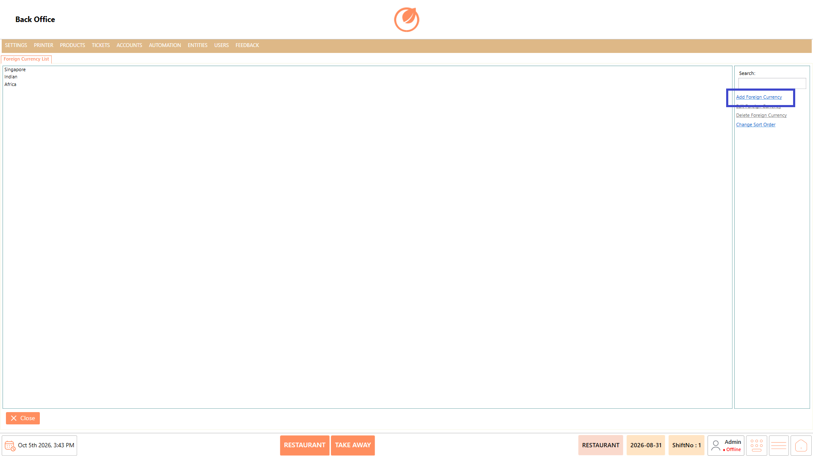
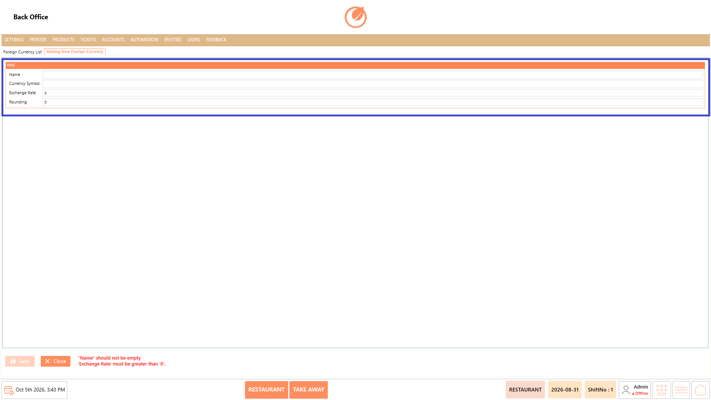
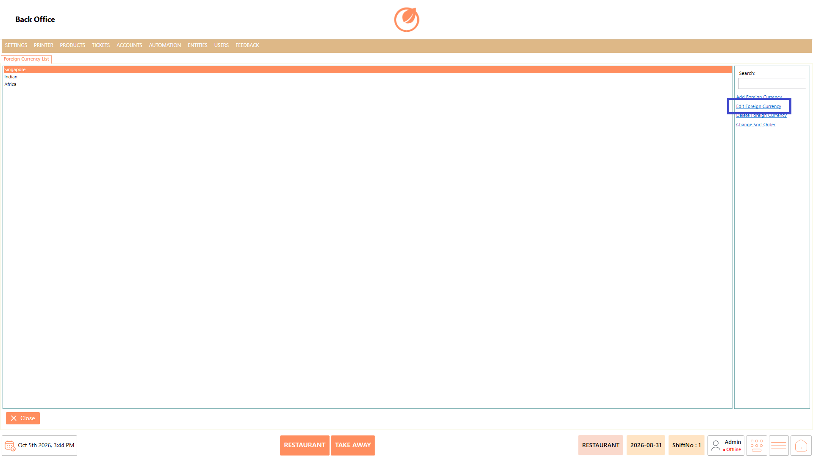
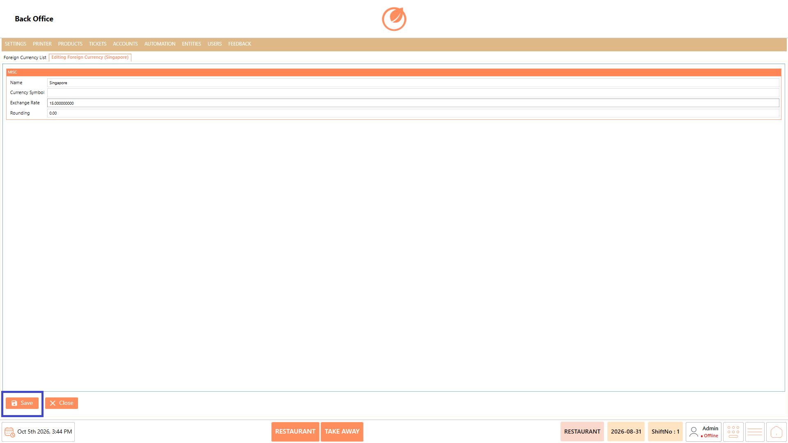
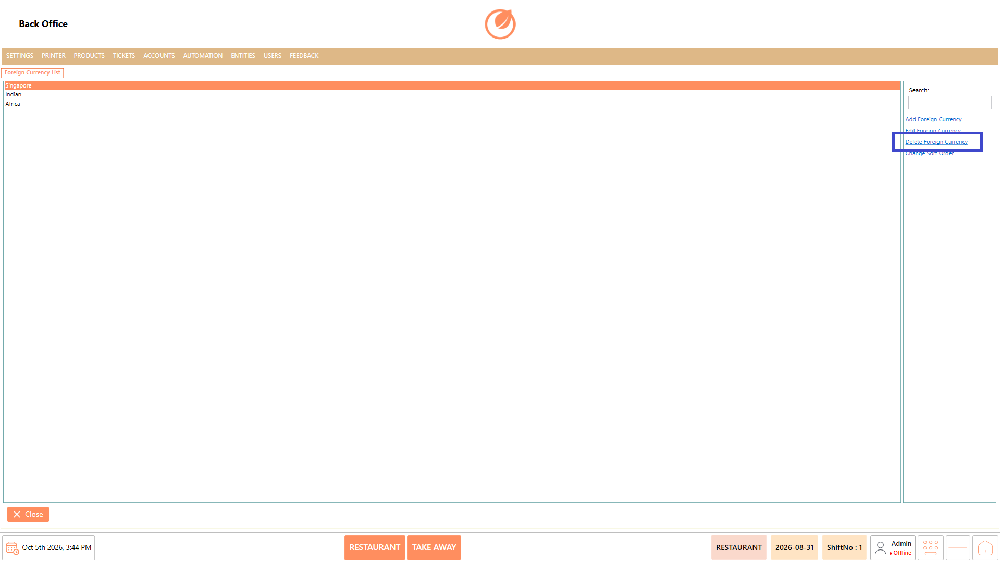
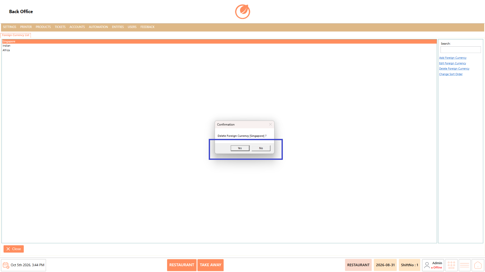
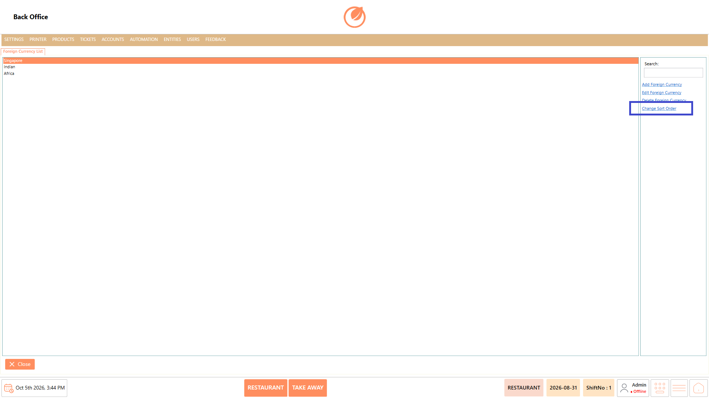

# Foreign Currency

## **Overview** 

The Foreign Currency section is used to configure currencies that can be used in the system. Users can add, edit, delete, and change the sort order of configured currencies based on the restaurant's requirements.

<figure><figcaption></figcaption></figure>

### **Screen Elements** 

| **Screen Element**      | **Description**                                             |
| ----------------------- | ----------------------------------------------------------- |
| Foreign Currency List   | Displays the foreign currencies configured in the system.   |
| Search                  | Used to search for a specific currency.                     |
| Add Foreign Currency    | Used to create a new foreign currency.                      |
| Edit Foreign Currency   | Used to modify the selected currency.                       |
| Delete Foreign Currency | Used to remove the selected currency.                       |
| Change Sort Order       | Used to change the order in which currencies are displayed. |
| Close                   | Closes the Foreign Currency screen.                         |

### **Working** 

#### **Add a Foreign Currency** 

1. Select "Add Foreign Currency".

<figure><figcaption></figcaption></figure>

2. Enter the required "Name" and "Currency Symbol".
3. Enter the applicable "Exchange Rate" and "Rounding" value.

<figure><figcaption></figcaption></figure>

4. Select "Save" to add the foreign currency.

<figure><figcaption></figcaption></figure>

#### **Edit a Foreign Currency** 

1. Select the required currency from the Foreign Currency List.
2. Select "Edit Foreign Currency".

<figure><figcaption></figcaption></figure>

3. Update the required information.
4. Select "Save" to apply the changes.

<figure><figcaption></figcaption></figure>

#### **Delete a Foreign Currency** 

1. Select the currency to be deleted.
2. Select "Delete Foreign Currency".

<figure><figcaption></figcaption></figure>

3. Confirm the deletion when prompted.

<figure><figcaption></figcaption></figure>

#### **Change Sort Order** 

1. Select "Change Sort Order".

<figure><figcaption></figcaption></figure>

2. Arrange the currencies in the required order.
3. Confirm or save the new order as prompted.

### **Use Case** 

* Accept payments in currencies other than the restaurant's primary currency when serving international customers.
* Configure multiple foreign currencies when the restaurant operates in an area with customers from different countries.
* Apply the appropriate exchange rate when converting foreign currency amounts for transactions.
* Configure rounding rules to ensure foreign currency amounts are handled according to the required currency format.
* Support international guests who prefer to view or pay their transactions in their local currency.
* Maintain different currency configurations when the restaurant needs to support multiple foreign currencies.
* Update exchange rates when currency values change and the restaurant needs the latest configured conversion rate.
* Organize multiple configured currencies in a preferred order for easier identification and management during transactions.

### **Notes** 

* Enter the correct exchange rate when adding a foreign currency.
* Configure the rounding value according to the required currency handling.
* Review the currency details before saving.
* Review the selected currency before deleting it.
* The available currencies depend on the configuration maintained in the system.
