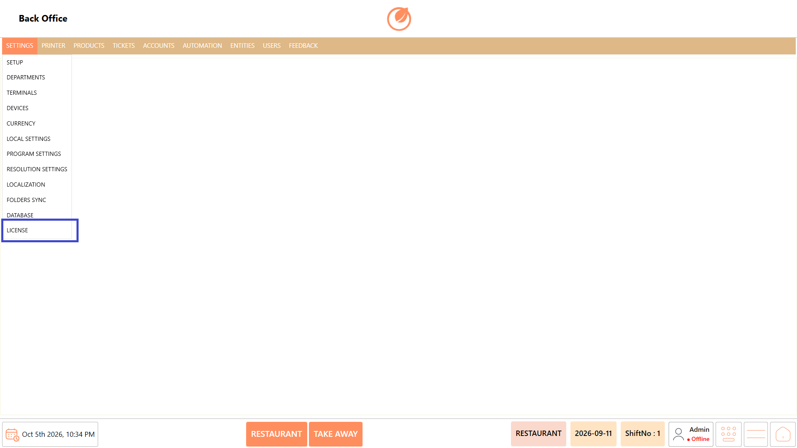
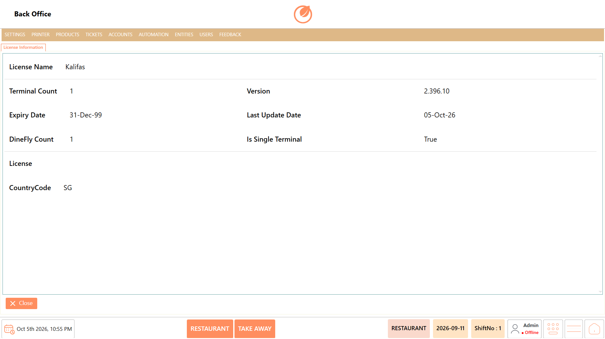
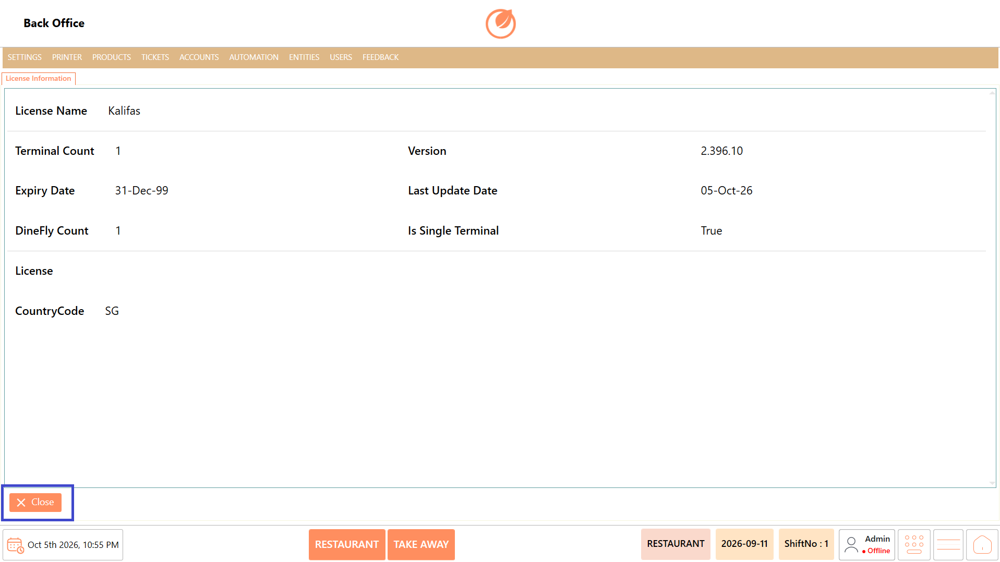

# License Information

### **Overview** 

The **License Information** section displays the license details associated with the DinePlan application.

<figure><figcaption></figcaption></figure>

### **Screen Elements** 

| **Screen Element** | **Description**                                                    |
| ------------------ | ------------------------------------------------------------------ |
| License Name       | Displays the name associated with the license.                     |
| Terminal Count     | Displays the number of terminals included in the license.          |
| Expiry Date        | Displays the license expiry date.                                  |
| DineFly Count      | Displays the DineFly count associated with the license.            |
| Version            | Displays the current DinePlan application version.                 |
| Last Update Date   | Displays the date when the application was last updated.           |
| Is Single Terminal | Indicates whether the license is configured for a single terminal. |
| License            | Displays the available license information.                        |
| CountryCode        | Displays the country code associated with the license.             |
| "Close"            | Closes the License Information screen.                             |

### **Working** 

1. Open "License Information".
2. Review the displayed license details.
3. Check the License Name, Terminal Count, Expiry Date, and other available license information.
4. Review the Version and Last Update Date when required.

<figure><figcaption></figcaption></figure>

5. Click "Close" to exit the screen.

<figure><figcaption></figcaption></figure>

### **Use Case** 

1. View the license details configured for the DinePlan application.
2. Verify the license name associated with the installation.
3. Check the number of licensed terminals.
4. Review the license expiry date.
5. Verify the DineFly count associated with the license.
6. Check the current application version.
7. Review the last update date.
8. Verify the country code and single-terminal configuration.

### **Notes** 

* The License Information screen is primarily used to view license-related details.
* The displayed values depend on the license configuration of the application.
* No configuration changes are performed from this screen.
