# Local Settings

## **Overview** 

Local Settings is used to configure how DinePlan operates and how information is displayed to users. It includes terminal selection, application and database connection settings, display preferences, devices, DineFly, DineMenu, DineQueue, and Ticket Queue configurations.

<figure>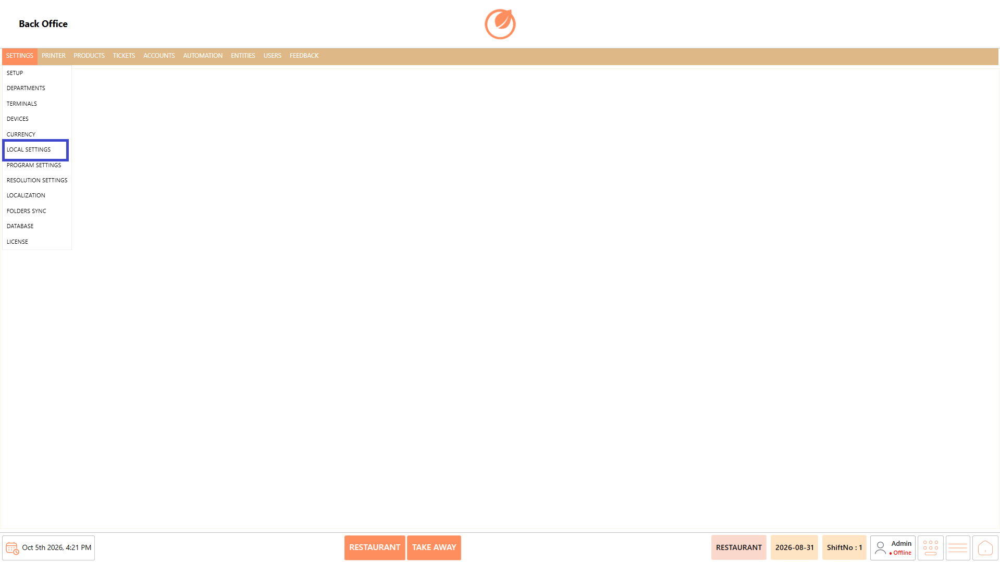<figcaption></figcaption></figure>

In general, True means the option is enabled or visible, while False means the option is disabled or hidden.

### **General** 

The General section contains the basic terminal, application, logo, database connection, and display settings used by DinePlan.

#### **Screen Elements** 

| **Screen Element**      | **Description**                                             |
| ----------------------- | ----------------------------------------------------------- |
| Terminal Name           | Selects the terminal configured for the current system.     |
| Logo Path               | Specifies the logo image used by the application.           |
| Connection String       | Defines the application and SQL Server database connection. |
| Multiple Databases      | Enables or disables support for multiple databases.         |
| DisplayTaxName          | Controls whether the tax name is displayed.                 |
| DisplayItemPriceWithTax | Controls whether item prices are displayed with tax.        |
| DisplayItemPrice        | Controls whether item prices are displayed.                 |
| Show Sold Out           | Controls the display of sold-out items.                     |
| Order Tag SoldOut       | Controls sold-out status for order-tagged items.            |
| Save                    | Saves the configured settings.                              |
| Close                   | Closes the settings screen.                                 |
| DISPLAY APP PATH        | Opens the application path.                                 |
| DISPLAY USER PATH       | Opens the user path.                                        |

#### **Working** 

1. Select the required terminal from "Terminal Name".

<figure>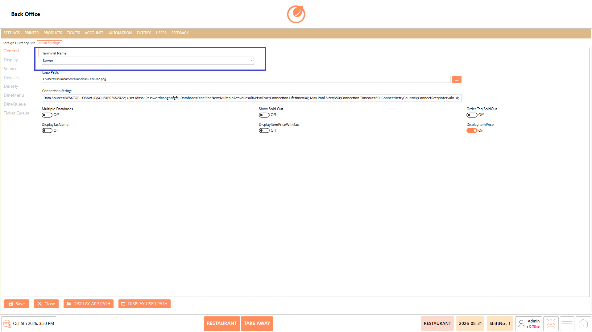<figcaption></figcaption></figure>

2. Configure the required logo path in "Logo Path".

<figure>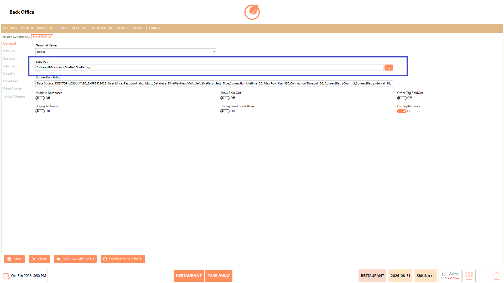<figcaption></figcaption></figure>

3. Verify the "Connection String" used for the application and SQL Server database connection.

<figure>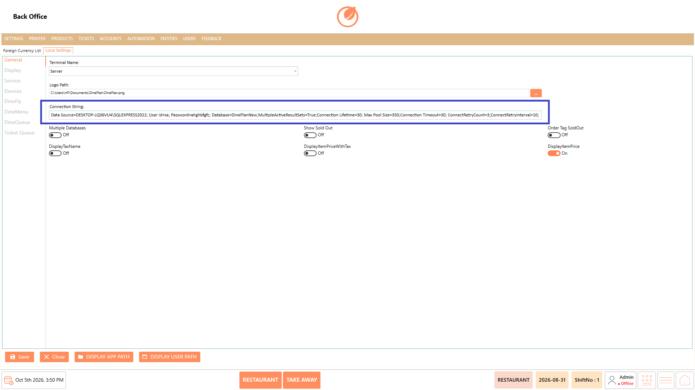<figcaption></figcaption></figure>

4. Enable or disable the required display options using their respective settings.

<figure>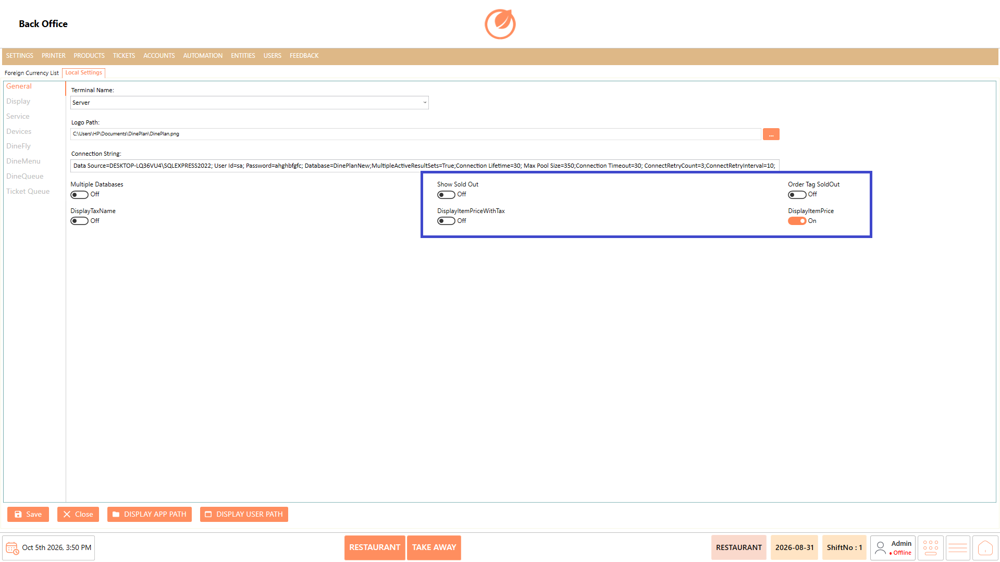<figcaption></figcaption></figure>

5. For "Multiple Databases", enable it only when required.

<figure>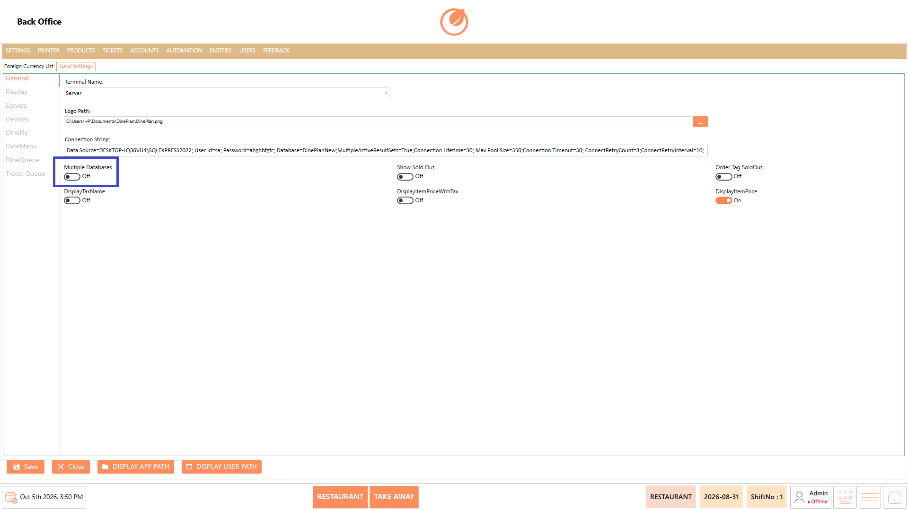<figcaption></figcaption></figure>

6. Select "Save" to apply the configuration.

<figure>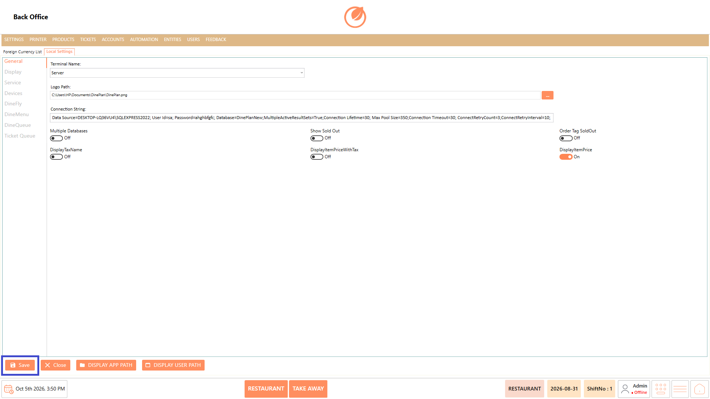<figcaption></figcaption></figure>

#### **Use Case** 

* Configure the terminal that the DinePlan application should operate with.
* Set the appropriate application logo when the POS requires restaurant-specific branding.
* Establish the database connection required for DinePlan to communicate with the SQL Server database.
* Configure display options when staff need specific product, pricing, or tax information to be shown in the application.
* Enable multiple database support when the DinePlan setup requires connections to more than one database.
* Update the terminal or application configuration when the restaurant changes its system or database setup.

#### **Notes** 

* Terminal configurations created in the system are available for selection under "Terminal Name".
* The connection string controls the connection between the application and SQL Server.
* If "Multiple Databases" is enabled, it cannot be disabled directly from this screen.
* To disable "Multiple Databases", the relevant program data XML file must be updated by changing the corresponding value from true to false, and the file must be saved.
* Take care when modifying the XML configuration, as incorrect changes can affect application operation.
* Use the approved connection string and configuration values provided for the installation.

## **Display** 

### **Overview** 

The Display section controls how information and screens are presented to users, including window scale, resolution, ticket filtering, search, and ticket column visibility.

#### **Screen Elements** 

| **Screen Element**                        | **Description**                                         |
| ----------------------------------------- | ------------------------------------------------------- |
| Window Scale                              | Sets the display scaling used by the application.       |
| Resolution                                | Defines the application display resolution.             |
| Ticket Filter Status (Separated by Comma) | Defines ticket statuses used for filtering.             |
| Refresh Entity (Seconds)                  | Defines the interval for refreshing entity information. |
| Bold Font                                 | Enables or disables bold text.                          |
| Item Search (POS)                         | Controls item search functionality in POS.              |
| Switch Default Department                 | Controls default department switching.                  |
| MergeOrder                                | Controls order merging behavior.                        |
| Edit Ticket Column Settings               | Opens the ticket column configuration.                  |

#### **Working** 

1. Enter the required value in "Window Scale" and configure the required "Resolution".

<figure><figcaption></figcaption></figure>

2. Enter the required ticket status values in "Ticket Filter Status (Separated by Comma)".

<figure>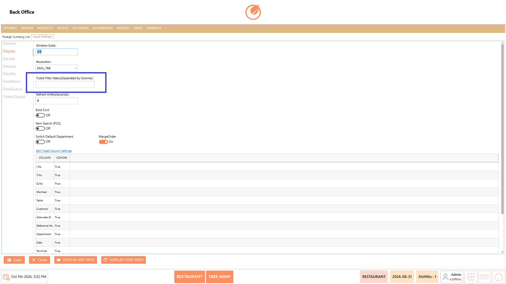<figcaption></figcaption></figure>

3. Set the required refresh interval in "Refresh Entity (Seconds)".

<figure>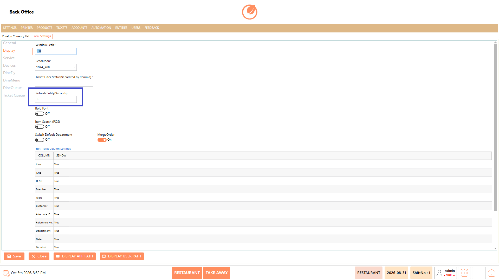<figcaption></figcaption></figure>

4. Enable or disable the required display options.

<figure>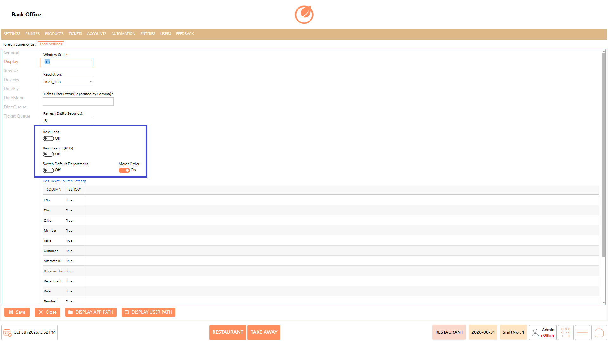<figcaption></figcaption></figure>

5. Select "Edit Ticket Column Settings" to control which ticket columns are visible.

<figure>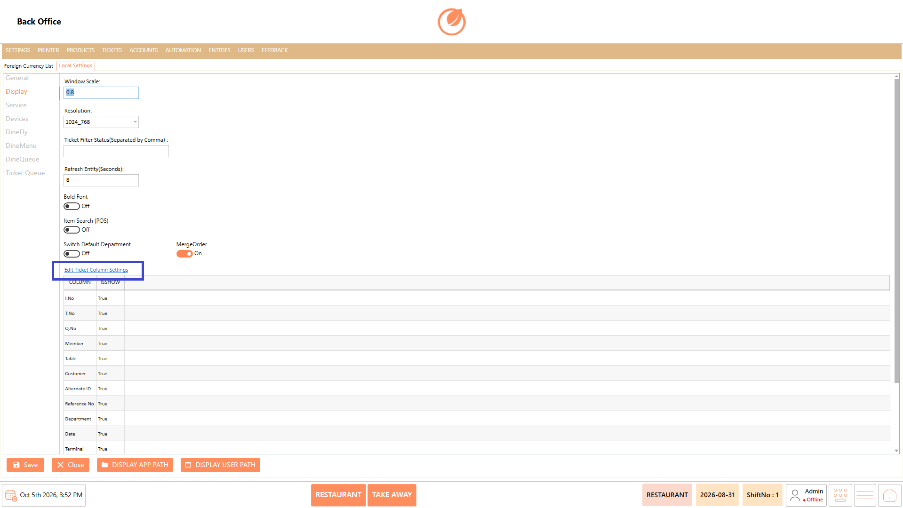<figcaption></figcaption></figure>

6. In the column settings, set the required columns to True or False.

Notes:

* True means the corresponding option or column is visible/enabled.
* False means the corresponding option or column is hidden/disabled.

<figure>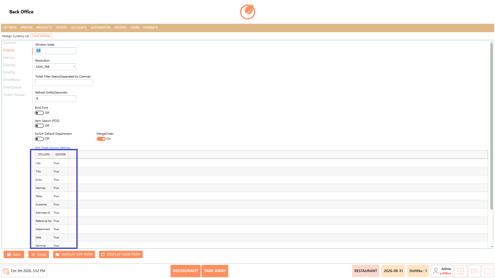<figcaption></figcaption></figure>

7. Select "Save" to apply the settings.

<figure>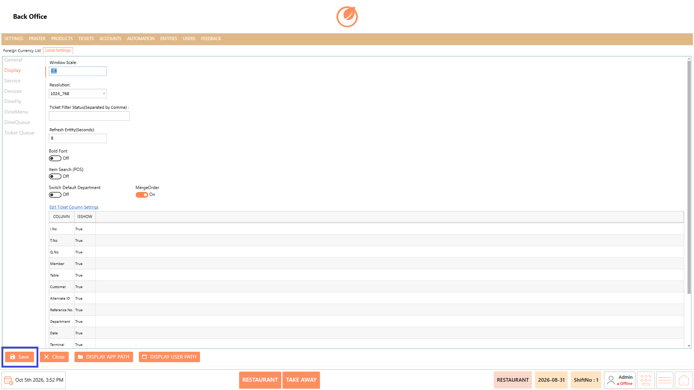<figcaption></figcaption></figure>

#### **Use Case** 

* Adjust the POS window size and resolution to suit different monitor sizes and screen setups.
* Configure the ticket status filters to display only the order statuses relevant to the user's workflow.
* Set the refresh interval when ticket or entity information needs to be updated automatically at regular intervals.
* Show or hide specific display options based on the information required by staff during POS operations.
* Customize ticket columns so staff can view only the ticket information relevant to their daily tasks.

#### **Notes** 

* True means the corresponding option or column is visible/enabled.
* False means the corresponding option or column is hidden/disabled.
* Ticket column visibility can be customized based on the information required by users.
* The available display settings may vary depending on the system configuration.

## **Service** 

### **Overview** 

The Service section contains the local service and communication settings required for DinePlan and connected services. It includes the IP address, ports, messaging server, API options, synchronization, and external ordering integrations.

#### **Screen Elements** 

| **Screen Element**          | **Description**                                       |
| --------------------------- | ----------------------------------------------------- |
| IP Address                  | Specifies the local service IP address.               |
| PORT                        | Specifies the service communication port.             |
| ApiSecure                   | Enables or disables API security.                     |
| Messaging Server Name       | Specifies the messaging server.                       |
| Messaging Server Port       | Specifies the messaging server port.                  |
| API Server                  | Enables or disables the API server.                   |
| DineCall                    | Enables or disables DineCall.                         |
| Auto Sync Connect           | Controls automatic synchronization connection.        |
| eDine                       | Enables or disables eDine.                            |
| AutoeDineSync               | Controls automatic eDine synchronization.             |
| GloriaFood                  | Enables or disables GloriaFood integration.           |
| ExternalOrder               | Controls external order integration.                  |
| Auto Start Messaging Client | Controls automatic messaging client startup.          |
| FlyLog                      | Controls FlyLog functionality.                        |
| SyncClub                    | Controls SyncClub synchronization.                    |
| SyncOpenTable               | Controls OpenTable synchronization.                   |
| LogEvents                   | Enables or disables event logging.                    |
| TabSquare                   | Controls TabSquare integration.                       |
| Reservation                 | Controls reservation integration.                     |
| Connect to Message Server   | Connects DinePlan to the configured messaging server. |

#### **Working** 

1. Enter or select the required "IP Address".

<figure>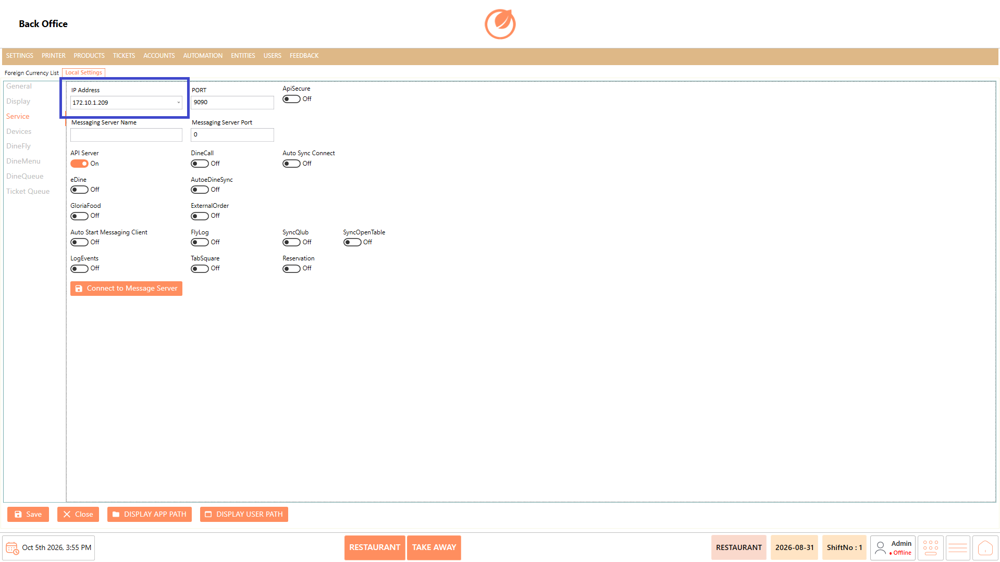<figcaption></figcaption></figure>

2. Enter the configured "PORT".

<figure>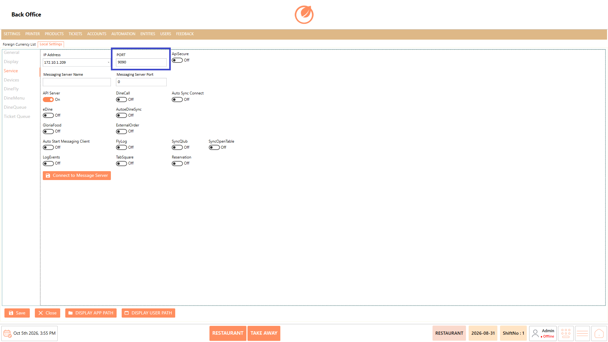<figcaption></figcaption></figure>

3. Configure the messaging server details when required.
4. Enable the required service or integration options.

<figure>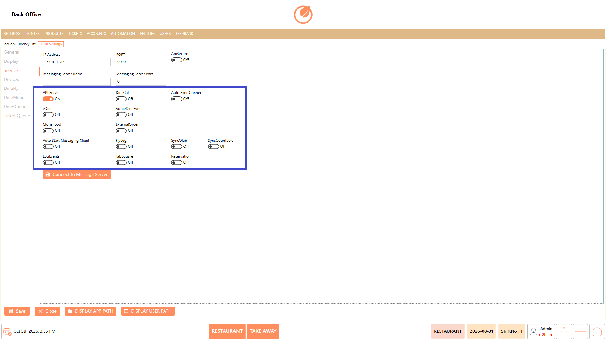<figcaption></figcaption></figure>

5. Select "Connect to Message Server" when a messaging server connection is required.

<figure>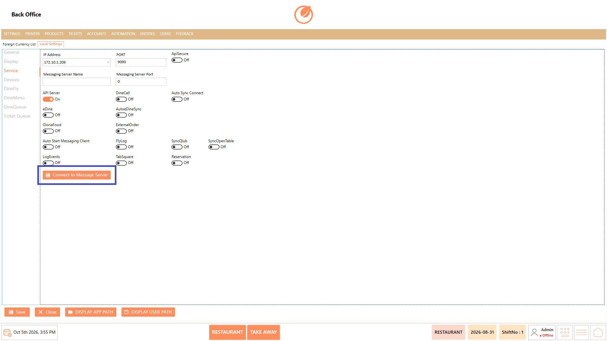<figcaption></figcaption></figure>

6. Select "Save" to apply the configuration.

<figure>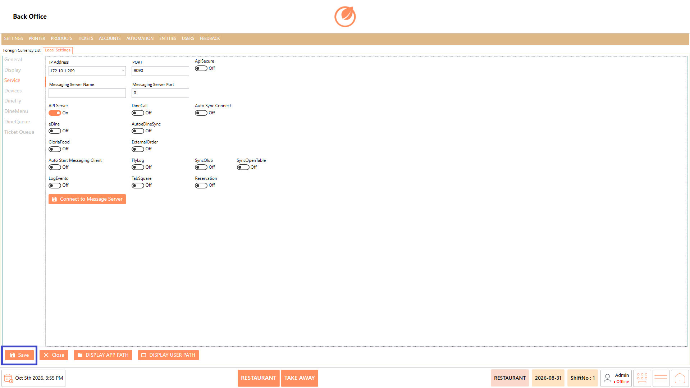<figcaption></figcaption></figure>

#### **Use Case** 

* Configure IP addresses and ports when DinePlan needs to communicate with services running on a specific network location.
* Enable synchronization services when information needs to be exchanged between DinePlan and connected systems.
* Configure supported external ordering integrations when orders need to be received from third-party services.
* Maintain communication settings when integrating DinePlan with additional services or system components.
* Update service configuration when network details, ports, messaging servers, or connected integrations change.

#### **Notes** 

* IP addresses and port numbers must match the configured system environment.
* Enable only the services required for the restaurant setup.
* Service configuration should be completed according to the integration being used.

## **Devices** 

### **Overview** 

The Devices section is used to configure devices connected to the DinePlan system.

#### **Screen Elements** 

| **Screen Element** | **Description**                           |
| ------------------ | ----------------------------------------- |
| ADD                | Adds a new device configuration.          |
| REMOVE             | Removes an existing device configuration. |
| SETTINGS           | Opens the selected device settings.       |
| DEVICE NAME        | Displays the configured device name.      |

#### **Working** 

1. Open "Devices" under Local Settings.
2. Select "ADD" to create a device configuration.
3. Enter or select the required device details.

<figure>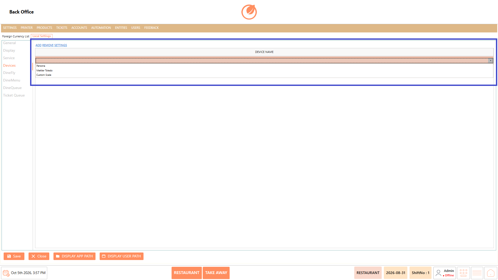<figcaption></figcaption></figure>

4. Select "SETTINGS" to configure the device when additional settings are required.

<figure>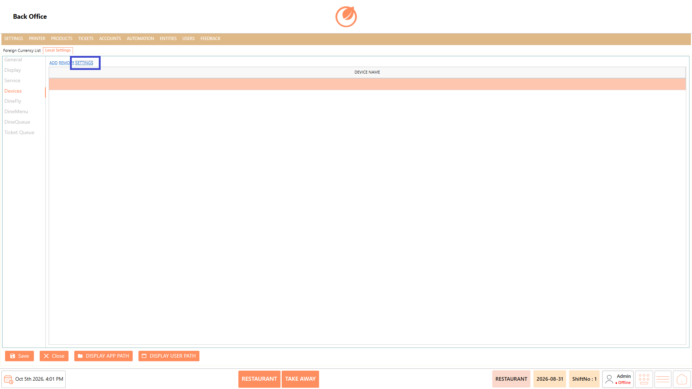<figcaption></figcaption></figure>

5. Select "Save" to apply the configuration.

<figure>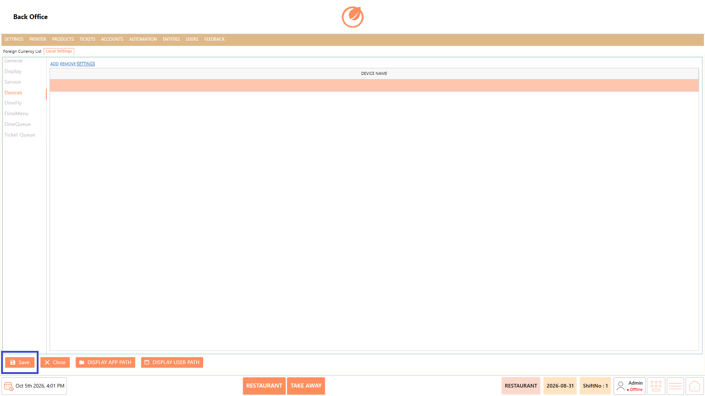<figcaption></figcaption></figure>

#### **Use Case** 

* Connect supported hardware or devices to DinePlan for use during restaurant operations.
* Add a new device when additional hardware needs to communicate with the DinePlan system.
* Configure individual device settings when different devices require specific configurations.
* Manage multiple connected devices when the restaurant operates with hardware across different counters or service areas.
* Update device configurations when hardware settings or operational requirements change.

#### **Notes** 

* Configure devices according to the hardware being used.
* Verify the device name and configuration before saving.
* Remove a device only when it is no longer required.

## **DineFly** 

### **Overview** 

DineFly is the waiter ordering application used for taking orders. The DineFly settings control the screens and billing-related functions available through the application.

#### **Screen Elements** 

| **Screen Element** | **Description**                                                                   |
| ------------------ | --------------------------------------------------------------------------------- |
| Fly Entity Screens | Defines the entity screens available in DineFly.                                  |
| Bill Job           | Defines the billing action or document required for the selected DineFly process. |

#### **Working** 

1. Open "DineFly" under Local Settings.
2. Enter the required information in "Fly Entity Screens".
3. Select the required option from "Bill Job".

<figure><figcaption></figcaption></figure>

4. Select "Save" to apply the configuration.

<figure>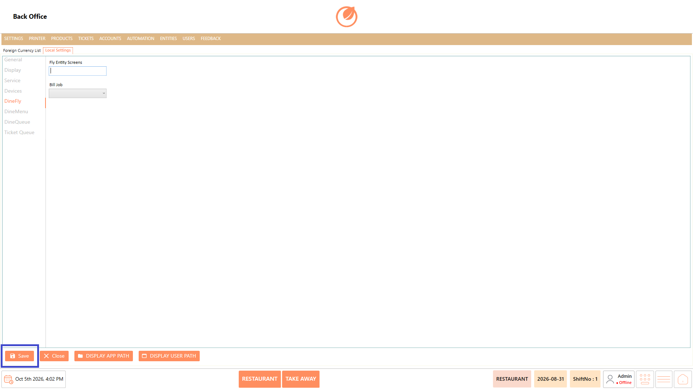<figcaption></figcaption></figure>

#### **Use Case** 

* Configure the screens that waiters can access while taking customer orders through DineFly.
* Support table-side ordering by allowing waiters to enter and manage orders directly from the application.
* Configure the required billing action when an order needs to generate a specific print or display output.
* Send order information to the kitchen when the selected billing workflow requires kitchen printing or kitchen display.
* Print invoices or bills through DineFly when the waiter needs to complete the billing process from the application.

#### **Notes** 

* DineFly is used by waiters for order taking.
* Configure "Bill Job" according to the required billing workflow.
* The available billing options include actions such as Print Ticket, Print Invoice, Print Kitchen, Print Kitchen Display, Print Bill, and Pole-related options.

## **DineMenu** 

### **Overview** 

DineMenu settings are used to configure the location of menu images used by the DineMenu application.

#### **Screen Elements** 

| **Screen Element**  | **Description**                                               |
| ------------------- | ------------------------------------------------------------- |
| Dine Menu ImagePath | Specifies the location where DineMenu menu images are stored. |
| Browse              | Used to select the required image folder or path.             |

#### **Working** 

1. Open "DineMenu" under Local Settings.
2. Enter or select the required location in "Dine Menu ImagePath".

<figure>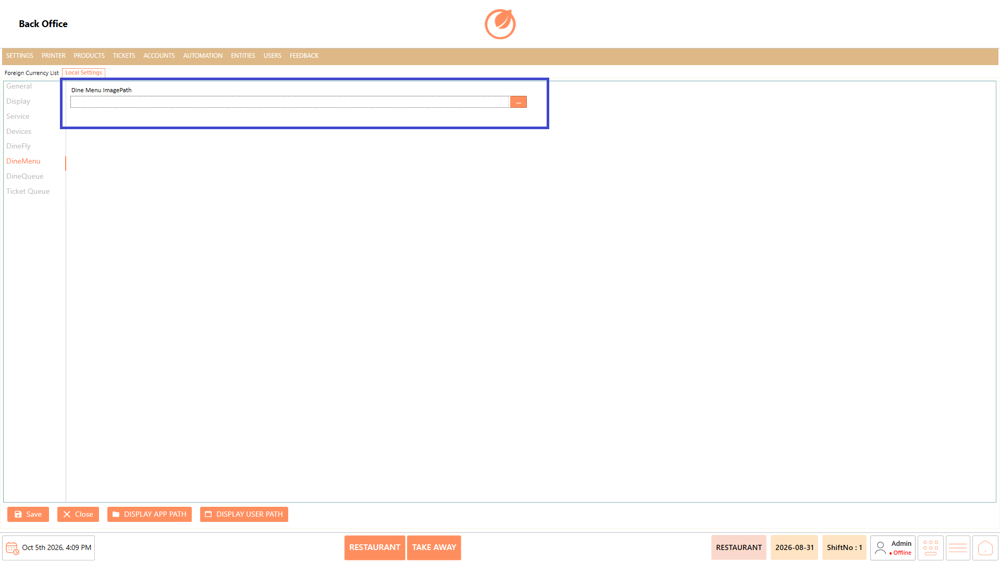<figcaption></figcaption></figure>

3. Select "Save" to apply the configuration.

<figure>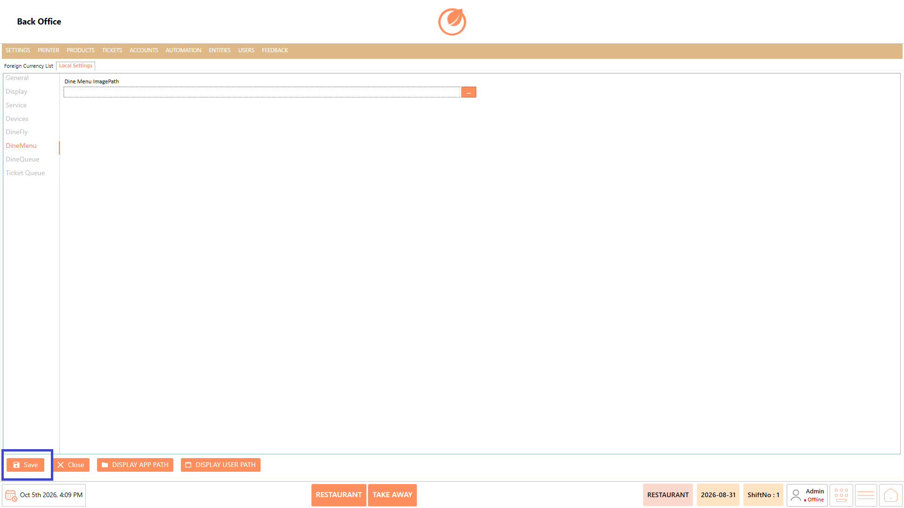<figcaption></figcaption></figure>

#### **Use Case** 

* Configure the location from which DineMenu retrieves menu images for display.
* Change the image location when menu images are moved to a different folder or storage path.
* Configure a centralized image folder when multiple menu images need to be maintained in one location.
* Update the image path when the restaurant changes its menu image storage structure.
* Ensure DineMenu loads the latest menu images from the configured location.

#### **Notes** 

* Ensure the configured path is accessible by the application.
* Use the correct image location configured for the restaurant.

## **DineQueue** 

### **Overview** 

DineQueue is the queue display system used to configure how queue information is presented to customers. The settings control the queue layout, fonts, ticket count, status display, and widgets.

#### **Screen Elements** 

| **Screen Element**               | **Description**                                                              |
| -------------------------------- | ---------------------------------------------------------------------------- |
| Name                             | Defines the queue configuration name.                                        |
| ConnectionString Separate Queue  | Specifies the connection string for a separate queue database when required. |
| Activate Separate Queue          | Enables or disables a separate queue.                                        |
| Columns                          | Defines the width of queue display columns.                                  |
| Rows                             | Defines the height of queue display rows.                                    |
| Font                             | Sets the font used for queue information.                                    |
| Number Of Tickets Per Page       | Defines the number of tickets displayed on each page.                        |
| Header Font Size                 | Sets the font size for queue headers.                                        |
| Queue Number Font Size           | Sets the font size for queue numbers.                                        |
| Edit All Queues Widgets Settings | Opens configuration for queue status display.                                |
| Widgets                          | Defines the widgets shown on the queue display.                              |

#### **Working** 

1. Open "DineQueue" under Local Settings.
2. Configure the queue name and separate queue settings when required.
3. Configure the required rows and columns for the display.
4. Set the font and ticket display settings.
5. Configure the queue status and widget information as required.

<figure>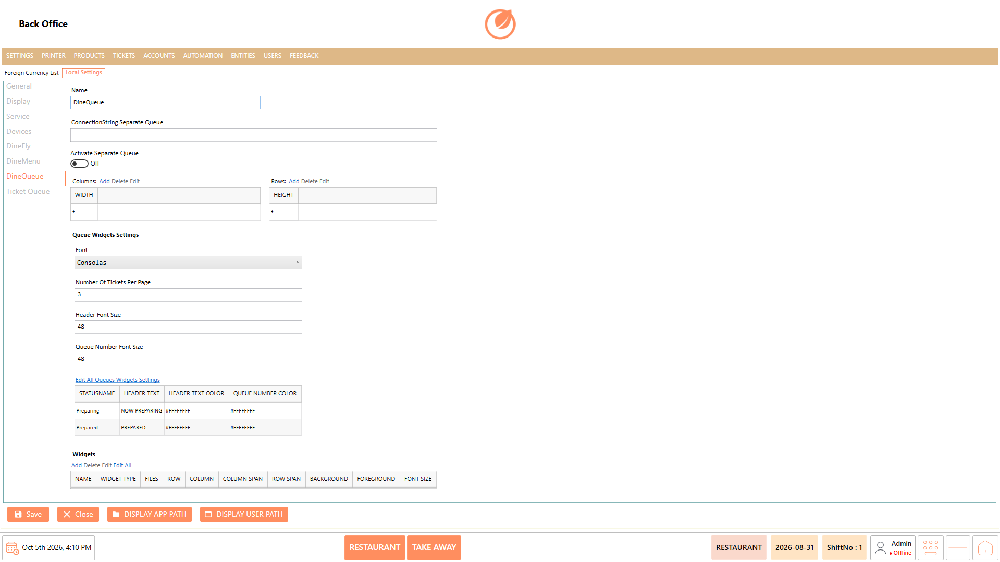<figcaption></figcaption></figure>

6. Select "Save" to apply the configuration.

<figure>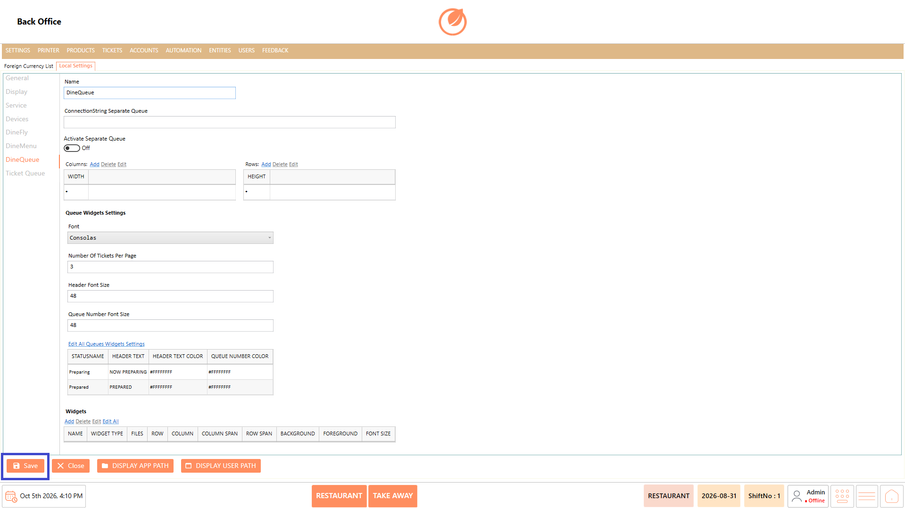<figcaption></figcaption></figure>

#### **Use Case** 

* Display queue numbers clearly to customers while they wait for their orders or service.
* Present order status information so customers can easily identify whether their order is being processed or is ready.
* Configure the display layout to suit different screen sizes and orientations used in the restaurant.
* Adjust the number of rows and columns when the display needs to show more or fewer queue entries at a time.
* Customize font sizes so queue numbers and status information remain clearly visible from the waiting area.
* Display widgets alongside queue information when additional content needs to be shown on the customer-facing screen.

#### **Notes** 

* Configure the layout according to the customer display requirements.
* Ticket count and font sizes should be selected based on the display screen.
* Separate queue settings are required only when a separate queue database is used.

## **Ticket Queue** 

### **Overview** 

Ticket Queue is the web-based queue display system used to configure the customer-facing ticket queue and its display behavior.

#### **Screen Elements** 

| **Screen Element**                | **Description**                                                      |
| --------------------------------- | -------------------------------------------------------------------- |
| Auto Refresh Interval Seconds     | Defines how frequently the ticket queue refreshes.                   |
| PageSize                          | Defines the number of records displayed per page.                    |
| Last Order Ready Interval Seconds | Defines the interval for the last ready order display.               |
| SortField                         | Defines the field used to sort tickets.                              |
| SortDirection                     | Defines the sorting direction.                                       |
| Slider Interval Seconds           | Defines the interval for moving between displayed queue information. |
| Reset Ticket Queue                | Resets the current ticket queue.                                     |
| View Mode                         | Defines how ticket information is displayed.                         |
| Order Ready Item View             | Controls the display of ready-order items.                           |

#### **Working** 

1. Open "Ticket Queue" under Local Settings.
2. Configure the required refresh, page size, sorting, and slider settings.
3. Select the required option under "View Mode".
4. Enable "Order Ready Item View" when required.
5. Use "Reset Ticket Queue" only when the queue needs to be reset.

<figure>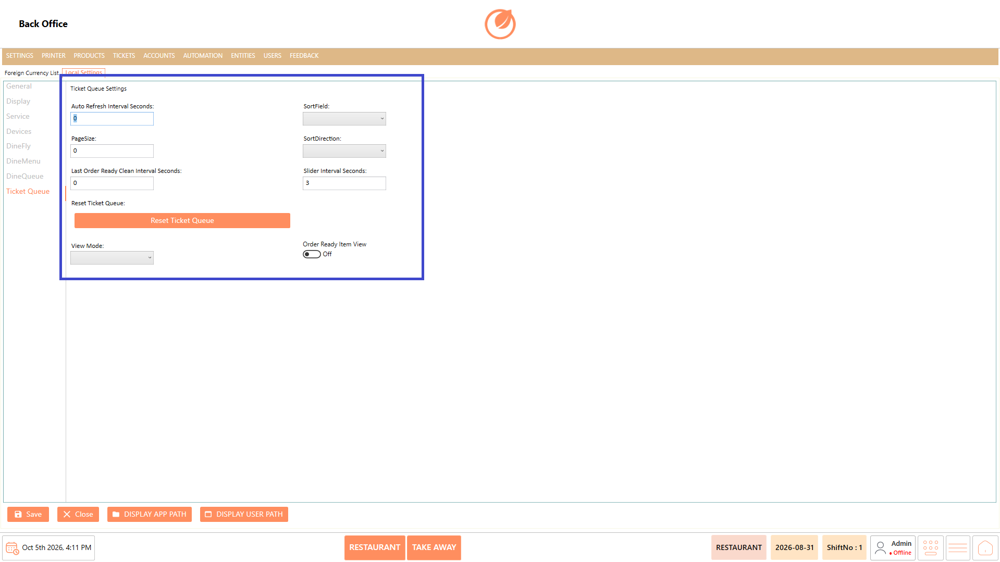<figcaption></figcaption></figure>

6. Select "Save" to apply the configuration.

<figure>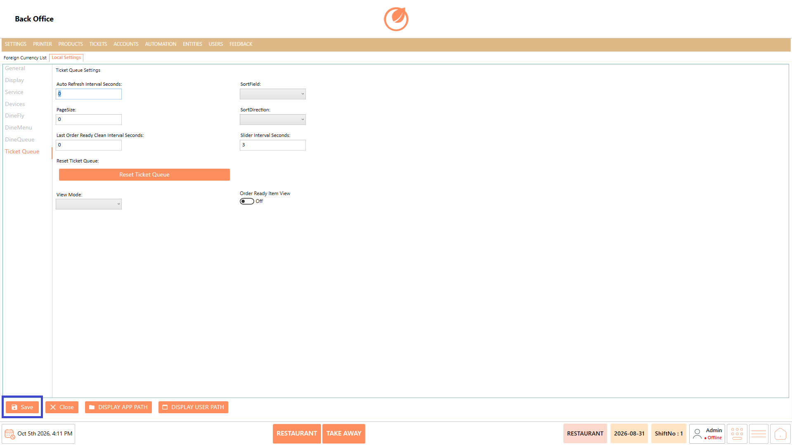<figcaption></figcaption></figure>

#### **Use Case** 

Use Ticket Queue when configuring the web-based customer queue display and controlling how customers see order status and ready-order information.

#### **Notes** 

* Configure Ticket Queue settings before configuring the customer-facing View Mode.
* The View Mode determines how much ticket information is displayed to customers.
* Use "Reset Ticket Queue" carefully, as it is intended to reset the current queue display.
* Ticket Queue is used for the customer display URL/web-based queue system.
