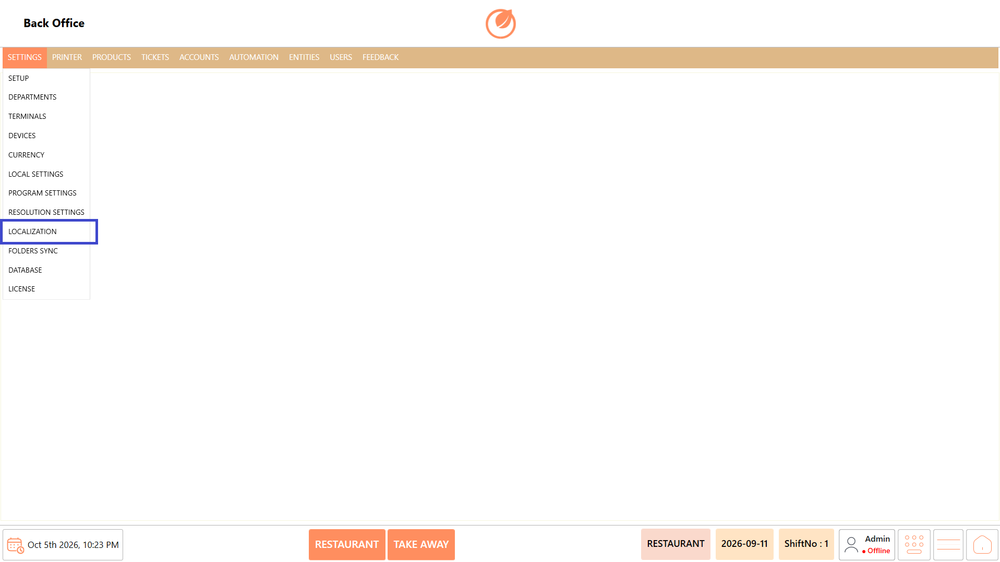
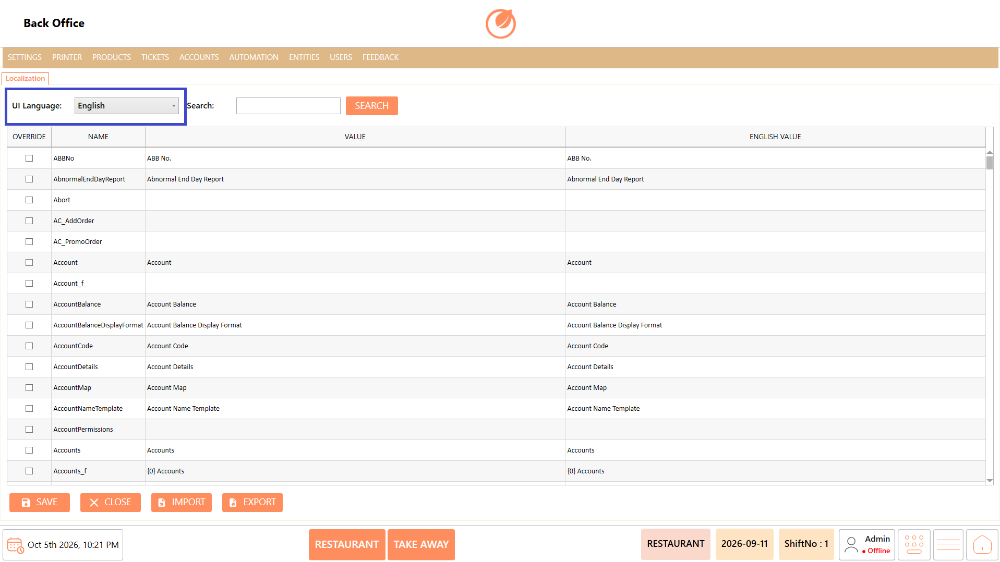
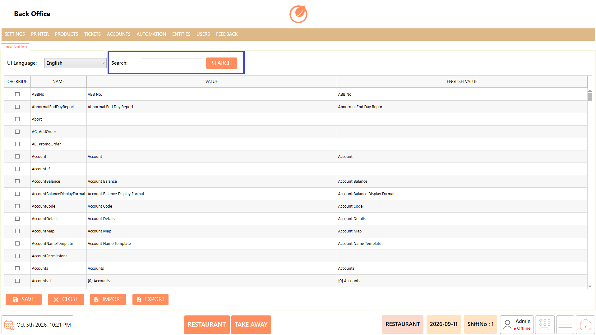
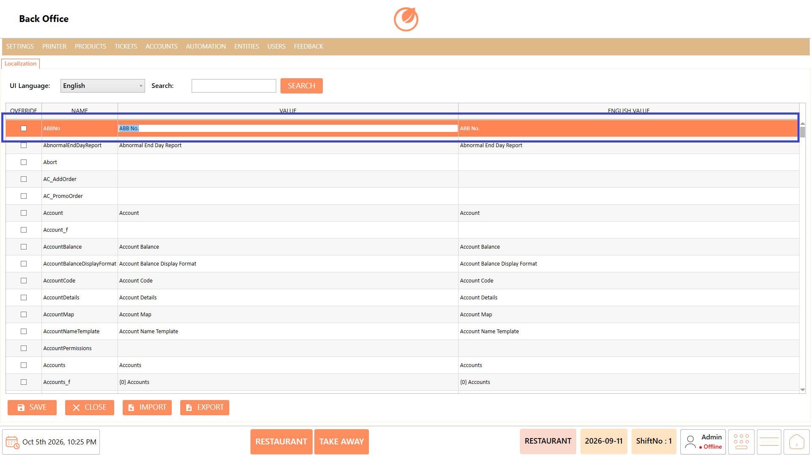
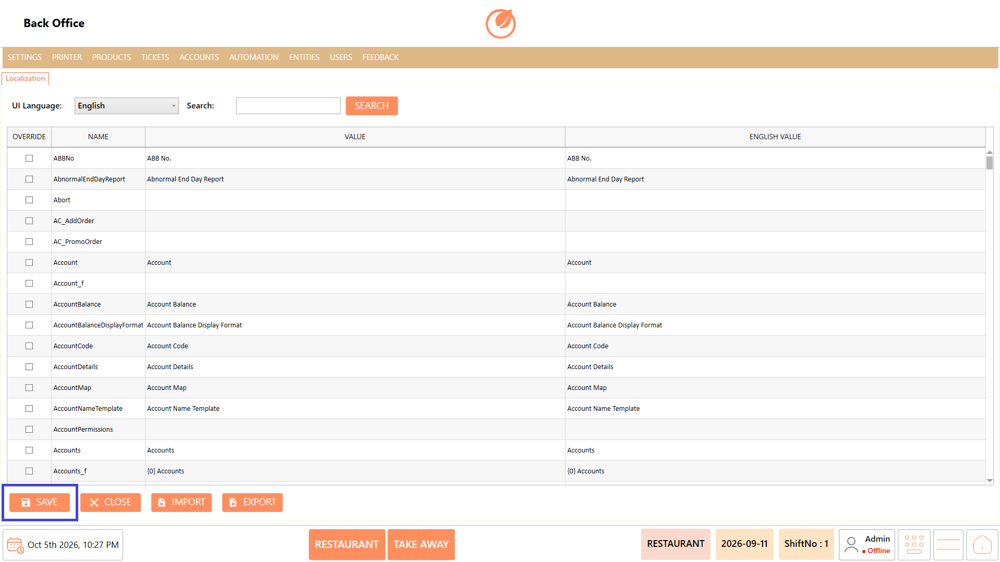
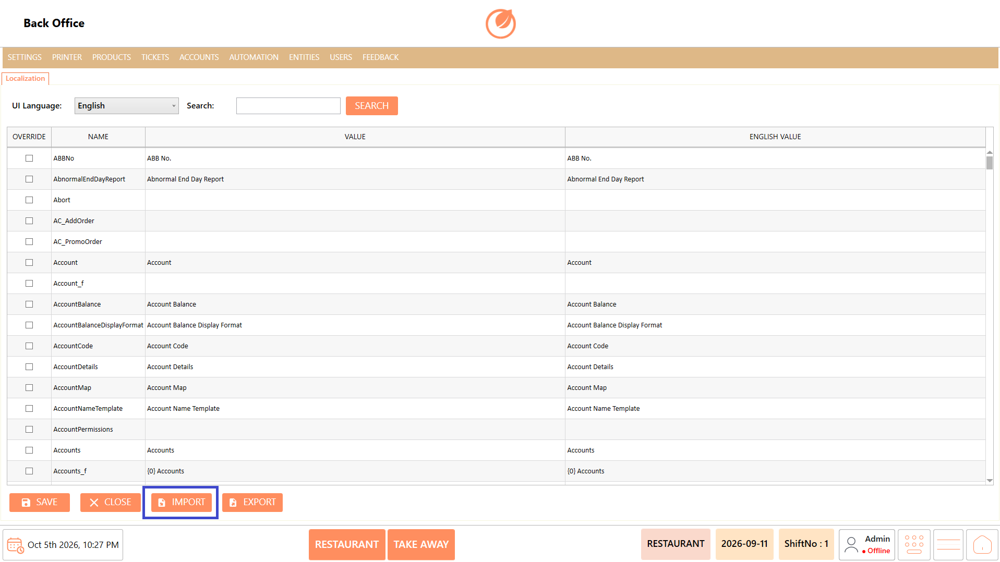
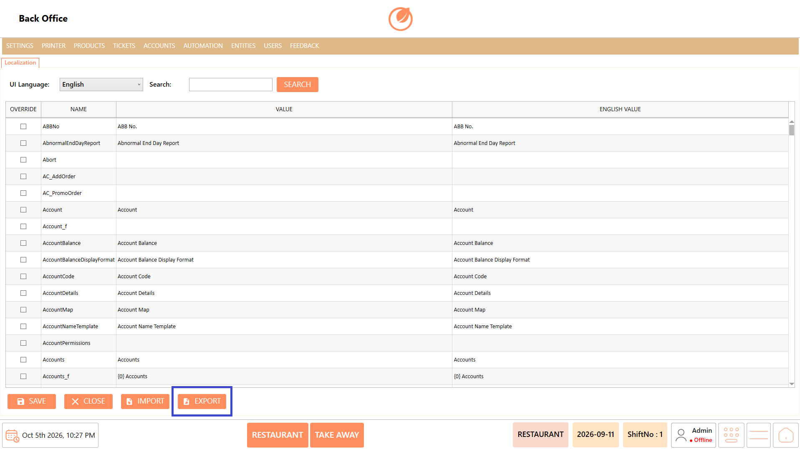

# Localization

### **Overview** 

**Localization** is used to modify the names and text displayed in the POS application without making changes at the code level. It allows users to search for a specific text or label and update its displayed value according to the customer's requirements.

<figure><figcaption></figcaption></figure>

### **Screen Elements** 

| **Screen Element** | **Description**                                                               |
| ------------------ | ----------------------------------------------------------------------------- |
| UI Language        | Selects the language for the localization settings.                           |
| Search             | Allows users to search for a specific name or text that needs to be modified. |
| Override           | Allows the selected localization value to be customized.                      |
| Name               | Displays the internal name or identifier of the text.                         |
| Value              | Displays the current localized value that can be modified.                    |
| English Value      | Displays the original English value for reference.                            |
| "Save"             | Saves the localization changes.                                               |
| "Close"            | Closes the Localization screen.                                               |
| "Import"           | Imports localization data.                                                    |
| "Export"           | Exports localization data.                                                    |

### **Working** 

#### **Change a Display Name** 

1. Open "Localization" from the required settings section.
2. Select the required language from "UI Language".

<figure><figcaption></figcaption></figure>

3. Enter the name or text that needs to be changed in "Search".
4. Click "SEARCH" to find the required localization entry.

<figure><figcaption></figcaption></figure>

5. Locate the required name in the list.
6. Select the "Override" option for the required entry.
7. Modify the value in the "Value" field with the required name.

<figure><figcaption></figcaption></figure>

8. Click "Save" to save the changes.

<figure><figcaption></figcaption></figure>

9. Select "Import" to import the required localization data.

<figure><figcaption></figcaption></figure>

10. Select "Export" to export the localization data.

<figure><figcaption></figcaption></figure>

11. Verify that the updated name is displayed in the relevant screen or report.

### **Use Case** 

1. Rename a specific label displayed in the POS application.
2. Change report names according to the customer's preferred terminology.
3. Customize system labels without modifying the application code.
4. Update displayed text to match the terminology used by a specific business.
5. Modify a particular name across the UI using the localization entry.
6. Search for a required text quickly using the "Search" option.
7. Configure localized values for the selected "UI Language".
8. Maintain customer-specific terminology while keeping the underlying application configuration unchanged.

### **Notes** 

* Localization allows text or names to be modified without making changes at the code level.
* Use the "English Value" column as a reference when identifying the required text.
* Enable "Overrid&#x65;**"** before modifying a localization value.
* Search for the exact name or text when multiple localization entries are available.
* After saving, verify the change in the relevant screen or report.
* Changes should be made carefully to avoid modifying the wrong localization entry.
