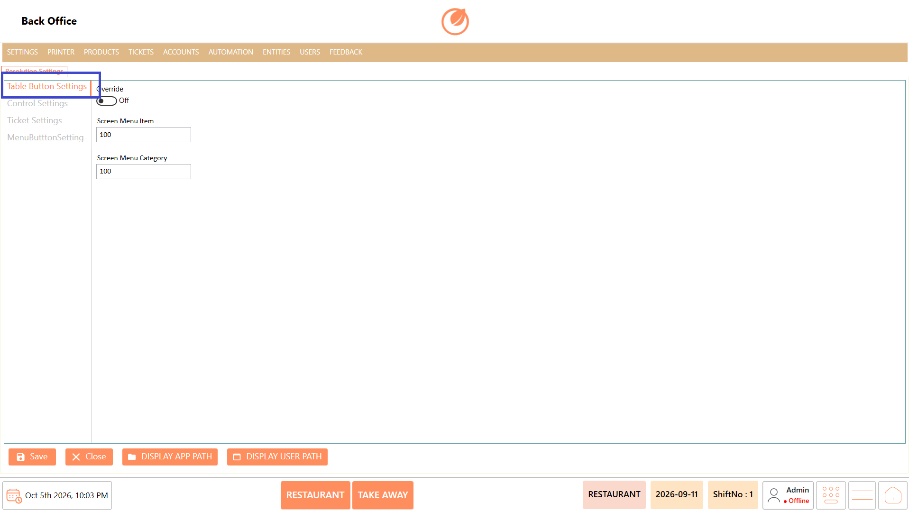
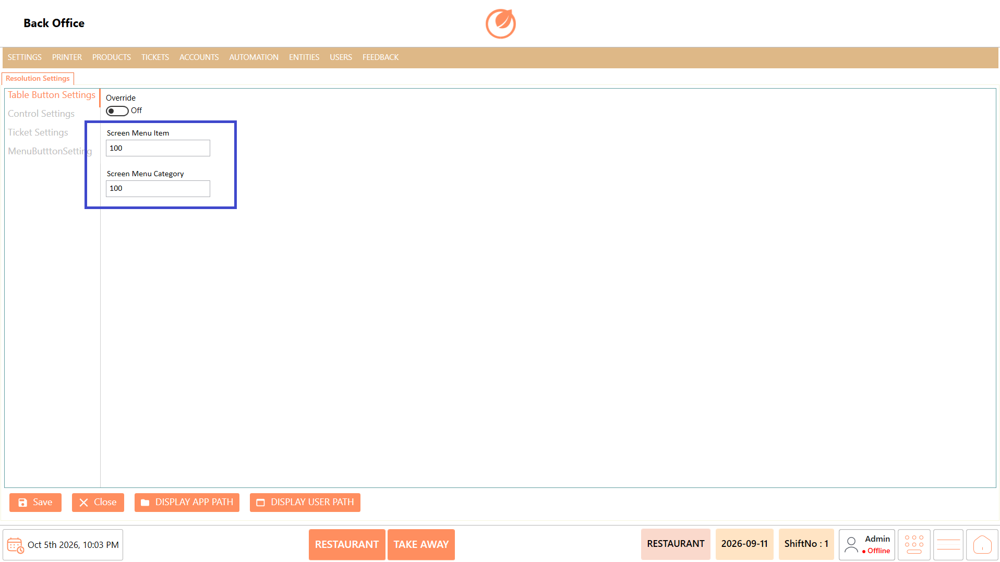
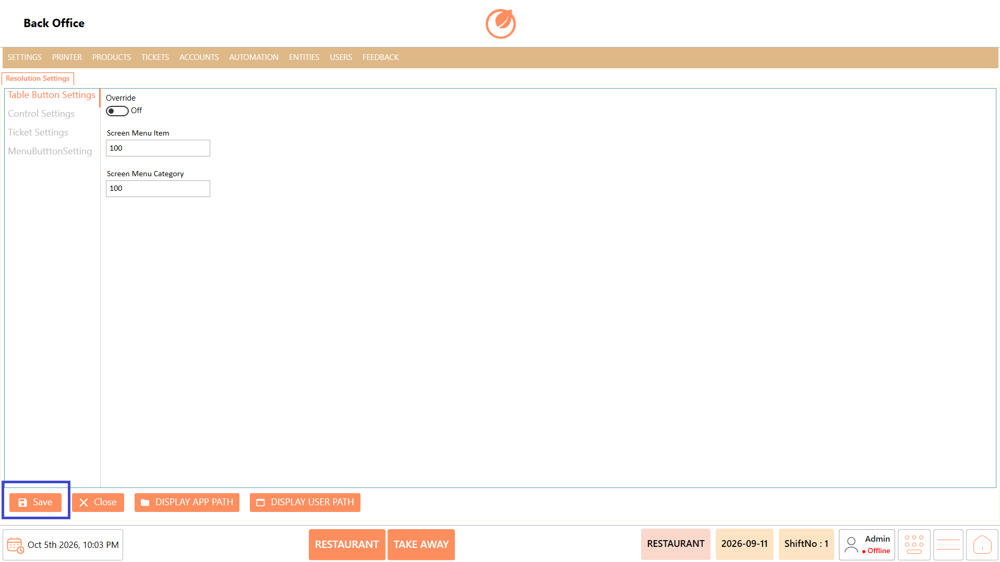
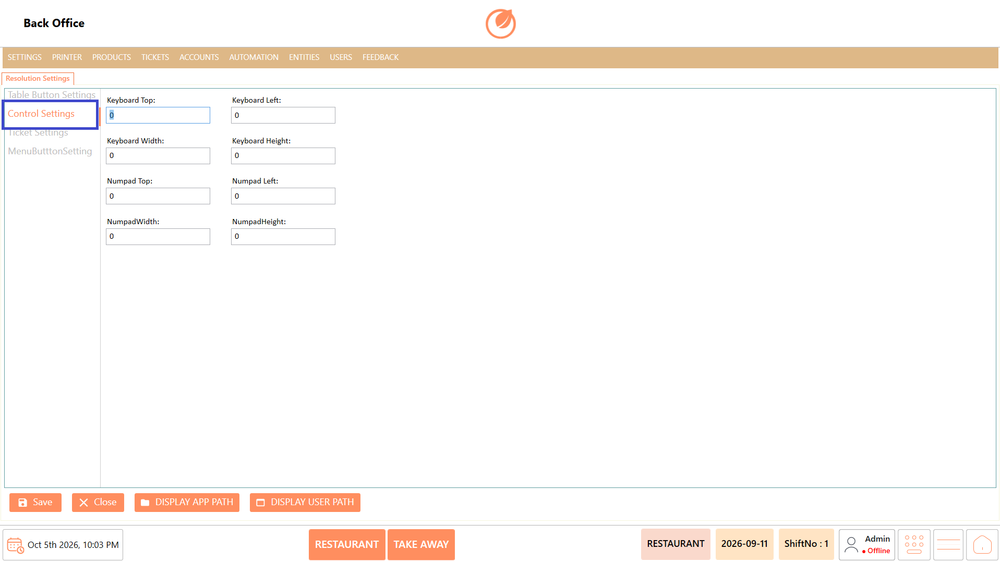
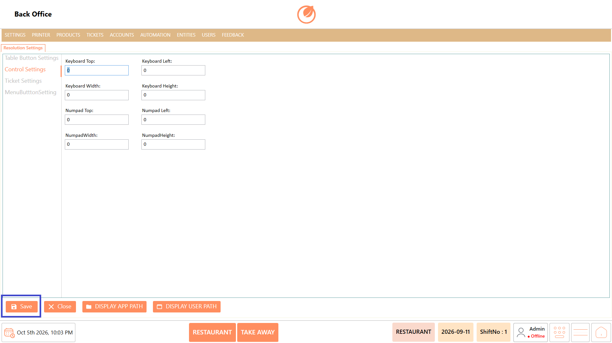
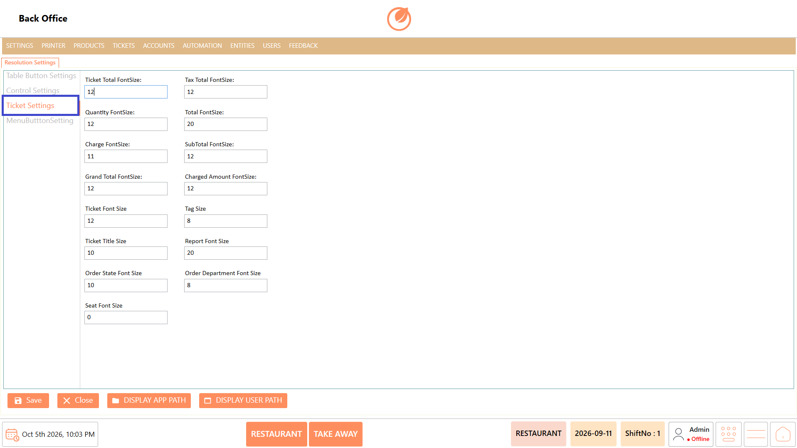
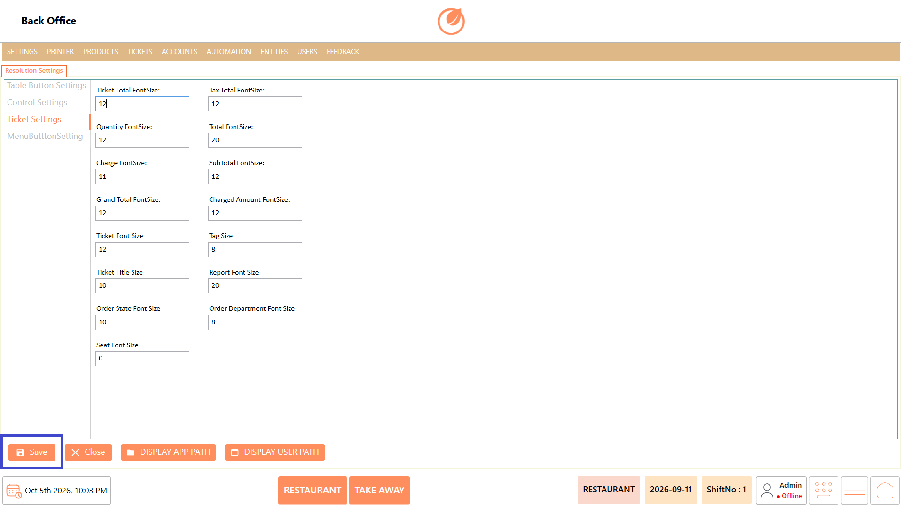
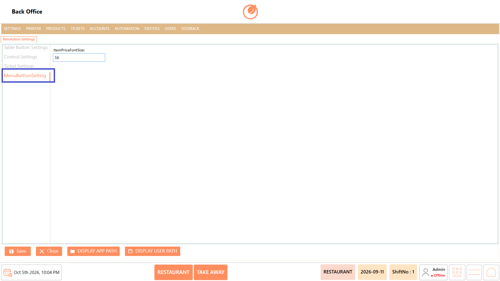
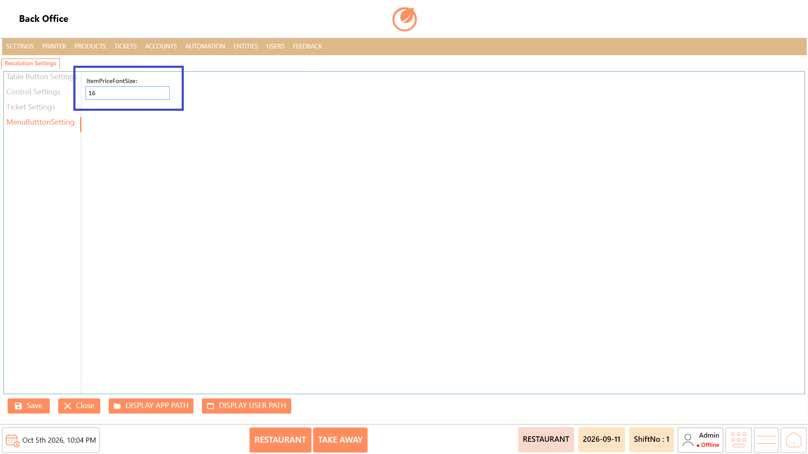
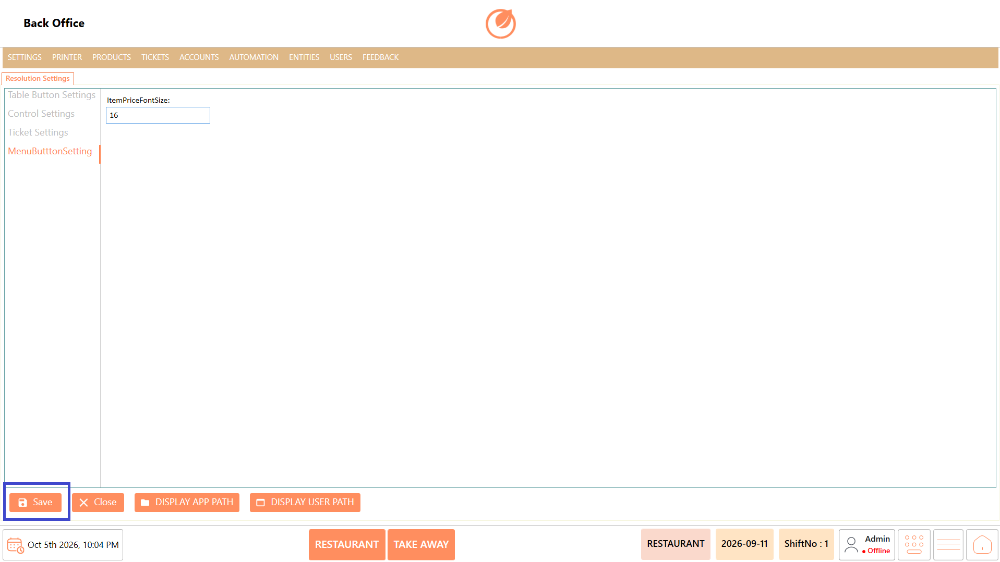

# Resolution Settings

### **Overview** 

Resolution Settings is used to configure the user interface (UI) of the POS application. It includes settings for the ordering screen, ticket screen, and other display-related elements. The available options allow the UI layout, keyboard positioning, ticket display, and menu item appearance to be adjusted according to the customer's requirements.

<figure><figcaption></figcaption></figure>

### **Screen Elements** 

<figure><figcaption></figcaption></figure>

| **Screen Element**    | **Description**                                                                                   |
| --------------------- | ------------------------------------------------------------------------------------------------- |
| Table Button Settings | Configures the display and button-related settings for the table and ordering interface.          |
| Control Settings      | Configures the position and size of the on-screen keyboard and numpad.                            |
| Ticket Settings       | Configures the font sizes used for different elements displayed on the ticket and report screens. |
| MenuButtonSetting     | Configures the font size of menu item information displayed on the ordering screen.               |
| Save                  | Saves the configured resolution settings.                                                         |
| Close                 | Closes the Resolution Settings screen.                                                            |
| Display App Path      | Displays the application path.                                                                    |
| Display User Path     | Displays the user path.                                                                           |

## **Table Button Settings** 

### **Overview** 

Table Button Settings is used to configure the display settings for table-related buttons and menu items in the POS ordering screen.

<figure><figcaption></figcaption></figure>

### **Screen Elements** 

| **Screen Element**   | **Description**                                                        |
| -------------------- | ---------------------------------------------------------------------- |
| Override             | Enables or disables the override setting.                              |
| Screen Menu Item     | Defines the setting used for displaying menu items on the screen.      |
| Screen Menu Category | Defines the setting used for displaying menu categories on the screen. |

### **Working** 

1. Click on "Resolution Settings".
2. Select "Table Button Settings" from the left panel.

<figure><figcaption></figcaption></figure>

3. Enable "Override" if the customer requires the override settings.

<figure><figcaption></figcaption></figure>

4. Enter the required values in "Screen Menu Item" and "Screen Menu Category".

<figure><figcaption></figcaption></figure>

5. Click "Save" to save the configuration.

<figure><figcaption></figcaption></figure>

### **Use Case** 

1. Configure table button display settings based on the customer's ordering screen requirements.
2. Adjust the number or configuration of menu items displayed on the screen.
3. Configure menu category display according to the available screen space.
4. Use the "Override" option when the default settings need to be replaced.
5. Configure the ordering screen for different POS display requirements.
6. Adjust the interface when the customer uses a different screen resolution.
7. Maintain a consistent menu and category layout across POS terminals.
8. Customize the ordering interface to suit the customer's operational requirements.

### **Notes** 

* Configure the settings according to the customer's UI requirements.
* Enable "Override" only when the default configuration needs to be overridden.
* Review the ordering screen after saving the configuration to verify the display.

## **Control Settings** 

### **Overview** 

Control Settings is used to configure the position and dimensions of the on-screen keyboard and numpad displayed in the POS application.

<figure><figcaption></figcaption></figure>

### **Screen Elements** 

| **Screen Element** | **Description**                                      |
| ------------------ | ---------------------------------------------------- |
| Keyboard Top       | Defines the top position of the on-screen keyboard.  |
| Keyboard Left      | Defines the left position of the on-screen keyboard. |
| Keyboard Width     | Defines the width of the on-screen keyboard.         |
| Keyboard Height    | Defines the height of the on-screen keyboard.        |
| Numpad Top         | Defines the top position of the numpad.              |
| Numpad Left        | Defines the left position of the numpad.             |
| Numpad Width       | Defines the width of the numpad.                     |
| Numpad Height      | Defines the height of the numpad.                    |

### **Working** 

1. Click on "Resolution Settings".
2. Select "Control Settings" from the left panel.

<figure><figcaption></figcaption></figure>

1. Enter the required position and size values for the Keyboard.
2. Enter the required position and size values for the Numpad.

<figure><figcaption></figcaption></figure>

5. Click "Save" to save the configuration.

<figure><figcaption></figcaption></figure>

### **Use Case** 

1. Adjust the on-screen keyboard position according to the POS display.
2. Configure the keyboard size to fit the available screen area.
3. Position the keyboard appropriately for touch-screen terminals.
4. Adjust the numpad position according to the customer's screen layout.
5. Configure the numpad dimensions for better visibility.
6. Prevent the keyboard or numpad from overlapping other screen elements.
7. Configure different layouts for terminals with different screen dimensions.
8. Optimize the ordering interface for convenient touch-screen operation.

### **Notes** 

* Enter the position and dimension values according to the customer's screen configuration.
* Incorrect values may affect the placement or visibility of the keyboard and numpad.
* Verify the UI after saving the settings.

&#x20;

## **Ticket Settings** 

### **Overview** 

Ticket Settings is used to configure the font sizes of different elements displayed on the ticket and report screens. These settings can be adjusted according to the customer's display requirements.

<figure><figcaption></figcaption></figure>

### **Screen Elements** 

| **Screen Element**         | **Description**                                             |
| -------------------------- | ----------------------------------------------------------- |
| Ticket Total Font Size     | Sets the font size of the ticket total.                     |
| Tax Total Font Size        | Sets the font size of the tax total.                        |
| Quantity Font Size         | Sets the font size of the quantity displayed on the ticket. |
| Total Font Size            | Sets the font size of the total amount.                     |
| Charge Font Size           | Sets the font size of charges displayed on the ticket.      |
| Sub Total Font Size        | Sets the font size of the subtotal.                         |
| Grand Total Font Size      | Sets the font size of the grand total.                      |
| Charged Amount Font Size   | Sets the font size of the charged amount.                   |
| Ticket Font Size           | Sets the font size of ticket information.                   |
| Tag Size                   | Sets the font size of tags displayed on the ticket.         |
| Ticket Title Size          | Sets the font size of the ticket title.                     |
| Report Font Size           | Sets the font size used in reports.                         |
| Order State Font Size      | Sets the font size of the order state.                      |
| Order Department Font Size | Sets the font size of the order department.                 |
| Seat Font Size             | Sets the font size of the seat information.                 |

### **Working** 

1. Click on "Resolution Settings".
2. Select "Ticket Settings" from the left panel.

<figure><figcaption></figcaption></figure>

3. Enter the required font sizes for the ticket and report elements.
4. Review the configured values.

<figure><figcaption></figcaption></figure>

5. Click "Save" to save the configuration.

<figure><figcaption></figcaption></figure>

### **Use Case** 

1. Adjust ticket font sizes according to the customer's display requirements.
2. Increase the size of important values such as the Grand Total for better visibility.
3. Adjust the quantity and item-related text for easier reading.
4. Configure the size of tax and charge information displayed on the ticket.
5. Adjust the ticket title size to make ticket identification easier.
6. Configure report font size based on the available display area.
7. Adjust order state and department text for better visibility.
8. Configure seat information display according to the customer's requirements.

### **Notes** 

* Configure each font size according to the customer's display requirements.
* Avoid using excessively large values that may cause text to overlap or affect the layout.
* Review the ticket and report display after saving the settings.

## **Menu Button Settings** 

### **Overview** 

Menu Button Setting is used to configure the display size of menu item information on the POS ordering screen. The Item Price Font Size setting allows the font size of the item price displayed on the ordering screen to be adjusted according to the customer's requirements.

<figure><figcaption></figcaption></figure>

### **Screen Elements** 

| **Screen Element**   | **Description**                                                        |
| -------------------- | ---------------------------------------------------------------------- |
| Item Price Font Size | Sets the font size of the item price displayed on the ordering screen. |

### **Working** 

1. Click on "Resolution Settings".
2. Select "Menu Button Setting" from the left panel.

<figure><figcaption></figcaption></figure>

3. Enter the required value in "Item Price Font Size".
4. Review the configured font size.

<figure><figcaption></figcaption></figure>

5. Click "Save" to save the configuration.

<figure><figcaption></figcaption></figure>

### **Use Case** 

1. Adjust the item price font size on the ordering screen.
2. Increase the price font size for better visibility on larger displays.
3. Reduce the font size when the ordering screen has limited space.
4. Improve price visibility on touch-screen POS terminals.
5. Configure the price display according to the customer's preferred UI layout.
6. Maintain consistent price visibility across different POS terminals.
7. Adjust the price display when the screen resolution changes.
8. Optimize the ordering screen for easier identification of item prices.

### **Notes** 

* "ItemPriceFontSize" affects the font size of the item price displayed on the ordering screen.
* Configure the value according to the customer's screen and display requirements.
* Verify the ordering screen after saving the configuration to ensure the price is displayed correctly.
