# Setup

## **Overview** 

The Setup section is used to configure how features and information are set up and displayed in the user view. It includes options for importing data, configuring additional features, setting up custom functionality, and importing entity information.

<figure>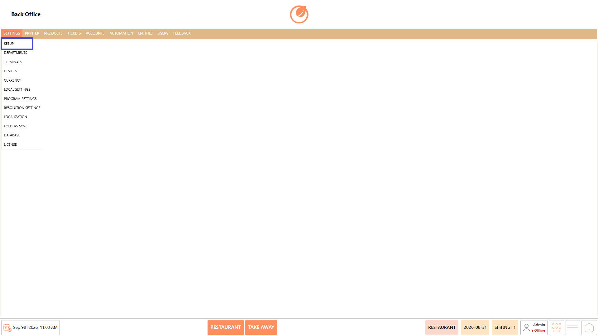<figcaption></figcaption></figure>

### **Import** 

The Import section is used to import menu and table information using prepared files. It also provides options to clear existing data when required.

<figure><figcaption></figcaption></figure>

#### **Screen Elements** 

| **Screen Element** | **Description**                                       |
| ------------------ | ----------------------------------------------------- |
| Import Menu        | Used to import menu information.                      |
| File Selection     | Used to select the menu import file.                  |
| Clear Data         | Clears the applicable existing data before importing. |
| Clear Menu         | Clears existing menu information.                     |
| Import Menu        | Imports the selected menu file.                       |
| Import Table       | Used to import table information.                     |
| File Selection     | Used to select the table import file.                 |
| Clear Table        | Clears existing table information.                    |
| Import Table       | Imports the selected table file.                      |

#### **Working** 

1. Select "Import" under Setup.

<figure>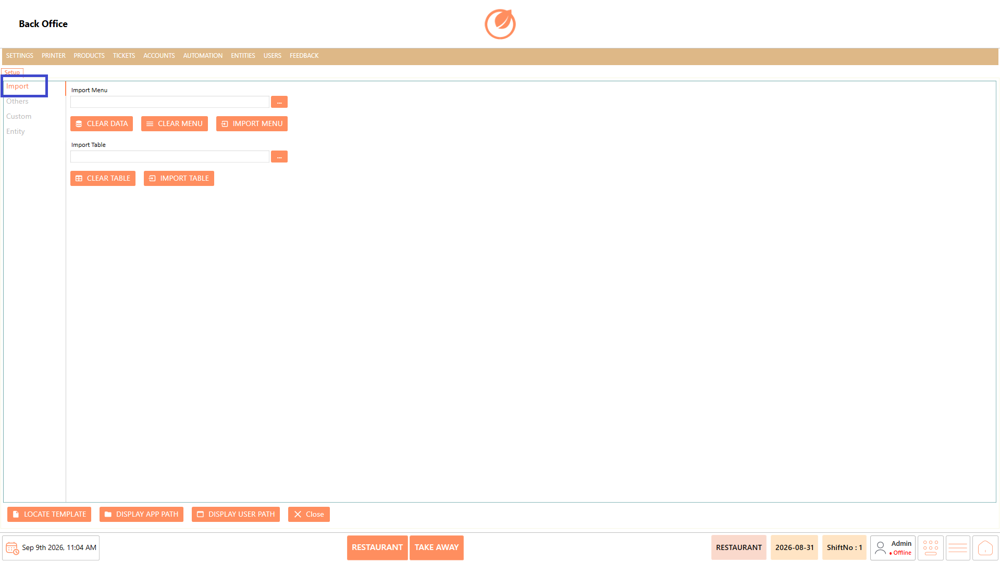<figcaption></figcaption></figure>

2. Under "Import Menu", select the required menu file.

<figure>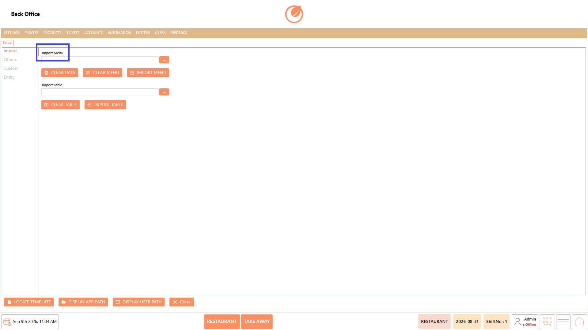<figcaption></figcaption></figure>

3. Select "Import Menu" to import the menu information.

<figure>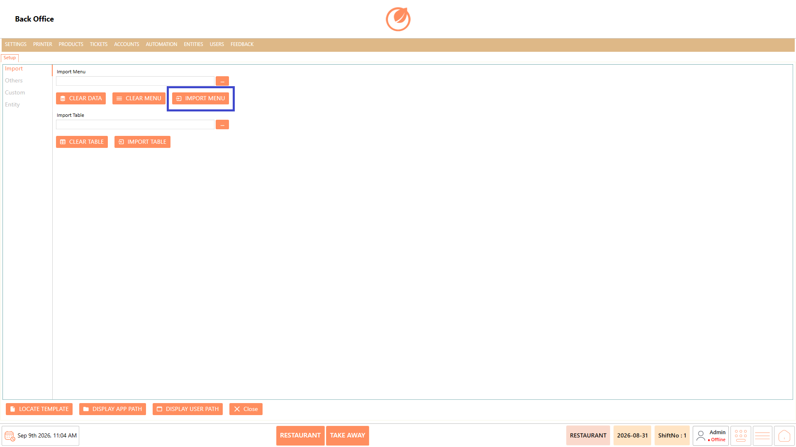<figcaption></figcaption></figure>

4. Under "Import Table", select the required table file.

<figure>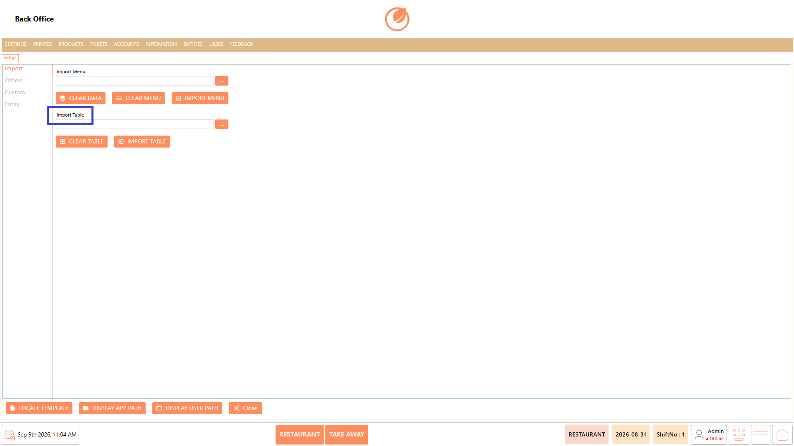<figcaption></figcaption></figure>

5. Select "Import Table" to import the table information.

<figure>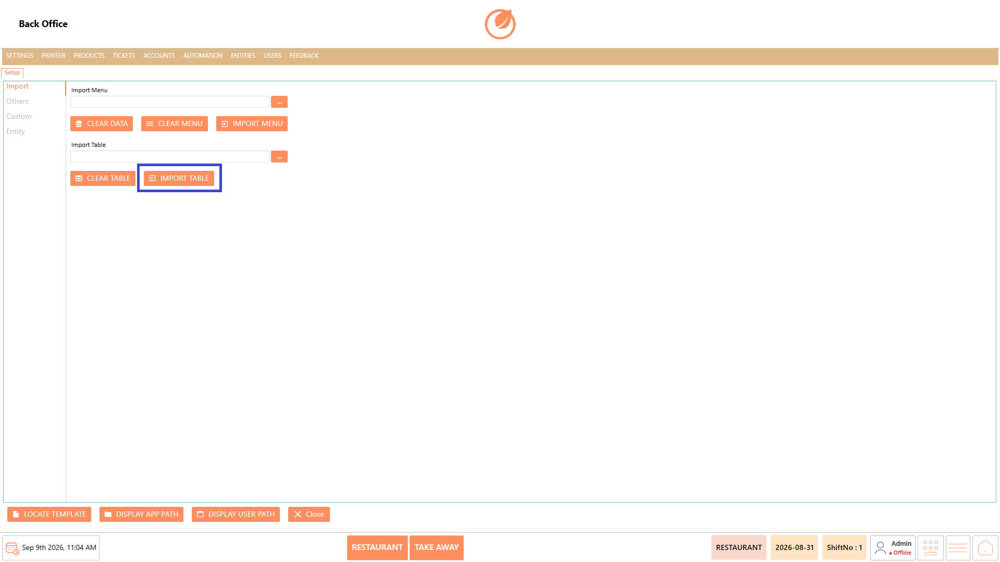<figcaption></figcaption></figure>

#### **Use Case** 

Use the Import section when menu or table information needs to be added or updated in bulk using a prepared file.

#### **Notes** 

* Verify the import file before importing.
* Use "Clear Menu" or "Clear Table" only when existing data needs to be removed.

<figure>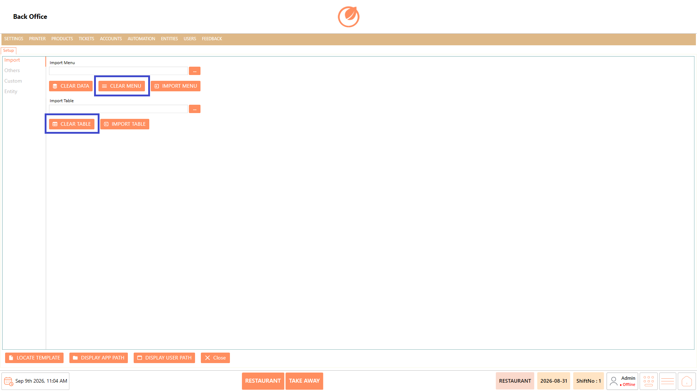<figcaption></figcaption></figure>

* Use the appropriate import option for the type of data being uploaded.

### **Others** 

The Others section provides additional setup options that can be enabled and configured according to the restaurant's requirements.

<figure>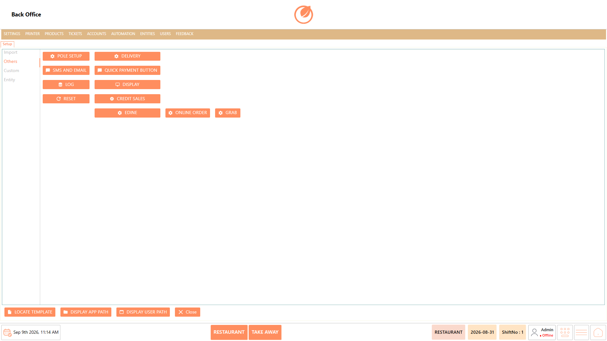<figcaption></figcaption></figure>

#### **Screen Elements** 

| **Screen Element**   | **Description**                                   |
| -------------------- | ------------------------------------------------- |
| Pole Setup           | Used to configure the pole display setup.         |
| Delivery             | Used to configure delivery-related functionality. |
| SMS and Email        | Used to configure SMS and email functionality.    |
| Quick Payment Button | Used to configure quick payment options.          |
| Log                  | Used to configure logging-related options.        |
| Display              | Used to configure display-related options.        |
| Reset                | Used to reset the applicable configuration.       |
| Credit Sales         | Used to configure credit sales functionality.     |
| Edine                | Used to configure eDine-related functionality.    |
| Online Order         | Used to configure online ordering functionality.  |
| Grab                 | Used to configure grab-related functionality.     |

#### **Working** 

1. Select "Others" under Setup.

<figure>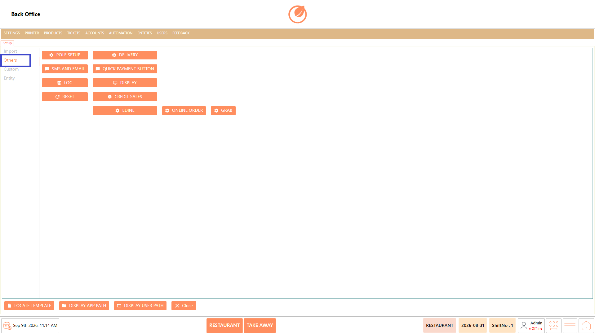<figcaption></figcaption></figure>

2. Select the required feature.

<figure>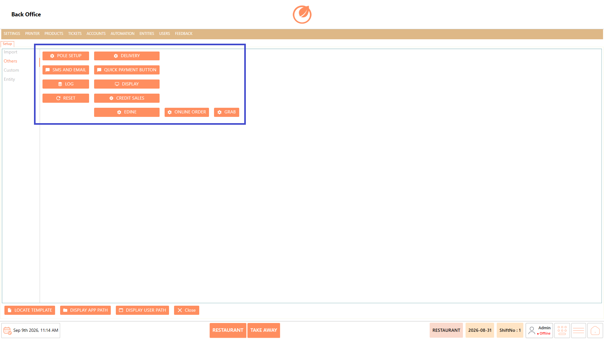<figcaption></figcaption></figure>

3. If "POLE SETUP" is selected, enter the required password to enable the feature or add it to the required user.

<figure>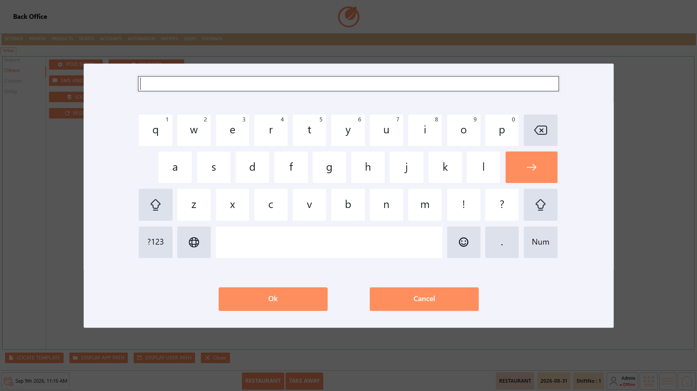<figcaption></figcaption></figure>

4. Configure or enable the selected feature as required.

#### **Use Case** 

Use the Others section when additional features need to be enabled or configured for the restaurant.

#### **Notes** 

* Some features may require authorization before they can be enabled.
* The password requirement depends on the selected feature and action.
* Configure only the features required for the restaurant.

### **Custom** 

The Custom section is used to configure custom functionality such as CRM and make it available to the required users.

<figure>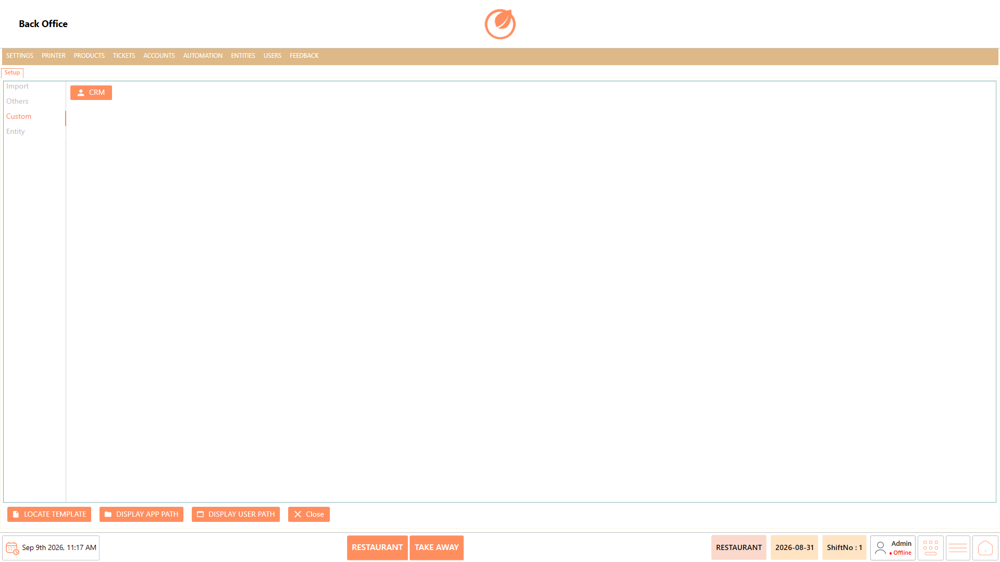<figcaption></figcaption></figure>

#### **Screen Elements** 

| **Screen Element** | **Description**                      |
| ------------------ | ------------------------------------ |
| CRM                | Used to configure CRM functionality. |

#### **Working** 

1. Select "Custom" under Setup.

<figure>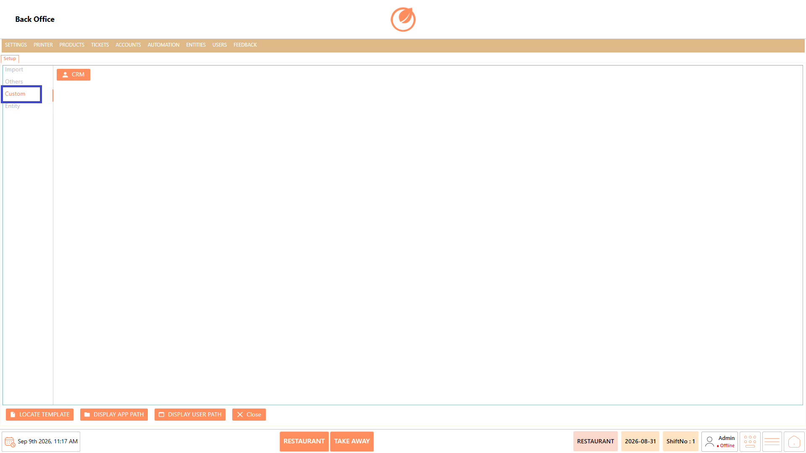<figcaption></figcaption></figure>

2. Select "CRM".

<figure>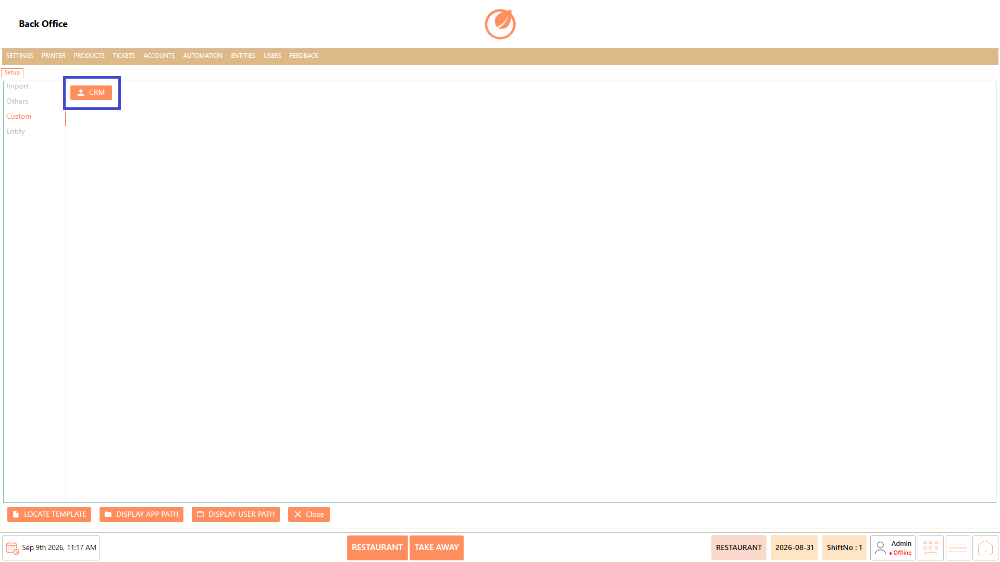<figcaption></figcaption></figure>

3. Enter the required password when prompted.

<figure>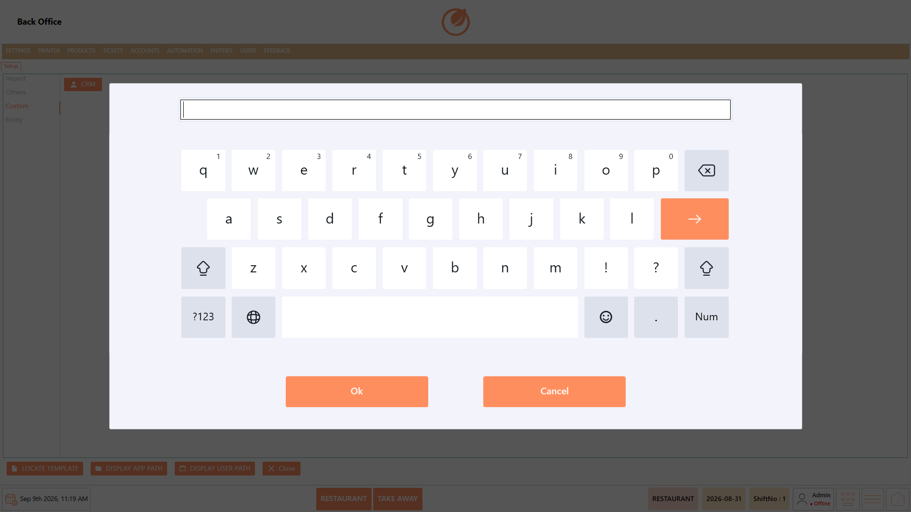<figcaption></figcaption></figure>

5. Enable or configure CRM as required.

#### **Use Case** 

* Enable CRM functionality when the restaurant needs customer-related features within DinePlan.
* Make CRM available to selected users when access needs to be controlled based on staff responsibilities.
* Restrict CRM access to authorized staff when customer information should not be accessible to all users.
* Provide CRM access to managers or designated employees who are responsible for customer-related activities.
* Configure CRM during system setup when the restaurant plans to use customer management functionality.

#### **Notes** 

* CRM follows the same authorization process as applicable options under Others.
* A password may be required to enable CRM or add it to a user.
* Configure CRM according to the restaurant's requirements.

### **Entity** 

The Entity section is used to import information for entities such as Members, Tables, and Customers using the provided template.

<figure>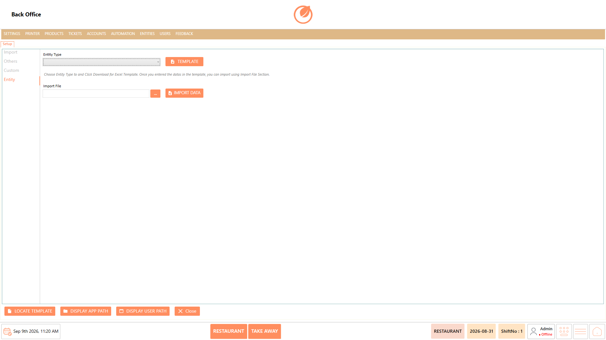<figcaption></figcaption></figure>

#### **Screen Elements** 

| **Screen Element** | **Description**                                   |
| ------------------ | ------------------------------------------------- |
| Entity Type        | Used to select the type of entity to be imported. |
| Members            | Used to import member information.                |
| Tables             | Used to import table information.                 |
| Customers          | Used to import customer information.              |
| Template           | Used to download the applicable import template.  |
| Import File        | Used to select the completed import file.         |
| Import Data        | Imports the selected entity information.          |
| Locate Template    | Used to locate the required template.             |

#### **Working** 

1. Select "Entity" under Setup.

<figure>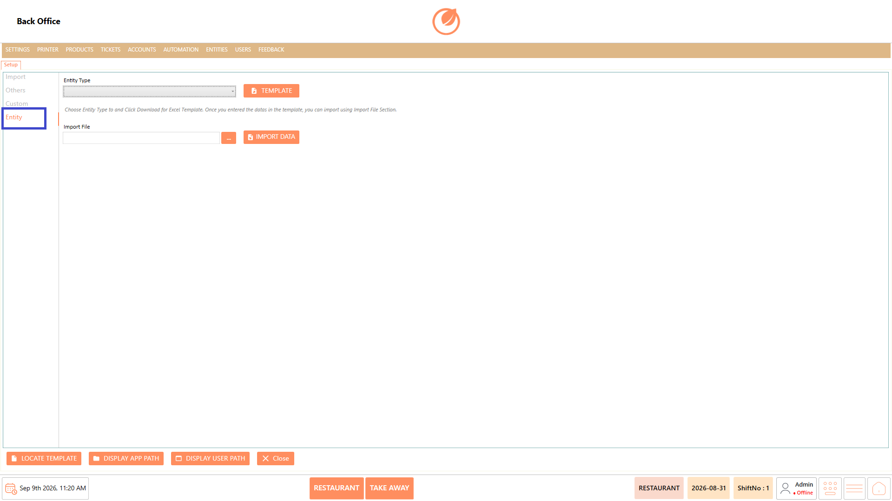<figcaption></figcaption></figure>

2. Select the required entity type, such as "Members", "Tables", or "Customers".

<figure>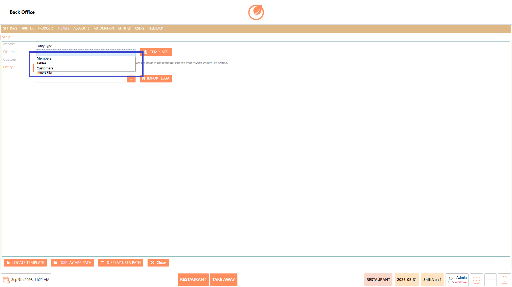<figcaption></figcaption></figure>

3. Select "Template" to download the applicable template.

<figure>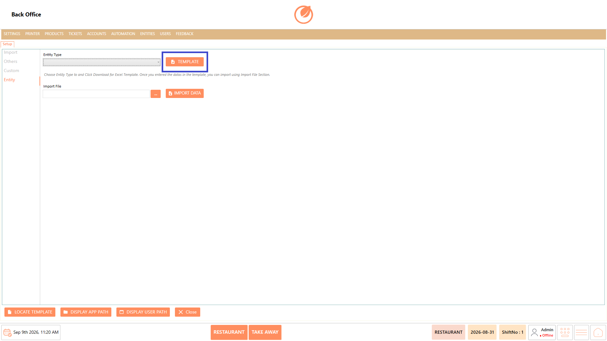<figcaption></figcaption></figure>

4. Enter the required information in the template.
5. Select the completed file. Click "..." to locate the file

<figure>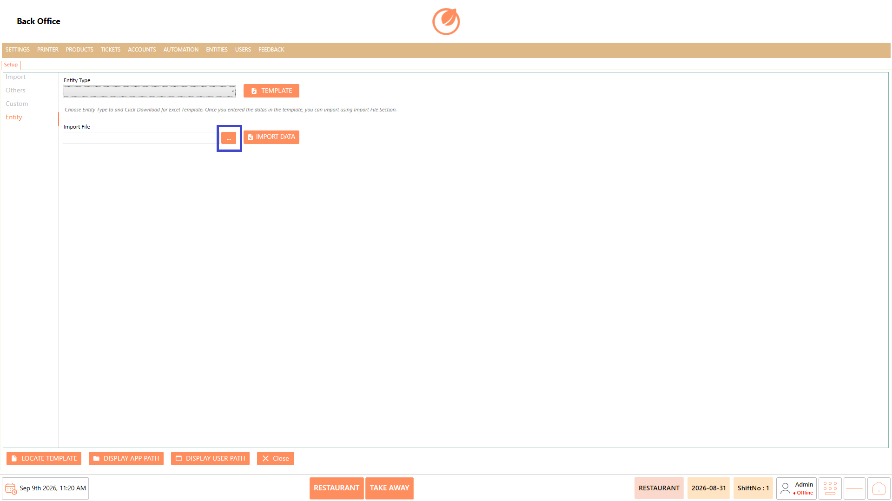<figcaption></figcaption></figure>

6. Select it under "Import File".

<figure>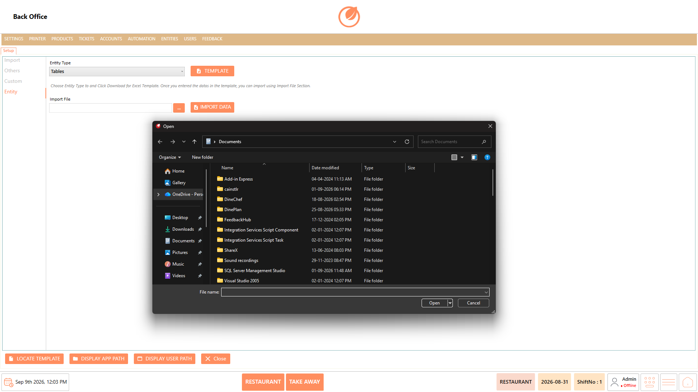<figcaption></figcaption></figure>

7. Select "Import Data" to import the information.

<figure>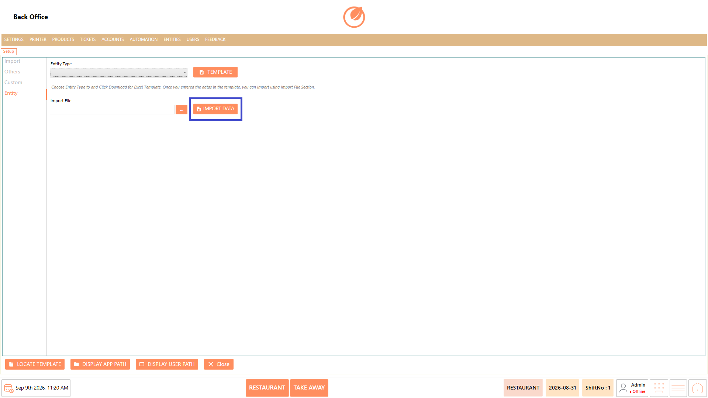<figcaption></figcaption></figure>

#### **Use Case** 

* Add a large number of records to the system without entering each record individually.
* Import member information when existing member data needs to be added to DinePlan in bulk.
* Import table information when multiple tables need to be configured at the same time.
* Add customer information in bulk when customer records are maintained in an external file.
* Transfer existing entity information into DinePlan using the provided import template.

#### **Notes** 

* Select the correct entity type before downloading or importing the template.
* Verify the information in the template before importing.
* Use the template provided for the selected entity type.

### **Additional Setup Options** 

The Setup screen also provides utility options at the bottom of the screen. These options can be used to locate templates, view application or user paths, and exit the current Setup screen.

<figure>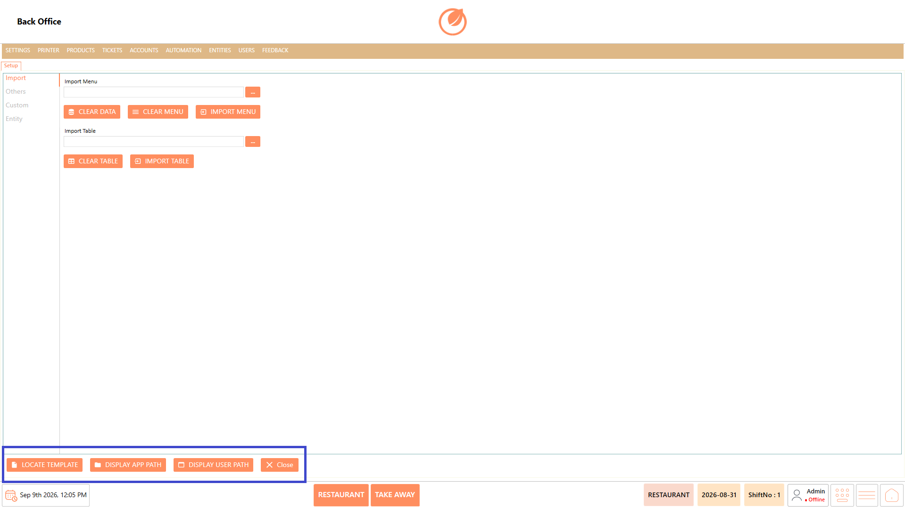<figcaption></figcaption></figure>

#### **Screen Elements** 

| **Screen Element** | **Description**                                                                              |
| ------------------ | -------------------------------------------------------------------------------------------- |
| Locate Template    | Provides an option to locate the template used for the applicable setup or import operation. |
| Display App Path   | Displays the application path.                                                               |
| Display User Path  | Displays the user path.                                                                      |

#### **Working** 

1. Select the required utility option based on the action you need to perform.
2. Select "Locate Template" to locate the required template.

<figure>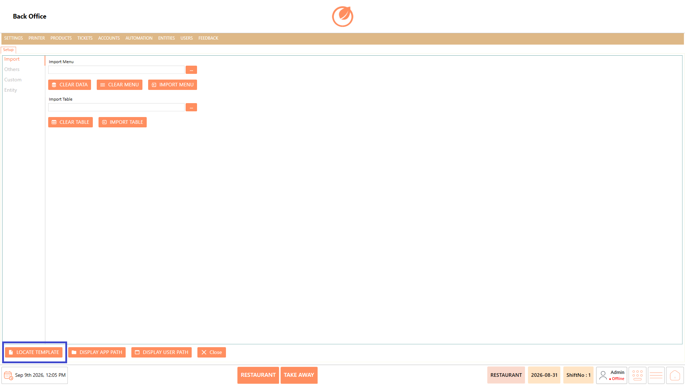<figcaption></figcaption></figure>

2. Select "Display App Path" to view the application path.

<figure>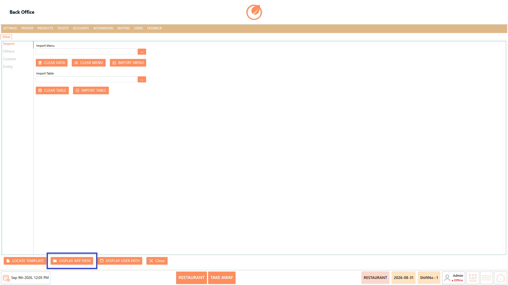<figcaption></figcaption></figure>

3. Select "Display User Path" to view the user path.

<figure>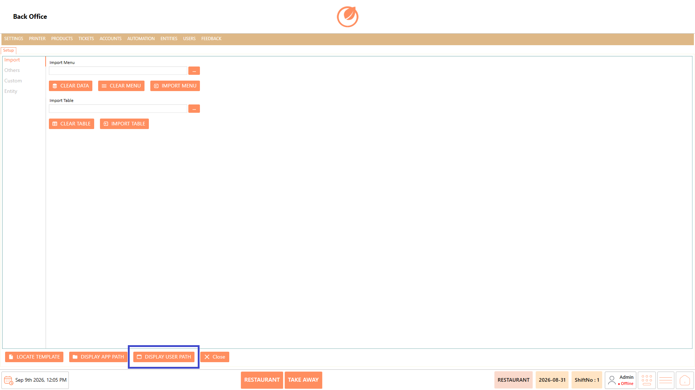<figcaption></figcaption></figure>

4. Select "Close" to exit the Setup screen.

<figure>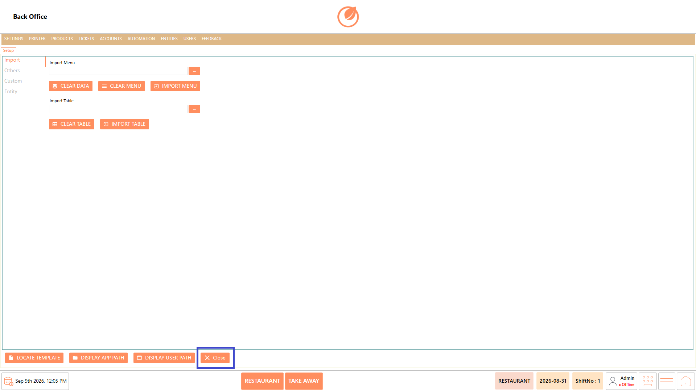<figcaption></figcaption></figure>

#### **Use Case** 

These options can be used when users need to:

* Locate an import template.
* Check the application path.
* Check the user path.
* Exit the Setup section after completing the required configuration.

#### **Notes** 

* Use "Locate Template" when the required template needs to be located.
* "Display App Path" and "Display User Path" are provided for path reference.
* Select "Close" after completing the required Setup activities.
* Setup controls how features and information are configured and made available in the user view.
* Use the appropriate Setup section based on the required configuration.
* Verify imported files before performing any import operation.
* Use clear or reset options carefully, as they may affect existing configuration or data.
* Some features require a password before they can be enabled or assigned to a user.
* Available Setup options may vary based on the system configuration and enabled features.
