# Terminals

## **Overview** 

The Terminals section is used to configure and manage the terminals used in the system. Users can create terminals based on their restaurant setup and manage existing terminals by editing, deleting, or changing their display order.

<figure>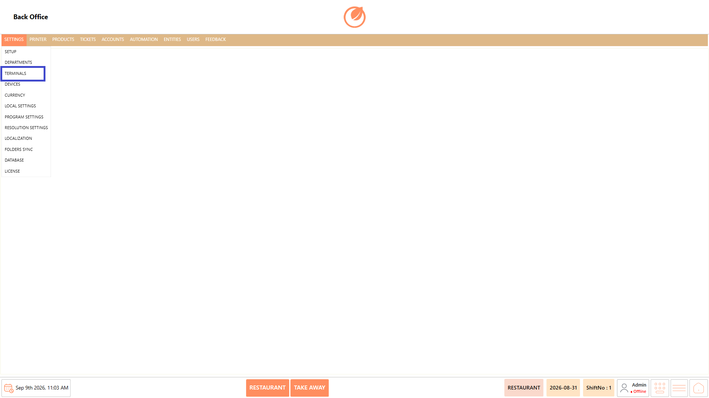<figcaption></figcaption></figure>

### **Screen Elements** 

<figure>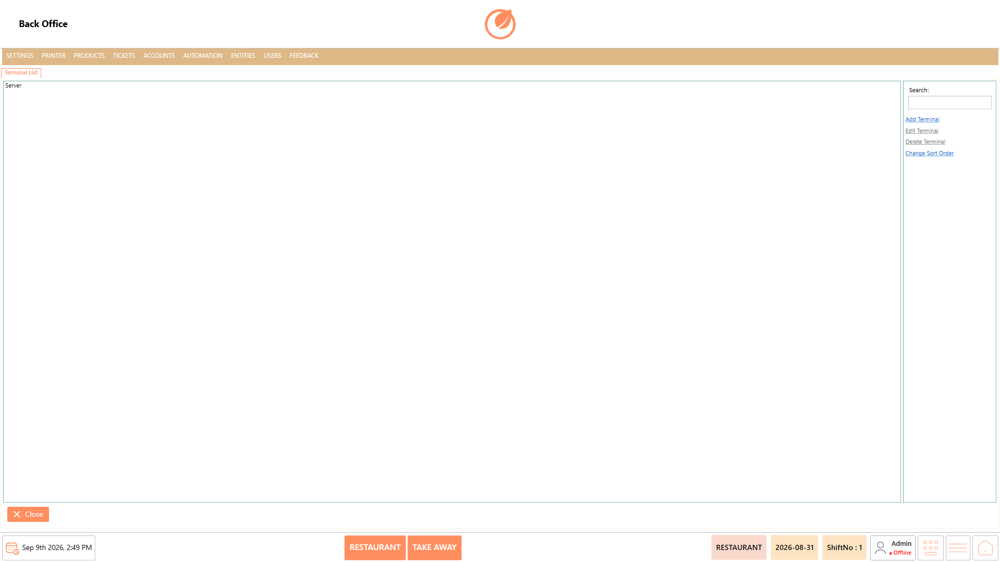<figcaption></figcaption></figure>

| **Screen Element** | **Description**                                            |
| ------------------ | ---------------------------------------------------------- |
| Terminal List      | Displays the terminals configured in the system.           |
| Search             | Used to search for a specific terminal.                    |
| Add Terminal       | Used to create a new terminal.                             |
| Edit Terminal      | Used to modify the selected terminal.                      |
| Delete Terminal    | Used to remove the selected terminal.                      |
| Change Sort Order  | Used to change the order in which terminals are displayed. |
| Close              | Closes the Terminal screen.                                |

### **Working** 

#### **Create a Terminal** 

1. Select "Add Terminal" from the Terminal List.

<figure>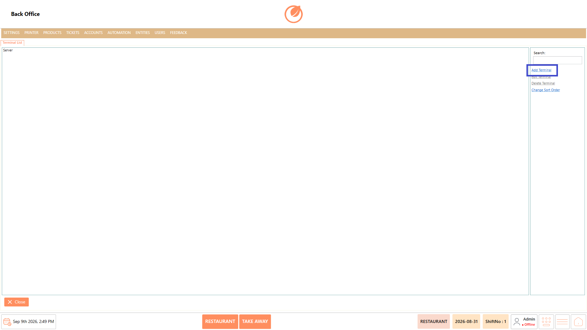<figcaption></figcaption></figure>

2. Enter the required "Code Name" and "Terminal Name".

<figure>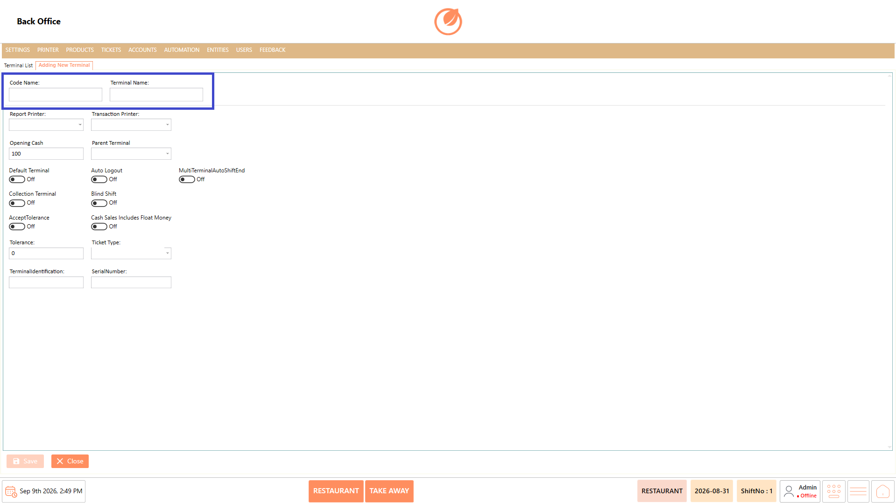<figcaption></figcaption></figure>

3. Select the required "Report Printer", "Transaction Printer", and "Parent Terminal".

<figure>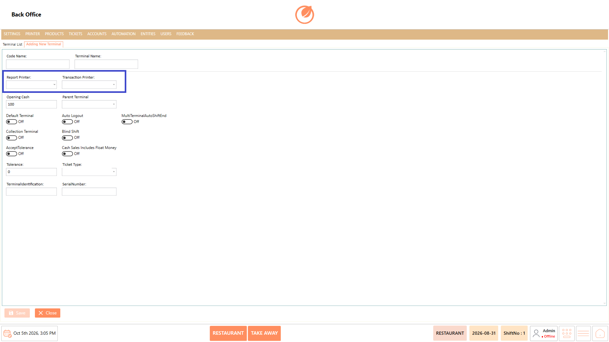<figcaption></figcaption></figure>

4. Enter the required "Opening Cash" and "Tolerance" values.

<figure>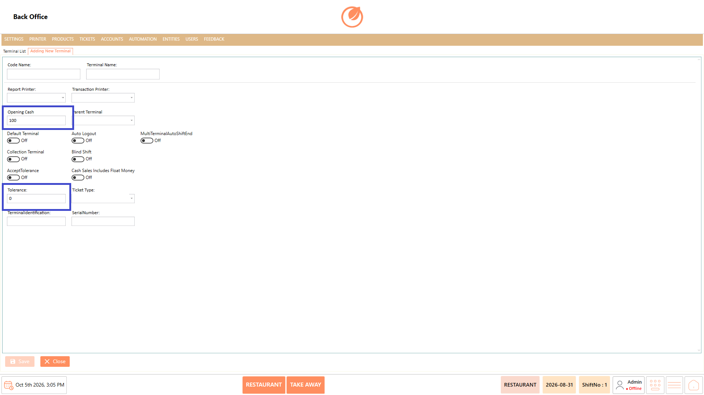<figcaption></figcaption></figure>

5. Enable the required terminal options, such as "Default Terminal" or "Collection Terminal".
6. Enter the required "Terminal Identification" and "SerialNumber".

<figure>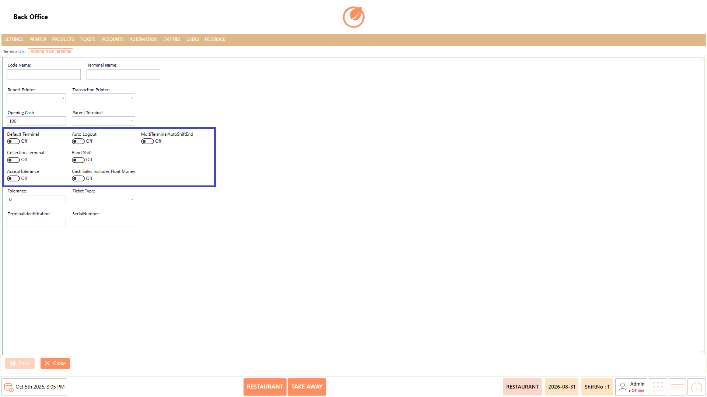<figcaption></figcaption></figure>

7. Select "Save" to create the terminal.

<figure>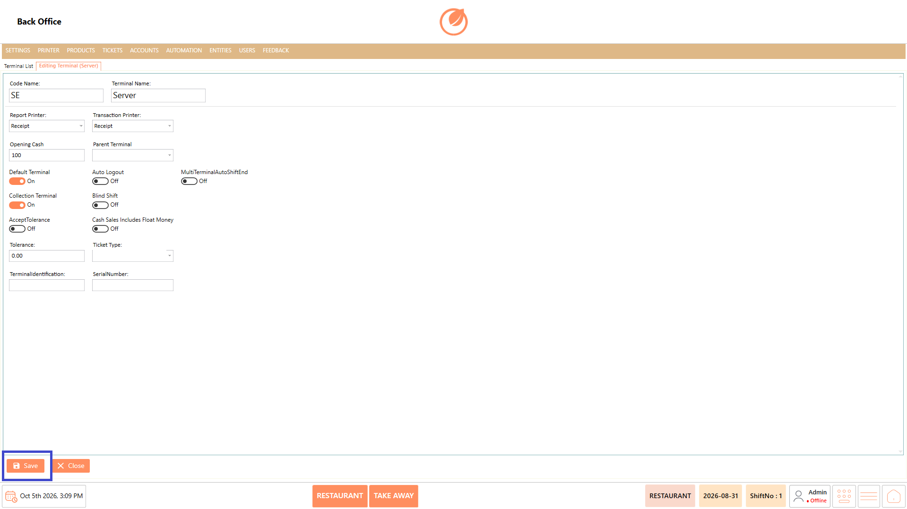<figcaption></figcaption></figure>

#### **Edit a Terminal** 

1. Select the required terminal from the Terminal List.
2. Select "Edit Terminal".

<figure>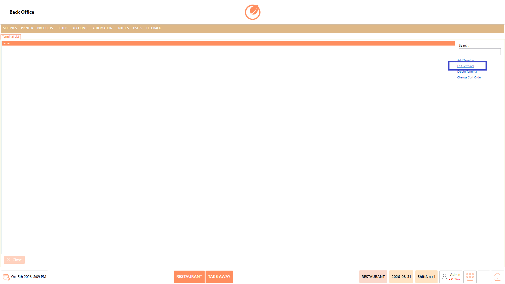<figcaption></figcaption></figure>

3. Update the required terminal information.
4. Select "Save" to apply the changes.

<figure><figcaption></figcaption></figure>

#### **Delete a Terminal** 

1. Select the terminal to be deleted.
2. Select "Delete Terminal".

<figure><figcaption></figcaption></figure>

3. Confirm the deletion when prompted.

<figure>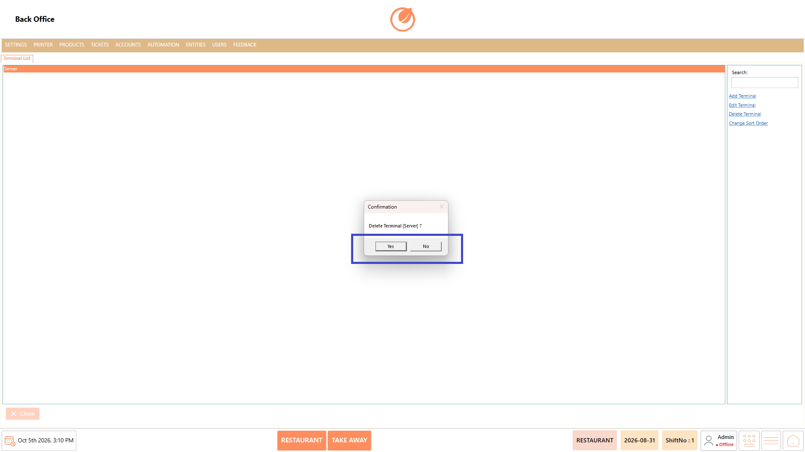<figcaption></figcaption></figure>

#### **Change Sort Order** 

1. Select "Change Sort Order".

<figure>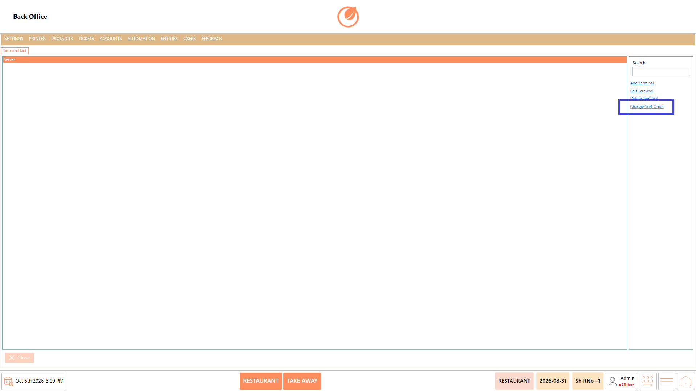<figcaption></figcaption></figure>

2. Arrange the terminals in the required order.
3. Save the new order as prompted.

### **Use Case** 

* Configure separate terminals for different billing counters within the restaurant.
* Set up dedicated terminals for different service areas, such as the restaurant floor, takeaway counter, or drive-through counter.
* Assign specific report and transaction printers to terminals based on the printing requirements of each counter or service area.
* Configure a terminal as the "Default Terminal" when it needs to be used as the primary terminal for the operation.
* Set up a "Collection Terminal" when a particular terminal is responsible for handling collections.
* Define "Opening Cash" for terminals that handle cash transactions at the beginning of their operation.
* Configure multiple terminals when the restaurant requires separate billing points for different operational areas.
* Organize the configured terminals in a preferred order to make them easier to identify and manage in the Back Office.

### **Notes** 

* Configure each terminal with the appropriate terminal code and name.
* Select the correct printers for reports and transactions.
* Configure "Opening Cash" according to the terminal's operational requirements.
* Enable "Default Terminal" or "Collection Terminal" only when required.
* Enter the correct "SerialNumber" and terminal identification details.
* Review the terminal before deleting it, as deletion removes it from the configured Terminal List.
