# Calculation Selector

### **Overview** 

The Calculation Selector allows users to configure and manage calculation options that can be applied during ticket processing. It provides a centralized list of configured calculation selectors, where users can create new selectors, modify existing configurations, remove selectors that are no longer required, and arrange them in a preferred order.

Each selector can be configured with general settings, applicable calculation types, and mappings based on the terminal, user role, department, and ticket type.

<figure>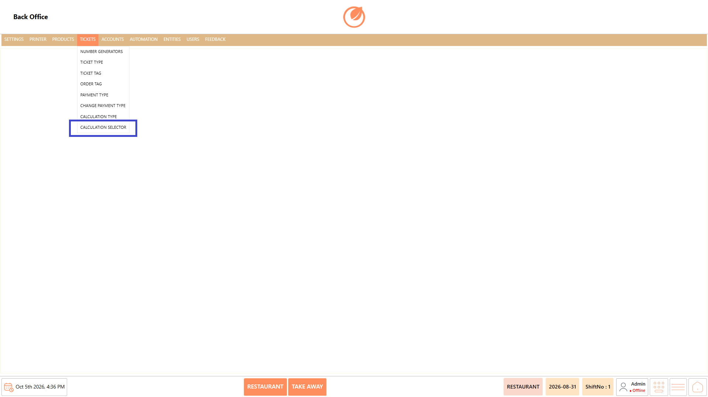<figcaption></figcaption></figure>

### **Screen Elements** 

| **Screen Element**          | **Description**                                                                                                  |
| --------------------------- | ---------------------------------------------------------------------------------------------------------------- |
| Calculation Selector List   | Displays the configured calculation of selectors.                                                                |
| Search                      | Allows users to search for a specific calculation selector.                                                      |
| Add Calculation Selector    | Opens the screen to create a new calculation selector.                                                           |
| Edit Calculation Selector   | Allows users to modify the selected calculation selector.                                                        |
| Delete Calculation Selector | Deletes the selected calculation selector after confirmation.                                                    |
| Sort Calculation Selectors  | Allows users to change the order of calculation selectors by dragging them.                                      |
| Name                        | Specifies the name of the calculation selector.                                                                  |
| Button Header               | Defines the header displayed for the calculation selector button.                                                |
| Button Color                | Allows users to configure the button color.                                                                      |
| Font Size                   | Specifies the font size for the button.                                                                          |
| Confirmation                | Configures the confirmation option for the calculation selector.                                                 |
| Group                       | Specifies the group associated with the calculation selector.                                                    |
| Restrict Promotion          | Controls whether promotion restrictions are enabled for the selector.                                            |
| Calculation Type            | Displays the calculation types configured for the selector.                                                      |
| Mappings                    | Allows calculation selector availability to be mapped based on terminal, user role, department, and ticket type. |
| Terminal                    | Specifies the terminal to which the mapping applies.                                                             |
| User Role                   | Specifies the user role for the mapping.                                                                         |
| Department                  | Specifies the department for mapping.                                                                            |
| Ticket Type                 | Specifies the ticket type for the mapping.                                                                       |
| Save                        | Saves the calculation selector configuration.                                                                    |
| Close                       | Closes the current screen.                                                                                       |

### **Working** 

#### **Add a Calculation Selector** 

1. Select "Add Calculation Selector".

<figure>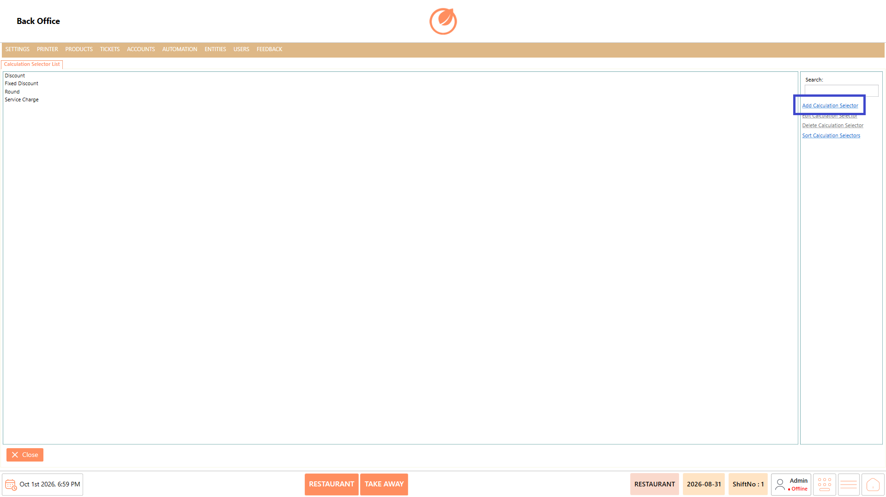<figcaption></figcaption></figure>

2. Enter the required details in "Name" and configure the available general settings.
3. If required, enable "Restrict Promotion".

<figure>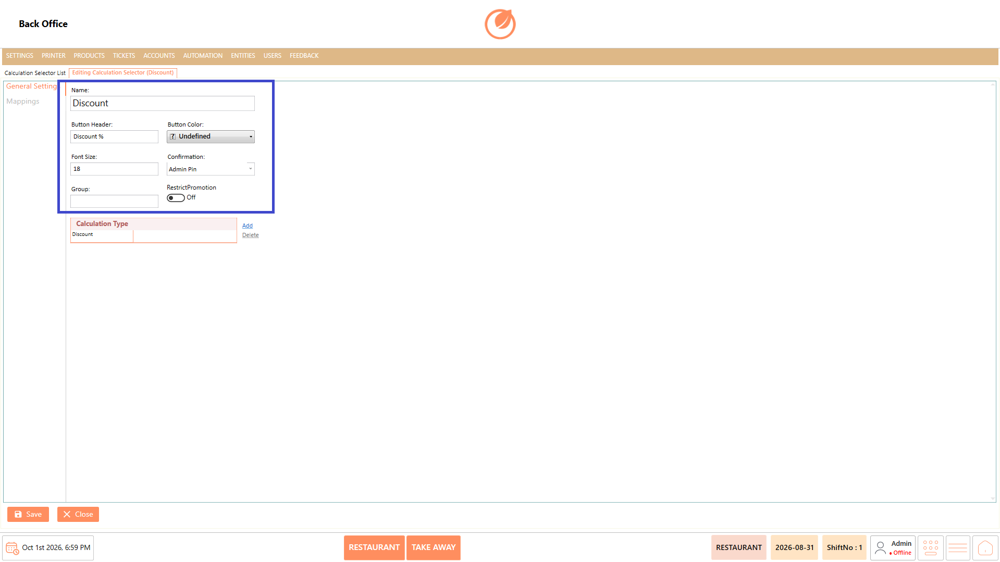<figcaption></figcaption></figure>

4. Under "Calculation Type", select "Add".

<figure>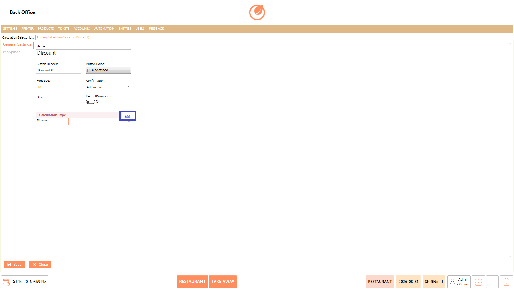<figcaption></figcaption></figure>

5. Select the required calculation types and select "OK".

<figure>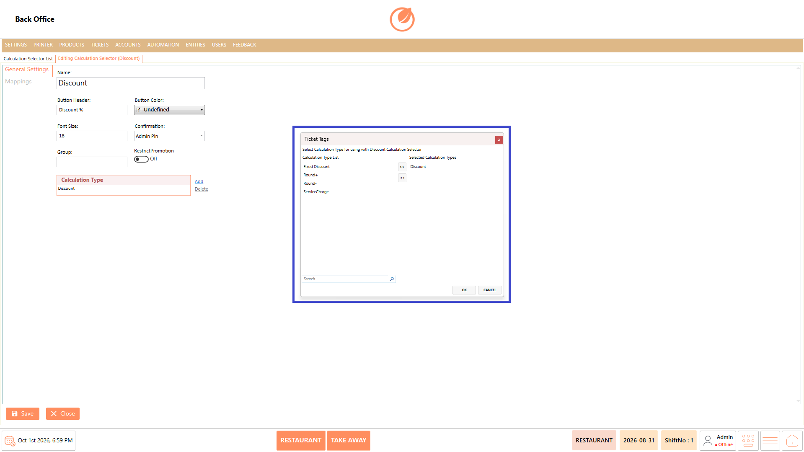<figcaption></figcaption></figure>

6. Open "Mappings" and select "Add".

<figure>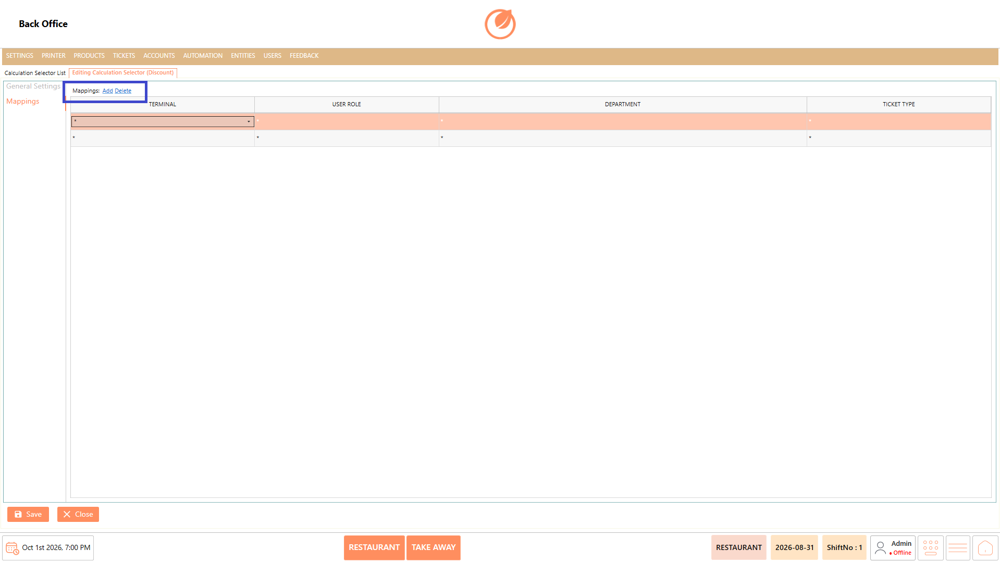<figcaption></figcaption></figure>

7. Configure the required "Terminal", "User Role", "Department", and "Ticket Type".

<figure>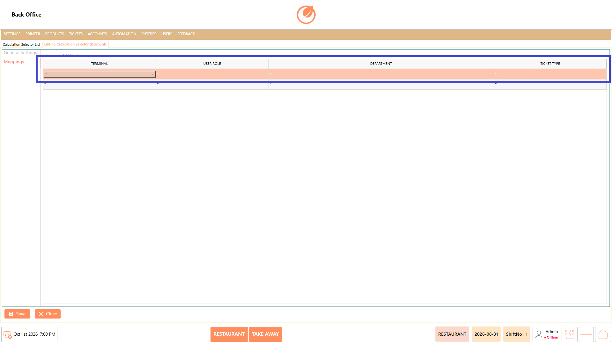<figcaption></figcaption></figure>

8. Select "Save" to create the calculation selector.

<figure>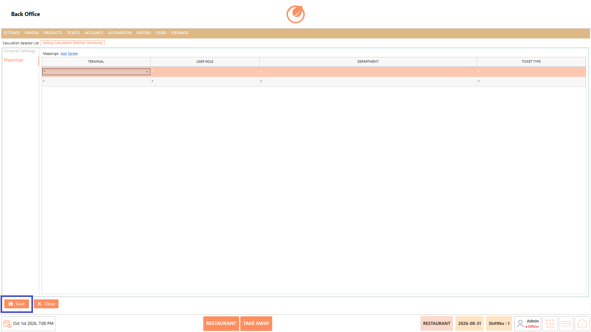<figcaption></figcaption></figure>

#### **Edit a Calculation Selector** 

1. Select the calculation selector that needs to be modified.
2. Select "Edit Calculation Selector".

<figure>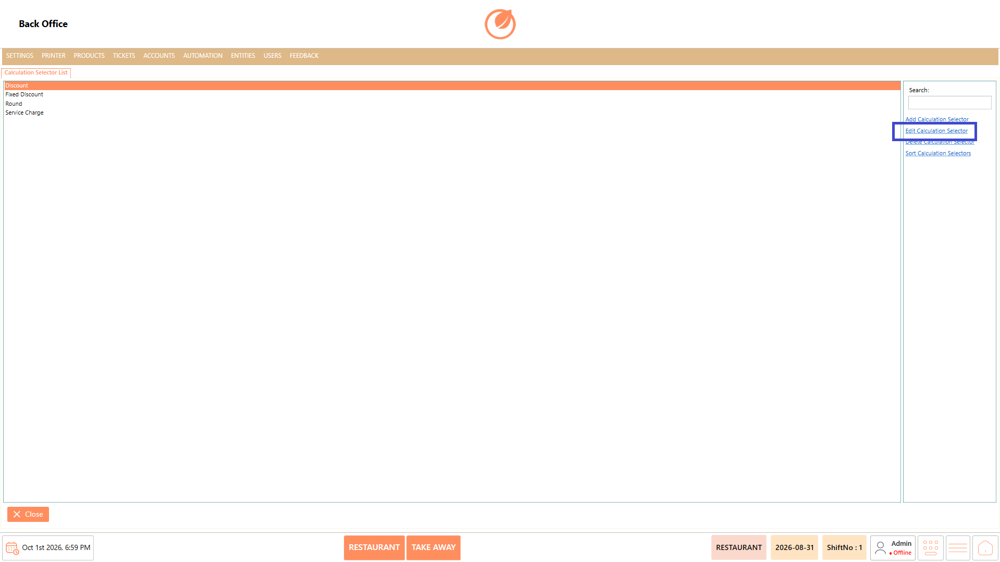<figcaption></figcaption></figure>

3. Update the required general settings, calculation types, or mappings.
4. Select "Save" to save the changes.

<figure><figcaption></figcaption></figure>

#### **Delete a Calculation Selector** 

1. Select the calculation selector that needs to be deleted.
2. Select "Delete Calculation Selector".

<figure><figcaption></figcaption></figure>

3. In the confirmation message, select "Yes" to delete the calculation selector.

<figure>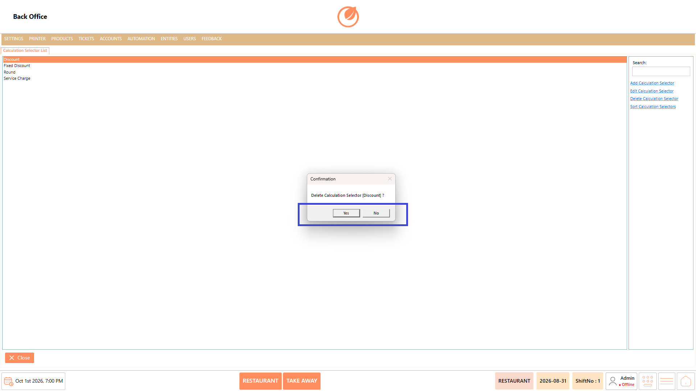<figcaption></figcaption></figure>

#### **Sort Calculation Selectors** 

1. Select "Sort Calculation Selectors".

<figure>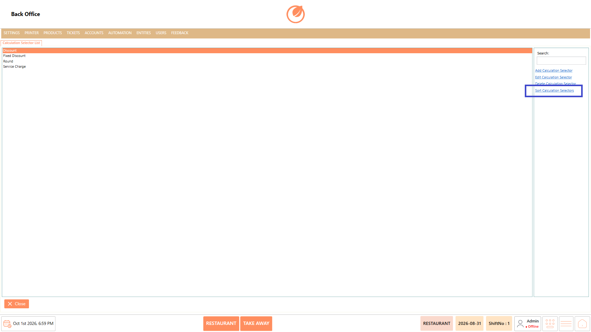<figcaption></figcaption></figure>

2. Drag the calculation selectors to arrange them in the required order.

<figure>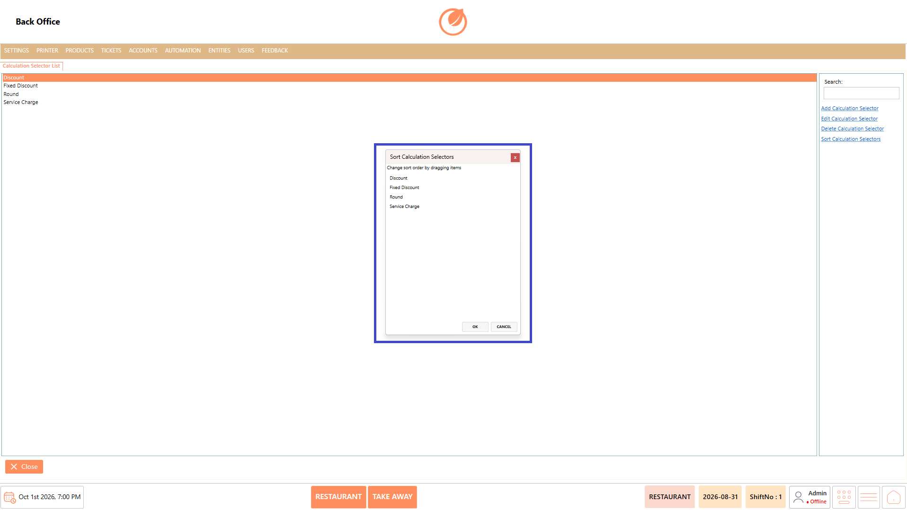<figcaption></figcaption></figure>

3. Select "OK" to save the updated order.

<figure>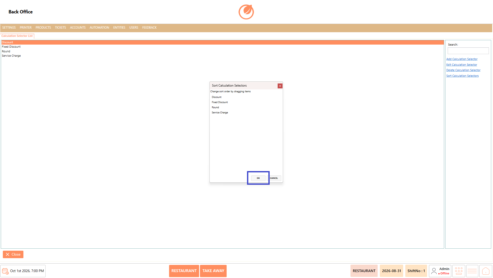<figcaption></figcaption></figure>

### **Use Case** 

1. Configure calculation selectors for commonly used calculation options.
2. Define the calculation types available within a selector.
3. Configure selector settings such as button header, color, and font size.
4. Restrict a calculation selector based on the configured promotion setting.
5. Map calculation selectors to specific terminals.
6. Control selector availability based on user roles, departments, and ticket types.
7. Modify or remove calculation selectors when configuration requirements change.
8. Arrange calculation selectors in a preferred order for easier access.

### **Notes** 

* A "Name" is required when creating a calculation selector.
* Calculation types must be selected from the available "Calculation Type List".
* Mappings can be configured using "Terminal", "User Role", "Department", and "Ticket Type".
* Select "Save" after adding or modifying a calculation selector to retain the configuration.
* Deleting a calculation selector requires confirmation.
* Use "Sort Calculation Selectors" to change the display order of configured selectors.
* Use "Search" to quickly locate a calculation selector from the list.
