# Calculation Type

### **Overview** 

The Calculation Type feature in Back Office allows administrators to configure and manage different types of calculations that can be applied to ticket amounts. The Calculation Type List displays the available calculation types, such as Discount, Fixed Discount, Round+, Round-, and Service Charge.

Administrators can add new calculation types by defining the calculation method, rate or amount, and other calculation settings. Tax templates can also be associated with a calculation type, and existing calculation types can be edited, deleted, or reordered based on the operational requirement.

<figure>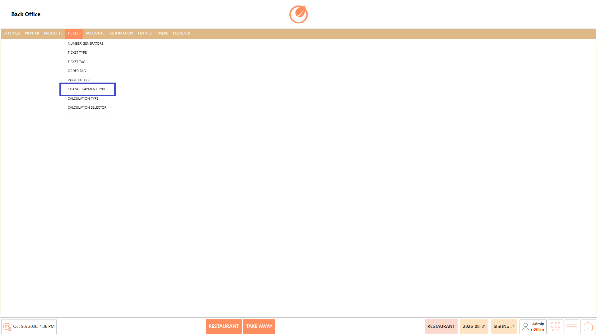<figcaption></figcaption></figure>

### **Screen Elements** 

#### **Calculation Type List** 

| **Screen Element**      | **Description**                                                        |
| ----------------------- | ---------------------------------------------------------------------- |
| Calculation Type List   | Displays the available calculation types configured in the system.     |
| Search                  | Allows users to search for a specific calculation type.                |
| Add Calculation Type    | Opens the screen to create a new calculation type.                     |
| Edit Calculation Type   | Opens the selected calculation type for modification.                  |
| Delete Calculation Type | Allows the selected calculation type to be deleted after confirmation. |
| Sort Calculation Types  | Opens the sorting window to change the order of calculation types.     |
| Close                   | Closes the Calculation Type screen.                                    |

### **Working** 

#### **Add a Calculation Type** 

1. Select "Add Calculation Type".

<figure>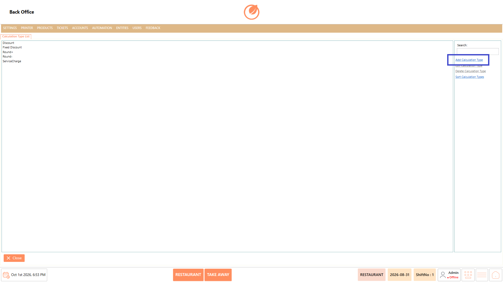<figcaption></figcaption></figure>

2. Enter the required details in "Template Name" and configure "Account Transaction Type", "Calculation Method", and "Rate or Amount".
3. Configure the required calculation options such as "Include Tax", "Decrease Amount", "Use Plain Sum", "Toggle Calculation", "Use Original Item Price", "Change On Department", "Use Sub Total", and "Ask Reference".

<figure>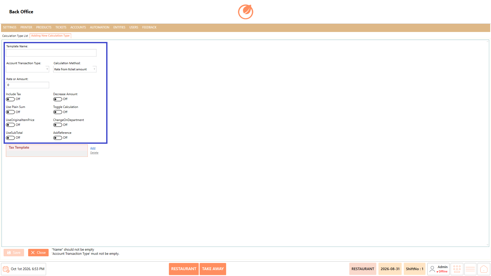<figcaption></figcaption></figure>

4. Under "Tax Template", select "Add" and choose the required tax template.

<figure>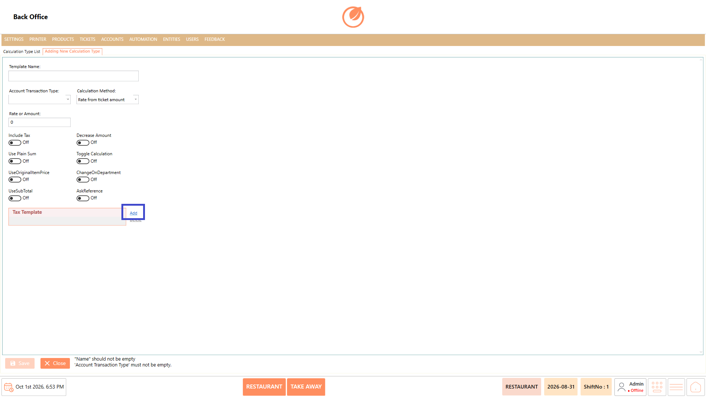<figcaption></figcaption></figure>

5. Select "OK" to add the selected tax template.

<figure>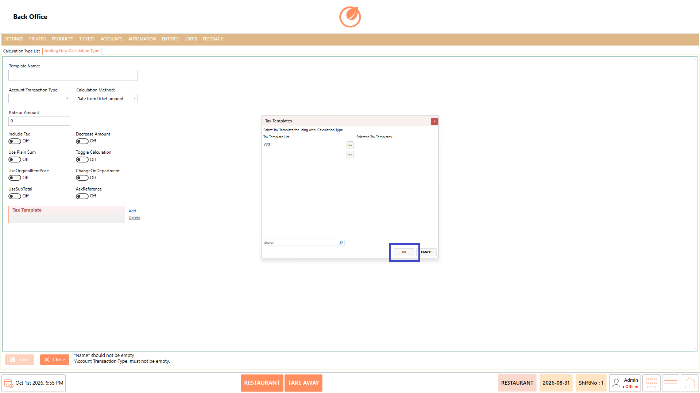<figcaption></figcaption></figure>

6. Select "Save" to create the calculation type.

<figure>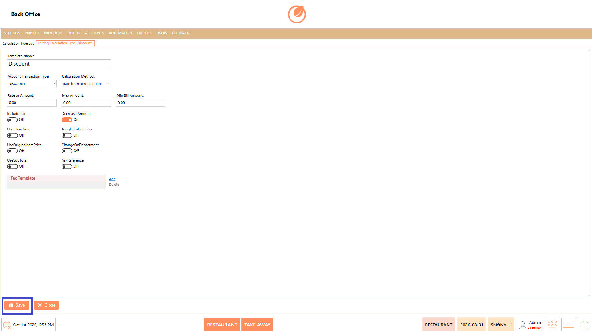<figcaption></figcaption></figure>

#### **Edit a Calculation Type** 

1. Select the calculation type that needs to be modified.
2. Select "Edit Calculation Type".

<figure>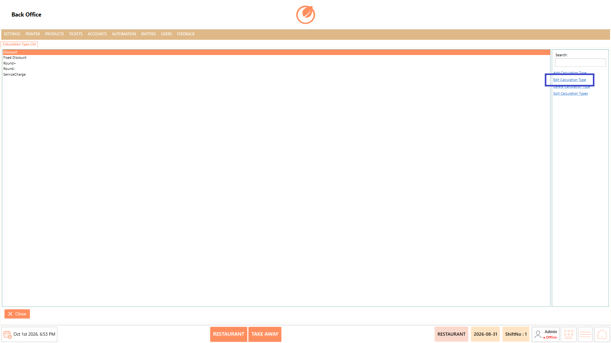<figcaption></figcaption></figure>

3. Update the required calculation settings or tax template configuration.
4. Select "Save" to save the changes.

<figure><figcaption></figcaption></figure>

#### **Delete a Calculation Type** 

1. Select the calculation type that needs to be deleted.
2. Select "Delete Calculation Type".

<figure><figcaption></figcaption></figure>

3. In the confirmation message, select "Yes" to delete the calculation type.

<figure>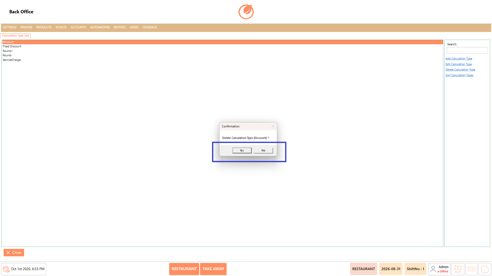<figcaption></figcaption></figure>

#### **Sort Calculation Types** 

1. Select "Sort Calculation Types".

<figure>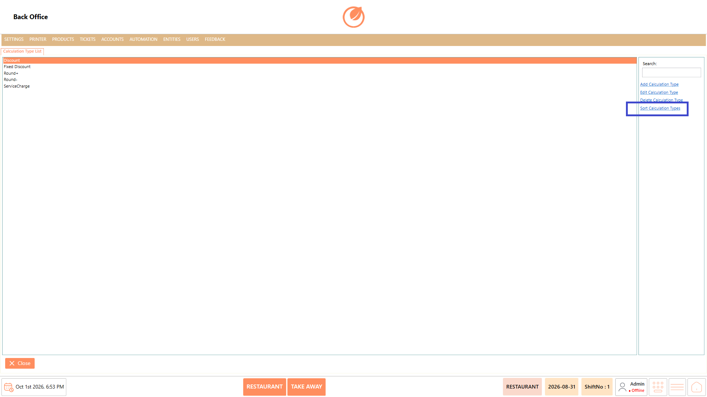<figcaption></figcaption></figure>

2. Arrange the calculation types in the required order by dragging the items.

<figure>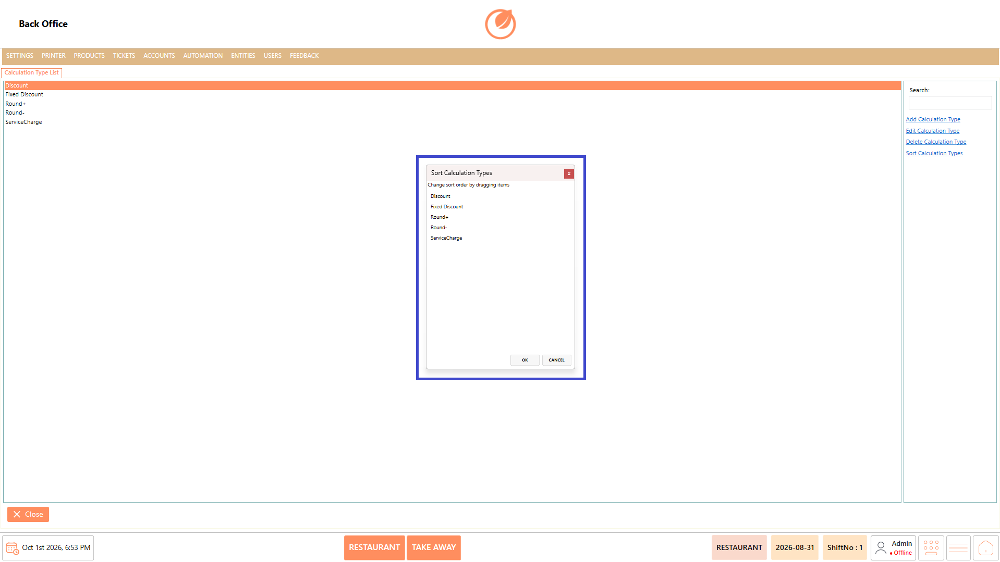<figcaption></figcaption></figure>

3. Select "OK" to save the updated order.

<figure>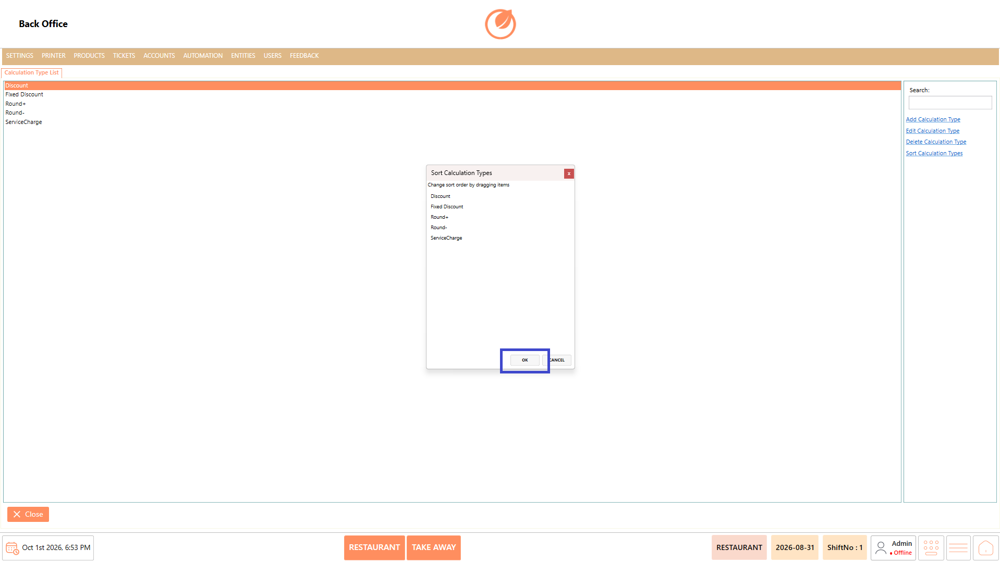<figcaption></figcaption></figure>

### **Use Case** 

1. Configure discounts by creating calculation types such as Discount or Fixed Discount.
2. Manage rounding calculations using options such as Round+ and Round-.
3. Configure service charges using the Service Charge calculation type.
4. Define calculation methods based on the required rate or amount.
5. Associate tax templates with a calculation type when tax configuration is required.
6. Modify existing calculations when the calculation settings or associated options need to be updated.
7. Remove unused calculation types from the configured list when they are no longer required.
8. Arrange calculation types in the required order using the sorting option.

### **Notes** 

* Template Name and Account Transaction Type are required when creating a calculation type.
* Configure the Calculation Method according to the calculation requirement.
* Enter the appropriate value in Rate or Amount based on the selected calculation configuration.
* Review the available calculation options before saving the configuration.
* Tax templates can be selected through the Tax Templates window.
* Use Edit Calculation Type to modify an existing configuration instead of creating a duplicate.
* Deleting a calculation type requires confirmation.
* Use Sort Calculation Types to maintain the required order of calculation types.
