# Change Payment Type

### **Overview** 

The Change Payment Type feature allows you to manage the payment types used for changing or replacing payment methods in the system. You can create new change payment types by entering a template name and configuring the required account details.

The feature also allows you to define mappings based on user roles, departments, and ticket types. Existing change payment types can be edited or deleted when required, and the list can be reordered for easier management. The Search option helps you quickly locate a specific change payment type from the list.

<figure>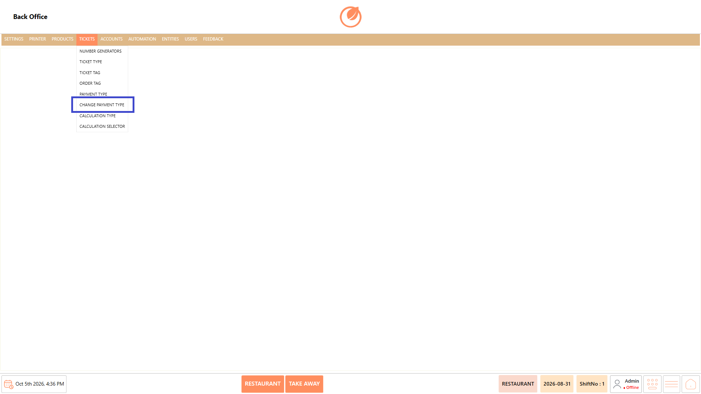<figcaption></figcaption></figure>

### **Screen Elements** 

#### **Change Payment Type List** 

| **Screen Element**         | **Description**                                                       |
| -------------------------- | --------------------------------------------------------------------- |
| Change Payment Type List   | Displays the available change payment types.                          |
| Search                     | Allows you to search for a specific change payment type.              |
| Add Change Payment Type    | Opens the screen to create a new change payment type.                 |
| Edit Change Payment Type   | Opens the selected change payment type for modification.              |
| Delete Change Payment Type | Deletes the selected change payment type after confirmation.          |
| Sort Change Payment Types  | Opens the sorting window to change the order of change payment types. |
| Close                      | Closes the Change Payment Type screen.                                |

#### **General Settings** 

| **Screen Element**       | **Description**                                                                            |
| ------------------------ | ------------------------------------------------------------------------------------------ |
| Template Name            | Allows you to enter the name of the change payment type.                                   |
| Account Transaction Type | Allows you to select the required account transaction type.                                |
| Account                  | Allows you to select the required account.                                                 |
| Mappings                 | Opens the mapping section for configuring user role, department, and ticket type mappings. |
| Save                     | Saves the change payment type configuration.                                               |
| Close                    | Closes the current screen.                                                                 |

### **Working** 

#### **Add a Change Payment Type** 

1. Select "Add Change Payment Type".

<figure>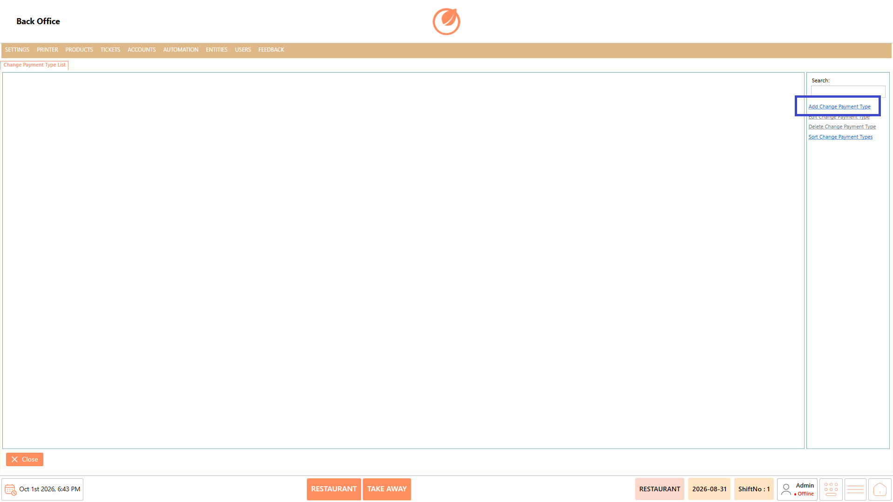<figcaption></figcaption></figure>

2. Enter the required details in "Template Name" and configure "Account Transaction Type" and "Account".

<figure>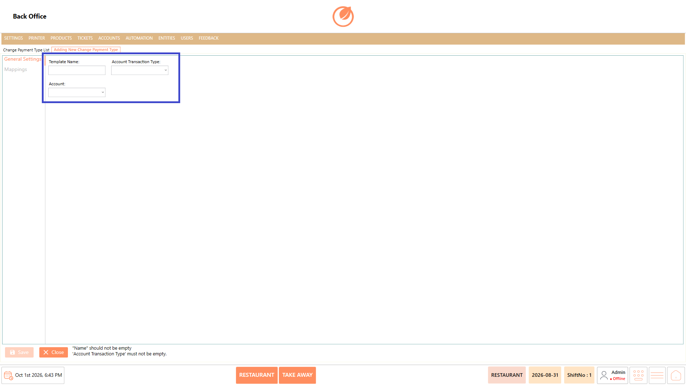<figcaption></figcaption></figure>

3. Open "Mappings" and select "Add" to add the required mapping.
4. Configure the required "User Role", "Department", and "Ticket Type".

<figure>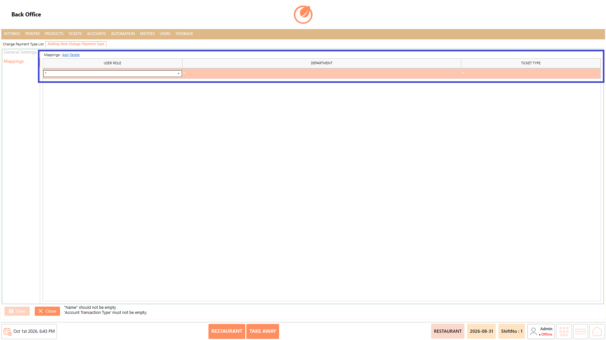<figcaption></figcaption></figure>

5. Select "Save" to create the change payment type.

<figure>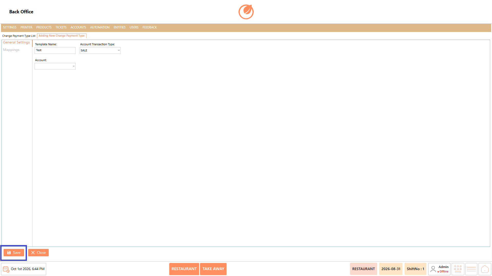<figcaption></figcaption></figure>

#### **Edit a Change Payment Type** 

1. Select the change payment type that needs to be modified.
2. Select "Edit Change Payment Type".

<figure>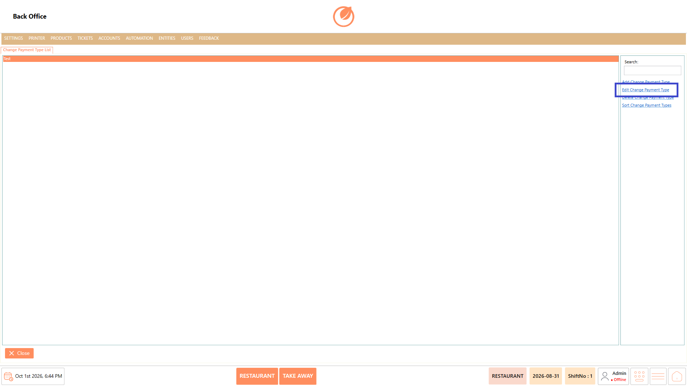<figcaption></figcaption></figure>

3. Update the required general settings or mappings.
4. Select "Save" to save the changes.

<figure><figcaption></figcaption></figure>

#### **Delete a Change Payment Type** 

1. Select the change payment type that needs to be deleted.
2. Select "Delete Change Payment Type".

<figure>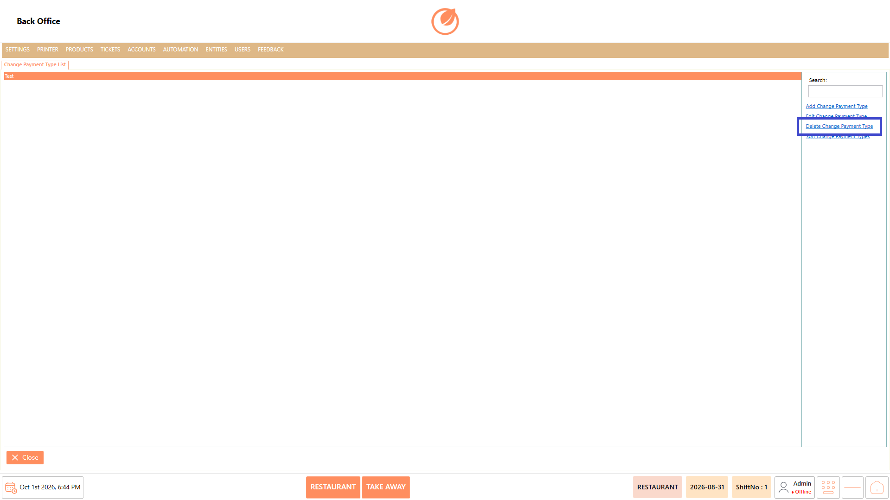<figcaption></figcaption></figure>

3. In the confirmation message, select "Yes" to delete the change payment type.

<figure>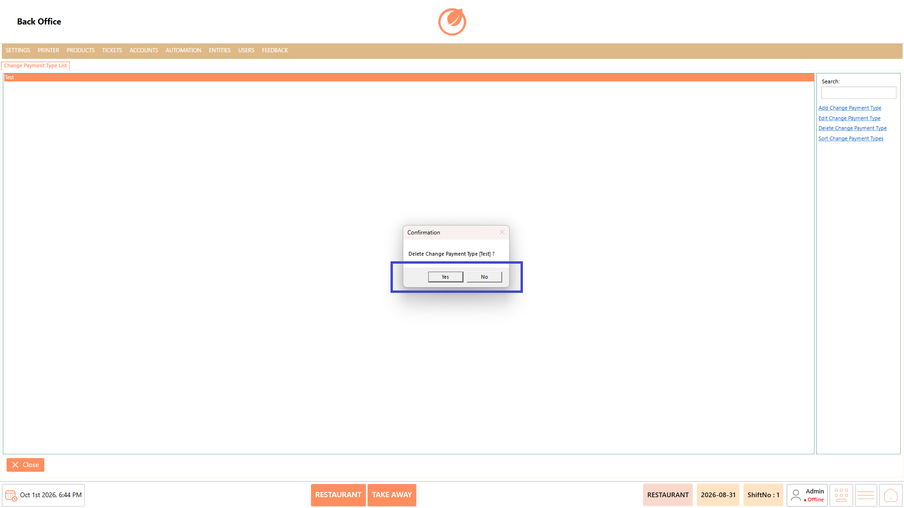<figcaption></figcaption></figure>

#### **Sort Change Payment Types** 

1. Select "Sort Change Payment Types".

<figure>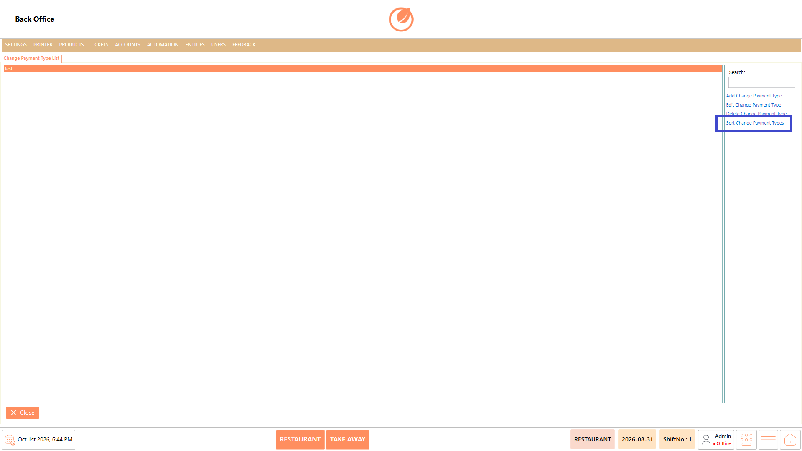<figcaption></figcaption></figure>

2. Arrange the change payment types in the required order by dragging the items.

<figure>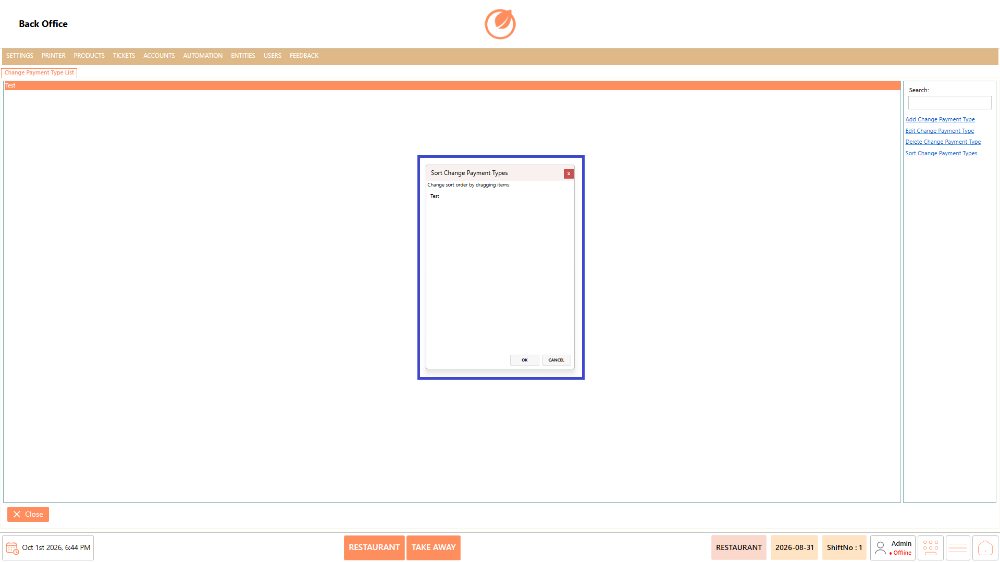<figcaption></figcaption></figure>

3. Select "OK" to save the updated order.

<figure>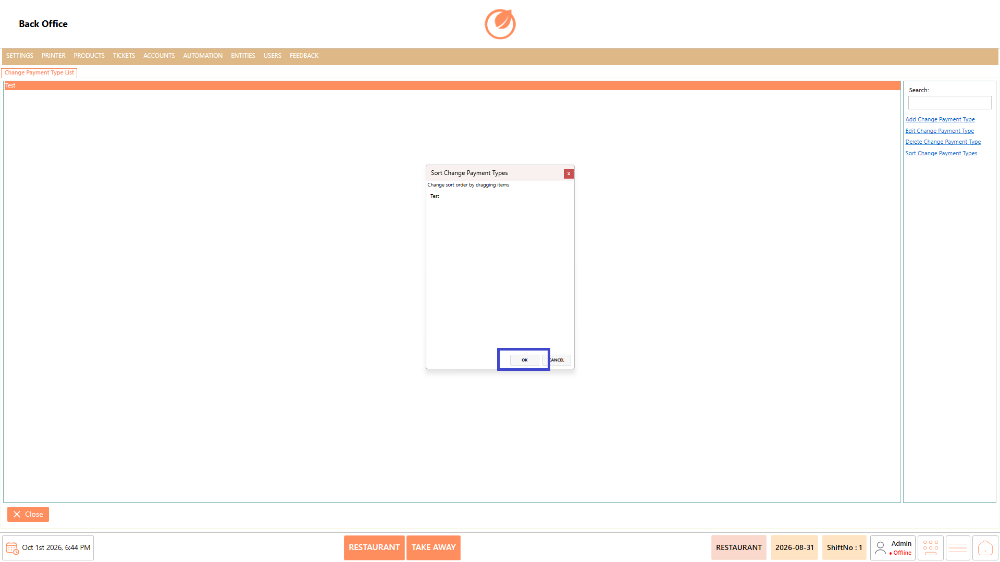<figcaption></figcaption></figure>

### **Use Case** 

* Create a change payment type with the required template and account details.
* Configure mappings for specific user roles, departments, and ticket types.
* Modify existing change payment type settings when account or mapping details need to be updated.
* Remove change payment types that are no longer required.
* Arrange change payment types in a preferred order for easier management.
* Search for a specific change payment type when multiple entries are available.
* Define which user roles, departments, and ticket types can use a change payment type through mappings.
* Maintain payment-related configurations according to the operational requirements of the restaurant.

### **Notes** 

* Enter the required "Template Name" before saving.
* "Account Transaction Type" is required to save the configuration.
* Configure the required "Account" based on the payment setup.
* Review the mappings before saving a change payment type.
* Deleting a change payment type requires confirmation.
* Use "Sort Change Payment Types" to change the display order.
* Use "Search" to quickly locate a specific change payment type.
* Ensure the required mapping details are configured correctly before saving.
