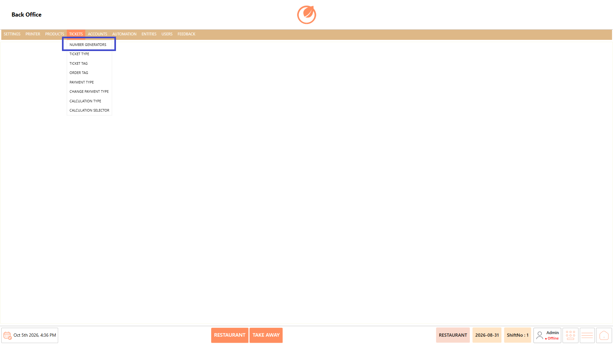
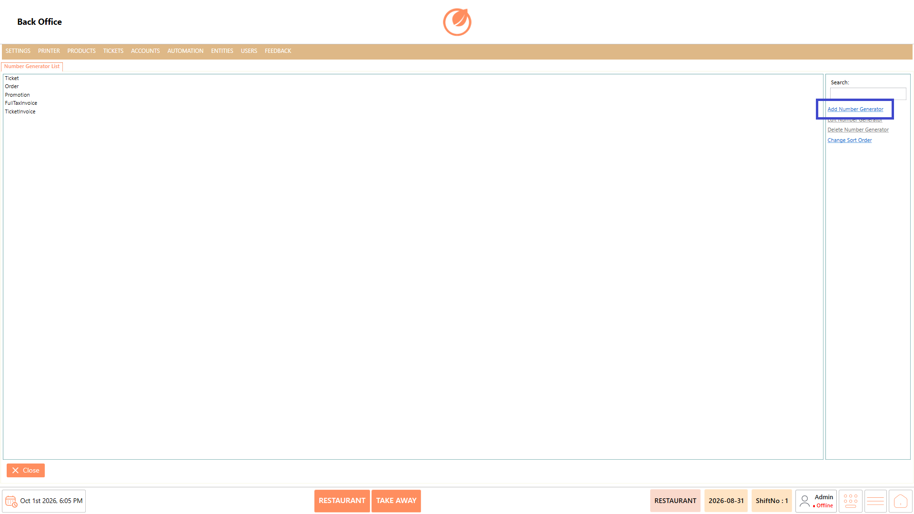
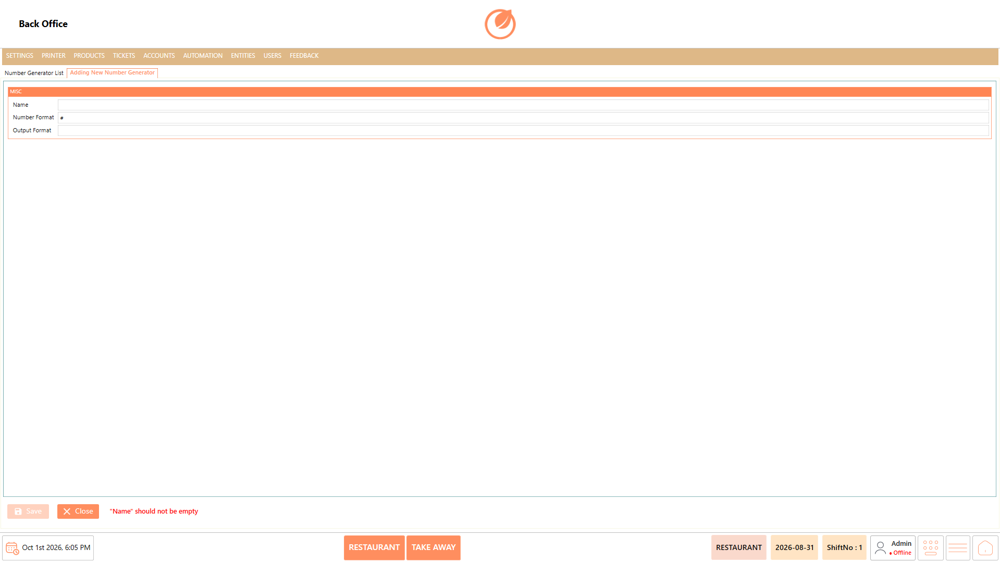
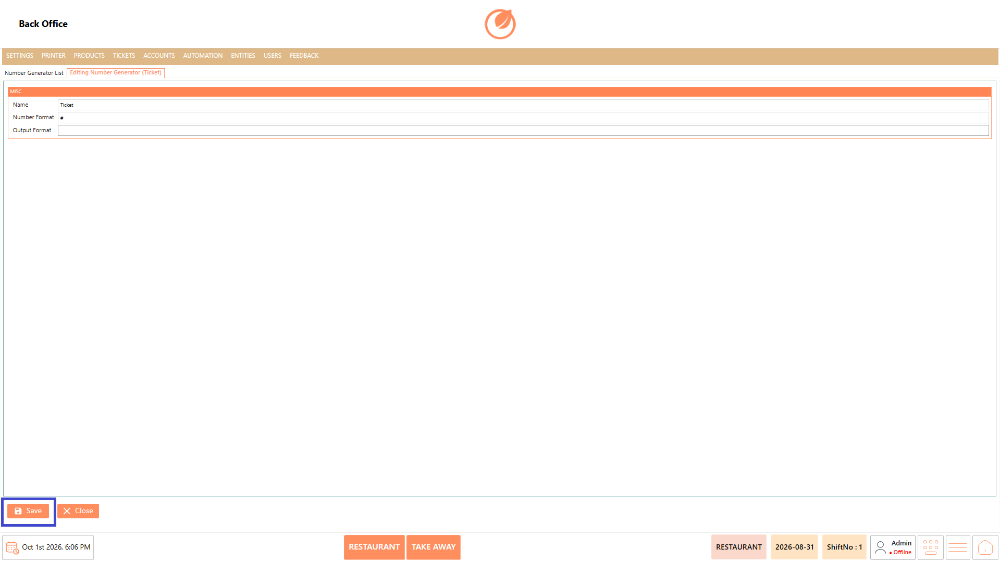
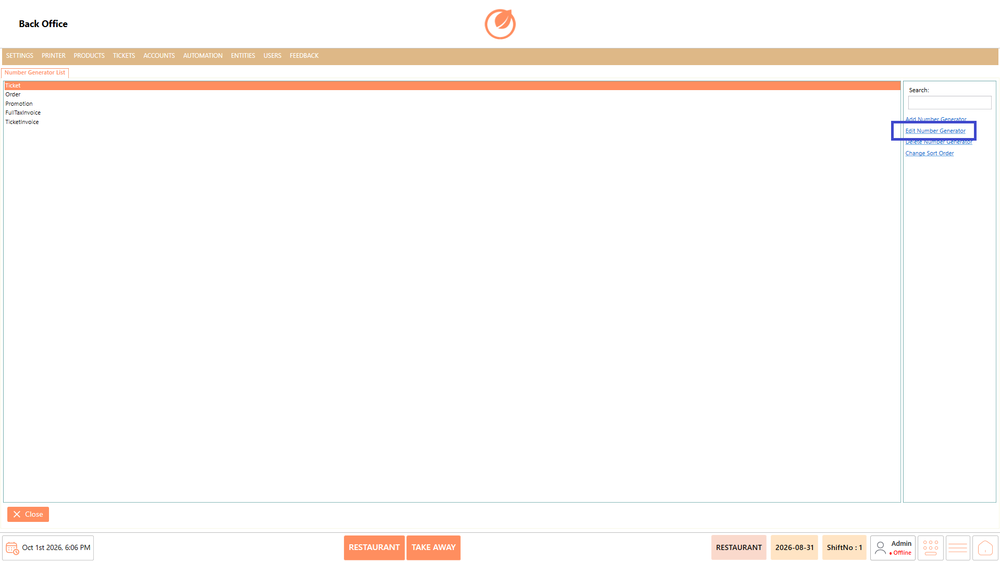
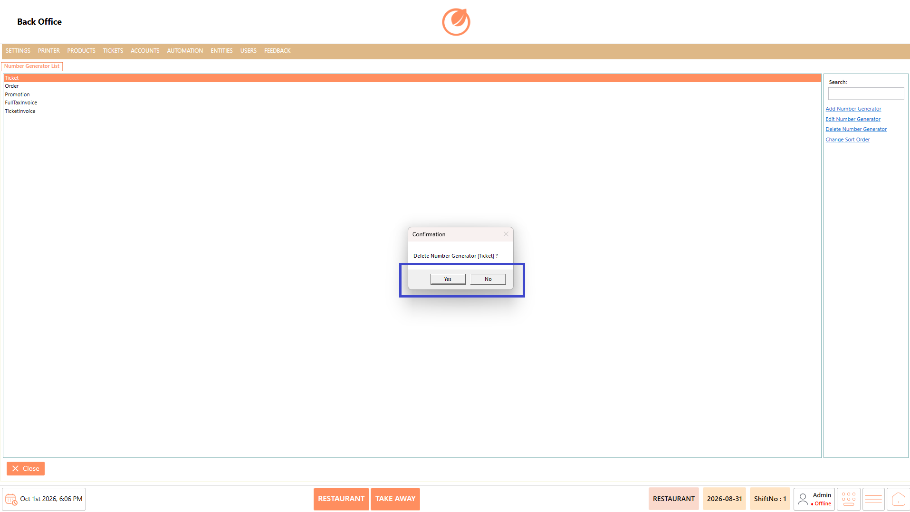

# Number Generator

### **Overview** 

The Number Generator setting allows you to manage number generators used for different transaction types, such as Ticket, Order, Promotion, Full Tax Invoice, and Ticket Invoice. You can add, edit, delete, and change the sort order of number generators.

<figure><figcaption></figcaption></figure>

### **Screen Elements** 

| **Screen Element**      | **Description**                                           |
| ----------------------- | --------------------------------------------------------- |
| Number Generator List   | Displays the available number generators.                 |
| Search                  | Allows you to search for a specific number generator.     |
| Add Number Generator    | Opens the screen to create a new number generator.        |
| Edit Number Generator   | Opens the selected number generator for editing.          |
| Delete Number Generator | Deletes the selected number generator after confirmation. |
| Change Sort Order       | Allows you to change the order of the number generators.  |
| Name                    | Specifies the name of the number generator.               |
| Number Format           | Specifies the format used for generating numbers.         |
| Output Format           | Specifies the output format for the generated number.     |
| Save                    | Saves the number generator details.                       |
| Close                   | Closes the current screen.                                |

### **Working** 

#### **Add a Number Generator** 

1. Select "Add Number Generator".

<figure><figcaption></figcaption></figure>

2. Enter the required details in "Name", "Number Format", and "Output Format".

<figure><figcaption></figcaption></figure>

2. Select "Save" to create the number generator.

<figure><figcaption></figcaption></figure>

#### **Edit a Number Generator** 

1. Select the number generator that needs to be modified.
2. Select "Edit Number Generator".

<figure><figcaption></figcaption></figure>

3. Update the required details.
4. Select "Save" to save the changes.

<figure><figcaption></figcaption></figure>

#### **Delete a Number Generator** 

1. Select the number generator that needs to be deleted.
2. Select "Delete Number Generator".

<figure><figcaption></figcaption></figure>

3. In the confirmation message, select "Yes" to delete the number generator.

<figure><figcaption></figcaption></figure>

#### **Change Sort Order** 

1. Select "Change Sort Order".

<figure><figcaption></figcaption></figure>

2. Change the order of the number generators as required.

### **Use Case** 

* Configure number generators for different transaction types, such as Ticket, Order, Promotion, Full Tax Invoice, and Ticket Invoice.
* Define the Number Format and Output Format for generated transaction numbers.
* Update existing number generator configurations when numbering requirements change.
* Remove number generators that are no longer required.
* Arrange number generators in a preferred order for easier management.
* Search for a specific number generator when multiple generators are available.

### **Notes** 

* Ensure that the required Name is entered when creating a number generator.
* Review the selected number generator before selecting "Delete Number Generator".
* Deleting a number generator requires confirmation.
* Use "Change Sort Order" to organize the number generators in the required sequence.
