# Order Tag Group

### **Overview** 

The Order Tag Group feature allows you to manage groups of order tags used for organizing and applying additional options to orders. You can create, modify, remove, and arrange order tag groups as required.

<figure>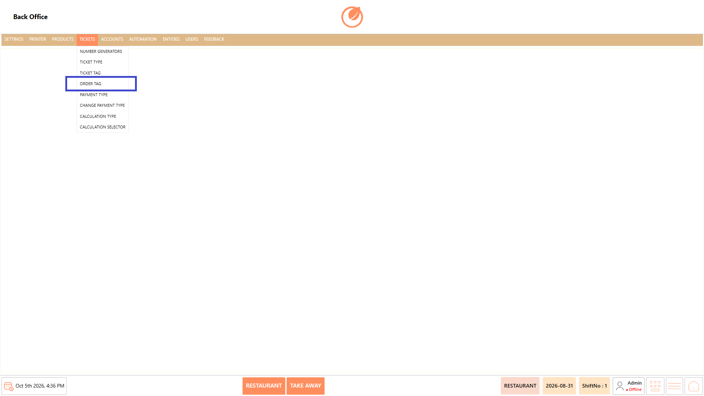<figcaption></figcaption></figure>

### **Screen Elements** 

| **Screen Element**     | **Description**                                                                                                                                                     |
| ---------------------- | ------------------------------------------------------------------------------------------------------------------------------------------------------------------- |
| Order Tag Group List   | Displays the available order tag groups.                                                                                                                            |
| Search                 | Allows you to search for a specific order tag group.                                                                                                                |
| Add Order Tag Group    | Opens the screen to create a new order tag group.                                                                                                                   |
| Edit Order Tag Group   | Allows you to modify the selected order tag group.                                                                                                                  |
| Delete Order Tag Group | Allows you to remove the selected order tag group after confirmation.                                                                                               |
| Sort Order Tag Groups  | Allows you to arrange the order tag groups in the required order.                                                                                                   |
| General Settings       | Allows you to configure the basic details and settings of the order tag group.                                                                                      |
| Order Tag List         | Allows you to add, edit, delete, and sort the order tags within the group.                                                                                          |
| Prefix List            | Allows you to add, delete, and sort prefixes associated with the order tag group.                                                                                   |
| Suffix List            | Allows you to add, delete, and sort suffixes associated with the order tag group.                                                                                   |
| Mappings               | Allows you to add and delete mappings for the order tag group based on user role, department, ticket type, product group, sub product group, category, and product. |
| Save                   | Saves the configured order tag group.                                                                                                                               |
| Close                  | Closes the current screen.                                                                                                                                          |

### **Working** 

#### **Add an Order Tag Group** 

1. Select "Add Order Tag Group".

<figure>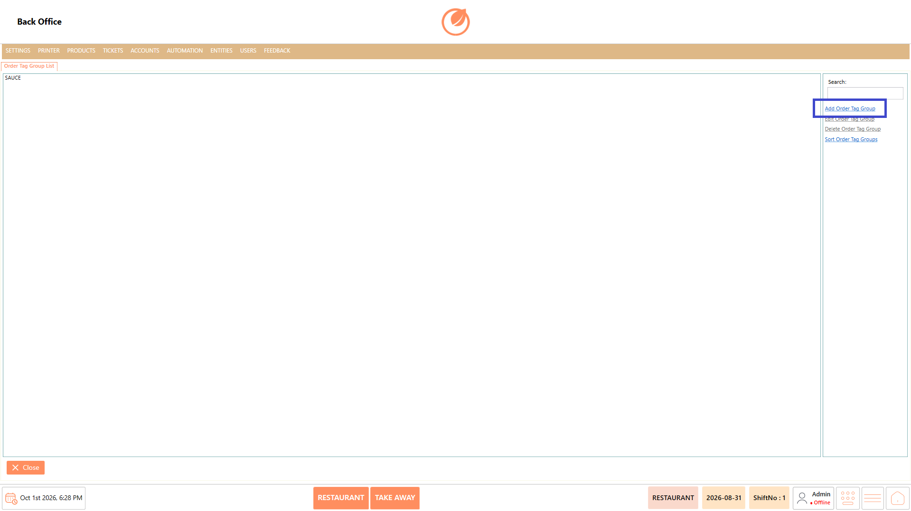<figcaption></figcaption></figure>

2. Enter the required details in "Name" and configure the order tag group using the available settings, such as "Alias Name", "Min Selected Items", "Max Selected Items", "MaximumItemSelect", and the available options under Display Settings.

<figure>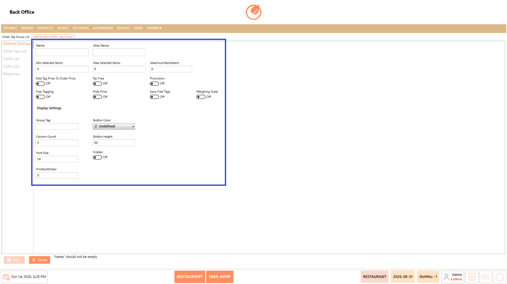<figcaption></figcaption></figure>

3. Open "Order Tag List" and select "Add Order Tag" to add the required order tags.

<figure>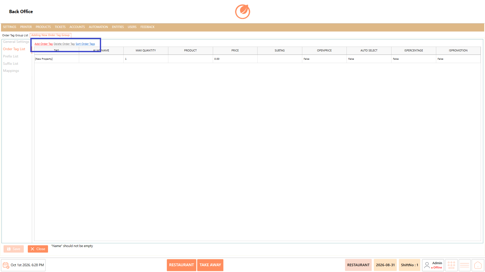<figcaption></figcaption></figure>

4. Open "Prefix List" and select "Add Prefix" to add the required prefixes.

<figure>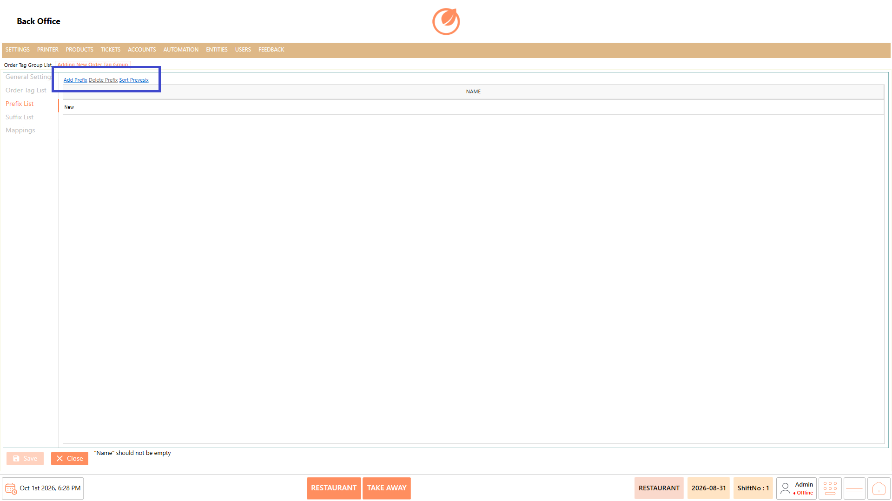<figcaption></figcaption></figure>

5. Open "Suffix List" and select "Add Suffix" to add the required suffixes.

<figure>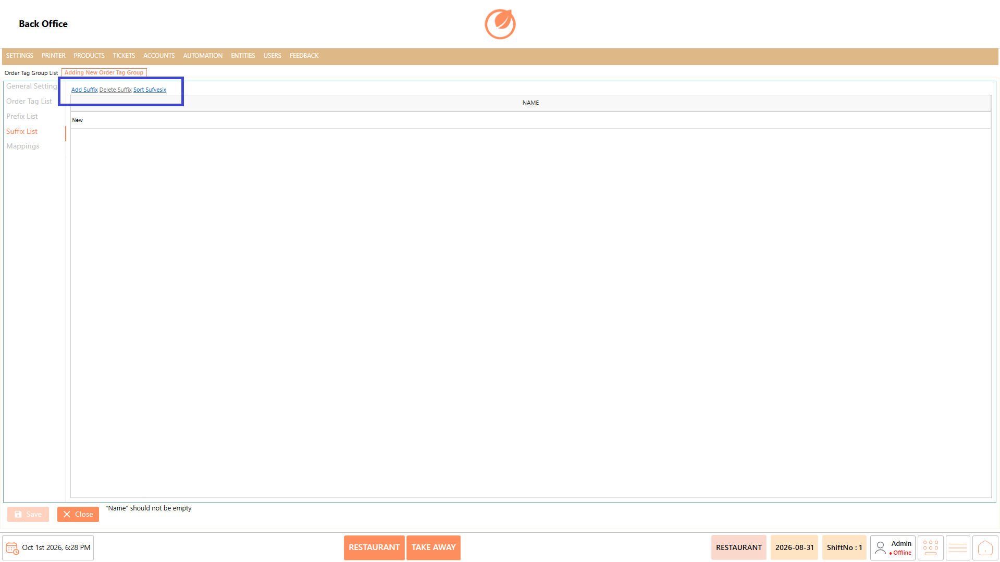<figcaption></figcaption></figure>

6. Open "Mappings" and select "Add" to configure the required mappings.

<figure>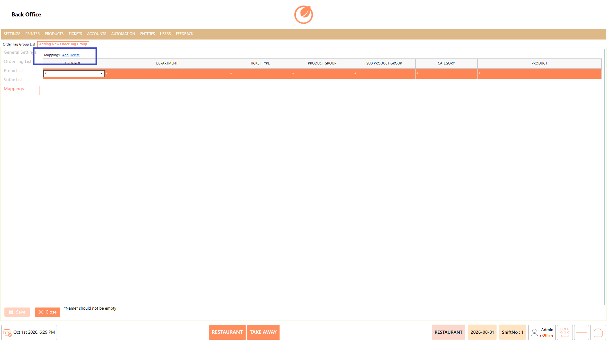<figcaption></figcaption></figure>

7. Select "Save" to create the order tag group.

<figure>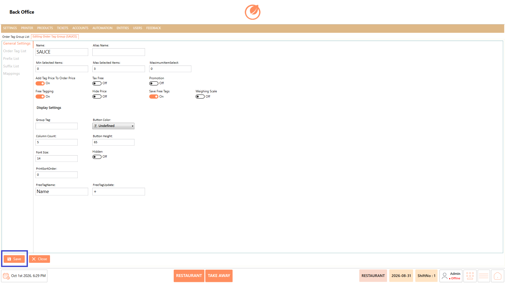<figcaption></figcaption></figure>

#### **Edit an Order Tag Group** 

1. Select the order tag group that needs to be modified.
2. Select "Edit Order Tag Group".

<figure>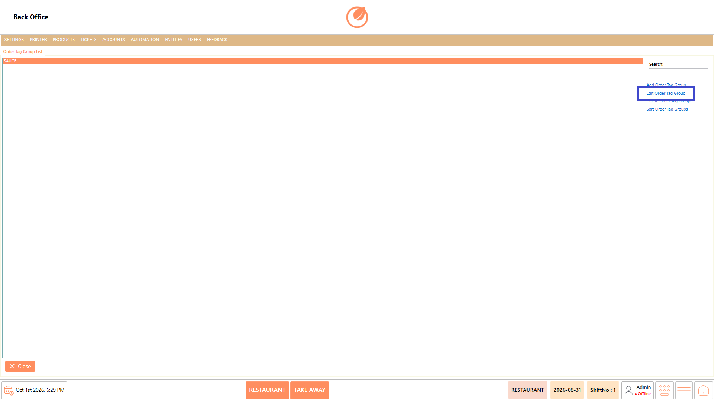<figcaption></figcaption></figure>

3. Update the required settings, order tags, prefixes, suffixes, or mappings.
4. Select "Save" to save the changes.

<figure><figcaption></figcaption></figure>

#### **Delete an Order Tag Group** 

1. Select the order tag group that needs to be deleted.
2. Select "Delete Order Tag Group".

<figure><figcaption></figcaption></figure>

3. In the confirmation message, select "Yes" to delete the order tag group.

<figure>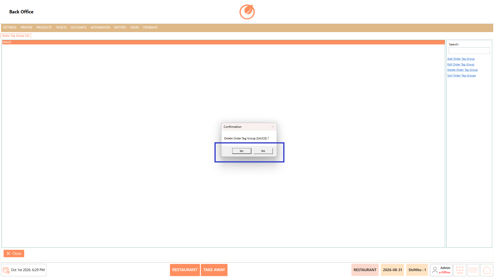<figcaption></figcaption></figure>

#### **Sort Order Tag Groups** 

1. Select "Sort Order Tag Groups".

<figure>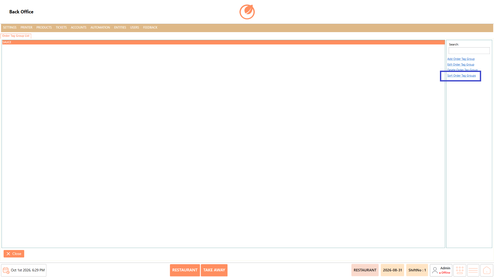<figcaption></figcaption></figure>

2. Arrange the order tag groups in the required order.

### **Use Case** 

* Create separate order tag groups to organize different order-related options.
* Configure the basic settings required for an order tag group.
* Add and manage individual order tags within a group.
* Define prefixes and suffixes for order tags where required.
* Map order tag groups to specific user roles, departments, ticket types, or product-related criteria.
* Modify existing order tag group settings when requirements change.
* Remove unused order tag groups from the configuration.
* Arrange order tag groups in the required display order.

### **Notes** 

* A Name is required when creating an order tag group.
* Review the configured settings before clicking "Save".
* Deleting an order tag group requires confirmation.
* Use "Sort Order Tag Groups" to maintain the required order of groups.
* Manage order tags, prefixes, and suffixes from their respective sections.
* Configure mappings based on the applicable business requirements.
